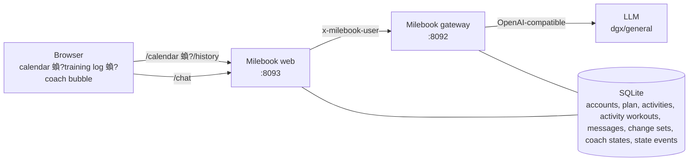

<h1 align="center">⚡ Milebook</h1>

<p align="center">
  <strong>A calendar-first AI coach for runners.</strong><br>
  The private calendar is the product; the coach lives in a bubble on it and books, moves, deletes and reverts training
  sessions in front of the runner.
</p>

<p align="center">
  <a href="#status"></a>
  <a href="#status"></a>
  
  
  
</p>

<p align="center">
  <a href="#quick-start">Quick start</a> 蝜?  <a href="#what-is-in-the-box">Features</a> 蝜?  <a href="#architecture">Architecture</a> 蝜?  <a href="#docs">Docs</a> 蝜?  <a href="#deploy-the-live-process">Deploy</a> 蝜?  <a href="#status">Status</a> 蝜?  <a href="#honest-limits">Limits</a>
</p>

<p align="center">
  
</p>

<p align="center"><em>Planned rows are colored by kind; a green-and-purple row pairs a recorded run with the Garmin workout it followed. Every row adds the amount its title omits, so repeated titles stay distinct. All screenshots use a fake demo runner and synthetic training data.</em></p>

> **Milebook** (formerly POC3) is a proof of concept: a private training calendar owned by the system, with an LLM coach behind a validating
> gateway. Accounts are independent; every runner keeps their own profile, plan, training log and coach conversation.

**Stack:** TypeScript 蝜?Node.js 24 蝜?SQLite (`node:sqlite`) 蝜?vanilla HTML/CSS/JS 蝜?Vitest 蝜?OpenAI-compatible gateway.

## Quick start

**Prerequisites:** Node.js **24+** and pnpm.

```powershell
pnpm install

$env:MILEBOOK_AUTH_SECRET='<long random secret>'
$env:MILEBOOK_DB='sqlite:data/milebook.sqlite'
$env:MILEBOOK_MODEL_BASE_URL='http://192.168.1.202:8102/v1'
$env:MILEBOOK_MODEL_API_KEY='<model key>'
$env:MILEBOOK_MODEL_NAME='dgx/general'
$env:MILEBOOK_MAX_ATTEMPTS='2'
pnpm dev
```

PowerShell is shown above; on macOS/Linux use `export NAME=value` instead.

| Surface | Default URL |
|---|---|
| Calendar / sign-up | **http://127.0.0.1:8091/signup** (then `/login`) |
| Muscle tab | third app-bar tab, **http://127.0.0.1:8091/muscle** |
| Coach bubble | bottom-right **???Coach** on the calendar |
| Gateway health | **http://127.0.0.1:8090/health** |

The live deployment runs the calendar on **:8093** and the gateway on **:8092**; the defaults above are **:8091/:8090**.
See the [environment reference](docs/MILEBOOK-CALENDAR.md#environment-reference) for every variable.

## Commands

| Command | What it does |
|---|---|
| `pnpm dev` | Start the calendar web process and the coach gateway. |
| `pnpm test` | Run the Vitest suite (556 tests in 21 files). |
| `pnpm typecheck` | Type-check `src`, `test` and `tools` with `tsc --noEmit`. |
| `pnpm lint` | Dependency-free gate: no console output outside `src/index.ts`, no TODO/FIXME, no `any` or secrets in `src`/`test`. |
| `pnpm check` | Run lint, typecheck and the full suite in one gate (also used by CI). |
| `pnpm deploy:live` | Restart the live :8093/:8092 process with `tools/deploy.ps1`. |

## What is in the box

### ????Plan

- **Private month calendar** ??Monday-first grid, today ring, and typed calendar rows: a colored planned-session row, a
  green recorded-run row, and a **paired** green/purple row that puts a run and the Garmin workout it followed in one entry
  (a green run line above a purple workout line, when Garmin supplies the workout; the whole row is one click target).
  Every row adds the amount its title
  omits: the distance when the title does not state it, otherwise the duration only when no distance is known. Three runs
  with the same title therefore keep three different distances; hover tooltips carry the full kind, metrics and note, and a
  `+n more` hint keeps a busy day bounded.
- **Day actions** ??click a day to add, move, delete, ask the coach or open the day detail; the middle nav opens a
  year/month picker.
- **Run peek** ??click a recorded-run row, or anywhere on a paired run+workout row, for one popup with the run's key
  metrics, plan match, the **Training program · Garmin** (name, summary, step table with duration and target, and coach
  notes), training load/effect, fastest efforts and PR badges, plus **Open full detail**, **Ask coach**, **View day** and
  **Training log week**. Ask coach
  sends the natural question with the run's day and metrics ("How did my Tempo run go? (Thu, 12 Nov 2026 蝜?8 km 蝜?50 min)")
  plus a **hidden comment-only directive**: the coach checks that day's plan and comments without changing the calendar.
  The visible reference keeps repeated titles unambiguous, including in later follow-up turns. The paired row is one click
  and one keyboard target: the run and its program are read together, not in two half-row popups. Escape, outside click or
  the ? closes it; Escape returns focus to the row.
- **Session peek** ??click a colored planned-session row for the same anchored popup with the plan's day, kind,
  distance/duration and note, a **what this is for / how hard it should feel** line for the session kind, plus what
  happened: **Completed** with the matched run, **Not matched**, **Not done** (the plan does not change; nothing to make
  up), **Today/Upcoming**, or **Planned rest**. Actions are **View day**, **Ask coach** (the same comment-only review),
  **Move** (prefills the composer), **Open run** when the popup links a run, and **Training log week**. Planned rows are
  keyboard reachable and use the same
  Escape/outside-click/? close, focus restore and same-trigger toggle as the run peek.
- **In-place updates** ??coach turns refresh the grid without a reload; changed rows animate into place, and `prefers-reduced-motion` skips the
  flourish.
- **Log a run by hand** — the day page has a small form (day, title, distance, duration) for treadmill, commute or
  non-Garmin runs. Reported runs use the same `Activity` record and same-day plan matching as Garmin runs, appear on the
  calendar, day page, training log and peek, and a repeated submit reuses the same id instead of duplicating.
- **Recent changes** — the calendar lists the last five coach batches with what changed and an **Undo this change**
  button. Undo reuses the audited revert path and is itself recorded as a change.

### ?? Training log

- **Week / Month / Year** views with previous/next/current navigation and date/month/year pickers.
- Week = seven day cards with plan-match badges; month = week rows; year = month rows.
- Adaptive daily/weekly/monthly volume, one **metric-selectable trend graph** (pace, heart rate, cadence, load, distance,
  time, elevation) with instant chip switching and no reload, consistency, weekly load/ACWR/hard-easy, period best efforts
  and PR badges.
- A **Garmin workout** line on each week card when the recorded run followed a planned workout; the step card and the full
  program live on the activity detail.
- Per-activity **Ask coach** (a comment-only review), **Review my week** and auto-sync review prompts. Each action sends a
  typed intent; the server turns it into a hidden directive, so the visible message stays conversational.

### ?? Muscles

- A third app-bar tab, **Muscles** (`/muscle`): an interactive **3D muscle figure built from real anatomy** —
  BodyParts3D per-muscle and per-bone meshes (CC BY 4.0, attributed in `src/vendor/THREE-LICENSE.txt`), converted
  with Blender into one decimated GLB (`src/vendor/anatomy-muscles.glb`, 11 MB, one `RegionMuscle-<region>`
  material per catalog region, named `region__part__FJ`). three.js loads it via the vendored GLTFLoader; the
  procedural rig (`src/muscle-rig.ts`) stays as the automatic fallback when the asset or WebGL fails, and the
  flat figure remains the no-JS/keyboard surface. Hover names a muscle and paints it with the same ember as a
  click-select (a trailing-edge re-pick lands the cursor's resting position, and hovering never creates a tag),
  click/tap selects it (raycast on the real
  meshes — the check-in flow, tray, editor and flat figure share one selection state), drag orbits, scroll or
  pinch zooms, **Pause rotation** stops the turntable and breathing, and Front / Back / Reset tween the camera.
- Tagging is per muscle: a 0-10 anchored soreness slider
  (0 nothing · 5 noticeable · 7 sore to touch · 9-10 severe), condition tags (tight, cramp, fatigued, dull ache,
  sharp pain, swelling, numbness, old-injury flare), a left/right/both side, and a "better once warmed up?" toggle.
  A quick set applies one severity and tags to the whole selection, and the same controls are the no-JavaScript
  submission path.
- The heat ramp shows the latest check-in (legend included; a dashed outline marks tags that need care), and the
  reading is deterministic: **ok → sore → heavy → watch → warning → urgent**, with copy that normalizes normal
  soreness (peaks 24-72 h, eases with movement, not damage) and hands warning and urgent tags to a clinician —
  sharp pain, swelling, numbness and the rhabdomyolysis pattern (severe + swelling) get a one-tap
  **pain/injury** or **medical red flag** state that reuses the existing guardrails.
- **Drill suggestions** matched to the tags and the muscle's own library (mobility / activation / recovery, with
  dosage), each with an "ask the coach to work this in" button; warning and urgent levels deliberately suggest no
  drills. A per-muscle knowledge panel (function, common issues, recovery) is one tap away in the tag editor.
- **Muscles worked** appear on the activity detail (primary darker, helpers lighter) with a deep link that prefills
  a check-in; the new-run review card gets a **Log muscle feel** link; the calendar shows a one-tap chip when the
  latest check-in needs attention. `?activity=<id>` selects that run's muscles for you.
- The coach reads the same facts: the latest check-in rides in every prompt, and the Muscle tab's
  **Ask coach** buttons send a comment-only `review-muscles` intent (optionally zoomed to one muscle's knowledge
  and tags). Check-ins are private per runner and included in `/export.json`.

### ?? Activity detail

- Full metrics, rich Garmin metrics, fastest 1 km / 1 mi / 5 km efforts, per-kilometre splits, Garmin laps/intervals and
  HR-zone time.
- A **Training program 蝜?Garmin** card with the workout a run followed: the workout name, the grouped one-line summary
  (`3 ? (Run 7:00 @ 4:14??:33/km, Recovery 2:00)`), a step table with duration and target, and Garmin's coach notes.
- Planned-vs-actual comparison with distance/duration deltas and bars, plus a comment-only **Ask coach** and links back to
  the day and plan.

### ???Coach

- Self-implemented same-origin bubble; restores the recent conversation after refresh.
- **Coach dock (2026-11-20):** on wide screens the coach is a **docked column beside the page** (the content reflows, nothing is covered); below 1200 px it is a drawer or a phone sheet with a visible close. The panel is grouped into **Chat / States / Changes** — the conversation and composer, every active/proposed coaching state with Confirm / Discuss / Resolve, and the five latest change sets with **Undo in place**. States badges count proposals; Changes badges count unseen batches. Measurements and the page-by-page review are in [the layout review](docs/analysis/13-layout-review.md).
- **Same grammar on four pages (2026-11-20):** the training log is **Days / Review** tabs with the week first (2,198 → 1,547 px); coaching states are **Current / Set a state / History** tabs (1,722 → 1,231 px); the activity detail pairs program/metrics/splits beside muscles/zones/laps and puts **Ask coach in the head** (2,233 → 1,647 px); the muscle page sets a **status/readings rail beside the 3D check-in figure** from 1024 px. The shared `.seg-tabs` control is radio inputs + sibling CSS, so it works without JavaScript; arrow keys move the group natively.
- **Layout research (2026-11-20):** the evidence behind tabs vs side-by-side vs overlays — WCAG 2.2/APG semantics, Material/Apple/Fluent/Carbon/GOV.UK guidance, NN/g and human-AI research — plus a heuristic audit and an evaluation plan, is in [the UI/UX layout research](docs/analysis/14-uiux-layout-research.md).
- **P0 accessibility pass (2026-11-20):** the coach launcher now exposes `aria-expanded`/`aria-controls` and the panel is a named region. Below 1200 px the open panel sets `inert` on the page main and footer; at ≤720 px it also inerts the app bar (the sheet covers it), with resize sync and Escape/close returning focus to the launcher. A 320 px capture shows **0 horizontal overflow**. The dock at ≥1200 px leaves the page focusable.
- **P1/P2 layout pass (2026-11-20):** the week history summary keeps a `Load … · signal` chip visible and links it to Review/`#load-card`; history and states tabs are URL-addressable (`?tab=review`, `?tab=set`) with server rendering and back/forward; the states page has a “Set a state” head action; page tabs are explicit segmented controls (`role="radiogroup"`) while the dock keeps ARIA tabs; at 1024–1199 px with the coach open activity and muscle stack (988 px) and keep two columns when it is closed; activity has a “Muscles” jump chip; and `data-track` feeds a privacy-safe `milebook:track` event hook. 45 captures, 516/516 green.
- Add / move / delete / revert sessions; 1?? tappable follow-ups; starter prompts; a structured **Could not apply** card.
  Review requests are read-only and never write to the calendar.
- **Peer voice with a cap (2026-11-20):** the reply contract is spoken, not written — 2-4 short sentences, no
  headings, no lists, no markdown, at most one question — enforced by a 480-character validation cap with one
  repair attempt plus a deterministic markdown strip, so the plain-text bubble never shows structure noise. The
  suggestion chips carry the menu; the reply carries the advice. Plan and record:
  [the coach-interaction plan](docs/analysis/15-coach-interaction-llm-plan.md) and
  [the implementation record](docs/analysis/16-coach-interaction-implementation-record.md).
- **Cached prefill, obeyed (2026-11-20):** the prompt is now a byte-stable system head (rules + state catalog),
  a dated **context snapshot** (profile + facts as of one day) and an append-only date-stamped conversation. A
  new snapshot is appended only when the epoch rule fires — new day, new synced runs, a muscle check-in, a
  calendar edit, a state change, a profile or preference update — otherwise the turn is pure append and the
  provider's prefix cache covers everything but the trailing message. The model is told the newest snapshot is
  authoritative and the runner's newer words beat it; snapshots are persisted byte-frozen so reloads reproduce
  the same bytes, and long conversations compact past a token budget.
- **The loading line explains itself (2026-11-20):** while waiting, a bare "…" means a cached-append turn; when
  a re-prefill is expected the typing line names the reason in the runner's locale — "Pulling in your latest
  runs…", "Refreshing how your body feels…", "New day — checking your plan…" — predicted client-side from the
  sync/check-in/state signals and confirmed by the gateway's `prefill` block in the response.
- **Silent preference profile (2026-11-20):** the coach learns *how* to talk to this runner — reply language,
  tone, reply length, a nickname — silently through an optional `profileUpdates` tool field (never rendered,
  never announced) plus a zero-cost language heuristic; two consecutive Chinese messages persist `zh-Hant`, and
  a message that clearly switches language always wins. The values ride the snapshot's profile block (so they
  refresh only at the next epoch boundary), and only the owner's `/coach-audit` shows them. Memories merge on
  write instead of accumulating, keeping the newest 24 with a 12-memory prompt window.
- **Hidden directives** ??every action-originated message carries a server-authored stage direction (mode, write
  permission, references, focus, style and a short background note) that goes into the coach prompt but never into the
  chat bubble. The gateway enforces `allowCalendarWrites: false`, so a comment-only turn cannot write even if the model
  proposes it. A typed intent comes from the browser; hidden prose never does.
- **Coach audit** (`/coach-audit`, an internal page that is not linked in the end-user UI and is scoped to the signed-in
  runner) shows the recent
  hidden directives, blocked writes, the **learned preference profile and the snapshot window with each
  re-prefill's reasons**, active coaching states, an immutable state-transition log and any legacy `mode:`
  memories.
- **Coaching states** (`/coach-states`) ??durable context beyond one turn. Race phase (race day/week, taper, post-race),
  load (ACWR ramp, hard/easy mix, under-load), consistency and data freshness are detected from the calendar and Garmin;
  travel, heat, time pressure, pain, illness and focus blocks are proposed by the coach or set by the runner. Sensitive
  states (pain, illness, medical red flag, pregnancy/postpartum, menstrual-cycle support, low energy availability) are
  never inferred and need confirmation. Active states appear as calendar chips and bubble cards; the gateway enforces
  hard, day-aware guardrails over the effective post-turn calendar (including reverts and moved races) instead of
  trusting the prompt. Pages are read-only; **Refresh** persists auto states explicitly, and `MILEBOOK_AUTO_STATES=false`
  disables auto detection while keeping manual/chat states.
- The OpenAI-compatible `milebook-coach` gateway validates every proposal before writing, with one bounded
  repair/clarification loop and idempotent request replay.
- The runner's profile goal is in the coach's facts, so the plan can be checked against it instead of being stored and
  ignored.
- Every batch is stored with before/after snapshots. Undo is available in chat and from the **Recent changes** card on the
  calendar; both paths use the same audited revert and both record the undo as its own change set.
- A pending sensitive-state card (pain, illness, pregnancy/postpartum, low energy availability) is replayed from
  `/chat/history` after a refresh, so Confirm/Dismiss survives a reload instead of living only in the DOM.

### ?? Accounts & Garmin

- Standalone accounts: signup, login, profile (display name, timezone, goal, password), per-user isolation. The goal is
  saved and passed to the coach prompt.
- **Data ownership**: `/export.json` returns the profile, sessions, activities and change history as one bundle (no
  password hash, no Garmin key); `/export.ics` returns the planned sessions as an all-day calendar. Both are linked from
  the account menu and the profile page.
- Per-runner Garmin Personal API key, verified before storage and never shown again in full. **Sync Garmin now** and
  **Garmin key** live in the account menu behind the runner's name; syncing with no saved key opens the guide. The key can
  be removed from the same popup; removal stops sync and returns the account to the manual-log path.
- Manual sync results are rendered inline on the page (imported count or the Garmin error), not only in the bell.
- Automatic sync on every new browser session (login or resumed auth cookie) plus page-load backoff. Pulls the last
  90 days, up to 100 activities per pull; repeated syncs upsert by `(user_id, activity_id)` and enrich
  load/cadence/elevation/effect/HR-zone fields.
- The same Garmin activity can be synced independently by multiple accounts; run detail fetches per-kilometre samples,
  lap summaries and the activity's planned workout on demand. Up to three workouts are enriched per sync, and a calendar
  render fills up to six more for the visible month (2.5 s budget, 60 s throttle). They are stored in `activity_workouts`
  and shown as the paired row's purple program line, the integrated training program in the run peek, the detail step
  card, the week-card line and the day-page card.
- **The workout a run followed is available; the future Garmin plan is not.** A Personal API key cannot read scheduled
  workouts, Garmin Coach plans or the Garmin calendar ??that needs a separate Garmin SSO web session. The official Training
  API is publish-only. See [Garmin training programs](docs/GARMIN-TRAINING-PROGRAMS.md).
- Notification bell is the sync feed: manual/key syncs confirm, automatic no-change checks stay silent, errors always
  appear. Routine "Auto-synced N" and "Garmin sync: N imported" banners are gone; the review card appears only for a
  genuinely new activity.
- Browser tab titles follow the active nav and page, e.g. `Training log 蝜?Milebook (2)`. The unread count is
  server-rendered, capped at `99+`, cleared when the bell is opened, and kept current by the bell poll.

## Architecture



One SQLite file, two processes:

- **Milebook web** owns accounts, the calendar, the training log, activity detail, reported-run logging, export, Garmin sync
  and the same-origin bubble proxy.
- **Milebook gateway** owns the OpenAI-compatible contract, validates `propose_calendar_turn`, and writes validated change
  sets through the same store.
- The bubble is not an iframe: it can read and animate the grid directly (ADR-0002).

## Project layout

| Path | What lives there |
|---|---|
| `src/` | Web server, gateway, coach contract, store, Garmin sync, training-log math. |
| `test/` | 556 Vitest tests across 21 files. |
| `docs/` | Solution doc, training-log plan, feature backlog, ADRs and design screenshots. |
| `tools/` | Dependency-free lint gate and the live deploy script. |

## Docs

| Document | What it answers |
|---|---|
| [Solution document](docs/MILEBOOK-CALENDAR.md) | Architecture, accounts, coach contract, CRUD/batch, change history/revert, suggestions, animation, run/session peek, training log, activity detail, metric trend graph, Garmin workouts, auto-sync, Garmin, API, runbook and limits. |
| [Coaching states](docs/COACH-STATES.md) | The durable-state model, catalog, detectors, chat/user proposals, precedence, guardrails, UI/API, research citations and what is needed versus deliberately skipped. |
| [Coach-interaction plan](docs/analysis/15-coach-interaction-llm-plan.md) | The LLM-architecture review of the coach's voice and fuel: the rebuilt-per-turn prompt (measured), the reply-style contract, the epoch rule for cached prefill, the explained loading line and the silent preference profile. |
| [Coach-interaction record](docs/analysis/16-coach-interaction-implementation-record.md) | What shipped from the plan with which decisions (D19-D22), in which files, and with what verification, including the byte-stability probe. |
| [Training-log plan](docs/TRAINING-LOG-PLAN.md) | Research, feature inventory and the implemented load/ramp, rich-metrics, per-kilometre-split, lap/interval, HR-zone, best-efforts/PR, metric-trend, Garmin-workout and weekly-review slices. |
| [Muscle tab](docs/MUSCLE-TAB.md) | Research basis (scales, DOMS course, red flags), the check-in flow, the interpretation rules, drill suggestions, coach integration, accessibility and safety copy for the Muscles tab. |
| [Muscle anatomy 3D research](docs/MUSCLE-ANATOMY-3D-RESEARCH.md) | How to get a nicer muscle/skeleton figure: options with licenses (BodyParts3D recommended), the proven download→Blender→GLB→three.js pipeline, the curated per-muscle part mapping, and the integration plan. |
| [Garmin training programs](docs/GARMIN-TRAINING-PROGRAMS.md) | What the Garmin Personal API exposes about training programs (per-activity executed workout), what it does not (future scheduled workouts, Coach/adaptive plans), and what a full-plan import would require. |
| [Feature backlog](docs/FEATURES-FOR-REVIEW.md) | Remaining candidate features, prioritised and waiting for owner review. |
| [ADR-0001](docs/adr/0001-server-validated-coach.md) | LLM proposes; the server validates before writing. |
| [ADR-0002](docs/adr/0002-calendar-first-bubble.md) | The calendar is the product; the bubble is same-origin, not an iframe. |
| [ADR-0003](docs/adr/0003-validation-feedback-loop.md) | Rejected proposals are fed back for one repair/clarification; turns are idempotent. |

Fake-data screenshots: [calendar CRUD animation](docs/design/calendar-crud-demo.png) 蝜?[run peek](docs/design/activity-peek-demo.png) 蝜?[session peek](docs/design/session-peek-demo.png) 蝜?[coach states](docs/design/coach-states-demo.png) 蝜?[coach state card](docs/design/coach-state-bubble-demo.png) 蝜?[coach audit](docs/design/coach-audit-demo.png) 蝜?[coach starter suggestions](docs/design/coach-starter-demo.png) 蝜?[coach Could not apply card](docs/design/coach-not-applied-demo.png) 蝜?[delete in place](docs/design/coach-delete-demo.png) 蝜?[training log month](docs/design/training-log-month-demo.png) 蝜?[training log week](docs/design/training-log-week-demo.png) 蝜?[training log cadence selected](docs/design/training-log-cadence-demo.png) 蝜?[training log year](docs/design/training-log-year-demo.png) 蝜?[activity detail](docs/design/activity-detail-demo.png) 蝜?[muscle tab](docs/design/muscle-tab-demo.png).

## Deploy the live process

On Windows, every completed change is deployed by restarting the live :8093/:8092 process:

```powershell
pnpm deploy:live
```

`tools/deploy.ps1` reads the auth secret from `data/milebook-auth.secret`, the model API key from `MILEBOOK_MODEL_API_KEY` or
`data/milebook-model.secret`, uses `sqlite:data/milebook-auth.sqlite`, stops only the process whose command line contains
`src/index.ts`, starts `pnpm dev`, waits for `/health` and `/login`, and rejects a stylesheet without the calendar pill
styles or the coaching-state card/form/refresh styles. The deploy fails when the auth secret or model key is missing, so a
restart cannot silently drop the coach's model credentials. Logs are `data/milebook-live.out.log` and
`data/milebook-live.err.log`; the deploy history is `data/milebook-deploy.log`.

## Status

| Gate | State |
|---|---|
| Tests | **560 / 560** in 21 files |
| Lint | pass (`pnpm lint`) |
| Typecheck | pass (`pnpm typecheck`) |
| CI | `.github/workflows/ci.yml` runs `pnpm check` on Node 24 |
| Live deployment | calendar **:8093**, gateway **:8092** (redeployed 2026-11-20 with the daily-pages slice — the training log's one period summary line and the day page's native log disclosure — via the `\Milebook-Live-Deploy` scheduled task: gateway health 200, `/login` serves `app.css?v=30`, 560/560 green. **Live-verified 20/20:** the day disclosure, the removed subline, the period summary, and a real manual-run POST (5 km / 30 min) that appeared on the day and in the history line; the temporary account was removed. Earlier the same day: the entry slice (today-first hero, one primary action, row key), the coach-interaction slice (peer voice, epoch-gated cached prefill, silent preference profile), the en/zh-HK localization, the coach dock, the four-page regroup and the P0/P1/P2 layout passes; earlier the same week: the real BodyParts3D muscle figure on the Muscles tab, with hover/click/orbit/pause on the real meshes and the procedural sculpt as fallback) |

**Live-verified calendar rows (2026-11-18):** the live :8093 process serves `app.css?v=17` with `.cal-items`, `.cal-meta`,
`.cal-pair-run`, `.peek-program` and `.peek-step-head`; a real busy day with three same-titled runs and one paired workout
rendered the plan title whole with its distance, three distinct run amounts and the purple workout line, so repeated titles
no longer look identical. The paired row is one click target and one keyboard target: clicking its purple workout line
opened the run peek with the run's metrics, plan match and the full **Training program · Garmin** (3 steps and notes), and
Escape returned focus to the row; `/workout/<id>/peek` now returns 404, so there is no separate brief. `/calendar/data`
returned the typed `plan | record | pair` items (pair: `activityId`, `run`, `workout`, `tooltip`) and the same
server-rendered row fragment; a preview check found the first paint and the refresh fragment byte-identical. The live check
was read-only.

**Live-verified:** multi-user signup/login/profile/isolation; multi-day batch CRUD; in-place grid refresh including delete
without reload; page-wide CRUD animation; conversation reload after refresh; LLM-driven undo; starter and follow-up
suggestions; non-scrolling suggestion rail; minimize-to-bubble; structured failure cards; Plan/Training log switcher;
timezone-correct "today"; native tool calls; validation feedback; clarification instead of a dead-end fallback; idempotent
request replay; typed coach intents with server-authored hidden directives and comment-only write enforcement; the live
`coach_states` schema and `coach_state_events` audit table; a real model turn; read-only state pages plus the explicit
refresh action; the state manager's CSRF origin rejection; and the state event log on the audit page. The live
verification created a temporary account, exercised the routes and a real model turn, and removed every temporary row
(no test state or event left behind). **Coach-interaction slice (2026-11-20):** two real Chinese model turns in the
peer voice (99 and 68 characters, one question, Chinese suggestion chips); the prefill meta reporting `first-turn`
then `memories-updated, profile-updated`; the silently learned `zh-Hant` preference visible only on `/coach-audit`
with the snapshot reason chips; the wait-line strings and the client prediction hook on the live calendar page; the
temporary account and its 14 rows removed afterwards.

**Entry slice (2026-11-20):** the calendar's first screen is a today hero - the date, the one-line answer, the next
session, one 44 px primary (a complete plan request sent in one click) and one quiet manual link, with the coach's
states and the live muscle reading as a 12 px context line. The header dropped the eyebrow, the prose legend, the
mixed action row and the state-chip row; the row key and the Garmin freshness moved into the month card above the
grid; the duplicate empty/connect cards are gone. Measured at 1164x900: head 217 -> 51 px, grid 479 -> 362 px,
above-grid targets 11 -> 7; phone grid 556 -> 461 px. The seeded booked/recorded/empty-month hero states were
captured, and the live probe exercised the empty-month request with a real model turn (111 Chinese characters,
6 sessions booked, 6 changes) before removing the temp account and its 16 rows.

**Daily pages slice (2026-11-20):** the training log now opens with h1 + intro, one 17 px period summary line (runs,
km, time, longest, planned) and the Days/Review tabs; the four stat cards and the eyebrow are gone, and the tabs start
74 px higher. The day page drops the date/runner/profile subline and turns its five-field log form into a native
disclosure whose summary is the one 44 px "Log a run" primary; the closed page fits one screen (1315 -> 900 px
desktop, 1471 -> 856 px phone), and `/day/...#log-run` opens it. The live probe also logged a real 5 km / 30 min
manual run through the form and read it back on the day and the history summary.

**Live-verified Garmin:** a real personal-key pull of **100 activities** (the list endpoint's maximum); the 90-day
filter/upsert; enriched load/cadence/elevation/effect/HR-zone fields; the current week's real load card; per-kilometre
splits on a real run detail; Garmin laps/intervals; HR zones and PR badges; period best efforts; the auto-sync review
prompt; and the week/month/year selector against the live database.

**Live-verified honesty slice (2026-11-18):** a temporary account was created on the live :8093 process and removed
afterwards. The live calendar showed the 180-day horizon, the empty-calendar card, the Garmin connect card, the Recent
changes card and the Log-a-run link; `POST /activities` created a reported run that appeared on the day page; `/export.json`
and `/export.ics` returned the bundle and a valid VCALENDAR; `?synced=2` rendered the inline sync banner; and
`POST /garmin/key/delete` rendered the removal banner. The deployed stylesheet is `app.css?v=17` and contains the new
banner, change-list, peek-intent, coach-horizon, log-row, typed calendar-row and reduced-motion rules. No temporary rows were left behind.
The rest of the route-level behaviour is covered by the 337-test suite.

**Cross-account:** two accounts can store the same Garmin activity independently, and a repeated sync leaves the
notification count unchanged.

**Notifications:** automatic no-change page loads leave both the page and the bell silent; the existing new-activity
notification and the 2026-11-15 recorded run remain. Manual/key no-new confirmations and newest-new targeting are
test-covered.

**Fixture-verified:** populated week, month and year training-log views plus the load card, weekly review prompt, period
best efforts, the metric trend card (with the Cadence chip selected in a second capture) and activity detail with rich
metrics, per-kilometre splits, laps, HR zones, PR badges and the Garmin workout step card, plus the calendar
run-peek popup with its metrics, plan match, integrated training program, fastest efforts, four actions, Escape/focus
restore, keyboard open, outside-click close and same-row toggle, the planned-session peek with
completed/missed/unmatched/upcoming/rest outcomes and its four actions, and the paired row that opens the one integrated
run+program peek (headless Chrome, fake demo data:
[training log month](docs/design/training-log-month-demo.png),
[week](docs/design/training-log-week-demo.png),
[cadence selected](docs/design/training-log-cadence-demo.png), [year](docs/design/training-log-year-demo.png),
[activity detail](docs/design/activity-detail-demo.png), [run peek](docs/design/activity-peek-demo.png),
[session peek](docs/design/session-peek-demo.png)); the coaching
states manager with Refresh, active calendar chips, bubble state cards and guardrail system
([coach states](docs/design/coach-states-demo.png), [state card](docs/design/coach-state-bubble-demo.png)); the coach
audit page with recent hidden directives, blocked-write badges, active states, the immutable State activity log and
legacy `mode:` memories ([coach audit](docs/design/coach-audit-demo.png)); plan-vs-actual
matcher; adaptive volume and the metric-selectable trend graph; load/ramp and hard/easy classification; split parsing; lap mapping; HR zones;
workout mapping, the workout enrichment cap/retry, the calendar fill and the paired-row/integrated-program wiring; personal bests; auto-sync backoff.

**Calendar rows:** planned sessions, recorded runs and paired run+workout entries render as one typed row anatomy in each
day cell: a type rail, an optional glyph (`✓` run, `◈` workout), the title and the amount on the right. The amount is the
distance when the title does not state it, otherwise the duration only when no distance is known, so three same-titled runs
stay distinguishable without cutting a title that already carries its distance. The full kind/metrics/note is in the hover
tooltip and a `+n more` hint keeps a day with more than four items bounded. A paired row is one click target: it opens the
integrated run peek with the Garmin program inside it. Planned rows open the session peek popup, and the full activity
detail is one tap away (headless Chrome, fake demo data:
[calendar-demo.png](docs/design/calendar-demo.png), [run peek](docs/design/activity-peek-demo.png),
[session peek](docs/design/session-peek-demo.png), [coach audit](docs/design/coach-audit-demo.png)).

**Not in scope:** admin console, Strava, payments, external calendar sync, production multi-tenant deployment, Garmin
wellness/HRV/sleep data, weather/air-quality providers, and clinical decision support. The Muscle tab's 3D figure is a
procedurally rigged, physically rendered anatomy sculpt; the upgrade to real anatomy meshes is researched with a
pipeline-proven path in [docs/MUSCLE-ANATOMY-3D-RESEARCH.md](docs/MUSCLE-ANATOMY-3D-RESEARCH.md).

## Honest limits

- **Booking horizon:** the coach accepts bookings up to **180 days ahead** (shown in the bubble header).
- **Model loop:** one bounded repair attempt; there is no open-ended agent loop.
- **No streaming:** the bubble waits for the full reply; the typing line names the reason when the turn is
  known to re-read the runner's context instead of appending to the cached conversation. The provider's cache is
  external — the app guarantees byte-stable prefixes and reports what refreshed, it cannot force a particular
  backend to cache (the gateway's `usage` passthrough is still stubbed, so a live cache-hit measurement is a
  follow-up).
- **Auth:** the cookie is signed with `MILEBOOK_AUTH_SECRET`; set a strong secret.
- **State detection is heuristic:** ACWR, race-week and post-race detection are signals, not diagnoses. The runner can
  resolve any state; sensitive states are never inferred. The engine does not replace a clinician or coach.
- **State pages are read-only:** auto detection is persisted by a gateway turn or the explicit **Refresh**
  action, never by a GET. `MILEBOOK_AUTO_STATES=false` disables auto detection; manual/chat states still work.
- **State retention:** resolved rows and transition events older than 180 days are pruned; the manager keeps the last
  100 rows for resolved history. State writes are serialized with `BEGIN IMMEDIATE`/`busy_timeout`; a future
  multi-process writer would need a partial unique index on open `(user_id, state_key)`.
- **No wellness or weather data:** sleep/HRV/readiness, heat, air quality and altitude are chat/user states until those
  data sources are integrated.
- **Gateway trust:** the gateway trusts the internal `x-milebook-user` header; it binds to `127.0.0.1` and must stay on a
  private network. The web surface binds to `0.0.0.0` behind session auth and same-origin state POST checks.
- **SQLite:** single-process; run one app process per database.
- **Code shape:** the calendar-cell union and its single renderer live in `src/calendar-items.ts`; the state catalog in
  `src/coach-state-catalog.ts`, the state/audit page render in `src/web-coach-states.ts`, and shared HTML helpers in
  `src/web-html.ts`. The muscle domain (catalog, taxonomy, interpretation rules, drills, validation) lives in
  `src/muscles.ts`, the SVG figures in `src/muscle-map.ts`, the 3D rig in `src/muscle-rig.ts`, the real anatomy
  asset + three.js/GLTFLoader builds in `src/vendor/` (licenses and the CC BY 4.0 BodyParts3D attribution in
  `src/vendor/THREE-LICENSE.txt`), and the Muscle tab page in `src/web-muscle.ts`.
  `src/web.ts` still holds the routes and the inline client script, so a route/client-script split is a
  follow-up refactor, not a behavior change.
- **Garmin:** capped at **100 activities per pull**; the Personal API key is stored per runner in SQLite in plaintext, so
  run this PoC on a private server.
- **Garmin workouts:** the activity-workout DTO is only partly documented; the mapper is defensive and treats an unreadable
  payload as "no planned workout". Enrichment is capped at three lookups per sync (two attempts), six more per calendar
  render for the visible month (2.5 s budget, 60 s throttle) plus an on-demand retry; it is best-effort ??it never fails
  the activity sync. A run with no known workout stays a plain green pill.
- **No future Garmin plan import:** a Personal API key cannot read scheduled workouts, Garmin Coach / adaptive plans or the
  Garmin calendar. The official Training API is publish-only. Importing the future plan needs a separate Garmin SSO web
  session and a product/terms decision. See [Garmin training programs](docs/GARMIN-TRAINING-PROGRAMS.md).
- **Training load:** Garmin's proprietary value; ACWR is a soft coupled 7/28-day signal, not medical advice.
- **Splits and zones:** per-kilometre splits are computed on demand from Garmin detail samples; Garmin's own
  lap/interval summaries are separate; HR-zone time has no stored zone boundaries.
- **PRs:** PR badges and period best efforts are bests within stored history (100 activities / 90 days), not a lifetime
  record. A dedicated records page and zone charts are later slices.

See the [solution document](docs/MILEBOOK-CALENDAR.md) and [training-log plan](docs/TRAINING-LOG-PLAN.md) for the full list.

## License

> Private proof of concept. No license granted for redistribution.
