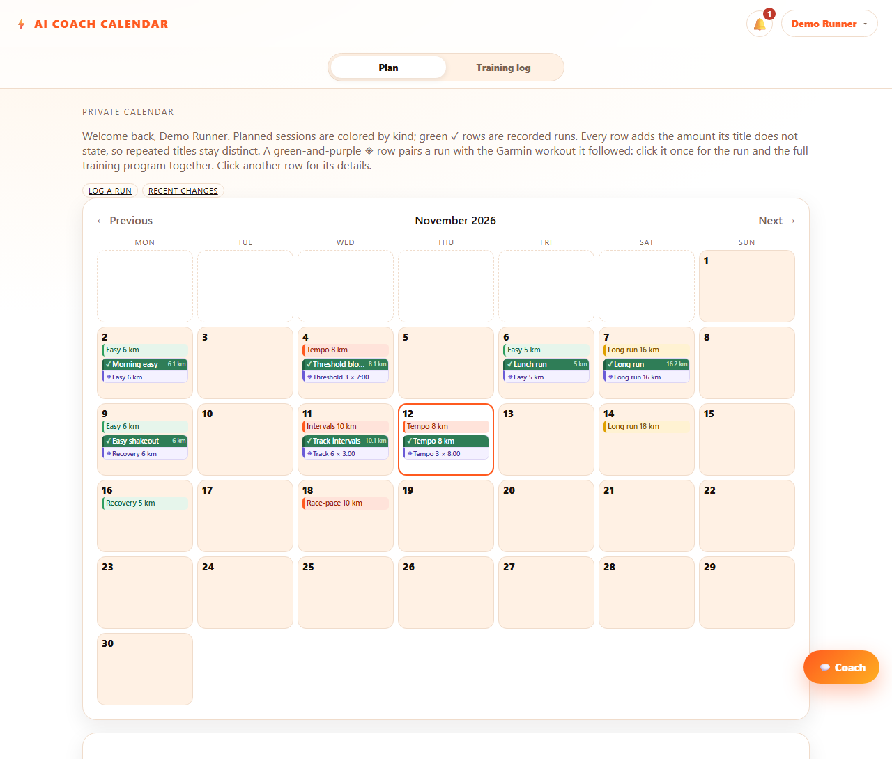
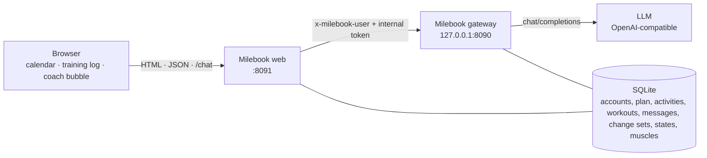

<h1 align="center">⚡ Milebook</h1>

<p align="center">
  <strong>A calendar-first AI coach for runners.</strong><br>
  The private calendar is the product; the coach lives in a bubble on it and books, moves, deletes and reverts training
  sessions in front of the runner.
</p>

<p align="center">
  
  
  
  
  
  
</p>

<p align="center">
  <a href="#quick-start">Quick start</a> · <a href="#what-is-in-the-box">Features</a> · <a href="#architecture">Architecture</a> ·
  <a href="#documentation">Docs</a> · <a href="#operations">Operations</a> · <a href="#status">Status</a>
</p>

<p align="center">
  
</p>

<p align="center"><em>Planned rows are coloured by kind; a green-and-purple row pairs a recorded run with the Garmin workout it followed. Every row adds the amount its title omits, so repeated titles stay distinct. All screenshots use a fake demo runner and synthetic training data.</em></p>

Milebook is a private training calendar owned by the system, with an LLM coach behind a validating gateway. Accounts
are independent; every runner keeps their own profile, plan, training log, body record and coach conversation. The
model proposes and the server validates before anything is written.

**Stack:** TypeScript · Node.js 24 · SQLite (`node:sqlite`) · vanilla HTML/CSS/JS · Vitest · OpenAI-compatible gateway.

## Quick start

**Prerequisites:** Node.js **24+** and pnpm **12**.

```powershell
pnpm install
Copy-Item .env.example .env      # then fill in AUTH_SECRET, MODEL_BASE_URL, MODEL_NAME
pnpm dev
```

`.env.example` documents every setting; [docs/OPERATIONS.md](docs/OPERATIONS.md) is the full reference with failure
modes. The process refuses to start without `MILEBOOK_AUTH_SECRET` (≥ 32 characters), `MILEBOOK_MODEL_BASE_URL` and
`MILEBOOK_MODEL_NAME` — there are no development secrets or LAN defaults baked into the code.

| Surface | Default URL |
|---|---|
| Calendar / sign-up | **http://127.0.0.1:8091/signup** (then `/login`) |
| Muscle tab | third app-bar tab, **http://127.0.0.1:8091/muscle** |
| Coach bubble | bottom-right **⚡ Coach** on the calendar |
| Gateway health | **http://127.0.0.1:8090/health** |

The web surface binds `0.0.0.0`; the gateway binds `127.0.0.1` only and is reached through the web surface.

## Commands

| Command | What it does |
|---|---|
| `pnpm dev` | Start the calendar web process and the coach gateway. |
| `pnpm start` | Start the same process the deploy uses (`node --import tsx src/index.ts`). |
| `pnpm test` | Run the Vitest suite. |
| `pnpm typecheck` | Type-check `src`, `test` and `tools` with `tsc --noEmit`. |
| `pnpm lint` | Dependency-free gate: no console output outside `src/index.ts`, no TODO/FIXME, no `any`, no key patterns. |
| `pnpm docs:check` | Verify doc links, code anchors, encoding and page headers. |
| `pnpm check` | Lint + typecheck + docs gate + full suite — the same gate CI runs. |
| `pnpm backup` | Write a consistent online backup of the SQLite database to `data/backups`. |
| `pnpm deploy:live` | Back up, restart and verify the live process with `tools/deploy.ps1`. |

Never quote a test count in prose; run `pnpm check`.

## What is in the box

### 📅 Plan

- **Private month calendar** — Monday-first grid, today ring, and typed rows: a coloured planned-session row, a green
  recorded-run row, and a **paired** green/purple row that puts a run and the Garmin workout it followed in one entry.
  Every row adds the amount its title omits, so three same-titled runs stay distinct; hover tooltips carry the full
  kind, metrics and note, and a `+n more` hint keeps a busy day bounded.
- **Day actions** — click a day to add, move, delete, ask the coach or open the day detail.
- **Run peek / session peek** — one anchored popup with the run's metrics, plan match, the Garmin training program,
  load/effect, fastest efforts and PR badges, plus **Open full detail**, **Ask coach** (comment-only), **View day**,
  **Move** and **Training log week**. Escape, outside click or the × closes it and returns focus to the row.
- **In-place updates** — coach turns refresh the grid without a reload; changed rows animate into place and
  `prefers-reduced-motion` skips the flourish.
- **Log a run by hand** — the day page has a native disclosure form for treadmill, commute or non-Garmin runs; they use
  the same activity record and same-day matching as Garmin runs.
- **Undo** — every coach batch is a change set with before/after snapshots. Undo lives in the coach dock's Changes tab
  and on the **All changes** page; both paths use the same audited revert and both record the undo as its own change.

### 📈 Training log

- **Week / Month / Year** views with previous/next/current navigation and date pickers, plus **Days / Review** tabs.
- Adaptive daily/weekly/monthly volume, one metric-selectable trend graph (pace, heart rate, cadence, load, distance,
  time, elevation) with CSS-only switching, consistency, weekly load/ACWR/hard-easy, period best efforts and PR badges.
- A **Garmin workout** line on each week card; the step table and full program live on the activity detail.
- Per-activity **Ask coach**, **Review my week** and auto-sync review prompts, each sent as a typed intent that the
  server turns into a hidden directive.

### 💪 Muscles

- An interactive **3D muscle figure built from real anatomy** (BodyParts3D, CC BY 4.0 — see
  [THIRD-PARTY-NOTICES.md](THIRD-PARTY-NOTICES.md)) with hover naming, click/tap selection, orbit, zoom, pause and
  Front/Back/Reset camera tweens; a procedural rig and a flat no-JS surface remain as fallbacks.
- Per-muscle tagging: a 0–10 anchored soreness slider, condition tags, a side and a "better once warmed up?" toggle.
- A deterministic reading — **ok → sore → heavy → watch → warning → urgent** — that normalises normal soreness and hands
  warning/urgent tags to a clinician instead of suggesting drills.
- Drill suggestions matched to the tags, a per-muscle knowledge panel, and a **coach-managed muscle condition** flow:
  the coach may notice a change in the runner's words and emit a typed proposal, but only **Confirm** writes what the
  runner's own check-in would have written; **Dismiss** leaves the record untouched and **Adjust** prefills the form.

### 💬 Coach

- Self-implemented same-origin bubble; restores the recent conversation after a refresh.
- **Coach dock** — a docked column beside the page on wide screens, a drawer or phone sheet below 1200 px, grouped into
  **Chat / States / Changes**.
- Add / move / delete / revert sessions, tappable follow-ups, starter prompts and a structured **Could not apply** card.
  Review requests are read-only and never write to the calendar.
- A spoken reply contract (2–4 short sentences, no headings or lists, at most one question) with a deterministic
  markdown strip, a byte-stable prompt head, a dated context snapshot appended only when the epoch rule fires, and an
  explained loading line that names why the coach is re-reading the runner's context.
- **Coaching states** — durable context beyond one turn (race phase, load, consistency, freshness, plus travel, heat,
  pain, illness and focus blocks). Sensitive states are never inferred; hard day-aware guardrails are enforced on the
  server over the effective post-turn calendar.
- **Coach audit** (`/coach-audit`) — hidden directives, blocked writes, the learned preference profile, the snapshot
  window and the state-transition log, scoped to the signed-in runner.

### 🔐 Accounts & Garmin

- Standalone accounts: signup, login, profile (display name, timezone, goal, password), per-user isolation.
- **Data ownership**: `/export.json` returns the profile, sessions, activities and change history as one bundle (no
  password hash, no Garmin key); `/export.ics` returns the planned sessions as an all-day calendar.
- Per-runner Garmin Personal API key, verified before storage and never shown again in full. Sync pulls the last 90
  days, up to 100 activities per pull, upserts by `(user_id, activity_id)` and enriches load/cadence/elevation/effect/
  HR-zone fields; the executed workout is enriched best-effort.
- **The workout a run followed is available; the future Garmin plan is not** — a Personal API key cannot read scheduled
  workouts, Garmin Coach plans or the Garmin calendar. See [docs/GARMIN.md](docs/GARMIN.md).
- Two locales: English and Traditional Chinese (Hong Kong), with per-runner date and number formatting.

## Architecture



One SQLite file, two processes in one Node runtime:

- **Milebook web** owns accounts, the calendar, the training log, activity detail, reported-run logging, export, Garmin
  sync, the muscle and state pages, and the same-origin bubble proxy.
- **Milebook gateway** owns the OpenAI-compatible contract, validates the coach's turn, and writes validated change sets
  through the same store. It trusts the internal `x-milebook-user` header **and** a shared internal token, and it sends
  no CORS grant, so another local process or web page cannot act as a runner.
- The bubble is not an iframe: it reads and animates the grid directly (ADR-0002).

## Project layout

| Path | What lives there |
|---|---|
| `src/` | Web server, gateway, coach contract, store, Garmin sync, training-log math, muscle domain, i18n, styles. |
| `src/vendor/` | Vendored three.js r170 builds, the BodyParts3D muscle GLB and the original art plates. |
| `test/` | The Vitest suite (HTTP surface, gateway contract, domain rules). |
| `docs/` | The wiki: product, architecture, data model, contracts, operations, security, testing, roadmap. |
| `tools/` | Lint gate, docs gate, database backup, live deploy. |
| `.github/` | CI workflow and the pull-request template. |

## Documentation

Start at the [documentation index](docs/README.md). The shortest path:

| Document | What it answers |
|---|---|
| [Product](docs/PRODUCT.md) | What Milebook is, who it serves, what each screen is for, explicit non-goals. |
| [Architecture](docs/ARCHITECTURE.md) | Processes, ports, trust boundaries, request flow, module map. |
| [Data model](docs/DATA-MODEL.md) | Every table, invariant, retention rule, migration story, backup contract. |
| [Coach contract](docs/COACH-CONTRACT.md) | The turn schema, validation rules, repair loop, hidden directives, prompt caching. |
| [HTTP API](docs/HTTP-API.md) | Every route with method, auth, input, output and errors. |
| [Operations](docs/OPERATIONS.md) | Environment reference, run, deploy, backup, rollback, incident playbooks. |
| [Security](docs/SECURITY.md) | Controls in place, and the gaps that are still open. |
| [Production readiness](docs/PRODUCTION-READINESS.md) | What must change before real users, ordered, with evidence. |
| [Limits](docs/LIMITS.md) | The honest capability boundary, in one place. |
| [Roadmap](docs/ROADMAP.md) | What comes after this release, and the decisions that block it. |

Domain pages: [training log](docs/TRAINING-LOG.md), [muscles](docs/MUSCLE-DOMAIN.md),
[coaching states](docs/COACHING-STATES.md), [Garmin](docs/GARMIN.md), [UI grammar](docs/UI-GRAMMAR.md),
[asset provenance](docs/ASSET-PROVENANCE.md), [testing](docs/TESTING.md), [release](docs/RELEASE.md), and the
[decision records](docs/adr/).

## Operations

Production runs on the Windows host through `tools/deploy.ps1`, which backs up the database, refuses to kill a process
that is not provably this app, starts `node --import tsx src/index.ts`, and verifies `/health`, `/login` and the
stylesheet version read from `APP_CSS_VERSION` in `src/web.ts`. Full runbook, backup/restore and rollback:
[docs/OPERATIONS.md](docs/OPERATIONS.md). Known release blockers: [docs/PRODUCTION-READINESS.md](docs/PRODUCTION-READINESS.md).

## Status

| Gate | State |
|---|---|
| Tests | 638 passing in 23 files (`pnpm test`) |
| Lint | pass (`pnpm lint`) |
| Typecheck | pass (`pnpm typecheck`) |
| Docs gate | pass (`pnpm docs:check`) |
| CI | `.github/workflows/ci.yml` runs `pnpm check` on Linux and Windows, Node 24 |
| Release | **1.0.1** — see [CHANGELOG.md](CHANGELOG.md) and [docs/RELEASE.md](docs/RELEASE.md) |

## License

Proprietary — all rights reserved. See [LICENSE](LICENSE) and [THIRD-PARTY-NOTICES.md](THIRD-PARTY-NOTICES.md).
Milebook provides training guidance, not medical advice; see the health disclaimer in the licence.
