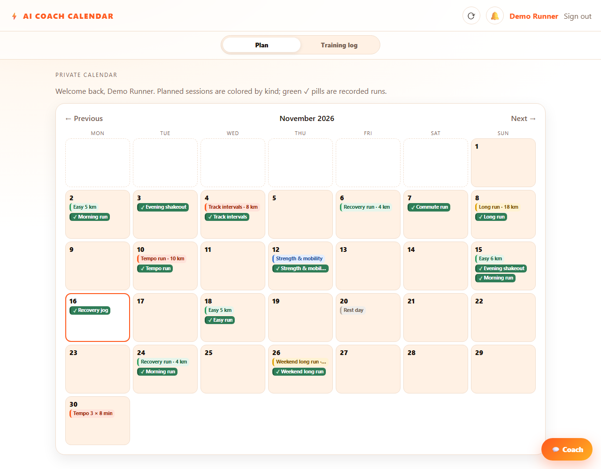
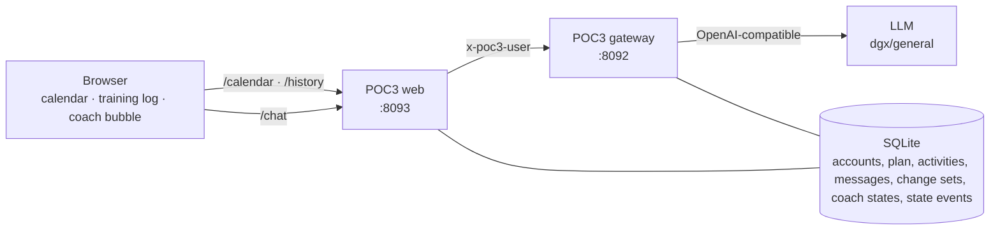

<h1 align="center">⚡ POC3</h1>

<p align="center">
  <strong>A calendar-first AI coach for runners.</strong><br>
  The private calendar is the product; the coach lives in a bubble on it and books, moves, deletes and reverts training
  sessions in front of the runner.
</p>

<p align="center">
  <a href="#status"></a>
  <a href="#status"></a>
  
  
  
</p>

<p align="center">
  <a href="#quick-start">Quick start</a> ·
  <a href="#what-is-in-the-box">Features</a> ·
  <a href="#architecture">Architecture</a> ·
  <a href="#docs">Docs</a> ·
  <a href="#deploy-the-live-process">Deploy</a> ·
  <a href="#status">Status</a> ·
  <a href="#honest-limits">Limits</a>
</p>

<p align="center">
  
</p>

<p align="center"><em>Plan pills are colored by kind; green ✓ pills are recorded runs. All screenshots use a fake demo runner and synthetic training data.</em></p>

> **POC3** is a proof of concept: a private training calendar owned by the system, with an LLM coach behind a validating
> gateway. Accounts are independent; every runner keeps their own profile, plan, training log and coach conversation.

**Stack:** TypeScript · Node.js 24 · SQLite (`node:sqlite`) · vanilla HTML/CSS/JS · Vitest · OpenAI-compatible gateway.

## Quick start

**Prerequisites:** Node.js **24+** and pnpm.

```powershell
pnpm install

$env:POC3_AUTH_SECRET='<long random secret>'
$env:POC3_DB='sqlite:data/poc3.sqlite'
$env:POC3_MODEL_BASE_URL='http://192.168.1.202:8102/v1'
$env:POC3_MODEL_API_KEY='<model key>'
$env:POC3_MODEL_NAME='dgx/general'
$env:POC3_MAX_ATTEMPTS='2'
pnpm dev
```

PowerShell is shown above; on macOS/Linux use `export NAME=value` instead.

| Surface | Default URL |
|---|---|
| Calendar / sign-up | **http://127.0.0.1:8091/signup** (then `/login`) |
| Coach bubble | bottom-right **💬 Coach** on the calendar |
| Gateway health | **http://127.0.0.1:8090/health** |

The live deployment runs the calendar on **:8093** and the gateway on **:8092**; the defaults above are **:8091/:8090**.
See the [environment reference](docs/POC3-CALENDAR.md#environment-reference) for every variable.

## Commands

| Command | What it does |
|---|---|
| `pnpm dev` | Start the calendar web process and the coach gateway. |
| `pnpm test` | Run the Vitest suite (257 tests in 11 files). |
| `pnpm typecheck` | Type-check `src`, `test` and `tools` with `tsc --noEmit`. |
| `pnpm lint` | Dependency-free gate: no console output outside `src/index.ts`, no TODO/FIXME, no `any` or secrets in `src`/`test`. |
| `pnpm check` | Run lint, typecheck and the full suite in one gate (also used by CI). |
| `pnpm deploy:live` | Restart the live :8093/:8092 process with `tools/deploy.ps1`. |

## What is in the box

### 🗓️ Plan

- **Private month calendar** — Monday-first grid, today ring, colored plan pills, green `✓` recorded-run pills, hover
  tooltips and a `+n more` hint for busy days.
- **Day actions** — click a day to add, move, delete, ask the coach or open the day detail; the middle nav opens a
  year/month picker.
- **Run peek** — click a green recorded-run pill for a popup with the run's key metrics, plan match, training load/effect,
  fastest efforts and PR badges, plus **Open full detail**, **Ask coach**, **View day** and **Training log week**. Ask coach
  sends the natural question with the run's day and metrics ("How did my Tempo run go? (Thu, 12 Nov 2026 · 8 km · 50 min)")
  plus a **hidden comment-only directive**: the coach checks that day's plan and comments without changing the calendar.
  The visible reference keeps repeated titles unambiguous, including in later follow-up turns. Escape, outside click or the
  × closes it; Escape returns focus to the pill, and the pill is keyboard reachable.
- **In-place updates** — coach turns refresh the grid without a reload; changed pills animate into place.

### 📈 Training log

- **Week / Month / Year** views with previous/next/current navigation and date/month/year pickers.
- Week = seven day cards with plan-match badges; month = week rows; year = month rows.
- Adaptive daily/weekly/monthly volume, pace/HR trends, consistency, weekly load/ACWR/hard-easy, period best efforts
  and PR badges.
- Per-activity **Ask coach** (a comment-only review), **Review my week** and auto-sync review prompts. Each action sends a
  typed intent; the server turns it into a hidden directive, so the visible message stays conversational.

### 🏃 Activity detail

- Full metrics, rich Garmin metrics, fastest 1 km / 1 mi / 5 km efforts, per-kilometre splits, Garmin laps/intervals and
  HR-zone time.
- Planned-vs-actual comparison with distance/duration deltas and bars, plus a comment-only **Ask coach** and links back to
  the day and plan.

### 💬 Coach

- Self-implemented same-origin bubble; restores the recent conversation after refresh.
- Add / move / delete / revert sessions; 1–3 tappable follow-ups; starter prompts; a structured **Could not apply** card.
  Review requests are read-only and never write to the calendar.
- **Hidden directives** — every action-originated message carries a server-authored stage direction (mode, write
  permission, references, focus, style and a short background note) that goes into the coach prompt but never into the
  chat bubble. The gateway enforces `allowCalendarWrites: false`, so a comment-only turn cannot write even if the model
  proposes it. A typed intent comes from the browser; hidden prose never does.
- **Coach audit** (`/coach-audit`, an owner-only internal page that is not linked in the end-user UI) shows the recent
  hidden directives, blocked writes, active coaching states, an immutable state-transition log and any legacy `mode:`
  memories.
- **Coaching states** (`/coach-states`) — durable context beyond one turn. Race phase (race day/week, taper, post-race),
  load (ACWR ramp, hard/easy mix, under-load), consistency and data freshness are detected from the calendar and Garmin;
  travel, heat, time pressure, pain, illness and focus blocks are proposed by the coach or set by the runner. Sensitive
  states (pain, illness, medical red flag, pregnancy/postpartum, menstrual-cycle support, low energy availability) are
  never inferred and need confirmation. Active states appear as calendar chips and bubble cards; the gateway enforces
  hard, day-aware guardrails over the effective post-turn calendar (including reverts and moved races) instead of
  trusting the prompt. Pages are read-only; **Refresh** persists auto states explicitly, and `POC3_AUTO_STATES=false`
  disables auto detection while keeping manual/chat states.
- The OpenAI-compatible `poc3-coach` gateway validates every proposal before writing, with one bounded
  repair/clarification loop and idempotent request replay.
- Every batch is stored with before/after snapshots; undo is requested in chat, with no history panel.

### 🔐 Accounts & Garmin

- Standalone accounts: signup, login, profile (display name, timezone, goal, password), per-user isolation.
- Per-runner Garmin Personal API key, verified before storage and never shown again in full. The top-bar sync icon sits
  next to the notification bell and opens the key guide when none is saved.
- Automatic sync on every new browser session (login or resumed auth cookie) plus page-load backoff. Pulls the last
  90 days, up to 100 activities per pull; repeated syncs upsert by `(user_id, activity_id)` and enrich
  load/cadence/elevation/effect/HR-zone fields.
- The same Garmin activity can be synced independently by multiple accounts; run detail fetches per-kilometre samples
  and lap summaries on demand.
- Notification bell is the sync feed: manual/key syncs confirm, automatic no-change checks stay silent, errors always
  appear. Routine "Auto-synced N" and "Garmin sync: N imported" banners are gone; the review card appears only for a
  genuinely new activity.

## Architecture



One SQLite file, two processes:

- **POC3 web** owns accounts, the calendar, the training log, activity detail, Garmin sync and the same-origin bubble
  proxy.
- **POC3 gateway** owns the OpenAI-compatible contract, validates `propose_calendar_turn`, and writes validated change
  sets through the same store.
- The bubble is not an iframe: it can read and animate the grid directly (ADR-0002).

## Project layout

| Path | What lives there |
|---|---|
| `src/` | Web server, gateway, coach contract, store, Garmin sync, training-log math. |
| `test/` | 257 Vitest tests across 11 files. |
| `docs/` | Solution doc, training-log plan, feature backlog, ADRs and design screenshots. |
| `tools/` | Dependency-free lint gate and the live deploy script. |

## Docs

| Document | What it answers |
|---|---|
| [Solution document](docs/POC3-CALENDAR.md) | Architecture, accounts, coach contract, CRUD/batch, change history/revert, suggestions, animation, training log, activity detail, trends, auto-sync, Garmin, API, runbook and limits. |
| [Coaching states](docs/COACH-STATES.md) | The durable-state model, catalog, detectors, chat/user proposals, precedence, guardrails, UI/API, research citations and what is needed versus deliberately skipped. |
| [Training-log plan](docs/TRAINING-LOG-PLAN.md) | Research, feature inventory and the implemented load/ramp, rich-metrics, per-kilometre-split, lap/interval, HR-zone, best-efforts/PR and weekly-review slices. |
| [Feature backlog](docs/FEATURES-FOR-REVIEW.md) | Remaining candidate features, prioritised and waiting for owner review. |
| [ADR-0001](docs/adr/0001-server-validated-coach.md) | LLM proposes; the server validates before writing. |
| [ADR-0002](docs/adr/0002-calendar-first-bubble.md) | The calendar is the product; the bubble is same-origin, not an iframe. |
| [ADR-0003](docs/adr/0003-validation-feedback-loop.md) | Rejected proposals are fed back for one repair/clarification; turns are idempotent. |

Fake-data screenshots: [calendar CRUD animation](docs/design/calendar-crud-demo.png) ·
[run peek](docs/design/activity-peek-demo.png) ·
[coach states](docs/design/coach-states-demo.png) ·
[coach state card](docs/design/coach-state-bubble-demo.png) ·
[coach audit](docs/design/coach-audit-demo.png) ·
[coach starter suggestions](docs/design/coach-starter-demo.png) ·
[coach Could not apply card](docs/design/coach-not-applied-demo.png) ·
[delete in place](docs/design/coach-delete-demo.png) ·
[training log month](docs/design/training-log-month-demo.png) ·
[training log week](docs/design/training-log-week-demo.png) ·
[training log year](docs/design/training-log-year-demo.png) ·
[activity detail](docs/design/activity-detail-demo.png).

## Deploy the live process

On Windows, every completed change is deployed by restarting the live :8093/:8092 process:

```powershell
pnpm deploy:live
```

`tools/deploy.ps1` reads the auth secret from `data/poc3-auth.secret`, the model API key from `POC3_MODEL_API_KEY` or
`data/poc3-model.secret`, uses `sqlite:data/poc3-auth.sqlite`, stops only the process whose command line contains
`src/index.ts`, starts `pnpm dev`, waits for `/health` and `/login`, and rejects a stylesheet without the calendar pill
styles or the coaching-state card/form/refresh styles. The deploy fails when the auth secret or model key is missing, so a
restart cannot silently drop the coach's model credentials. Logs are `data/poc3-live.out.log` and
`data/poc3-live.err.log`; the deploy history is `data/poc3-deploy.log`.

## Status

| Gate | State |
|---|---|
| Tests | **257 / 257** in 11 files |
| Lint | pass (`pnpm lint`) |
| Typecheck | pass (`pnpm typecheck`) |
| CI | `.github/workflows/ci.yml` runs `pnpm check` on Node 24 |
| Live deployment | calendar **:8093**, gateway **:8092** (pid 29472, model key preserved) |

**Live-verified:** multi-user signup/login/profile/isolation; multi-day batch CRUD; in-place grid refresh including delete
without reload; page-wide CRUD animation; conversation reload after refresh; LLM-driven undo; starter and follow-up
suggestions; non-scrolling suggestion rail; minimize-to-bubble; structured failure cards; Plan/Training log switcher;
timezone-correct "today"; native tool calls; validation feedback; clarification instead of a dead-end fallback; idempotent
request replay; typed coach intents with server-authored hidden directives and comment-only write enforcement; the live
`coach_states` schema and `coach_state_events` audit table; a real model turn; read-only state pages plus the explicit
refresh action; the state manager's CSRF origin rejection; and the state event log on the audit page. The live
verification created a temporary account, exercised the routes and a real model turn, and removed every temporary row
(no test state or event left behind).

**Live-verified Garmin:** a real personal-key pull of **100 activities** (the list endpoint's maximum); the 90-day
filter/upsert; enriched load/cadence/elevation/effect/HR-zone fields; the current week's real load card; per-kilometre
splits on a real run detail; Garmin laps/intervals; HR zones and PR badges; period best efforts; the auto-sync review
prompt; and the week/month/year selector against the live database.

**Cross-account:** two accounts can store the same Garmin activity independently, and a repeated sync leaves the
notification count unchanged.

**Notifications:** automatic no-change page loads leave both the page and the bell silent; the existing new-activity
notification and the 2026-11-15 recorded run remain. Manual/key no-new confirmations and newest-new targeting are
test-covered.

**Fixture-verified:** populated week, month and year training-log views plus the load card, weekly review prompt, period
best efforts and activity detail with rich metrics, per-kilometre splits, laps, HR zones and PR badges, plus the calendar
run-peek popup with its metrics, plan match, fastest efforts, four actions, Escape/focus restore, keyboard open,
outside-click close and same-pill toggle (headless Chrome, fake demo data:
[training log month](docs/design/training-log-month-demo.png),
[week](docs/design/training-log-week-demo.png), [year](docs/design/training-log-year-demo.png),
[activity detail](docs/design/activity-detail-demo.png), [run peek](docs/design/activity-peek-demo.png)); the coaching
states manager with Refresh, active calendar chips, bubble state cards and guardrail system
([coach states](docs/design/coach-states-demo.png), [state card](docs/design/coach-state-bubble-demo.png)); the coach
audit page with recent hidden directives, blocked-write badges, active states, the immutable State activity log and
legacy `mode:` memories ([coach audit](docs/design/coach-audit-demo.png)); plan-vs-actual
matcher; adaptive volume and pace/HR charts; load/ramp and hard/easy classification; split parsing; lap mapping; HR zones;
personal bests; auto-sync backoff.

**Calendar pills:** planned sessions and recorded runs render as colored descriptions in each day cell, with the full
kind/metrics/note in the hover tooltip and a `+n more` hint when a day has more than four items. Recorded-run pills also
open the run peek popup, with the full activity detail one tap away (headless Chrome, fake demo data:
[calendar-demo.png](docs/design/calendar-demo.png), [run peek](docs/design/activity-peek-demo.png),
[coach audit](docs/design/coach-audit-demo.png)).

**Not in scope:** admin console, Strava, payments, external calendar sync, production multi-tenant deployment, Garmin
wellness/HRV/sleep data, weather/air-quality providers, and clinical decision support.

## Honest limits

- **Booking horizon:** the coach accepts bookings up to **180 days ahead** (shown in the bubble header).
- **Model loop:** one bounded repair attempt; there is no open-ended agent loop.
- **No streaming:** the bubble waits for the full reply.
- **Auth:** the cookie is signed with `POC3_AUTH_SECRET`; set a strong secret.
- **State detection is heuristic:** ACWR, race-week and post-race detection are signals, not diagnoses. The runner can
  resolve any state; sensitive states are never inferred. The engine does not replace a clinician or coach.
- **State pages are read-only:** auto detection is persisted by a gateway turn or the explicit **Refresh**
  action, never by a GET. `POC3_AUTO_STATES=false` disables auto detection; manual/chat states still work.
- **State retention:** resolved rows and transition events older than 180 days are pruned; the manager keeps the last
  100 rows for resolved history. State writes are serialized with `BEGIN IMMEDIATE`/`busy_timeout`; a future
  multi-process writer would need a partial unique index on open `(user_id, state_key)`.
- **No wellness or weather data:** sleep/HRV/readiness, heat, air quality and altitude are chat/user states until those
  data sources are integrated.
- **Gateway trust:** the gateway trusts the internal `x-poc3-user` header; it binds to `127.0.0.1` and must stay on a
  private network. The web surface binds to `0.0.0.0` behind session auth and same-origin state POST checks.
- **SQLite:** single-process; run one app process per database.
- **Code shape:** the state catalog lives in `src/coach-state-catalog.ts`, the state/audit page render in
  `src/web-coach-states.ts`, and shared HTML helpers in `src/web-html.ts`. `src/web.ts` still holds the routes and the
  inline client script, so a route/client-script split is a follow-up refactor, not a behavior change.
- **Garmin:** capped at **100 activities per pull**; the Personal API key is stored per runner in SQLite in plaintext, so
  run this PoC on a private server.
- **Training load:** Garmin's proprietary value; ACWR is a soft coupled 7/28-day signal, not medical advice.
- **Splits and zones:** per-kilometre splits are computed on demand from Garmin detail samples; Garmin's own
  lap/interval summaries are separate; HR-zone time has no stored zone boundaries.
- **PRs:** PR badges and period best efforts are bests within stored history (100 activities / 90 days), not a lifetime
  record. A dedicated records page and zone charts are later slices.

See the [solution document](docs/POC3-CALENDAR.md) and [training-log plan](docs/TRAINING-LOG-PLAN.md) for the full list.

## License

> Private proof of concept. No license granted for redistribution.
