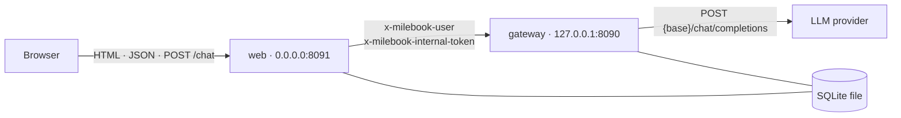

# Architecture

**Status:** current · **Owner:** platform · **Updated:** 2026-11-22 · **Supersedes:** docs/MILEBOOK-CALENDAR.md §4-5

Milebook is one Node.js 24 process serving two HTTP surfaces over one SQLite database. There is no framework, no client
build step and no runtime npm dependency beyond the TypeScript loader. That shape is deliberate: it keeps the app
deployable on a single host, auditable end to end, and fast enough that every page is server-rendered HTML.

## 1. Runtime topology

| Component | Entry | Binds | Owns |
|---|---|---|---|
| Web surface | `(src/index.ts · createWeb)` | `0.0.0.0:$MILEBOOK_WEB_PORT` (8091) | Accounts, every page, JSON endpoints, static assets, export, Garmin sync, the coach proxy |
| Coach gateway | `(src/index.ts · createGateway)` | `127.0.0.1:$MILEBOOK_GATEWAY_PORT` (8090) | The OpenAI-compatible contract, turn validation, change-set writes |
| Store | `(src/store.ts · createStore)` | one SQLite file | Every table; one writer |
| Auth | `(src/auth.ts · createAuth)` | — | Signup/login, signed session cookies |

Both servers are started by `(src/index.ts)`, which fails closed on missing configuration, loads an optional `.env`,
creates the database directory, and wires a shared internal token between the two surfaces. Shutdown drains on
`SIGINT`/`SIGTERM` with a 15 s deadline.

## 2. Trust boundaries

| Boundary | Rule | Enforced by |
|---|---|---|
| Browser → web | Session cookie (HMAC-signed `milebook_session`), `SameSite=Lax`, `HttpOnly`, optional `Secure`; every state-changing POST must be same-origin | `(src/auth.ts · read)`, `(src/web.ts · isSameOriginPost)` |
| Web → gateway | Loopback bind + shared `x-milebook-internal-token`; the gateway believes `x-milebook-user` only after the token check | `(src/gateway.ts · createGateway)` |
| Gateway → model | Server-authored prompt only; the browser never talks to the model directly | `(src/web.ts · createWeb)` chat proxy |
| Model → data | The model proposes JSON; the server validates and writes; `allowCalendarWrites: false` blocks comment-only turns | `(src/coach.ts · parseCoachTurn)`, `(src/gateway.ts · createGateway)` |
| Runner → runner | Every store method takes `userId` and every query filters on it | `(src/store.ts · createStore)` |

The gateway sends **no CORS grant** and answers `OPTIONS` with a bare `204`: the browser never calls it cross-origin,
so any CORS allowance would only help an attacker.

## 3. Request flow: a coach turn

1. The bubble posts `POST /chat` with a typed intent to the web surface.
2. The web surface resolves the runner, builds a **hidden directive** from the intent
   (`(src/directives.ts · buildDirectiveForIntent)`), and calls the gateway with the runner id, the internal token and an
   idempotency header.
3. The gateway assembles the prompt — byte-stable system head, the newest context snapshot, the append-only conversation
   — calls the model with a 120 s abort, and validates the reply (`(src/coach.ts · parseCoachTurn)`).
4. Invalid replies get one bounded repair attempt with structured feedback; a validated turn is applied as one change
   set with before/after snapshots (`(src/history.ts · applyRevert)` is the reverse path).
5. The gateway persists the assistant message, the turn record, directives and any proposals, then returns the reply and
   a `milebook` meta block. The web surface returns it to the bubble, which refreshes the grid in place.

The proxy aborts at 130 s so a hung gateway cannot pin a browser request; the browser sees `504` (timeout) or `502`
(upstream failure) with a stable message, never an internal error string.

## 4. Request flow: a page render

Every page is rendered server-side inside `(src/web.ts · createWeb)`:

- resolve locale (cookie → `Accept-Language` → `en`), then a per-request translator;
- resolve the runner from the signed cookie;
- read only what the page needs from the store;
- render HTML through small helpers (`escapeHtml`, `errorBanner`, `auditMetric` in `src/web-html.ts`);
- serve `/static/app.css?v=APP_CSS_VERSION` and the vendored scripts/images from memory with an ETag.

Interactive behaviour is inline, unobtrusive JavaScript embedded in the page (the dock, peeks, the metric switch,
in-place refresh). Forms work without JavaScript: the same routes accept a POST and redirect.

## 5. Module map

| Module | Responsibility | Depends on |
|---|---|---|
| `src/index.ts` | Config, startup, shutdown, wiring | all |
| `src/web.ts` | HTTP surface, page render, inline client scripts, chat proxy | auth, store, coach, directives, garmin, muscles, states, i18n, styles |
| `src/gateway.ts` | OpenAI-compatible API, turn execution, persistence | store, coach, directives, states, muscles, history |
| `src/coach.ts` | Prompt assembly, turn parsing and validation, reply style | types, time, muscles, states, directives |
| `src/directives.ts` | Typed intents → hidden directives | types, time |
| `src/coach-states.ts`, `src/coach-state-catalog.ts` | State detection, precedence, guardrails | store, time, training |
| `src/muscles.ts`, `src/muscle-status.ts`, `src/muscle-proposals.ts` | Muscle catalog, reading rules, drills, proposals | store, time |
| `src/muscle-viewer.ts`, `src/muscle-rig.ts`, `src/muscle-map.ts` | 3D figure, procedural fallback, flat legend | vendor assets, i18n |
| `src/training.ts` | Load/ACWR, plan matching, best efforts | types, time |
| `src/garmin.ts`, `src/garmin-sync.ts`, `src/garmin-workout.ts`, `src/garmin-errors.ts` | Garmin client, sync, workout overlay, error mapping | store, time |
| `src/store.ts` | Schema, migrations, every query | `node:sqlite` |
| `src/auth.ts` | Accounts, scrypt hashes, signed cookies | store |
| `src/rate-limit.ts` | Failed-credential and model-spend throttles | — |
| `src/i18n.ts` | Two catalogs, locale resolution, date formatting, client strings | — |
| `src/styles.ts` | The whole stylesheet as one string | — |
| `src/export.ts` | JSON bundle and ICS calendar | store |
| `src/history.ts` | Revert application and change-set helpers | store |
| `src/web-html.ts` | Escaping and shared HTML helpers | — |
| `src/time.ts` | Day arithmetic, timezone safety, local formatting | — |

`src/web.ts` is the largest module (~6.9k lines) because it holds three things in one file: view builders, the inline
client scripts, and the route dispatcher. Splitting it is the top structural follow-up, tracked in
[PRODUCTION-READINESS.md](PRODUCTION-READINESS.md).

## 6. Data and state

- **One SQLite file**, WAL mode, `synchronous=NORMAL`, `busy_timeout=5000` (`(src/store.ts · SqliteStore)`). One writer:
  run exactly one app process per database file.
- **Schema at boot**: `CREATE TABLE IF NOT EXISTS` plus two ad-hoc migrations. There is no version table yet; the gap is
  documented in [DATA-MODEL.md](DATA-MODEL.md).
- **Sessions**: the signed cookie is stateless (30 days); an in-memory page-session map only decides when to pull
  Garmin on a new browser session. It is lost on restart, which is intentional and harmless.
- **Caches**: none. The Garmin client and the model are called per request; the prompt cache is the model provider's.

## 7. Assets and delivery

| Asset | Delivery | Cache |
|---|---|---|
| Stylesheet | `/static/app.css?v=APP_CSS_VERSION` | `public, max-age=31536000, immutable` |
| three.js builds | `/static/three.module.js` + 3 addons | `no-cache` (revalidate, 304) |
| Anatomy GLB (11 MB) | `/static/anatomy-muscles.glb` | `public, max-age=3600` + ETag |
| Art plates (webp) | `/static/*.webp` | `public, max-age=86400` + ETag |

All assets are read into memory once at startup and served with a startup-computed ETag, so a revalidating request costs
a `304` and no bytes. There is no compression and no CDN; both are recorded as follow-ups.

## 8. Architectural decisions

| ADR | Decision |
|---|---|
| [ADR-0001](adr/0001-server-validated-coach.md) | The LLM proposes; the server validates before writing. |
| [ADR-0002](adr/0002-calendar-first-bubble.md) | The calendar is the product; the bubble is same-origin, not an iframe. |
| [ADR-0003](adr/0003-validation-feedback-loop.md) | Rejected proposals are fed back once; turns are idempotent. |

## 9. What this architecture deliberately does not have

No message queue, no background worker, no cache layer, no ORM, no client framework, no container, no multi-process
deployment. Each of those would be justified by scale or by a feature that does not exist yet; [LIMITS.md](LIMITS.md)
records what would have to change to lift them.

Cross-links: [PRODUCT.md](PRODUCT.md), [DATA-MODEL.md](DATA-MODEL.md), [COACH-CONTRACT.md](COACH-CONTRACT.md),
[HTTP-API.md](HTTP-API.md), [SECURITY.md](SECURITY.md), [OPERATIONS.md](OPERATIONS.md).
