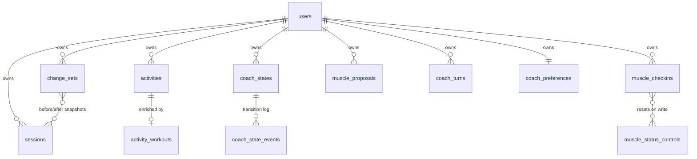

# Data model
**Status:** current · **Owner:** persistence · **Updated:** 2026-11-22 · **Supersedes:** docs/MILEBOOK-CALENDAR.md §6, docs/MUSCLE-TAB.md §3

Milebook keeps every durable fact in one SQLite file opened by `src/store.ts`. The shape is deliberately uniform: each row stores the whole TypeScript record as a JSON `payload` and mirrors only the columns the app filters or orders on, so a read is one indexed query and a write is one upsert `(src/store.ts · SqliteStore)`. This page is the reference for that file — engine, tables, relations, invariants, pruning, schema evolution, export, sizing and backup. Routes live in [HTTP-API.md](HTTP-API.md), process layout in [ARCHITECTURE.md](ARCHITECTURE.md), runtime duties in [OPERATIONS.md](OPERATIONS.md), the coach's reading of these rows in [COACH-CONTRACT.md](COACH-CONTRACT.md).

## 1. Storage engine

| Fact | Value | Anchor |
|---|---|---|
| Driver | `node:sqlite` `DatabaseSync`, synchronous API, one connection per process | `(src/store.ts · SqliteDatabase)` |
| Loading | `createRequire` at runtime: Node 24 keeps `sqlite` out of `module.builtinModules`, and Vite 5 would otherwise resolve it as a package | `(src/store.ts · SqliteStatement)` |
| File spec | `MILEBOOK_DB`, default `sqlite:data/milebook.sqlite`; the `sqlite:` prefix is stripped, `:memory:` is ephemeral, and the parent directory is created at boot | `(src/index.ts · databaseSpec)`, `(src/store.ts · resolveLocation)`, `(src/index.ts · handle)` |
| Open / close | one `new DatabaseSync(location)` in the constructor; `close()` is idempotent and called from the signal path | `(src/store.ts · SqliteStore.constructor)`, `(src/index.ts · shutdown)` |

### Pragmas

| Pragma | Set by Milebook | Effective value | Consequence |
|---|---|---|---|
| `journal_mode = WAL` | yes, file databases only (`:memory:` is skipped) | `wal`, persisted in the file | readers never block the writer; commits append to a `-wal` sidecar |
| `synchronous = NORMAL` | yes, every open | `NORMAL` (1) for that connection | durable across a process crash; a power cut can lose the most recent commits without corrupting the file |
| `busy_timeout = 5000` | yes | 5000 ms | a competing writer waits up to 5 s, then `SQLITE_BUSY` is thrown |
| `foreign_keys` | no | `ON` — node:sqlite default | inert: the schema declares no `REFERENCES`, so nothing is enforced |
| `user_version` | no | `0` | schema generation is unrecorded (§6) |
| `auto_vacuum`, `wal_checkpoint`, `optimize` | no | driver defaults | freed pages are reused in place; the file never shrinks |

`synchronous` is a per-connection setting, not a file property: a fresh `DatabaseSync` reports `FULL` until the constructor sets `NORMAL`, which is why it is set on every open. Verified on Node 24.22.3 against a scratch file database: `journal_mode=wal` (persisted across reopen), `synchronous=1` in session, `foreign_keys=1`, `busy_timeout=5000`.

### Single writer and its consequence

One process owns the file. The web surface and the coach gateway are built from the same handle; the gateway is the only writer of new plan rows, while the web surface's undo route restores sessions from a change set — no request posts a session straight to the table `(src/index.ts · handle)`, `(src/web.ts · createWeb)`, `(src/history.ts · applyRevert)`. Multi-row batches take the write lock explicitly: `transaction()` runs `BEGIN IMMEDIATE`, and a throwing callback rolls back `(src/store.ts · SqliteStore.transaction)`.

Operational consequence: writes serialise behind one connection, and WAL means readers do not queue behind them. A second writer — another instance, a `sqlite3` shell with a write, an external backup tool holding the lock — makes the app wait five seconds and then fail the request; there is no retry wrapper in the store. Model calls never hold the lock: the gateway parses the reply first and only then opens the transaction that applies the plan, records the change set and appends the assistant message `(src/gateway.ts · applyParsedTurn)`.

## 2. Table catalogue

DDL is verbatim from `SCHEMA`; every table and index is created with `IF NOT EXISTS`, so boot is idempotent on an existing file `(src/store.ts · SCHEMA)`. Narrow tables are listed as their verbatim column list; the three widest get a column table. `payload` always holds the full record of the named type.

### users · payload `UserProfile` · read: `getUser`
**Columns:** `user_id` TEXT PRIMARY KEY · `username` TEXT NOT NULL UNIQUE COLLATE NOCASE · `created_at` TEXT NOT NULL · `payload` TEXT NOT NULL (profile incl. `passwordHash`, never a plaintext password)

### messages · index `messages_user_created (user_id, created_at)` · payload `Message` · read: `listMessages`
**Columns:** `message_id` TEXT PRIMARY KEY · `user_id` TEXT NOT NULL · `created_at` TEXT NOT NULL · `payload` TEXT NOT NULL (`role`, `text` live only here)

### memories · index `memories_user_created (user_id, created_at)` · payload `Memory` · read: `listMemories`
**Columns:** `memory_id` TEXT PRIMARY KEY · `user_id` TEXT NOT NULL · `created_at` TEXT NOT NULL · `payload` TEXT NOT NULL (`text` lives only here)

### sessions · index `sessions_user_day (user_id, day)` · payload `TrainingSession` · read: `listSessions`
**Columns:** `session_id` TEXT PRIMARY KEY (single column, not composite) · `user_id` TEXT NOT NULL · `day` TEXT NOT NULL · `created_at` TEXT NOT NULL · `payload` TEXT NOT NULL — written with `INSERT OR REPLACE` on the global `session_id`, so a repeated id replaces the row outright `(src/store.ts · UPSERT_SESSION)`

### activities · index `activities_user_day (user_id, day)` · payload `Activity` · read: `getActivity`
**Columns:** `activity_id` TEXT NOT NULL (PK part) · `user_id` TEXT NOT NULL (PK part) · `day` TEXT NOT NULL · `created_at` TEXT NOT NULL · `payload` TEXT NOT NULL · PRIMARY KEY `(user_id, activity_id)` — two runners may hold the same Garmin id. The upsert also overwrites `created_at` with the newest sync's value `(src/store.ts · UPSERT_ACTIVITY)`

### activity_workouts · index `activity_workouts_user_day (user_id, day)` · payload `ActivityWorkout` · read: `getActivityWorkout`
**Columns:** `user_id` TEXT NOT NULL (PK part) · `activity_id` TEXT NOT NULL (PK part) · `day` TEXT NOT NULL · `status` TEXT NOT NULL (`ok` / `none` / `unavailable`) · `attempts` INTEGER NOT NULL DEFAULT 0 · `fetched_at` TEXT NOT NULL · `payload` TEXT NOT NULL (normalised steps, label, summary, notes)

### sync_state · payload: none (columns only) · read: `getLastSync`
**Columns:** `user_id` TEXT PRIMARY KEY · `last_synced_at` TEXT NOT NULL — upserted on every sync attempt, success or failure, so automatic sync backs off `(src/garmin-sync.ts · createGarminSync)`

### garmin_keys · payload: none (columns only) · read: `getGarminKey`
**Columns:** `user_id` TEXT PRIMARY KEY · `saved_at` TEXT NOT NULL · `api_key` TEXT NOT NULL (plaintext; see [SECURITY.md](SECURITY.md))

### notifications · index `notifications_user_created (user_id, created_at)` · payload `AppNotification` · read: `countUnreadNotifications`
**Columns:** `notification_id` TEXT PRIMARY KEY · `user_id` TEXT NOT NULL · `created_at` TEXT NOT NULL · `read_at` TEXT NULL (the only mutable column; `NULL` = unread) · `payload` TEXT NOT NULL — `read_at` is denormalised: `listNotifications` overrides the payload copy with the column, so the column wins `(src/store.ts · SqliteStore.listNotifications)`

### muscle_checkins · indexes `muscle_checkins_user_day (user_id, day)`, `muscle_checkins_user_created (user_id, created_at)` · payload `MuscleCheckIn` · read: `getMuscleCheckIn`
**Columns:** `check_in_id` TEXT PRIMARY KEY · `user_id` TEXT NOT NULL · `day` TEXT NOT NULL (the day the feelings are about) · `created_at` TEXT NOT NULL · `payload` TEXT NOT NULL (`muscles[]` tags, optional `activityId`, `note`)

### muscle_status_controls · payload `MuscleStatusControl` · read: `listMuscleStatusControls`
**Columns:** `user_id` TEXT NOT NULL (PK part) · `muscle_id` TEXT NOT NULL (PK part) · `updated_at` TEXT NOT NULL · `payload` TEXT NOT NULL (`hold`, `resolvedDay`) · PRIMARY KEY `(user_id, muscle_id)` — at most one control row per muscle; a newer check-in overwrites it `(src/store.ts · UPSERT_MUSCLE_STATUS_CONTROL)`

### muscle_proposals · index `muscle_proposals_user_status (user_id, status, created_at)` · payload `MuscleProposal` · read: `getMuscleProposal`
**Columns:** `proposal_id` TEXT PRIMARY KEY · `user_id` TEXT NOT NULL · `status` TEXT NOT NULL (`proposed` / `confirmed` / `dismissed`) · `created_at` TEXT NOT NULL · `updated_at` TEXT NOT NULL · `decided_at` TEXT NULL until the runner decides · `payload` TEXT NOT NULL (action, muscle, report fields, evidence, confidence, `day`)

### change_sets · index `change_sets_user_created (user_id, created_at)` · payload `ChangeSet` · read: `getChangeSet`
**Columns:** `change_set_id` TEXT PRIMARY KEY · `user_id` TEXT NOT NULL · `created_at` TEXT NOT NULL · `reverted_at` TEXT NULL (null while the batch still stands) · `payload` TEXT NOT NULL (summary and `entries[]` with `before`/`after` snapshots)

### coach_turns · index `coach_turns_user_created (user_id, created_at)` · read: `getCoachTurn`

| Column | Type · constraint |
|---|---|
| `request_id` | TEXT NOT NULL · PK part |
| `user_id` | TEXT NOT NULL · PK part |
| `created_at` | TEXT NOT NULL |
| `completed_at` | TEXT NULL |
| `status` | TEXT NOT NULL — `in_progress` / `completed` / `failed` |
| `attempts` | INTEGER NOT NULL DEFAULT 0 |
| `validation_code` | TEXT NULL |
| `outcome` | TEXT NULL |
| `response_json` | TEXT NULL — the cached reply, replayed byte-for-byte |
| `directive_hash` | TEXT NULL — added to old databases by migration (§6) |

The one table with no `payload`: its columns are the record `(src/types.ts · CoachTurnRecord)`.

### coach_directives · index `coach_directives_user_created (user_id, created_at)` · payload `CoachDirectiveRecord` · read: `listCoachDirectives`
**Columns:** `directive_id` TEXT PRIMARY KEY · `user_id` TEXT NOT NULL · `created_at` TEXT NOT NULL · `payload` TEXT NOT NULL (visible message, hidden directive, ids, `renderedPromptSuffix`, `blockedWrites`)

### coach_states · indexes `coach_states_user_updated (user_id, updated_at)`, `coach_states_user_key (user_id, state_key, status)` · payload `CoachStateRecord` · read: `getCoachState`

| Column | Type · constraint |
|---|---|
| `state_id` | TEXT PRIMARY KEY |
| `user_id` | TEXT NOT NULL |
| `state_key` | TEXT NOT NULL — catalog key, e.g. `load_spike` |
| `status` | TEXT NOT NULL — `observing` / `active` / `resolved` |
| `source` | TEXT NOT NULL — `auto` / `chat` / `user` |
| `updated_at` | TEXT NOT NULL |
| `expires_at` | TEXT NULL |
| `resolved_at` | TEXT NULL |
| `payload` | TEXT NOT NULL — `confidence`, `evidence[]`, `activatedAt` |

### coach_state_events · index `coach_state_events_user_created (user_id, created_at)` · payload `CoachStateEvent` · read: `listCoachStateEvents`

| Column | Type · constraint |
|---|---|
| `event_id` | TEXT PRIMARY KEY |
| `user_id` | TEXT NOT NULL |
| `state_id` | TEXT NOT NULL — the state row this transition belongs to |
| `state_key` | TEXT NOT NULL |
| `action` | TEXT NOT NULL — `activate` / `update` / `confirm` / `resolve` / `expire` / `set` |
| `from_status` | TEXT NULL — null on the first transition |
| `to_status` | TEXT NOT NULL |
| `source` | TEXT NOT NULL |
| `confidence` | REAL NOT NULL |
| `evidence` | TEXT NOT NULL — JSON array, `JSON.stringify(event.evidence)` |
| `created_at` | TEXT NOT NULL |
| `payload` | TEXT NOT NULL |

### coach_preferences · payload `CoachPreferences` · read: `getCoachPreferences`
**Columns:** `user_id` TEXT PRIMARY KEY · `updated_at` TEXT NOT NULL · `payload` TEXT NOT NULL (language, tone, reply length, nickname)

### prompt_snapshots · index `prompt_snapshots_user_created (user_id, created_at)` · payload `PromptSnapshot` · read: `listPromptSnapshots`
**Columns:** `snapshot_id` TEXT PRIMARY KEY · `user_id` TEXT NOT NULL · `created_at` TEXT NOT NULL · `payload` TEXT NOT NULL (`epoch`, `epochJson`, `reasons[]`, frozen `body`)

## 3. Entity relationships

No foreign keys exist in the file; the diagram is the logical relation the code maintains, and `user_id` is the only join key `(src/store.ts · SCHEMA)`.

Who owns what:

- **users** is the account row; every other table carries `user_id` and every read filters on it.
- **sessions** is the plan; **activities** is what happened; **activity_workouts** is the read-only Garmin overlay on one activity.
- **change_sets** points at sessions by id inside its payload, not by foreign key — one session may appear in many change sets.
- **coach_states** holds the current snapshot of each durable situation; **coach_state_events** is its append-only history, never updated.
- **muscle_checkins** is the runner's report history; **muscle_status_controls** is the small derived state (hold, resolved day) that a check-in resets; **muscle_proposals** is the coach's journal, separate from the runner's records until a confirm copies it in.
- **messages**, **memories**, **notifications**, **coach_turns**, **coach_directives**, **coach_preferences**, **prompt_snapshots**, **garmin_keys**, **sync_state** are the conversation, prompt cache and operational side rows — one runner's, read only through the owner-scoped method listed with each table.

## 4. Domain invariants

| Invariant | How it holds | Anchor |
|---|---|---|
| Per-user isolation | every statement filters on `user_id`; no unscoped read or write exists | `(src/store.ts · SqliteStore)` |
| Activity idempotency | `(user_id, activity_id)` PK + upsert; `garmin:<id>` for device runs, `activity:manual:<hash>` for reported runs | `(src/garmin.ts · mapGarminActivity)`, `(src/manual-activity.ts · activityIdFor)` |
| Turn idempotency | `(user_id, request_id)` PK; claim, replay the cached body, or refuse on a different directive hash | `(src/store.ts · CLAIM_COACH_TURN)` |
| Change-set snapshots | each entry stores the full `before` and `after` session, so a revert is a restore, never a diff | `(src/types.ts · ChangeSet)` |
| State-event immutability | events are insert-only; the state row keeps only the latest snapshot | `(src/coach-states.ts · recordStateEvent)` |
| Proposal status machine | `proposed` → `confirmed` / `dismissed`; a dismissal is restorable inside the TTL window | `(src/muscle-proposals.ts · confirmMuscleProposal)` |
| Check-in append-only | no update or delete method exists; every report is a new `checkin:<uuid>` row | `(src/store.ts · SqliteStore.appendMuscleCheckIn)` |

Three keys need care because they are not composite:

- **sessions** keys on `session_id` alone and writes with `INSERT OR REPLACE`, so isolation rests on the id being derived from the owner: `session:<sha256(userId:day:kind:title)>` `(src/gateway.ts · applyParsedTurn)`. A colliding id would replace another runner's row; the derivation is the only guard.
- **messages** and **muscle_checkins** key on a bare UUID; ownership comes from the `user_id` filter on every statement, not from the key.
- **coach_state_events.evidence** and **activity_workouts.payload** are JSON strings, so SQL constrains nothing about their shape; the validators in `src/muscles.ts` and `src/garmin-workout.ts` do.

Idempotency in detail:

- Garmin sync maps a device activity to `garmin:<rawId>` and upserts, so a repeated 90-day pull updates the row instead of duplicating it `(src/garmin.ts · mapGarminActivity)`, `(src/garmin-sync.ts · createGarminSync)`.
- The manual form hashes `userId:requestId` into `activity:manual:<24 hex>`, so a double submit replaces the same row; a missing or malformed request id falls back to a random UUID and a second row `(src/manual-activity.ts · activityIdFor)`.
- Coach turns claim before the model call and cache the reply after the commit; a replay returns the stored bytes, a different directive on the same id is a 409, and an in-flight id is a 409 `(src/gateway.ts · createGateway)`. Streaming requests (`stream: true`) carry no request id and leave no `coach_turns` row at all `(src/gateway.ts · requestIdFrom)`. A `failed` row can be re-claimed: the upsert only revives that status, resetting attempts and clearing the body `(src/store.ts · CLAIM_COACH_TURN)`. A handled error marks the row `failed`, but a crash between claim and commit leaves the id stuck in `in_progress` with no lease timeout and no boot recovery, so that request id answers 409 until the row is updated by hand.
- Revert is idempotent per change set: `reverted_at` is set once, an already reverted batch is a no-op, and the revert itself is appended as a new change set `(src/history.ts · applyRevert)`, `(src/store.ts · SqliteStore.markChangeSetReverted)`.

Check-in uniqueness, stated honestly: there is **no** unique key on `(user_id, day, muscle)`. A runner may append several check-ins for one day; the status layer takes the newest mention of each muscle, ordered by `createdAt` and then list position `(src/muscle-status.ts · latestMentionsByMuscle)`. Uniqueness is modelled at read time, not enforced by the file.

## 5. Retention and pruning

| Rule | Constant / limit | Anchor | Effect |
|---|---|---|---|
| Resolved state age | `STATE_RETENTION_DAYS = 180` | `(src/coach-states.ts · STATE_RETENTION_DAYS)` | deletes `resolved` rows whose `resolved_at` is older than the cutoff, inside the refresh transaction `(src/coach-states.ts · syncCoachStatesLocked)` |
| Event age | same cutoff | `(src/store.ts · PRUNE_COACH_STATE_EVENTS)` | deletes events by `created_at` whatever their state's status, so a resolved row and its log leave together |
| Resolved-history read cap | newest 100 rows | `(src/coach-states.ts · syncCoachStatesLocked)` | refresh and the states page never read further back, so an old resolved row cannot influence detection |
| Active-state cap | `MAX_ACTIVE_STATES = 8` | `(src/coach-states.ts · MAX_ACTIVE_STATES)` | detection output is sliced before sync; not a deletion |
| Memory rows | `MEMORY_KEEP_COUNT = 24` | `(src/store.ts · MEMORY_KEEP_COUNT)` | `appendMemory` deletes beyond the newest 24 per runner; a normalised duplicate is skipped instead of inserted |
| Memory prompt window | `COACH_MEMORY_WINDOW = 12` | `(src/coach.ts · COACH_MEMORY_WINDOW)` | the snapshot renders the newest 12 |
| Proposal journal cap | newest 40 | `(src/store.ts · PRUNE_MUSCLE_PROPOSALS)` | runs on every append, any status; oldest rows deleted |
| Proposal TTL | `MUSCLE_PROPOSAL_TTL_DAYS = 7` | `(src/muscle-proposals.ts · MUSCLE_PROPOSAL_TTL_DAYS)` | read-time only: a pending row older than 7 days by `day` is counted as expired and not offered; the row stays |
| Prompt snapshot cap | newest 3 | `(src/store.ts · PRUNE_PROMPT_SNAPSHOTS)` | appended then pruned per runner; assembly reads the same 3 |
| Prompt compaction | `ASSEMBLY_TOKEN_BUDGET = 8000`, floor `MIN_HISTORY_MESSAGES = 10` | `(src/coach.ts · assembleConversation)` | drops the oldest history messages when the estimate overflows; the database is untouched |
| History read window | 20 messages | `(src/gateway.ts · createGateway)` | each turn loads only the newest 20 |
| Notification read state | all unread → one timestamp | `(src/store.ts · MARK_NOTIFICATIONS_READ)` | `markNotificationsRead` stamps every unread row; unread count is `COUNT(*) WHERE read_at IS NULL`; the tray renders `99+` past its display cap `(src/web.ts · createWeb)`. Rows are never deleted or capped |
| Check-in backfill | `CHECKIN_BACKFILL_DAYS = 14` | `(src/muscles.ts · validateCheckInDay)` | writes older than 14 days are rejected; existing rows are kept forever |
| Muscle status fade | `MUSCLE_STATUS_WINDOW_DAYS = 10` | `(src/muscle-status.ts · decayedSoreness)` | derived: the level decays to zero and the status disappears; rows stay |
| Garmin import window | `WINDOW_DAYS = 90` | `(src/garmin-sync.ts · createGarminSync)` | only activities inside 90 days are imported — an import window, **not** retention; older activity rows stay |
| Revert lookback | `MAX_REVERT_LOOKBACK = 50` | `(src/gateway.ts · MAX_REVERT_LOOKBACK)` | an implicit undo scans the newest 50 change sets for the last un-reverted batch |

## 6. Migrations

Evolution is ordered and versioned. Boot order: open the file, set the three pragmas, run `SCHEMA`, run the migration
list, seal any legacy plaintext Garmin key, then start listening `(src/store.ts · SqliteStore.constructor)`.

| Step | Version | What it does | Idempotent because | Anchor |
|---|---|---|---|---|
| activities composite key | 1 | rebuilds `activities` with `PRIMARY KEY (user_id, activity_id)`: create `activities_new`, `INSERT OR IGNORE … SELECT`, drop, rename, recreate the index | returns early when the table's SQL already carries the composite key | `(src/migrations.ts · activitiesCompositeKey)` |
| coach_turns directive hash | 2 | `ALTER TABLE coach_turns ADD COLUMN directive_hash TEXT` | returns early when `PRAGMA table_info` already lists it | `(src/migrations.ts · coachTurnsDirectiveHash)` |

`PRAGMA user_version` records the last applied version `(src/migrations.ts · schemaVersion)`. A database created before
versioning reports 0 and therefore runs both steps once, which is safe because each step is idempotent. The runner owns
one `BEGIN IMMEDIATE` per step, so a failing step rolls back and leaves the file at the previous version, with a message
that names the step `(src/migrations.ts · runMigrations)`.

Rules for the next step: never edit or renumber a shipped one; append the next version; keep it synchronous and local;
and add a test that opens a legacy file and asserts both the new shape and the preserved rows
`(test/migrations.test.ts)`.

**Secrets at rest.** Password hashes are scrypt strings, produced and verified asynchronously so a login burst does not block the server. The Garmin API key is sealed with AES-256-GCM (fresh 96-bit
nonce per value, self-describing `enc:v1:` envelope) when the deployment sets `MILEBOOK_GARMIN_KEY`, and legacy plaintext
rows are sealed during the first boot after the key appears `(src/secrets.ts · createSecretBox)`,
`(src/store.ts · sealStoredGarminKeys)`. Without the variable the key stays plaintext and the boot log says so.

**The file states its own generation.** A boot with pending steps logs `schema N -> M (step; step)`; a boot with none
logs nothing, which is the normal case.

## 7. Export and erasure

| Surface | Includes | Anchor |
|---|---|---|
| `/export.json` | profile (`userId`, `username`, `displayName`, `timezone`, `goal`, `createdAt`), all sessions, up to 5000 activities, 500 change sets, 500 check-ins, every status control, 200 proposals | `(src/export.ts · buildExportBundle)` |
| `/export.ics` | sessions only: one all-day `VEVENT` per session, `UID` `<sessionId>@milebook`, `DTEND` the next day, lines folded at 74 characters | `(src/export.ts · buildCalendarIcs)` |

Deliberately excluded, and the list is a decision rather than an omission:

- `passwordHash` — the exported profile is rebuilt field by field, never spread from the stored record `(src/export.ts · ExportProfile)`.
- The Garmin key — no export path reads `garmin_keys`; the secret never leaves in a bundle.
- Messages, memories, notifications, `coach_turns`, `coach_directives`, `coach_states`, `coach_state_events`, `coach_preferences`, `prompt_snapshots` — the coach's private working set, including the hidden-directive audit and the rendered prompt bodies.
- `activity_workouts` and `sync_state` — derived operational overlays, rebuildable from Garmin.

Erasure is the complement of export: export deliberately omits the coach's working set, while deletion removes everything, including what export never carried.
- The ICS carries no activities and no change history: it is a calendar import, not a data export.

**Erasure path:** `POST /profile/delete` requires the current password and the username typed exactly, then calls `deleteAccount`, which removes every row the account owns - all 18 user-scoped tables, then the `users` row - inside one `BEGIN IMMEDIATE` transaction, and finally clears both cookies and every in-memory page session for that account `(src/store.ts · deleteAccount)`, `(src/web.ts · createWeb)`. The table list is a constant, so a table added without being listed fails the erasure test rather than leaking rows; the test seeds one row per table for two accounts, erases one through the store, and audits the file with a second connection `(test/store.test.ts)`. There is no soft-delete state to restore and a second call is a no-op.

## 8. Sizing and limits

Growth is dominated by append-only tables with no pruning: `messages`, `coach_turns`, `coach_directives`, `notifications`, `change_sets`, `muscle_checkins` and `activities`. Every row stores the record twice — `payload` plus mirrored columns — so budget roughly double the JSON size per row.

| Driver | Rows per runner | Capped? | Anchor |
|---|---|---|---|
| messages | 2 per turn (user + assistant) | no | `(src/gateway.ts · applyParsedTurn)` |
| coach_turns | 1 per non-streaming turn | no | `(src/gateway.ts · createGateway)` |
| coach_directives | 1 per action-originated turn | no | `(src/gateway.ts · applyParsedTurn)` |
| notifications | 1 per sync, 2 when a manual sync joins an in-flight run | no | `(src/garmin-sync.ts · createGarminSync)` |
| change_sets | 1 per write turn, +1 per revert | no | `(src/history.ts · applyRevert)` |
| muscle_checkins | 1 per report or confirmed report proposal | no | `(src/store.ts · SqliteStore.appendMuscleCheckIn)` |
| activities | 1 per Garmin run ever | no (90 days limits imports, not rows) | `(src/garmin-sync.ts · createGarminSync)` |
| coach_state_events | a few per refresh | yes, 180-day window | `(src/store.ts · PRUNE_COACH_STATE_EVENTS)` |
| prompt_snapshots / memories / muscle_proposals | ≤3 / ≤24 / ≤40 | yes | `(src/store.ts · PRUNE_PROMPT_SNAPSHOTS)` |

What to watch at 10k users (order-of-magnitude estimates from the row counts above, not measured data):

| Watch item | Why it bites | Mitigation |
|---|---|---|
| Database size | messages + coach_turns + activities dominate; payload duplication doubles bytes | archive by age, or add a retention rule before launch |
| Write lock | one writer, 5 s `busy_timeout`, no retry; an external backup or second instance stalls every request | keep one process, schedule backups off-peak, never point two apps at one file |
| Backup window | a multi-GB copy takes minutes; WAL means the `.sqlite` file alone is not a complete backup | run `tools/backup-db.mjs` (§9), which checkpoints online |
| Notification table | never pruned; every sync appends | add a cap or age rule; it is pure UI state |
| `activities` | accumulates forever, one row per run | decide a horizon; deleting past activities would break the training log and the coach's facts |
| Index bloat | the ten `(user_id, created_at)`-family indexes grow with their tables | `VACUUM` after a large prune; none is scheduled today |

## 9. Backup and restore

| Step | Command / action | Note |
|---|---|---|
| Identify the file | `MILEBOOK_DB` minus the `sqlite:` prefix, default `data/milebook.sqlite` | `(src/index.ts · databaseSpec)` |
| Backup (online) | `node tools/backup-db.mjs data/milebook.sqlite data/backups 14` | `VACUUM INTO` writes one checkpointed copy while readers and the writer keep running; it refuses to overwrite and prunes to the newest `keep` (deploy passes `-BackupKeep`, default 14) `(tools/backup-db.mjs · keep)`, `(tools/backup-db.mjs · target)` |
| Automatic | the deploy runs that same tool into `data/backups` before it stops the old process, and aborts the deploy when the backup fails | `(tools/deploy.ps1 · $dbFile)` |
| Cold copy | stop the process, then copy `.sqlite` **plus** `-wal` and `-shm` together | `(src/index.ts · shutdown)` |
| Restore | stop the process, replace the files (or the single backup output), start | migrations run at boot (§6) |

Why WAL matters: a file database now runs in write-ahead logging, so a commit returns after appending to `<db>-wal` and the `.sqlite` file may lag behind. While the process is open both `<db>-wal` and `<db>-shm` exist next to it; a clean close checkpoints and removes them (verified on Node 24.22.3: 20 KB of committed pages in `-wal` with a 4 KB main file, both gone after `close()`). Copying only the `.sqlite` file from a running process can therefore miss committed pages — which is exactly why the backup tool uses `VACUUM INTO` rather than a file copy. A cold copy is safe only with the writer stopped and all three files taken together. WAL also requires every connection to be on the same host; it is not safe over a network share.

The deploy therefore backs up first, stops the old process, then starts the new one `(tools/deploy.ps1 · $dbFile)`; a restore is stop, replace, start. Operational duties and the restart sequence are in [OPERATIONS.md](OPERATIONS.md), the threat model around the plaintext Garmin key in [SECURITY.md](SECURITY.md), and the remaining data-layer gaps in [PRODUCTION-READINESS.md](PRODUCTION-READINESS.md).
