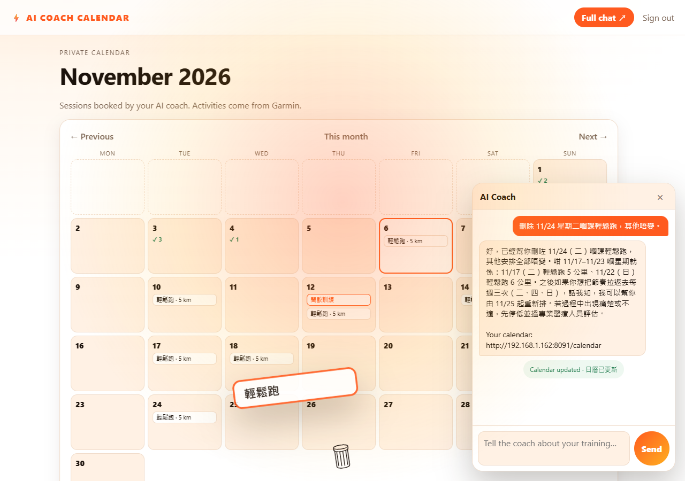

# POC3 — Calendar-first AI coach

**Status:** standalone proof of concept · **Surface:** private calendar + training log + in-calendar coach bubble · **Repo:** training-planner-3

---

## 1. What POC3 is

POC3 keeps the conversation, memory and planning, but moves the **calendar to the centre of the product**. After signup and
login the runner lands on a private month calendar. The coach lives in a bubble on that page: the runner talks to it, and the calendar
is the coach's working surface — it books, moves and deletes sessions in front of the runner, with a page-wide animation.

The product has two projections of the same training data: **Plan** (the calendar) and **Training log** (`/history`). The
training log shows what Garmin actually recorded, grouped by week, beside the session that was planned for that day. The
week view adds a **training-load card** (load, ACWR, week change, hard/easy split) and a one-tap **Review my week** prompt.
Each run opens an **activity detail** with plan-vs-actual distance/duration deltas, richer Garmin metrics, fastest efforts,
**per-kilometre splits**, **Garmin laps/intervals**, **HR-zone time** and **PR badges**; month/year views add period
**best efforts**. The log also carries adaptive volume and pace/HR trends. It is read-only: the past is a fact; the coach
can discuss it and adjust the future plan, never rewrite it.

The coach is not a human. It is an LLM behind a small server that validates every proposal before writing anything. The
calendar is **system-owned**: it is not the runner's Google/Outlook calendar, and the runner never has to curate it by hand.

POC3 is deliberately narrower than the earlier proofs:

- **Standalone product.** The calendar, the training log and the bubble are the product.
- **Standalone accounts.** Multiple runners can sign up; every account has its own profile, calendar, conversations and
  change history. Admin tooling is out of scope.
- **The coach is the only writer.** There is no manual edit form; the bubble is the edit path.
- **Every edit is auditable.** Each batch is stored with before/after snapshots and can be undone by another coach turn.

---

## 2. Why calendar-first

| Problem with chat-first | POC3 answer |
|---|---|
| A chat thread hides the plan; the runner has to remember what was booked | The plan is visible immediately: month grid, today ring, Garmin completions |
| "Coach said it changed something" is hard to verify | Every change is a visible cell edit + animation + `poc3.changes` metadata |
| "Did I actually do the plan?" is a separate question | The **Training log** shows actual Garmin activities beside the planned session for each day |
| Chat UIs are generic; a training plan has days, weeks and load | Calendar-native CRUD, batch edits, day detail |
| Embedding a separate chat application is heavy (iframe, cookies, double login) | A same-origin bubble: no iframe, no second login, direct DOM access for animation |

The design decision is recorded in [`adr/0002-calendar-first-bubble.md`](adr/0002-calendar-first-bubble.md).

---

## 3. The user journey

1. Open `http://<host>:8091/signup`, create an account (username, display name, password, timezone, optional goal), then
   sign in.
2. Land on **November 2026** (or the current month). Empty days are dashed; booked days carry session chips; Garmin days
   carry a `✓ n` badge. The nav shows your display name, a **sync icon**, a **notification bell**, and links to **/profile**.
   The coach header shows the booking limit: **Bookings up to 180 days ahead · 可預約未來 180 日**.
3. Click **💬 Coach** (bottom-right). Tell it a goal or a constraint:
   - "I want to run a 10k in 8 weeks."
   - "Move Tuesday's run to Wednesday and delete Sunday's."
   - "I only have 30 minutes on weekdays."
4. The coach replies in the bubble and books the plan. The month grid updates **in place**; changed days animate.
5. The coach returns 1–3 tappable suggestions after every turn; when there are none, the rail keeps starter prompts.
   To undo, the runner simply asks the coach in conversation (for example "undo the last change"); there is no history
   panel or Undo button.
6. Sync Garmin from the top-bar **sync icon** next to the notification bell. With no saved key, the icon opens a
   guide/popup; create a Personal API key, paste it, verify it with **Show**, and save. With a saved key the icon syncs
   immediately. The last 90 days are pulled in; repeated syncs update by per-runner activity id. The bell is the sync feed:
   manual/key syncs confirm even when nothing is new, automatic no-change checks stay silent, and errors always appear.
   Its **Garmin key** link reopens the popup to replace the key.
7. Switch to **Training log**. Use **Week / Month / Year** plus the period picker: week shows seven day cards, month
   shows week rows and year shows month rows. Previous/next, the current-period shortcut and the date/month/year picker
   make old periods reachable without a long scroll.
8. Open a run's **Detail** for the full metrics, plan-vs-actual comparison, rich Garmin metrics, fastest 1 km / 1 mi / 5 km
   efforts, per-kilometre splits, Garmin lap/interval summaries, HR-zone time and PR badges, then ask the coach about that
   specific run. Month and year views show a period **Best efforts** card.
9. A new browser session (login or a resumed auth cookie) auto-syncs Garmin when a key is saved; page loads also sync when
   the last pull is more than 10 minutes old. A genuinely new run produces a **Review this run with the coach** prompt; the
   week view also carries a **Review my week** prompt built from the selected week's load. Both stay one tap, never an
   unsolicited message.

---

## 4. Architecture

```
┌─────────────────────────────────────────────────────────────────────┐
│ Browser                                                             │
│  :8091/calendar   month grid + day cells + Garmin badges            │
│  :8091/history    training log: week/month/year + load + bests       │
│  period switch    Week | Month | Year + prev/next/picker             │
│  :8091/activity   run + plan-vs-actual + metrics + splits + laps     │
│                   + HR zones + PR badges                             │
│  view switch      Plan | Training log                                │
│  💬 Coach bubble  self-implemented HTML/CSS/JS, same-origin          │
│        │ POST /chat                                                  │
└────────┼────────────────────────────────────────────────────────────┘
         ▼
┌──────────────────────┐        ┌─────────────────────────────────────┐
│ POC3 web (:8091)     │        │ POC3 gateway (:8090)                │
│ src/web.ts           │───────▶│ src/gateway.ts                      │
│ - signup/login/      │  HTTP  │ - OpenAI-compatible /v1/chat/...    │
│   profile/cookie     │        │ - prompt (30 activities + plans)    │
│ - month/day render   │        │   + validate + apply CRUD           │
│ - /calendar/data     │        │ - change sets + revert + suggestions│
│ - /history + /activity│       └───────────────┬─────────────────────┘
│ - /sync + auto-sync  │                       ▼
└──────────┬───────────┘           ┌──────────────────────────────┐
           │                       │ SQLite (node:sqlite)         │
           │                       │ messages, memories,          │
           │                       │ sessions, activities,        │
           │                       │ sync_state, change_sets      │
           │                       └──────────────────────────────┘
           ▼
   Garmin Personal API
   activities + activity summary/laps + detail samples
```

Key properties:

- **One store.** The calendar page and the gateway share the same SQLite file. The bubble never talks to the LLM directly;
  it always goes through `/chat` → gateway.
- **No iframe.** The bubble is part of the calendar document (ADR-0002). It can read the month cells and animate them.
- **Server-side validation.** The model proposes; `parseCoachTurn` validates day, horizon, kinds, counts and CRUD ids before
  any write (ADR-0001).
- **Accounts are server-side.** `src/auth.ts` hashes passwords with scrypt and issues a signed `poc3_session` cookie; every
  route resolves the current user and scopes all reads/writes to that `userId`.
- **The calendar is a projection.** The booking is stored in SQLite; the calendar page reads SQLite.
- **The training log is a read-only projection.** It joins activities to sessions by day and groups them by week; it never
  writes the past. `src/training.ts` matches each run to at most one planned session by distance tolerance, so the log can
  show on-plan / short / long / unplanned rather than pretending every run is a plan.
- **Three history periods.** Week is the day-level drill-down, month summarizes calendar weeks, and year summarizes
  months. The mode switch keeps the period anchor; month/year rows drill into the next level.
- **Load is a soft weekly signal.** The week card sums Garmin training load, shows a coupled 7/28-day ACWR, the
  week-over-week change and the hard/easy split from Garmin training-effect labels. It is guidance, not a diagnosis.
- **Run detail is on demand.** The sync stores the list metrics (load, cadence, elevation, effect, fastest splits, HR-zone
  seconds); the detail page fetches Garmin activity samples for per-kilometre splits and the activity summary for
  lap/interval splits. A failed detail or summary request degrades only its own section.
- **Best efforts are period-scoped.** Month/year views show the fastest 1 km / 1 mi / 5 km in that period; the activity
  detail marks a fastest effort as **PR** when it holds the stored-history best. Ties go to the later day.
- **Auto-sync backs off.** Page loads call Garmin only when `sync_state.last_synced_at` is older than 10 minutes; the manual
  sync button shares the same helper and records the same timestamp.
- **Changes are auditable.** The gateway writes one `ChangeSet` per batch with before/after snapshots; a later coach turn can
  revert it.

---

## 5. Surfaces

| Surface | URL | Implementation | Purpose |
|---|---|---|---|
| Private calendar | `/calendar` (`:8091`) | `src/web.ts` + `src/styles.ts` | month grid, day detail, Garmin badges |
| Training log | `/history?view=week\|month\|year&period=...` (`:8091`) | `src/web.ts` + `src/styles.ts` + `src/training.ts` | week = seven day cards, month = week rows, year = month rows; plan-match badges, weekly load/ACWR/hard-easy card, Review my week prompt, period best efforts, adaptive summary/trends, Ask coach, auto-sync review prompt |
| Period selector | Week / Month / Year | `src/web.ts` + `src/styles.ts` | mode switch, previous/next/current and date/month/year picker; preserves the period anchor |
| Activity detail | `/activity/<activityId>` (`:8091`) | `src/web.ts` + `src/garmin.ts` + `src/training.ts` | one run's metrics, rich Garmin metrics, fastest efforts, per-kilometre splits, Garmin laps/intervals, HR zones, PR badges, planned-vs-actual deltas, comparison bars, Ask coach |
| View switcher | Plan / Training log | `layout()` in `src/web.ts` | sliding segmented control between the two projections |
| Coach bubble | bottom-right of both views | self-implemented in `renderChatBubble()` | short turns, bookings, CRUD, revert, suggestions, animation; reloads the recent conversation on open |
| Coach gateway | `:8090/v1` | `src/gateway.ts` | OpenAI-compatible model `poc3-coach`; the only writer |
| Accounts | `/signup`, `/login`, `/logout` | `src/auth.ts` + `src/web.ts` | standalone multi-user accounts |
| Profile | `/profile` | `src/web.ts` | display name, timezone, goal, optional password change |
| Day detail | `/day/YYYY-MM-DD` | `src/web.ts` | one day's sessions and activities, with detail links |
| Garmin sync | `POST /sync` + page-load auto-sync | `src/garmin.ts` + `src/web.ts` | pull the last 90 days; repeated sync upserts and enriches activity metrics; detail samples fetched on demand; 10-minute auto-sync backoff |

The bubble is a same-origin client of `/chat`; it is not an iframe, widget or API-key embed.

---

## 6. Data model

SQLite tables (created by `src/store.ts`):

| Table | Key fields | Notes |
|---|---|---|
| `messages` | `message_id`, `user_id`, `role`, `text`, `created_at` | conversation history for prompt context |
| `memories` | `memory_id`, `user_id`, `text`, `created_at` | durable facts the coach chose to remember |
| `sessions` | `session_id`, `user_id`, `day`, `payload`, `created_at` | the training plan; `payload` is the full session JSON |
| `activities` | `activity_id`, `user_id`, `day`, `payload`, `created_at` | Garmin activities mapped to calendar days; composite primary key `(user_id, activity_id)`, so two runners can store the same Garmin activity independently; repeated sync updates and enriches the payload |
| `sync_state` | `user_id`, `last_synced_at` | per-runner auto-sync backoff timestamp |
| `garmin_keys` | `user_id` (PK), `saved_at`, `api_key` | one verified Garmin Personal API key per runner; plaintext |
| `notifications` | `notification_id`, `user_id`, `created_at`, `read_at`, `payload` | top-bar tray; success/error sync results, newest first |
| `users` | `user_id`, `username` (unique, case-insensitive), `payload`, `created_at` | standalone account + profile + password hash |
| `change_sets` | `change_set_id`, `user_id`, `created_at`, `payload`, `reverted_at` | audit log; payload has before/after entries |

Session payload:

```json
{
  "sessionId": "session:<sha256(userId:day:kind:title)[0..32]>",
  "userId": "u_<uuid>",
  "day": "2026-11-10",
  "title": "輕鬆跑",
  "kind": "easy",
  "distanceKm": 5,
  "durationMin": 35,
  "note": "可以邊跑邊講嘢嘅速度",
  "createdAt": "2026-11-06T01:00:00.000Z"
}
```

The session id is deterministic for an add (`day + kind + title`), so re-planning the same booking replaces it instead of
duplicating. `update` and `remove` target the existing id supplied by the prompt facts.

Activity payload (optional metrics omitted when Garmin does not provide them):

```json
{
  "activityId": "garmin:25064556308",
  "userId": "u_<uuid>",
  "day": "2026-11-13",
  "title": "新界 跑步",
  "distanceKm": 5.4,
  "durationMin": 28,
  "paceSecPerKm": 311,
  "avgHr": 139,
  "source": "garmin",
  "createdAt": "2026-11-15T05:46:42.728Z",
  "elevationGainM": 5,
  "calories": 348,
  "maxHr": 151,
  "cadenceSpm": 173,
  "strideLengthCm": 110.9,
  "groundContactMs": 251,
  "aerobicTrainingEffect": 3.1,
  "anaerobicTrainingEffect": 0,
  "trainingLoad": 92.6,
  "trainingEffectLabel": "AEROBIC_BASE",
  "fastest1kSec": 294,
  "fastest1miSec": 491,
  "fastest5kSec": 1557,
  "hrZone1Sec": 240,
  "hrZone2Sec": 600,
  "hrZone3Sec": 300,
  "hrZone4Sec": 60,
  "hrZone5Sec": 0
}
```

The optional fields keep old rows and chat-created activities valid without a migration. Per-kilometre splits are **not**
stored: the detail page fetches Garmin's activity samples on demand and computes them. Garmin's own lap/interval summaries
are also fetched on demand, not stored.

`change_sets` is the audit trail. Each entry stores the full `before` and `after` session snapshots, so the inverse is
unambiguous: an add is undone by a delete, a remove by restoring the snapshot, an update by restoring the previous snapshot.
A revert is itself recorded as a new change set, so the history remains append-only.

---

## 7. The coach contract

The model proposes one `propose_calendar_turn` tool call. The tool's JSON Schema mirrors the object below; the gateway
still validates every field itself, so the schema is a contract, not a substitute for server checks.

```json
{
  "reply": "string",
  "memories": ["string"],
  "sessions": [
    {
      "action": "add" | "update" | "remove",
      "sessionId": "session:… | null",
      "day": "YYYY-MM-DD",
      "title": "string",
      "kind": "easy" | "long" | "interval" | "tempo" | "rest" | "cross" | "race" | "racewalk",
      "distanceKm": 0,
      "durationMin": 0,
      "note": "string | null"
    }
  ],
  "suggestions": ["1–3 short follow-ups"],
  "revertChangeSetId": "change:… | last | null"
}
```

A plain assistant message with no tool call is a valid **clarification** turn. It writes nothing; it is how the coach asks
which day the runner meant instead of guessing.

Rules enforced by `src/coach.ts`:

- `add` and `update` need a day in `[today, today + 180]`; a past day is rejected. A month/day without a year resolves to the next occurrence on or after today.
- `update` and `remove` need an existing `sessionId` from the facts.
- At most **14 actions** per turn; titles ≤ 80 chars; notes ≤ 280; distance 0–60 km; duration 0–300 min.
- `suggestions` is required: 1–3 items, each 1–120 chars. They become tappable chips in the bubble; the reply does not
  repeat them, and the rail is the only place for next steps.
- The prompt carries the last 30 Garmin activities and the last 30 days of planned sessions, so a performance question can
  compare plan with actuals. The coach must not invent splits, heart-rate zones, distances or sessions.
- If the runner names a day but not a specific session and the day has several sessions, the coach asks which one and
  writes nothing.
- If a proposed target is not in the facts, the gateway applies the rest of the batch and returns structured `failures`;
  the UI renders them as a "Not applied · 未套用" card instead of appending an English note to the reply.
- `revertChangeSetId` is optional: an existing change-set id, or `"last"` for the newest non-reverted batch. A turn cannot
  combine a revert with `sessions`; that is rejected with zero writes.
- Unknown keys, wrong types, invalid kinds and malformed days reject the whole turn.
- A rejected turn writes **nothing**; the reply is a deterministic fallback only after the repair budget is exhausted.
- The prompt includes the last 10 turns as date-stamped "Conversation so far", the upcoming schedule with session ids,
  the last 30 activities, the last 30 days of planned sessions, the recent change sets (id, summary, createdAt, revertedAt),
  and the authoritative `today`, `timezone`, `weekday`, `tomorrow` and `horizonEnd`.

### Validation feedback loop

A proposal that fails validation is not immediately converted into a fallback. The gateway returns a structured tool
result to the model:

```json
{
  "ok": false,
  "code": "past-session",
  "issues": [
    { "path": "sessions[0].day", "code": "past-session", "message": "2026-11-06 is before today 2026-11-12." }
  ],
  "context": {
    "today": "2026-11-12",
    "timezone": "Asia/Hong_Kong",
    "weekday": "Thursday",
    "tomorrow": "2026-11-13",
    "horizonEnd": "2027-05-11"
  },
  "attempt": 1,
  "maxAttempts": 2,
  "policy": "ask-user"
}
```

The model gets one repair attempt (`POC3_MAX_ATTEMPTS`, default `2` total). It may correct the proposal or ask one short
clarifying question. The fallback is used only when the budget is exhausted or the model transport fails.

The policy is intentionally conservative:

| Code | Policy | What the model should do |
|---|---|---|
| `invalid-json`, `schema-echo`, `extra-keys`, `invalid-suggestions` | `repair-format` | Correct the format silently |
| `past-session` | `ask-user` | Do not silently move the date; ask or use a date the runner explicitly gave |
| `session-too-far` | `explain-limit` | Explain the 180-day limit; remember the goal; book nothing beyond it |
| `missing-session-id`, `invalid-action`, `invalid-session-kind` | `ask-user` | Re-read the facts and ask rather than inventing a session |

### Idempotent turns and audit

The browser sends an `x-poc3-request-id`; the web proxy forwards it to the gateway. The gateway records one
`coach_turns` row per request:

- `in_progress` — claimed before the first model call;
- `completed` — cached response, attempts, validation code and outcome;
- `failed` — transport/model failure; a retry with the same id may claim it again.

A repeated completed id returns the cached response with `x-poc3-idempotent-replay: true`; an in-flight duplicate returns
`409`. The `poc3` response block includes `attempts`, `outcome` (`committed`, `clarified` or `fallback`) and
`validationCode`.

### Timezone and dated history

`today` is computed in the runner's IANA timezone, not in server UTC. Conversation history is rendered as
`[YYYY-MM-DD HH:mm] Runner:` / `Coach:` in the same zone. The prompt states that those dates are historical, and a bare
follow-up such as “go” does not carry a date. This prevents a stale “today is 6 November” message from being reused on
12 November.

### CRUD, in one turn or many

A single reply may contain a batch of actions across days:

```json
"sessions": [
  { "action": "update", "sessionId": "session:a", "day": "2026-11-11", … },
  { "action": "update", "sessionId": "session:b", "day": "2026-11-13", … },
  { "action": "remove", "sessionId": "session:c" },
  { "action": "add",    "day": "2026-11-20", … }
]
```

The gateway applies the batch in order, records one change set with before/after snapshots, and returns the changes for
the UI:

```json
{
  "poc3": {
    "sessions": 4,
    "memories": 1,
    "changes": [
      { "action": "update", "fromDay": "2026-11-10", "toDay": "2026-11-11", "title": "輕鬆跑", "kind": "easy" },
      { "action": "remove", "fromDay": "2026-11-17", "toDay": null, "title": "輕鬆跑", "kind": "easy" }
    ],
    "changeSetId": "change:…",
    "reverted": false,
    "suggestions": ["加一次週末長跑", "將星期五改去星期六"],
    "failures": [
      { "action": "remove", "sessionId": "session:…", "title": "15 min drill", "day": "2026-11-13", "reason": "session-not-found" }
    ]
  }
}
```

### Change history and undo

Every batch is stored as a `ChangeSet` with `entries: ChangeEntry[]`. Each entry carries the full `before` and `after`
session snapshots, the action and the old/new day:

```ts
interface ChangeEntry {
  action: "add" | "update" | "remove" | "revert";
  sessionId: string;
  before: TrainingSession | null;
  after: TrainingSession | null;
  fromDay: string | null;
  toDay: string | null;
  title: string;
  kind: SessionKind;
}
```

A later coach turn can undo it by returning `revertChangeSetId` (or `"last"`). The gateway applies the inverse in reverse
order:

- `add` → delete the added session
- `remove` → restore the `before` snapshot
- `update` → restore the `before` snapshot (including a move back to `fromDay`)

The revert is itself appended as a new change set (`summary: "Undo: …"`), and the original set is marked `revertedAt`. This
keeps the log append-only and auditable. The log is internal: there is no history panel and no `/calendar/history` route.
Undo is intentionally **not a button**: the runner orders it inside the conversation, and the coach uses the same validated
revert path. There is no direct revert API shortcut.

---

## 8. Calendar and training log UX

- **View switcher** under the app bar: a sliding segmented control, **Plan | Training log**, with the active pill sliding to
  the current view. The profile page shows neither tab active. The switcher is on every signed-in page.
- **Month grid** with Monday-first weeks, today ring, out-of-month dimming, previous/next month. There is no separate month
  heading; the middle nav is the month display and shows the **month you are viewing** (for example December 2026).
  Clicking it opens the **year/month picker**: pick any year (2000–2100) and any month, or use **This month** inside the
  picker to jump back.
- **Session chips** carry title + distance; colours by kind (`easy`, `long`, `interval`, `tempo`, `rest`, `cross`, `race`, `racewalk`).
- **Garmin badge** `✓ n` on days with activities.
- **Training log periods** (`/history`): a **Week / Month / Year** mode switch with previous/next, a current-period shortcut
  and a period picker. Week shows seven day cards (Mon–Sun), month shows calendar-week rows and year shows month rows. The
  summary and trends follow the selected period; the log is read-only.
- **Period selector**: Week uses a date input (a chosen day snaps to its Monday), Month uses a month input, Year uses a
  2000–2100 select. The mode switch keeps the anchor (week → its month/year, month → its first/current week, year →
  January/current month).
- **Week view**: each day shows planned session chips, a match badge (**On plan / Short / Long / Unplanned**), activity rows
  (distance, time, pace, HR, source) with **Ask coach**, **Detail** and **View plan**, and "No activity recorded" or "No
  session or activity" for empty days.
- **Training load card** (week only): the Garmin load sum, a coupled 7/28-day ACWR, the week-over-week change and the
  hard/easy kilometres and minutes from Garmin training-effect labels. A signal chip shows **Steady**, **Watch the ramp**,
  **High ramp**, **Not enough history** or **No load data**. The **Review my week with the coach** button sends a prompt with
  the selected week's actual/planned/load figures. The card calls this a soft signal, not medical advice.
- **Month and year rows**: a month lists its weeks with runs/km/time/planned km and **View week**; a year lists its months
  with **View month**. This is the drill-down path from a year to a single day.
- **Period best efforts**: month and year views show the fastest 1 km / 1 mi / 5 km in that period with the date and
  activity title. A run that holds the stored-history best shows a **PR** badge on its detail page; ties go to the later
  day.
- **Trends** adapt: week = daily volume, month = weekly volume, year = monthly volume; pace and HR lines use the selected
  period's runs; consistency is active days / weeks / months. Charts are server-rendered SVG aggregate trends;
  per-kilometre splits live on the activity detail.
- **Activity detail** (`/activity/<id>`): full metrics, a planned-vs-actual card with distance/duration deltas and comparison
  bars, richer Garmin metrics (elevation, calories, max HR, cadence, stride, ground contact, training effect and load),
  fastest 1 km / 1 mi / 5 km efforts with **PR** badges, a **per-kilometre splits** table computed on demand from Garmin
  detail samples, **Garmin laps/intervals** from the activity summary, an **HR-zone** stacked bar/legend, Ask coach, and
  links back to the day and the plan. A failed detail or summary request degrades only its own section; the stored metrics
  still render. A run that no session fits is labeled unplanned rather than forced onto a plan.
- **Auto-sync and review prompt**: page loads pull Garmin when the last sync is older than 10 minutes. A genuinely new run
  shows a **Review this run with the coach** card; the coach turn stays one tap, not an unsolicited message.
- **Bubble** is a full-height floating panel: the log fills the available height and scrolls, with suggestions and the input
  pinned below; desktop and mobile both use the viewport height. The header's `−` button minimizes the panel back to the
  💬 Coach bubble; the conversation and rail stay in the DOM, so reopening is instant.
- **Suggestion rail** above the composer: starter prompts on first open or when a turn has no suggestions; otherwise the
  coach's 1–3 follow-ups. The rail grows with its content and never scrolls; the log is the only scrolling area. Tapping a
  chip sends it as the next message.
- **In-place refresh**: after a turn the bubble clears every day cell and re-renders from `/calendar/data`. The server omits
  days with nothing left, so a deleted session's chip disappears immediately; no page reload is needed.
- **Not applied card**: when a proposed target is missing, the reply stays clean and a card lists the action, title, day
  and reason, with `Show {day}` and `Try again`. A short localized note is stored with the message so the failure survives
  a history reload.

The states below were rendered in headless Chrome from a live fixture:


- **CRUD animation** (verified in headless Chrome):
  - `update`: the chip leaves the old cell, flies in an arc to the new day, scales up and rotates; the target cell pulses green.
  - `remove`: the chip flies into a bin at the bottom centre, shrinks and fades; the old cell pulses red and the bin pops.
  - `add`: the new chip pops into the target day.
  - Multiple changes leave in a **140 ms stagger**, so a multi-day edit reads as one coordinated action.
  - A full-page warm flash + short shake runs behind the animation. The grid is refreshed **before** the animation, so the
    end state is correct even if the animation is interrupted.



### Day actions

Clicking a day cell opens a small menu anchored to that day:

| Choice | What it does |
|---|---|
| Add a session here | Opens the coach bubble with `Add a session on YYYY-MM-DD: ` prefilled; the runner completes the request |
| Move a session here | Prefills `Move a session to YYYY-MM-DD: ` so the runner names the source |
| Delete a session here | Sends `Delete the session on YYYY-MM-DD.`; disabled when the day has no session |
| Ask coach about this day | Sends `What is planned on YYYY-MM-DD? Review it and suggest changes.` |
| View day details | Navigates to `/day/YYYY-MM-DD` |

All write choices go through the coach; there is no direct edit API. The menu closes on Escape, outside click, or after a
choice, and is keyboard reachable (Enter/Space on a focused day).

---

## 9. Garmin

`src/garmin.ts` calls the Garmin Personal API:

- Token endpoint returns a **bare JWT as `text/plain`**, not JSON; the client handles both.
- Activities: `activitylist-service/activities/search/activities?start=0&limit=N` with `Authorization: Bearer <jwt>`.
- `mapGarminActivity` maps an activity to the core record plus optional list metrics: elevation, calories, max HR,
  running cadence, stride length, ground-contact time, aerobic/anaerobic training effect, training load, training-effect
  label, fastest 1 km / 1 mi / 5 km splits and HR-zone seconds.
- Activity detail samples: `GET /activity-service/activity/{id}/details` returns metric descriptors and a per-sample stream.
  The detail page calls it on demand, finds `sumDistance`, `sumDuration` and `directHeartRate`, interpolates each 1,000 m
  crossing and renders per-kilometre splits plus the final partial split.
- Activity summary/laps: `GET /activity-service/activity/{id}` returns `splitSummaries`. `mapGarminLaps` maps the lap type,
  distance, duration, pace, HR, elevation and cadence; the detail page shows them as **Garmin laps / intervals**, separate
  from the per-kilometre splits. A single whole-run lap is hidden.
- HR zones: the list's `hrTimeInZone_1..5` seconds are stored; the detail page shows a stacked bar and legend. Zone
  boundaries are defined in Garmin and are not stored in POC3.
- `POST /sync`, the page-load auto-sync and the session-start sync share `src/garmin-sync.ts`: fetch up to **100** activities
  (the Garmin list endpoint's supported maximum), keep the last **90 days**, upsert by `(user_id, activity_id)` (a repeated
  sync updates and enriches instead of throwing; two runners may store the same Garmin activity independently), count new
  versus processed rows, and record `sync_state.last_synced_at`. Existing databases are migrated on startup from the old
  global `activity_id` primary key to the composite key; every stored activity row is preserved.
- The top-bar **sync icon** next to the notification bell is the manual trigger. With no saved key it redirects to the key
  popup; with a saved key it syncs and reloads the page. The result is recorded in the bell, not as a page banner. The popup
  explains where to create a Garmin Personal API key, offers **Show** so the full pasted key can be checked, verifies the key
  against the token endpoint, then stores it per runner and syncs immediately. The bell's **Garmin key** link reopens the
  popup; it shows the masked current key (`••••1234`) when replacing.
- A new browser session — a login or a resumed `poc3_session` auth cookie without a live `poc3sid` session — starts one
  background pull when a key is saved. Page loads also pull when the last sync is older than **10 minutes**; a failure backs
  off for the same interval. Manual `/sync` and `/garmin/key` requests skip the session auto-sync so they cannot double-pull.
- The top-bar notification bell polls `/notifications` and is the single sync feed. Explicit manual/key syncs always record
  a result, including **Garmin sync: no new activities** with the checked count. Automatic session/page syncs record only
  when new activities are added or an error occurs; routine no-change checks stay silent. The old **Auto-synced N** and
  **Garmin sync: N imported** page banners are gone. A success notification names the newest genuinely new activity and links
  to its month; the training-log review card appears only for a genuinely new activity. A 401/403 links back to the key
  popup; other errors link to the training log. `src/garmin-errors.ts` turns 401, 403, 429 and 400 responses into actionable
  text, including Garmin's `retryInSeconds` / `count` / `limit` rate-limit body.
- Garmin is the completion source; the coach is the booking source. Keys are per runner, stored plaintext in SQLite and never
  shown again in full; there is no deployment-wide Garmin key. Activity IDs are per runner too, so the same Garmin activity
  can be stored for multiple accounts without one runner's row blocking another.

---

## 10. HTTP API

### Gateway (`:8090`)

| Method | Path | Purpose |
|---|---|---|
| `GET` | `/health` | liveness + model name |
| `GET` | `/v1/models` | OpenAI-compatible model list (`poc3-coach`) |
| `POST` | `/v1/chat/completions` | one coach turn; `stream` supported (single-chunk SSE); optional `x-poc3-request-id` for idempotency |

The gateway binds `127.0.0.1` and trusts the internal `x-poc3-user` header set by the web server; the browser never talks to
it directly. The web surface is the authenticated entry point.

A completed request id is replayed from `coach_turns` with `x-poc3-idempotent-replay: true`; a duplicate while the first
request is still running gets `409 turn-in-progress`.

### Calendar web (`:8091`)

| Method | Path | Purpose |
|---|---|---|
| `GET`/`POST` | `/signup` | create a standalone account (username, display name, password, timezone, goal) |
| `GET`/`POST` | `/login` | password login; sets the signed `poc3_session` cookie plus the browser `poc3sid` session cookie and starts a sync when a key is saved |
| `GET` | `/logout` | clears both cookies |
| `GET`/`POST` | `/profile` | display name, timezone, goal, optional password change |
| `GET` | `/calendar?month=YYYY-MM` | month grid (authenticated, user-scoped) |
| `GET` | `/history?view=week\|month\|year&period=...` | training log period views; default week/current; week period is a date (snapped to Monday), month `YYYY-MM`, year `YYYY`; week includes the load card and weekly review prompt; month/year include period best efforts |
| `GET` | `/activity/<activityId>` | one run's detail with rich Garmin metrics, fastest efforts with PR badges, per-kilometre splits, Garmin laps/intervals, HR zones and planned-vs-actual comparison; 404 for a foreign or missing id |
| `GET` | `/day/YYYY-MM-DD` | day detail |
| `GET` | `/calendar/data?month=YYYY-MM` | JSON used by the in-place refresh |
| `POST` | `/chat` | bubble proxy → gateway; forwards `x-poc3-request-id`; returns `{reply, sessions, changes, suggestions, failures, changeSetId, reverted}` |
| `GET` | `/chat/history` | the signed-in runner's recent messages, oldest first (used to restore the bubble after refresh) |
| `POST` | `/sync` | manual Garmin pull (last 90 days, upsert and metric enrichment); no saved key redirects to the popup; `next` selects `/calendar` or `/history` |
| `POST` | `/garmin/key` | verify a pasted Personal API key, save it per runner, sync immediately; malformed/rejected keys return to the popup with `keyError` |
| `GET` | `/notifications` | newest 20 sync notifications plus the unread count for the signed-in runner |
| `POST` | `/notifications/read` | mark every unread notification for the runner as read |
| `GET` | `/static/app.css` | styles (linked with a version query for cache busting) |

All page routes except `/login`, `/signup`, `/health` and `/static/app.css` redirect unauthenticated requests to `/login`.

---

## 11. Run it

Requirements: Node.js 24+, pnpm 12+ (or npm), a model endpoint that speaks OpenAI chat completions.

```bash
pnpm install
```

Set the minimum environment (PowerShell shown):

```powershell
$env:POC3_AUTH_SECRET='<long random secret>'
$env:POC3_DB='sqlite:data/poc3.sqlite'
$env:POC3_MODEL_BASE_URL='http://192.168.1.202:8102/v1'
$env:POC3_MODEL_API_KEY='<model key>'
$env:POC3_MODEL_NAME='dgx/general'
$env:POC3_MAX_ATTEMPTS='2'
pnpm dev
```

Then:

- Sign up: `http://127.0.0.1:8091/signup`
- Calendar: `http://127.0.0.1:8091/calendar`
- Gateway: `http://127.0.0.1:8090/health`

Ports: `POC3_GATEWAY_PORT` (default `8090`), `POC3_WEB_PORT` (default `8091`). The live deployment uses
`POC3_GATEWAY_PORT=8092` and `POC3_WEB_PORT=8093`.

After signing in, use the top-bar **sync icon** once: with no saved key it opens the guide/popup, verifies the pasted
Personal API key, stores it for that account, and syncs. The bell's **Garmin key** link reopens the popup later. No Garmin
key belongs in the environment.

### Environment reference

| Variable | Default | Meaning |
|---|---|---|
| `POC3_GATEWAY_PORT` | `8090` | gateway port |
| `POC3_WEB_PORT` | `8091` | calendar port |
| `POC3_DB` | `sqlite:data/poc3.sqlite` | SQLite spec; directory is created |
| `POC3_AUTH_SECRET` | `poc3-dev-secret-change-me` | HMAC secret for the signed session cookie; set a strong value |
| `POC3_USER_ID` | `demo-runner` | gateway fallback when no `x-poc3-user` header |
| `POC3_MODEL_BASE_URL` | `http://192.168.1.202:8102/v1` | OpenAI-compatible endpoint |
| `POC3_MODEL_API_KEY` | empty | model bearer |
| `POC3_MODEL_NAME` | `dgx/general` | model name |
| `POC3_MODEL_ID` | `poc3-coach` | id exposed by the gateway |
| `POC3_MAX_ATTEMPTS` | `2` | initial proposal + repair calls per turn |
| `POC3_GATEWAY_URL` | `http://127.0.0.1:8090` | web → gateway |

Never commit real keys or `.env` files.

---

## 12. Testing and gates

```bash
pnpm lint
pnpm typecheck
pnpm test
```

Current state: **170 tests in 9 files** — auth (signup/login/cookie/profile), coach contract/actions/suggestions/revert,
gateway streaming + CRUD + batch + change sets + revert + repair loop + native tool calls + timezone + idempotency,
store users/change sets/coach turns/transactions/per-user activity upsert/old-schema migration/sync state/per-runner Garmin keys/notifications,
plan-vs-actual matcher, weekly load/ramp and hard/easy classification, personal bests and period bests, Garmin
mapping/token quirks/response bodies/enriched metrics/HR zones/detail fetch/summary fetch/per-kilometre split parser/lap
mapper/error copy, cross-user Garmin sync of the same activity, calendar web + conversation reload + week/month/year training log + period selector + load card + weekly
review prompt + rich activity detail + per-kilometre splits + Garmin laps + HR zones + PR badges + period best efforts +
trends + key popup/save/verify + always-enabled sync + manual no-new confirmations + silent automatic no-change checks +
newest-new notification targeting + session-start sync + page-load auto-sync backoff + idempotent Garmin sync.

The lint gate is `tools/lint.mjs`: no `console` in `src` except `index.ts`, no `TODO`, no `any`, no obvious secrets.

---

## 13. Honest limits

1. **No streaming in the bubble.** `/chat` waits for the whole reply; the gateway supports streaming, but idempotency is
   applied only to non-streaming completions.
2. **Auth is PoC-grade.** The default `POC3_AUTH_SECRET` must be replaced; there is no email verification, password reset,
   rate limit or session revocation list.
3. **The gateway trusts `x-poc3-user`.** It binds localhost and is meant to sit behind the web server; do not expose it.
4. **No manual edit form.** The coach is the only writer by design; the runner can only ask it.
5. **No external calendar sync.** Google/Outlook/CalDAV are out of scope.
6. **Single-process SQLite.** Fine for a PoC; not a multi-instance production store. `coach_turns` has no lease timeout, so
   an in-flight request left by a process crash needs manual cleanup.
7. **Animation is best-effort.** It is DOM/CSS/Web Animations; reduced-motion users get the grid update without the flourish.
8. **One repair, not an agent loop.** The model gets one bounded repair call; it is not allowed to iterate indefinitely.
9. **Per-kilometre splits are computed, not Garmin's own lap splits.** The detail page fetches Garmin's per-sample
   activity-detail stream on demand, interpolates each 1,000 m crossing and keeps the final partial split. Garmin's own
   `splitSummaries` are shown separately as laps/intervals; FIT parsing, pace zones and HR-zone charts remain later slices.
   A detail or summary request can be large or return 403; each section falls back independently.
10. **Auto-sync is session-start plus page-load, not a scheduler.** A new browser session (login or a resumed auth cookie)
    pulls once when a key is saved; page loads back off for 10 minutes. There is no background scheduler. The pull is limited
    to the last 90 days and at most 100 activities. The key is saved per runner from the calendar popup.
11. **Plan matching is heuristic.** `src/training.ts` greedily matches at most one activity to one session by distance
    tolerance; it is not a stored activity-to-session link. A run can be labeled unplanned, and a session can be unmatched.
12. **The post-run review is a prompt, not an unsolicited model turn.** After a sync the log shows a one-tap review card;
    it does not call the LLM or write a message without the runner's action.
13. **Per-runner Garmin key, stored plaintext.** Each account saves its own Personal API key; there is no Garmin OAuth flow.
    The key is kept in SQLite in plaintext and sent over the private HTTP deployment, so use a trusted network and a private
    server. The browser session cookie (`poc3sid`) lives in memory and lasts 24 hours; a server restart creates a new session
    and triggers the session-start pull again.
14. **History is a bounded period, not infinite scroll.** Month and year rows are summaries; drill down to a week for day
    details. There is no "load more" paging.
15. **The period picker is deliberately small.** Year is limited to 2000–2100; the week picker snaps to Monday; month
    views include partial calendar weeks at the edges.
16. **Garmin's list endpoint is capped at 100 activities per pull.** The last-90-days filter runs after that cap; a runner
    with more than 100 activities in 90 days will not see the oldest ones until a larger history sync exists.
17. **Training load is Garmin's proprietary value.** The week card displays it; POC3 does not recompute Garmin's algorithm.
    ACWR is a coupled 7/28-day rolling average and a soft signal, not an injury prediction. Hard/easy uses training-effect
    labels; activities without labels are left out of that split.
18. **The weekly review is a prompt, not an automatic model turn.** The load card offers a one-tap prompt; the coach is not
    called until the runner taps it.
19. **HR-zone time has no boundaries.** POC3 shows Garmin's seconds per zone as a stacked bar; it does not infer or edit
    zone thresholds. A zone chart with targets is later work.
20. **PRs are stored-history bests.** The 100-activity/90-day sync window means a PR badge is a best among stored
    activities, not a complete lifetime record. A dedicated records page and longer history are later work.
21. **Garmin laps are not per-kilometre splits.** They are Garmin's own lap/interval summaries; the computed per-kilometre
    table remains the only per-km view.

---

## 14. Documents

- [`FEATURES-FOR-REVIEW.md`](FEATURES-FOR-REVIEW.md) — candidate features from PoC1/PoC2, prioritised for review.
- [`TRAINING-LOG-PLAN.md`](TRAINING-LOG-PLAN.md) — training-log research, feature inventory and the implemented load/ramp,
  rich-metrics, per-kilometre-split, lap/interval, HR-zone, best-efforts/PR and weekly-review slices.
- [`adr/0001-server-validated-coach.md`](adr/0001-server-validated-coach.md)
- [`adr/0002-calendar-first-bubble.md`](adr/0002-calendar-first-bubble.md)
- [`adr/0003-validation-feedback-loop.md`](adr/0003-validation-feedback-loop.md)
- [`design/calendar-crud-animation.png`](design/calendar-crud-animation.png)
- [`design/training-log.png`](design/training-log.png)
- [`design/training-log-week.png`](design/training-log-week.png)
- [`design/training-log-year.png`](design/training-log-year.png)
- [`design/activity-detail.png`](design/activity-detail.png)

POC3 is a proof of concept, not a production plan. The next step is the owner's review of the feature backlog and the
training-log plan.
