# POC3 ??Calendar-first AI coach

**Status:** standalone proof of concept 繚 **Surface:** private calendar + training log + in-calendar coach bubble 繚 **Repo:** training-planner-3

---

## 1. What POC3 is

POC3 keeps the conversation, memory and planning, but moves the **calendar to the centre of the product**. After signup and
login the runner lands on a private month calendar. The coach lives in a bubble on that page: the runner talks to it, and the calendar
is the coach's working surface ??it books, moves and deletes sessions in front of the runner, with a page-wide animation.

The product has three projections of the same runner: **Plan** (the calendar), **Training log** (`/history`) and
**Muscles** (`/muscle`). The training log shows what Garmin actually recorded, grouped by week, beside the session that was planned for that day. The
week view adds a **training-load card** (load, ACWR, week change, hard/easy split) and a one-tap **Review my week** prompt.
Each run opens an **activity detail** with plan-vs-actual distance/duration deltas, richer Garmin metrics, fastest efforts,
**per-kilometre splits**, **Garmin laps/intervals**, **HR-zone time** and **PR badges**; month/year views add period
**best efforts**. The log also carries adaptive volume and one **metric-selectable trend graph** (pace, heart rate, cadence,
load, distance, time, elevation) instead of separate pace and HR cards. When Garmin knows the workout a run followed, the
run's day pairs the run and the workout into one green-and-purple paired row: one click opens the run peek with the run and
the full training program together. The activity detail gets a step card, and the training-log week card and day page name the
workout. It is read-only: the past is a fact; the coach can discuss it and adjust the future plan, never rewrite it.

The coach is not a human. It is an LLM behind a small server that validates every proposal before writing anything. The
calendar is **system-owned**: it is not the runner's Google/Outlook calendar, and the runner never has to curate it by hand.

POC3 is deliberately narrower than the earlier proofs:

- **Standalone product.** The calendar, the training log and the bubble are the product.
- **Standalone accounts.** Multiple runners can sign up; every account has its own profile, calendar, conversations and
  change history. Admin tooling is out of scope.
- **The coach is the only writer of planned sessions.** There is no manual session-edit form; the bubble is the edit path.
  The day page can log a **recorded run** by hand (treadmill, commute, non-Garmin watch), which is a log entry, not a plan edit.
- **Every edit is auditable.** Each batch is stored with before/after snapshots, can be undone by another coach turn, and
  is also listed on the calendar's **Recent changes** card with an Undo button.

---

## 2. Why calendar-first

| Problem with chat-first | POC3 answer |
|---|---|
| A chat thread hides the plan; the runner has to remember what was booked | The plan is visible immediately: month grid, today ring, Garmin completions |
| "Coach said it changed something" is hard to verify | Every change is a visible cell edit + animation + `poc3.changes` metadata |
| "Did I actually do the plan?" is a separate question | The **Training log** shows actual Garmin activities beside the planned session for each day |
| Chat UIs are generic; a training plan has days, weeks and load | Calendar-native CRUD, batch edits, day detail |
| Embedding a separate chat application is heavy (iframe, cookies, double login) | A same-origin bubble: no iframe, no second login, direct DOM access for animation |

The design decision is recorded in [`adr/0002-calendar-first-bubble.md`](adr/0002-calendar-first-bubble.md).

---

## 3. The user journey

1. Open `http://<host>:8091/signup`, create an account (username, display name, password, timezone, optional goal), then
   sign in.
2. Land on **November 2026** (or the current month). Empty days are dashed; booked days carry colored plan rows; recorded
   runs carry green `✓` rows with the run's description and amount. The nav shows the **notification bell** and your display name;
   clicking the name opens the **account menu** - Profile, Coaching states, Sync Garmin now, Garmin key, Export my data and Sign out - so the
   bar itself stays minimal. The coach enforces a 180-day booking horizon and explains it when a requested date is beyond it;
   the bubble header states the horizon.
3. Click **? Coach** (bottom-right). Tell it a goal or a constraint:
   - "I want to run a 10k in 8 weeks."
   - "Move Tuesday's run to Wednesday and delete Sunday's."
   - "I only have 30 minutes on weekdays."
4. The coach replies in the bubble and books the plan. The month grid updates **in place**; changed days animate.
5. The coach returns 1?? tappable suggestions after every turn; when there are none, the rail keeps starter prompts.
   To undo, the runner simply asks the coach in conversation (for example "undo the last change"); there is no history
   panel or Undo button.
6. Sync Garmin from the **account menu** (your display name, top right) ??**Sync Garmin now**. With no saved key that row
   opens the guide/popup; create a Personal API key, paste it, verify it with **Show**, and save. With a saved key it syncs
   immediately. The last 90 days are pulled in; repeated syncs update by per-runner activity id. The bell is the sync feed:
   manual/key syncs confirm even when nothing is new, automatic no-change checks stay silent, and errors always appear.
   **Garmin key** in the same menu reopens the popup to replace the key; the same popup can remove it, which stops sync
   until the runner connects again.
7. Switch to **Training log**. Use **Week / Month / Year** plus the period picker: week shows seven day cards, month
   shows week rows and year shows month rows. Previous/next, the current-period shortcut and the date/month/year picker
   make old periods reachable without a long scroll.
8. Open a run's **Detail** for the full metrics, plan-vs-actual comparison, rich Garmin metrics, fastest 1 km / 1 mi / 5 km
   efforts, per-kilometre splits, Garmin lap/interval summaries, HR-zone time and PR badges, then ask the coach about that
   specific run. Month and year views show a period **Best efforts** card.
9. A new browser session (login or a resumed auth cookie) auto-syncs Garmin when a key is saved; page loads also sync when
   the last pull is more than 10 minutes old. A genuinely new run produces a **Review this run with the coach** prompt; the
   week view also carries a **Review my week** prompt built from the selected week's load. Both stay one tap, never an
   unsolicited message.

---

## 4. Architecture

```
???€?€?€?€?€?€?€?€?€?€?€?€?€?€?€?€?€?€?€?€?€?€?€?€?€?€?€?€?€?€?€?€?€?€?€?€?€?€?€?€?€?€?€?€?€?€?€?€?€?€?€?€?€?€?€?€?€?€?€?€?€?€?€?€?€?€?€?€????Browser                                                             ???? :8091/calendar   month grid + plan/record pills                     ???? :8091/history    training log: week/month/year + load + bests       ???? period switch    Week | Month | Year + prev/next/picker             ???? :8091/activity   run + plan-vs-actual + metrics + splits + laps     ????                  + HR zones + PR badges                             ???? view switch      Plan | Training log                                ???? ? Coach bubble  self-implemented HTML/CSS/JS, same-origin          ????       ??POST /chat                                                  ?????€?€?€?€?€?€?€?潑??€?€?€?€?€?€?€?€?€?€?€?€?€?€?€?€?€?€?€?€?€?€?€?€?€?€?€?€?€?€?€?€?€?€?€?€?€?€?€?€?€?€?€?€?€?€?€?€?€?€?€?€?€?€?€?€?€?€?€??         ?????€?€?€?€?€?€?€?€?€?€?€?€?€?€?€?€?€?€?€?€?€??       ???€?€?€?€?€?€?€?€?€?€?€?€?€?€?€?€?€?€?€?€?€?€?€?€?€?€?€?€?€?€?€?€?€?€?€?€????POC3 web (:8091)     ??       ??POC3 gateway (:8090)                ????src/web.ts           ???€?€?€?€?€?€?嗯? src/gateway.ts                      ????- signup/login/      ?? HTTP  ??- OpenAI-compatible /v1/chat/...    ????  profile/cookie     ??       ??- prompt (30 activities + plans)    ????- month/day render   ??       ??  + validate + apply CRUD           ????- /calendar/data     ??       ??- change sets + revert + suggestions????- /history + /activity??      ???€?€?€?€?€?€?€?€?€?€?€?€?€?€?砂??€?€?€?€?€?€?€?€?€?€?€?€?€?€?€?€?€?€?€?€????- /sync + auto-sync  ??                      ?????€?€?€?€?€?€?€?€?€?砂??€?€?€?€?€?€?€?€?€?€??          ???€?€?€?€?€?€?€?€?€?€?€?€?€?€?€?€?€?€?€?€?€?€?€?€?€?€?€?€?€??           ??                      ??SQLite (node:sqlite)         ??           ??                      ??messages, memories,          ??           ??                      ??sessions, activities,        ??           ??                      ??sync_state, change_sets      ??           ??                      ???€?€?€?€?€?€?€?€?€?€?€?€?€?€?€?€?€?€?€?€?€?€?€?€?€?€?€?€?€??           ??   Garmin Personal API
   activities + activity summary/laps + detail samples
```

Key properties:

- **One store.** The calendar page and the gateway share the same SQLite file. The bubble never talks to the LLM directly;
  it always goes through `/chat` ??gateway.
- **No iframe.** The bubble is part of the calendar document (ADR-0002). It can read the month cells and animate them.
- **Server-side validation.** The model proposes; `parseCoachTurn` validates day, horizon, kinds, counts and CRUD ids before
  any write (ADR-0001).
- **Accounts are server-side.** `src/auth.ts` hashes passwords with scrypt and issues a signed `poc3_session` cookie; every
  route resolves the current user and scopes all reads/writes to that `userId`.
- **The calendar is a projection.** The booking is stored in SQLite; the calendar page reads SQLite.
- **The training log is a read-only projection.** It joins activities to sessions by day and groups them by week; it never
  writes the past. `src/training.ts` matches each run to at most one planned session by distance tolerance, so the log can
  show on-plan / short / long / unplanned rather than pretending every run is a plan.
- **Three history periods.** Week is the day-level drill-down, month summarizes calendar weeks, and year summarizes
  months. The mode switch keeps the period anchor; month/year rows drill into the next level.
- **Load is a soft weekly signal.** The week card sums Garmin training load, shows a coupled 7/28-day ACWR, the
  week-over-week change and the hard/easy split from Garmin training-effect labels. It is guidance, not a diagnosis.
- **Run detail is on demand.** The sync stores the list metrics (load, cadence, elevation, effect, fastest splits, HR-zone
  seconds); the detail page fetches Garmin activity samples for per-kilometre splits and the activity summary for
  lap/interval splits. A failed detail or summary request degrades only its own section.
- **Best efforts are period-scoped.** Month/year views show the fastest 1 km / 1 mi / 5 km in that period; the activity
  detail marks a fastest effort as **PR** when it holds the stored-history best. Ties go to the later day.
- **Auto-sync backs off.** Page loads call Garmin only when `sync_state.last_synced_at` is older than 10 minutes; the manual
  sync button shares the same helper and records the same timestamp.
- **Changes are auditable.** The gateway writes one `ChangeSet` per batch with before/after snapshots; a later coach turn can
  revert it.

---

## 5. Surfaces

| Surface | URL | Implementation | Purpose |
|---|---|---|---|
| Private calendar | `/calendar` (`:8091`) | `src/web.ts` + `src/styles.ts` + `src/calendar-items.ts` | month grid with typed plan/run rows and paired run+workout rows, day detail |
| Training log | `/history?view=week\|month\|year&period=...` (`:8091`) | `src/web.ts` + `src/styles.ts` + `src/training.ts` | week = seven day cards, month = week rows, year = month rows; plan-match badges, weekly load/ACWR/hard-easy card, Review my week prompt, period best efforts, adaptive summary and the metric-selectable trend graph, Garmin workout line on week cards, comment-only Ask coach, auto-sync review prompt |
| Period selector | Week / Month / Year | `src/web.ts` + `src/styles.ts` | mode switch, previous/next/current and date/month/year picker; preserves the period anchor |
| Activity detail | `/activity/<activityId>` (`:8091`) | `src/web.ts` + `src/garmin.ts` + `src/garmin-workout.ts` + `src/training.ts` | one run's metrics, rich Garmin metrics, fastest efforts, per-kilometre splits, Garmin laps/intervals, HR zones, PR badges, Garmin workout step card, planned-vs-actual deltas, comparison bars, comment-only Ask coach |
| View switcher | Plan / Training log / Muscles | `layout()` in `src/web.ts` | sliding segmented control inside the app bar; rendered only on the pages that name a view (calendar, day detail, training log, activity detail, muscle tab) |
| Muscle tab | `/muscle?day=…&activity=…` (`:8091`) | `src/web-muscle.ts` + `src/muscles.ts` + `src/muscle-map.ts` + `src/styles.ts` | interactive front/back muscle map (click, keyboard and a checkbox-list alternative), 0-10 anchored soreness with condition tags, deterministic readings (normal soreness → watch → warning → urgent), drill suggestions matched to the tags, per-muscle coach knowledge, one-tap pain/red-flag states, history; `POST /muscle/checkin` stores it; the muscles a run worked appear on the activity detail and can prefill a check-in |
| Coach bubble | bottom-right of both views | self-implemented in `renderChatBubble()` | short turns, bookings, CRUD, revert, suggestions, animation; reloads the recent conversation on open |
| Coach gateway | `:8090/v1` | `src/gateway.ts` | OpenAI-compatible model `poc3-coach`; the only writer |
| Accounts | `/signup`, `/login`, `/logout` | `src/auth.ts` + `src/web.ts` | standalone multi-user accounts |
| Profile | `/profile` | `src/web.ts` | display name, timezone, goal, optional password change |
| Day detail | `/day/YYYY-MM-DD` | `src/web.ts` | one day's sessions and activities, with detail links |
| Garmin sync | `POST /sync` + page-load auto-sync | `src/garmin.ts` + `src/garmin-workout.ts` + `src/garmin-sync.ts` + `src/web.ts` | pull the last 90 days; repeated sync upserts and enriches activity metrics; up to 3 activity-workout lookups per sync; detail samples fetched on demand; 10-minute auto-sync backoff |

The bubble is a same-origin client of `/chat`; it is not an iframe, widget or API-key embed.

---

## 6. Data model

SQLite tables (created by `src/store.ts`):

| Table | Key fields | Notes |
|---|---|---|
| `messages` | `message_id`, `user_id`, `role`, `text`, `created_at` | conversation history for prompt context |
| `memories` | `memory_id`, `user_id`, `text`, `created_at` | durable facts the coach chose to remember |
| `sessions` | `session_id`, `user_id`, `day`, `payload`, `created_at` | the training plan; `payload` is the full session JSON |
| `activities` | `activity_id`, `user_id`, `day`, `payload`, `created_at` | Garmin activities mapped to calendar days; composite primary key `(user_id, activity_id)`, so two runners can store the same Garmin activity independently; repeated sync updates and enriches the payload |
| `activity_workouts` | `user_id`, `activity_id`, `day`, `status`, `attempts`, `fetched_at`, `payload` | the Garmin workout a completed activity followed; primary key `(user_id, activity_id)`, index on `(user_id, day)`; `status` is `ok` / `none` / `unavailable`, `payload` is the normalized steps JSON |
| `sync_state` | `user_id`, `last_synced_at` | per-runner auto-sync backoff timestamp |
| `garmin_keys` | `user_id` (PK), `saved_at`, `api_key` | one verified Garmin Personal API key per runner; plaintext |
| `notifications` | `notification_id`, `user_id`, `created_at`, `read_at`, `payload` | top-bar tray; success/error sync results, newest first |
| `users` | `user_id`, `username` (unique, case-insensitive), `payload`, `created_at` | standalone account + profile + password hash |
| `change_sets` | `change_set_id`, `user_id`, `created_at`, `payload`, `reverted_at` | audit log; payload has before/after entries |
| `coach_directives` | `directive_id`, `user_id`, `created_at`, `payload` | hidden-directive audit row; visible message, directive, request/message ids and blocked writes |
| `coach_turns` | `user_id`, `request_id`, `message_id`, `status`, `response_json`, `directive_hash` | idempotent turn claim/replay; a mismatched directive on replay is rejected |
| `coach_states` | `state_id`, `user_id`, `state_key`, `status`, `source`, `updated_at`, `expires_at`, `resolved_at`, `payload` | durable coaching context; history is kept; active/observing rows drive the prompt and guardrails |
| `coach_state_events` | `event_id`, `user_id`, `state_id`, `state_key`, `action`, `from_status`, `to_status`, `source`, `confidence`, `evidence`, `created_at`, `payload` | immutable state transition log (activate/update/confirm/resolve/expire/set); retention 180 days |
| `muscle_checkins` | `check_in_id`, `user_id`, `day`, `created_at`, `payload` | per-muscle check-ins from the Muscle tab; append-only, indexes on `(user_id, day)` and `(user_id, created_at)`; `payload` is the full tags JSON (soreness 0-10, condition tags, side, warm-up answer, optional linked run and note) |

Session payload:

```json
{
  "sessionId": "session:<sha256(userId:day:kind:title)[0..32]>",
  "userId": "u_<uuid>",
  "day": "2026-11-10",
  "title": "頛?頝?,
  "kind": "easy",
  "distanceKm": 5,
  "durationMin": 35,
  "note": "?臭誑?????Ｗ??漲",
  "createdAt": "2026-11-06T01:00:00.000Z"
}
```

The session id is deterministic for an add (`day + kind + title`), so re-planning the same booking replaces it instead of
duplicating. `update` and `remove` target the existing id supplied by the prompt facts.

Activity payload (optional metrics omitted when Garmin does not provide them):

```json
{
  "activityId": "garmin:25064556308",
  "userId": "u_<uuid>",
  "day": "2026-11-13",
  "title": "?啁? 頝郊",
  "distanceKm": 5.4,
  "durationMin": 28,
  "paceSecPerKm": 311,
  "avgHr": 139,
  "source": "garmin",
  "createdAt": "2026-11-15T05:46:42.728Z",
  "elevationGainM": 5,
  "calories": 348,
  "maxHr": 151,
  "cadenceSpm": 173,
  "strideLengthCm": 110.9,
  "groundContactMs": 251,
  "aerobicTrainingEffect": 3.1,
  "anaerobicTrainingEffect": 0,
  "trainingLoad": 92.6,
  "trainingEffectLabel": "AEROBIC_BASE",
  "fastest1kSec": 294,
  "fastest1miSec": 491,
  "fastest5kSec": 1557,
  "hrZone1Sec": 240,
  "hrZone2Sec": 600,
  "hrZone3Sec": 300,
  "hrZone4Sec": 60,
  "hrZone5Sec": 0
}
```

The optional fields keep old rows and chat-created activities valid without a migration. Per-kilometre splits are **not**
stored: the detail page fetches Garmin's activity samples on demand and computes them. Garmin's own lap/interval summaries
are also fetched on demand, not stored.

`change_sets` is the audit trail. Each entry stores the full `before` and `after` session snapshots, so the inverse is
unambiguous: an add is undone by a delete, a remove by restoring the snapshot, an update by restoring the previous snapshot.
A revert is itself recorded as a new change set, so the history remains append-only.

---

## 7. The coach contract

The model proposes one `propose_calendar_turn` tool call. The tool's JSON Schema mirrors the object below; the gateway
still validates every field itself, so the schema is a contract, not a substitute for server checks.

```json
{
  "reply": "string",
  "memories": ["string"],
  "sessions": [
    {
      "action": "add" | "update" | "remove",
      "sessionId": "session:??| null",
      "day": "YYYY-MM-DD",
      "title": "string",
      "kind": "easy" | "long" | "interval" | "tempo" | "rest" | "cross" | "race" | "racewalk",
      "distanceKm": 0,
      "durationMin": 0,
      "note": "string | null"
    }
  ],
  "suggestions": ["1?? short follow-ups"],
  "revertChangeSetId": "change:??| last | null"
}
```

A plain assistant message with no tool call is a valid **clarification** turn. It writes nothing; it is how the coach asks
which day the runner meant instead of guessing.

Rules enforced by `src/coach.ts`:

- `add` and `update` need a day in `[today, today + 180]`; a past day is rejected. A month/day without a year resolves to the next occurrence on or after today.
- `update` and `remove` need an existing `sessionId` from the facts.
- At most **14 actions** per turn; titles ??80 chars; notes ??280; distance 0??0 km; duration 0??00 min.
- `suggestions` is required: 1?? items, each 1??20 chars. They become tappable chips in the bubble; the reply does not
  repeat them, and the rail is the only place for next steps.
- The prompt carries the last 30 Garmin activities and the last 30 days of planned sessions, so a performance question can
  compare plan with actuals. The coach must not invent splits, heart-rate zones, distances or sessions.
- A comment, review or opinion request is **comment-only**: the coach replies in plain text, writes no sessions and no
  revert, and leaves the calendar unchanged. It changes the calendar only when the runner explicitly asks to add, move,
  change or delete a session. Action-originated reviews carry a hidden directive with `allowCalendarWrites: false`, which
  the gateway enforces server-side, so a comment-only turn cannot write even if the model proposes it.
- If the runner names a day but not a specific session and the day has several sessions, the coach asks which one and
  writes nothing.
- If a proposed target is not in the facts, the gateway applies the rest of the batch and returns structured `failures`;
  the UI renders them as a "Could not apply 繚 ?芸??? card instead of appending an English note to the reply.
- `revertChangeSetId` is optional: an existing change-set id, or `"last"` for the newest non-reverted batch. A turn cannot
  combine a revert with `sessions`; that is rejected with zero writes.
- Unknown keys, wrong types, invalid kinds and malformed days reject the whole turn.
- A rejected turn writes **nothing**; the reply is a deterministic fallback only after the repair budget is exhausted.
- The prompt includes the last 10 turns as date-stamped "Conversation so far", the upcoming schedule with session ids,
  the last 30 activities, the last 30 days of planned sessions, the recent change sets (id, summary, createdAt, revertedAt),
  and the authoritative `today`, `timezone`, `weekday`, `tomorrow` and `horizonEnd`.

### Validation feedback loop

A proposal that fails validation is not immediately converted into a fallback. The gateway returns a structured tool
result to the model:

```json
{
  "ok": false,
  "code": "past-session",
  "issues": [
    { "path": "sessions[0].day", "code": "past-session", "message": "2026-11-06 is before today 2026-11-12." }
  ],
  "context": {
    "today": "2026-11-12",
    "timezone": "Asia/Hong_Kong",
    "weekday": "Thursday",
    "tomorrow": "2026-11-13",
    "horizonEnd": "2027-05-11"
  },
  "attempt": 1,
  "maxAttempts": 2,
  "policy": "ask-user"
}
```

The model gets one repair attempt (`POC3_MAX_ATTEMPTS`, default `2` total). It may correct the proposal or ask one short
clarifying question. The fallback is used only when the budget is exhausted or the model transport fails.

The policy is intentionally conservative:

| Code | Policy | What the model should do |
|---|---|---|
| `invalid-json`, `schema-echo`, `extra-keys`, `invalid-suggestions` | `repair-format` | Correct the format silently |
| `past-session` | `ask-user` | Do not silently move the date; ask or use a date the runner explicitly gave |
| `session-too-far` | `explain-limit` | Explain the 180-day limit; remember the goal; book nothing beyond it |
| `missing-session-id`, `invalid-action`, `invalid-session-kind` | `ask-user` | Re-read the facts and ask rather than inventing a session |

### Idempotent turns and audit

The browser sends an `x-poc3-request-id`; the web proxy forwards it to the gateway. The gateway records one
`coach_turns` row per request:

- `in_progress` ??claimed before the first model call;
- `completed` ??cached response, attempts, validation code and outcome;
- `failed` ??transport/model failure; a retry with the same id may claim it again.

A repeated completed id returns the cached response with `x-poc3-idempotent-replay: true`; an in-flight duplicate returns
`409`. The `poc3` response block includes `attempts`, `outcome` (`committed`, `clarified` or `fallback`) and
`validationCode`.

### Timezone and dated history

`today` is computed in the runner's IANA timezone, not in server UTC. Conversation history is rendered as
`[YYYY-MM-DD HH:mm] Runner:` / `Coach:` in the same zone. The prompt states that those dates are historical, and a bare
follow-up such as ?o??does not carry a date. This prevents a stale ?oday is 6 November??message from being reused on
12 November.

### CRUD, in one turn or many

A single reply may contain a batch of actions across days:

```json
"sessions": [
  { "action": "update", "sessionId": "session:a", "day": "2026-11-11", ??},
  { "action": "update", "sessionId": "session:b", "day": "2026-11-13", ??},
  { "action": "remove", "sessionId": "session:c" },
  { "action": "add",    "day": "2026-11-20", ??}
]
```

The gateway applies the batch in order, records one change set with before/after snapshots, and returns the changes for
the UI:

```json
{
  "poc3": {
    "sessions": 4,
    "memories": 1,
    "changes": [
      { "action": "update", "fromDay": "2026-11-10", "toDay": "2026-11-11", "title": "頛?頝?, "kind": "easy" },
      { "action": "remove", "fromDay": "2026-11-17", "toDay": null, "title": "頛?頝?, "kind": "easy" }
    ],
    "changeSetId": "change:??,
    "reverted": false,
    "suggestions": ["??甈⊿€望?瑁?", "撠????孵????],
    "failures": [
      { "action": "remove", "sessionId": "session:??, "title": "15 min drill", "day": "2026-11-13", "reason": "session-not-found" }
    ]
  }
}
```

### Change history and undo

Every batch is stored as a `ChangeSet` with `entries: ChangeEntry[]`. Each entry carries the full `before` and `after`
session snapshots, the action and the old/new day:

```ts
interface ChangeEntry {
  action: "add" | "update" | "remove" | "revert";
  sessionId: string;
  before: TrainingSession | null;
  after: TrainingSession | null;
  fromDay: string | null;
  toDay: string | null;
  title: string;
  kind: SessionKind;
}
```

A later coach turn can undo it by returning `revertChangeSetId` (or `"last"`). The gateway applies the inverse in reverse
order:

- `add` ??delete the added session
- `remove` ??restore the `before` snapshot
- `update` ??restore the `before` snapshot (including a move back to `fromDay`)

The revert is itself appended as a new change set (`summary: "Undo: <reverted summary>"`), and the original set is marked `revertedAt`. This
keeps the log append-only and auditable. The calendar now shows the last five batches on a **Recent changes** card, newest
first, with an **Undo this change** form per batch; the form posts to `POST /calendar/changes/<changeSetId>/revert`, which
reuses the same `applyRevert` path as the coach turn. Chat undo remains available and both paths append an audit set.
A direct undo cannot be replayed twice: an already reverted set returns an `undoError` flash instead of writing again.

---

## 8. Calendar and training log UX

- **View switcher** inside the app bar: a sliding segmented control, **Plan | Training log**, centered between the brand
  and the account actions, with the active pill sliding to the current view. It renders only on pages that belong to one of
  the two views — the calendar and day pages carry **Plan**, the training log and activity pages carry **Training log**.
  Profile, coaching states, coach audit, sign-in and error pages belong to neither view and show no switcher: a page must
  name its view to get one, and the layout default is "none", so a future page cannot accidentally inherit the Plan tab.
- **Month grid** with Monday-first weeks, today ring, out-of-month dimming, previous/next month. There is no separate month
  heading; the middle nav is the month display and shows the **month you are viewing** (for example December 2026).
  Clicking it opens the **year/month picker**: pick any year (2000??100) and any month, or use **This month** inside the
  picker to jump back.
- **Calendar rows** carry the description, not a tick count. Every row uses one anatomy: a type rail, an optional glyph
  (`✓` run, `◈` workout), the title and, when the title omits it, the amount on the right. Planned sessions use a colored row by kind (`easy`, `long`,
  `interval`, `tempo`, `rest`, `cross`, `race`, `racewalk`) with the distance when the title does not already state it, else
  the duration only when no distance is known; recorded runs use a green row with `✓` and the same amount rule, so three
  same-titled runs keep three different distances. When the run's Garmin workout is known, the run and the workout render as one **paired row**: a green
  run line (`✓` + title + amount) above a purple workout line (`◈` + workout label) inside one bordered item. The row is one
  click target: it opens the **run peek**, which carries the full training program (summary, step table and notes) beside
  the run's metrics. A run with no known workout stays a plain green row. Hovering a row shows the full kind, distance,
  duration, pace, HR, source and note in the tooltip; the paired row adds the workout summary and notes. Clicking a
  planned-session row opens the **session peek** popup instead of the day menu; every clickable row is keyboard reachable
  (Tab, then Enter/Space) and is marked `aria-haspopup="dialog"`. A day with more than four items shows the first four and a
  `+n more` hint; the day menu's **View day details** opens the complete list.
- **Training log periods** (`/history`): a **Week / Month / Year** mode switch with previous/next, a current-period shortcut
  and a period picker. Week shows seven day cards (Mon?un), month shows calendar-week rows and year shows month rows. The
  summary and the metric trend graph follow the selected period; the log is read-only.
- **Period selector**: Week uses a date input (a chosen day snaps to its Monday), Month uses a month input, Year uses a
  2000??100 select. The mode switch keeps the anchor (week ??its month/year, month ??its first/current week, year ??  January/current month).
- **Week view**: each day shows planned session chips, a match badge (**On plan / Short / Long / Unplanned**), a
  **Garmin workout** line when the run followed one, activity rows (distance, time, pace, HR, source) with **Ask coach**
  (comment-only), **Detail** and **View plan**, and "No activity recorded" or "No session or activity" for empty days.
- **Training load card** (week only): the Garmin load sum, a coupled 7/28-day ACWR, the week-over-week change and the
  hard/easy kilometres and minutes from Garmin training-effect labels. A signal chip shows **Steady**, **Watch the ramp**,
  **High ramp**, **Not enough history** or **No load data**. The **Review my week with the coach** button sends a prompt with
  the selected week's actual/planned/load figures. The card calls this a soft signal, not medical advice.
- **Month and year rows**: a month lists its weeks with runs/km/time/planned km and **View week**; a year lists its months
  with **View month**. This is the drill-down path from a year to a single day.
- **Period best efforts**: month and year views show the fastest 1 km / 1 mi / 5 km in that period with the date and
  activity title. A run that holds the stored-history best shows a **PR** badge on its detail page; ties go to the later
  day.
- **Metric trend graph**: week = daily volume, month = weekly volume, year = monthly volume. Below the volume and summary
  cards, one **Metric trend** card plots the selected period's runs for one metric at a time: **Pace, Heart rate, Cadence,
  Load, Distance, Time, Elevation**. The chips are a native radio group (keyboard arrow keys work), each metric has a
  server-rendered SVG panel, and CSS `:has()` shows exactly the checked panel, so switching is instant and needs no client
  script. The default is the first metric with at least two runs (Pace when it has data). Pace keeps the faster-is-higher
  axis; the others plot high at top. A metric with fewer than two runs shows an honest "Need at least two runs with ??data"
  note. The summary card also shows average cadence; consistency is active days / weeks / months. Charts are
  server-rendered SVG aggregate trends; per-kilometre splits live on the activity detail.
- **Activity detail** (`/activity/<id>`): full metrics, a planned-vs-actual card with distance/duration deltas and comparison
  bars, a **Training program 繚 Garmin** card with the workout name, grouped one-line summary, step table (# / Step /
  Duration / Target) and coach notes when Garmin knows the workout a run followed, richer Garmin metrics (elevation,
  calories, max HR, cadence, stride, ground contact, training effect and load), fastest 1 km / 1 mi / 5 km efforts with
  **PR** badges, a **per-kilometre splits** table computed on demand from Garmin detail samples, **Garmin laps/intervals**
  from the activity summary, an **HR-zone** stacked bar/legend, a comment-only Ask coach, and links back to the day and the
  plan. A failed detail, summary or workout request degrades only its own section; the stored metrics still render. A run
  that no session fits is labeled unplanned rather than forced onto a plan.
- **Auto-sync and review prompt**: page loads pull Garmin when the last sync is older than 10 minutes. A genuinely new run
  shows a **Review this run with the coach** card; the coach turn stays one tap, not an unsolicited message.
- **Bubble** is a full-height floating panel: the log fills the available height and scrolls, with suggestions and the input
  pinned below; desktop and mobile both use the viewport height. The header's `? button minimizes the panel back to the
  ? Coach bubble; the conversation and rail stay in the DOM, so reopening is instant.
- **Suggestion rail** above the composer: starter prompts on first open or when a turn has no suggestions; otherwise the
  coach's 1?? follow-ups. The rail grows with its content and never scrolls; the log is the only scrolling area. Tapping a
  chip sends it as the next message.
- **In-place refresh**: after a turn the bubble clears each cell's `.cal-items` slot and swaps in the server-rendered `html`
  from `/calendar/data`. The server omits days with nothing left, so a deleted session's row disappears immediately; no page
  reload is needed. The endpoint returns each day's typed `items` (a discriminated union of `plan`, `record` and `pair` in
  `src/calendar-items.ts`) plus the rendered `html`; the same renderer produces the first paint and the refresh, so the grid
  cannot drift and the client holds no row-building logic. Re-rendered rows keep their peek wiring, and an open peek closes
  when the grid refreshes.
- **Could not apply card**: when a proposed target is missing, the reply stays clean and a card lists the action, title, day
  and reason, with `Show {day}` and `Try again`. A short localized note is stored with the message so the failure survives
  a history reload.

The states below were rendered in headless Chrome from a fake demo fixture with synthetic training data. No real runner
name, activity title or coach conversation is used.

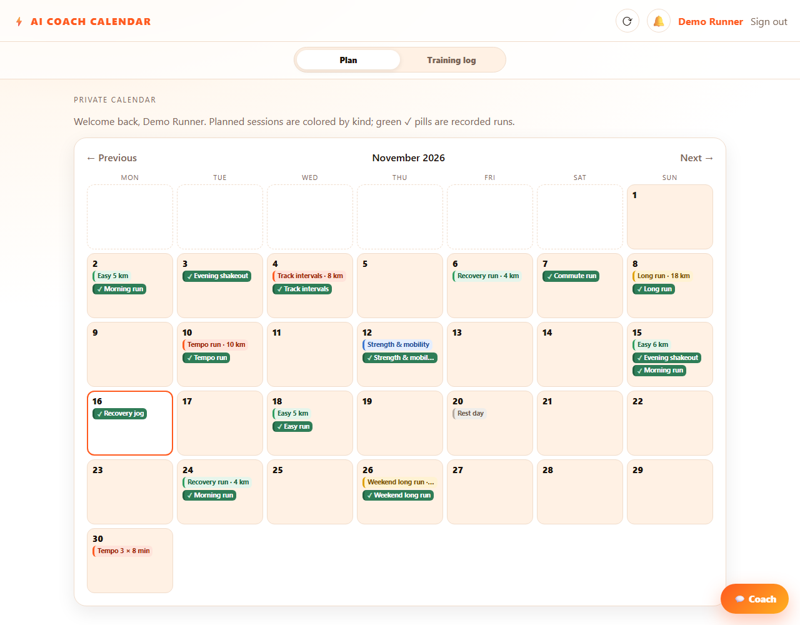

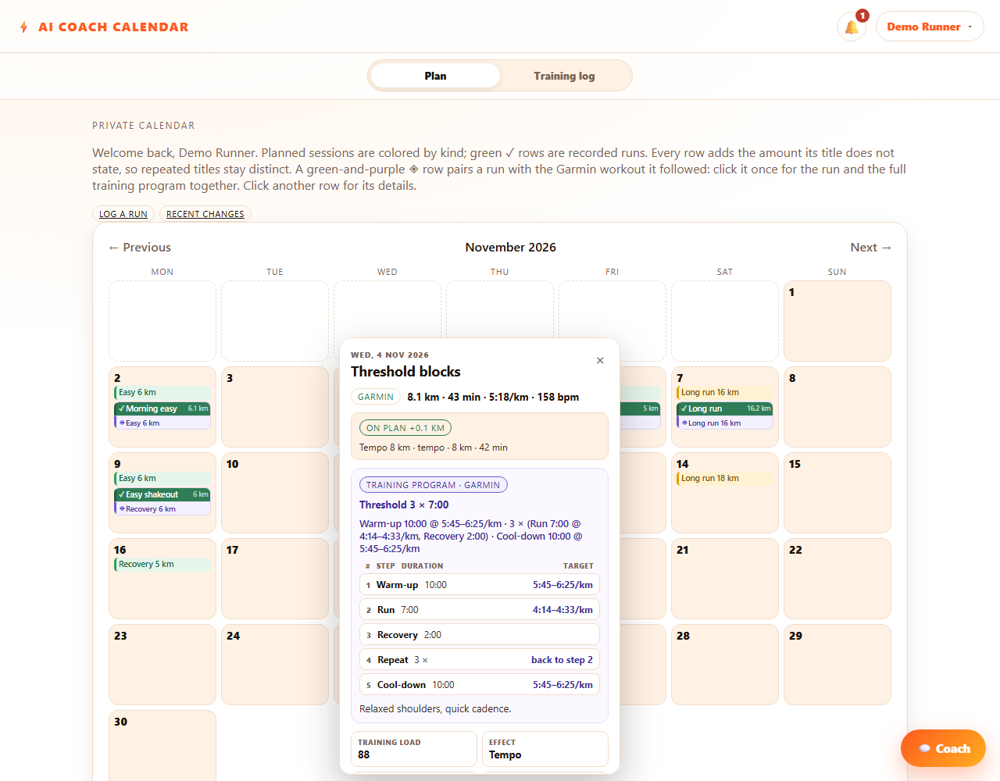

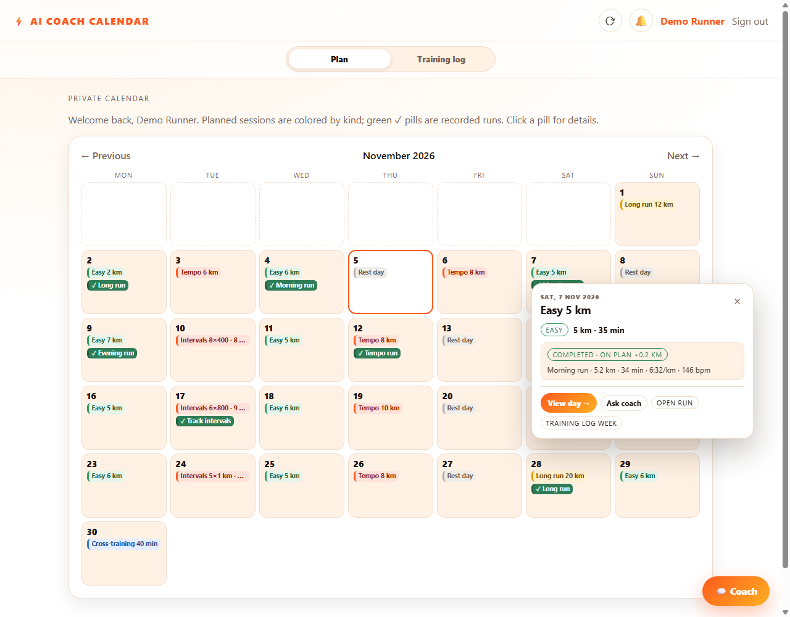

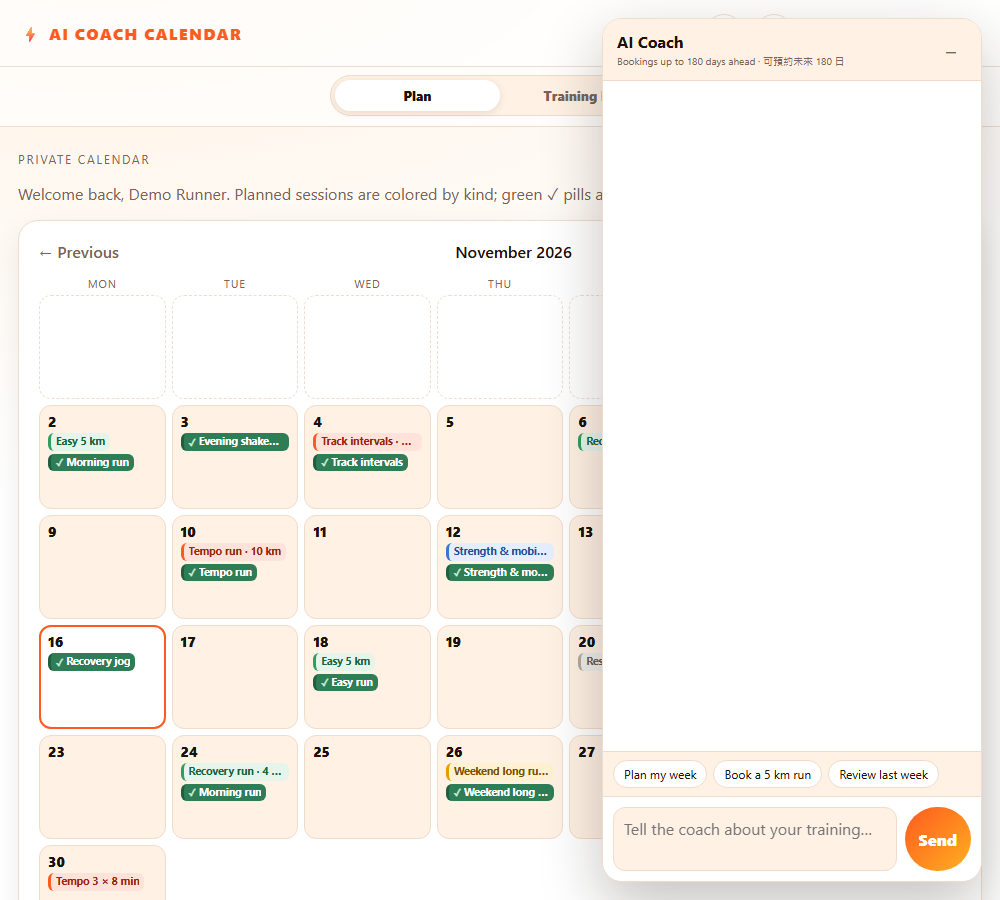

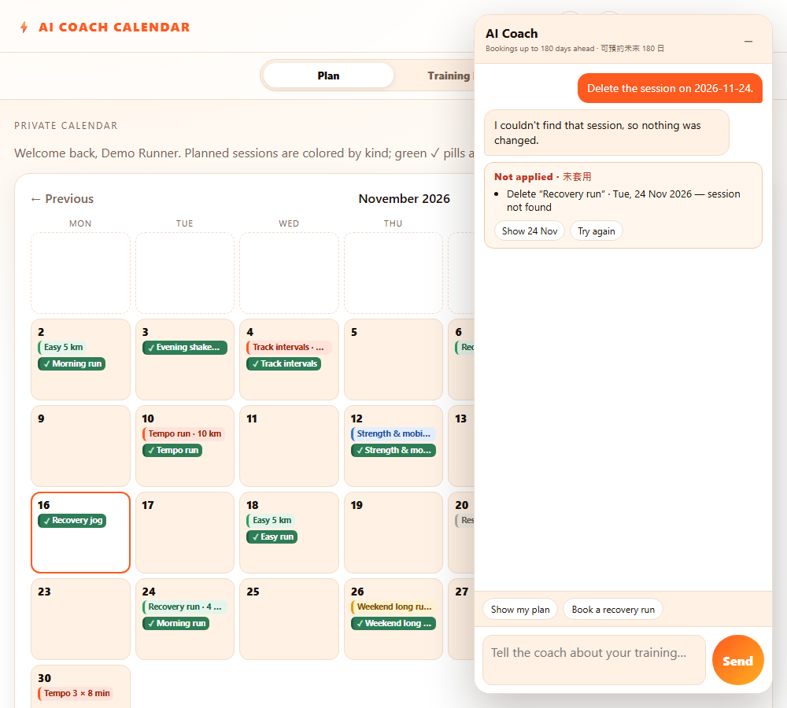

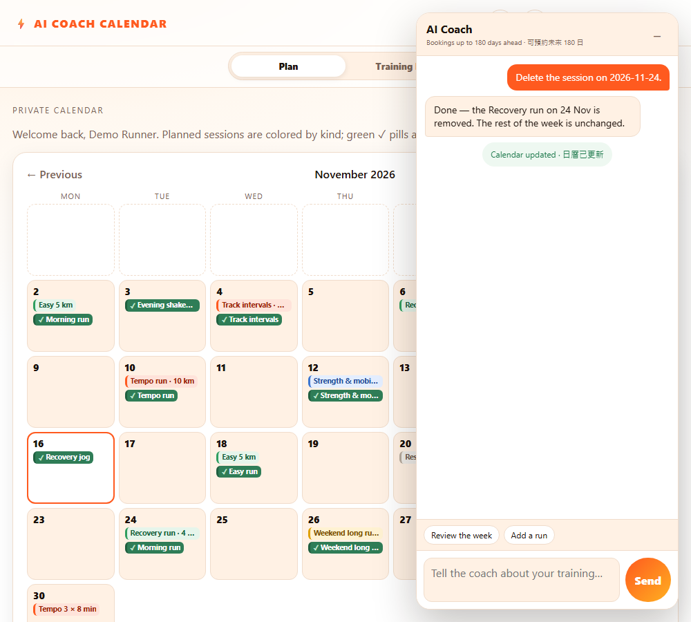

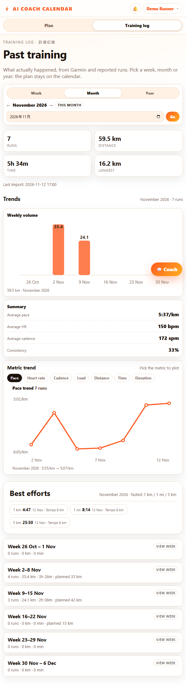

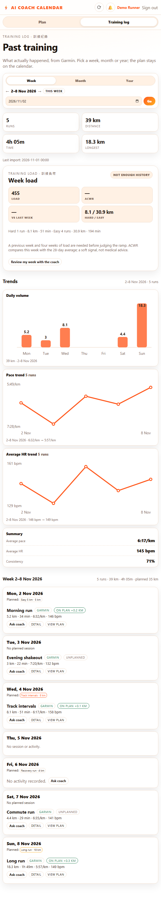

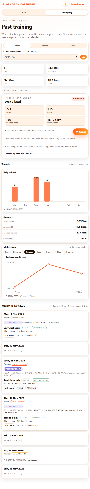

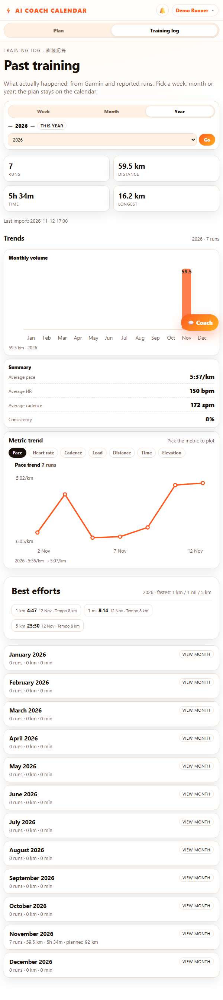

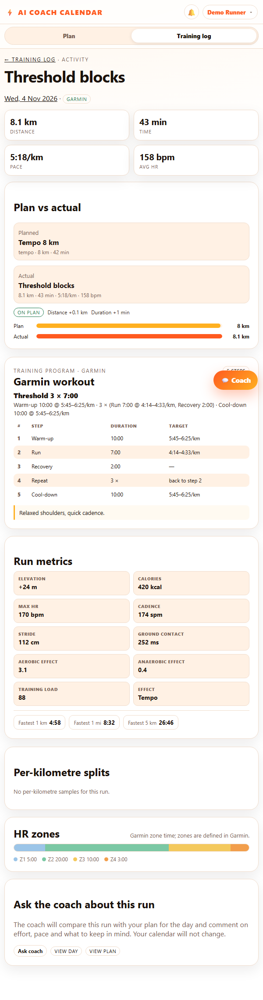

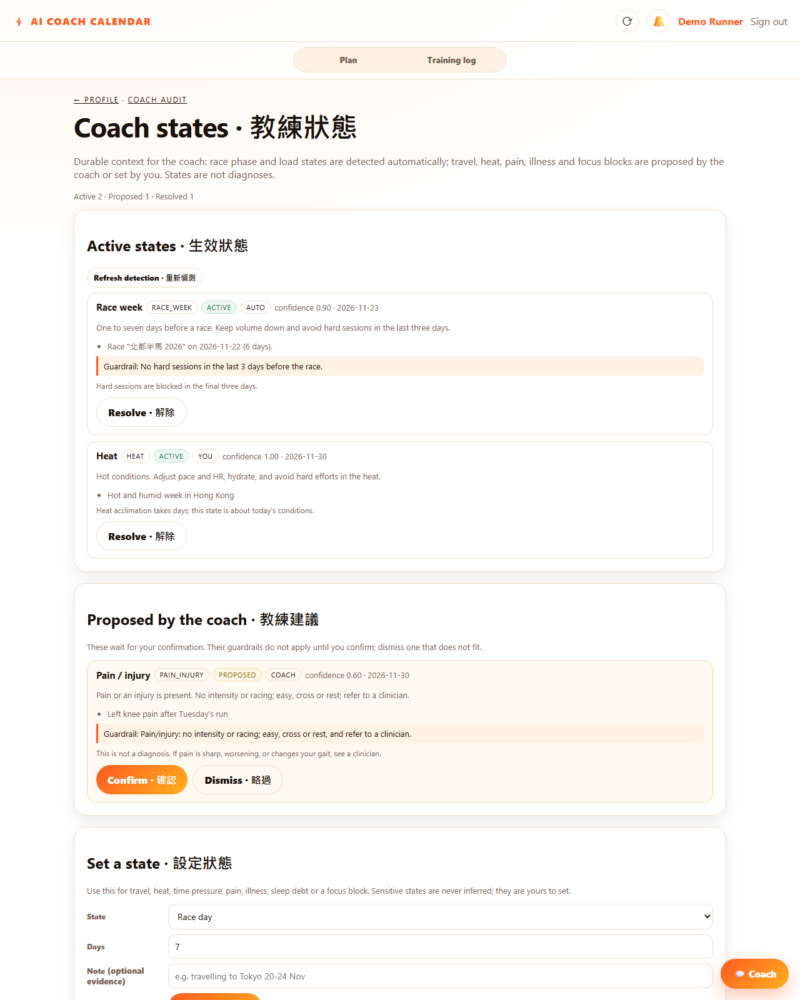

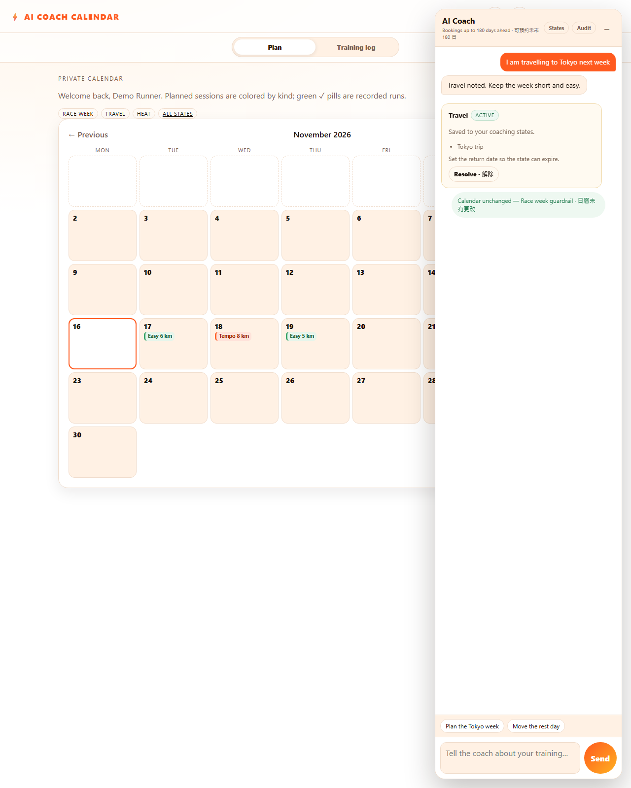

- **CRUD animation** (verified in headless Chrome):
  - `update`: the pill leaves the old cell, flies in an arc to the new day, scales up and rotates; the target cell pulses green.
  - `remove`: the pill flies into a bin at the bottom centre, shrinks and fades; the old cell pulses red and the bin pops.
  - `add`: the new pill pops into the target day.
  - Multiple changes leave in a **140 ms stagger**, so a multi-day edit reads as one coordinated action.
  - A full-page warm flash + short shake runs behind the animation. The grid is refreshed **before** the animation, so the
    end state is correct even if the animation is interrupted.

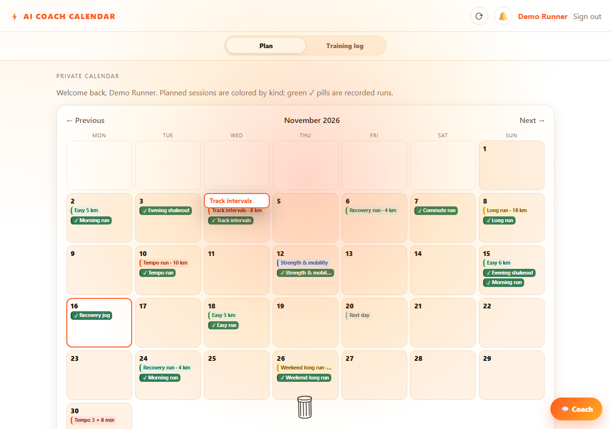

### Day actions

Clicking a day cell opens a small menu anchored to that day:

| Choice | What it does |
|---|---|
| Add a session here | Opens the coach bubble with `Add a session on YYYY-MM-DD: ` prefilled; the runner completes the request |
| Move a session here | Prefills `Move a session to YYYY-MM-DD: ` so the runner names the source |
| Delete a session here | Sends `Delete the session on YYYY-MM-DD.`; disabled when the day has no session |
| Ask coach about this day | Sends `What is planned on YYYY-MM-DD?` plus a hidden **review-day** directive; the coach comments and does not change the calendar |
| View day details | Navigates to `/day/YYYY-MM-DD` |

All write choices go through the coach; there is no direct edit API. The menu closes on Escape, outside click, or after a
choice, and is keyboard reachable (Enter/Space on a focused day).

### Run peek

Clicking a recorded-run row, or anywhere on a paired run+workout row, in the month grid opens a small popup anchored to the
row (a bottom sheet on narrow screens) with the run's key detail, the Garmin program it followed and next actions. The
paired row is one click target and one keyboard target: the run and the program are read together, not in two half-row
popups. The popup fetches `GET /activity/<id>/peek`; the server computes the display strings and returns the stored program,
so the client holds no metric logic.

| Part | What it shows |
|---|---|
| Header | run title and the full day; × closes |
| Meta | `Garmin` / `Reported` source chip and distance 繚 time 繚 pace 繚 avg HR |
| Plan | `On plan` / `Short` / `Long` / `Unplanned` chip, the matched session and its kind, distance and duration |
| Training program | when the run followed a Garmin workout: its name or main set, the grouped summary, up to eight step rows (# / Step / Duration / Target), Garmin's coach notes and "+n more steps in the activity detail" |
| Training metrics | up to six training-first values: training load, effect, elevation, calories, max HR, cadence |
| Best efforts | fastest 1 km / 1 mi / 5 km with a `PR` badge when the run holds the stored-history best |

| Action | What it does |
|---|---|
| Open full detail | navigates to `/activity/<id>` for the full step table and the run's metrics |
| Ask coach | opens the bubble with the natural question `How did my <title> go? (<day> 繚 <distance> 繚 <duration>)` plus a hidden **review-activity** directive; the visible day and metrics identify one exact record when titles repeat, and the coach checks that day's plan and comments without changing the calendar |
| View day | navigates to `/day/YYYY-MM-DD` |
| Training log week | navigates to `/history?view=week&period=<Monday of that week>` |

The program is read-only; the calendar does not change. A run whose workout is unavailable or `none` has no purple program
line and no program section. The popup closes on ×, Escape, outside click, page scroll or a calendar refresh; Escape and ×
return focus to the row. Clicking the same row again toggles it closed, and a failed load leaves **Open full detail** and
**View day** available. The row is a keyboard target (Tab, then Enter/Space), so the peek is not mouse-only.

### Session peek

Clicking a colored planned-session pill opens the same anchored popup (a bottom sheet on narrow screens) for the plan
instead of a run. The popup fetches `GET /session/<sessionId>/peek`; the server computes the display strings and the day
outcome, so the client holds no plan-match logic.

| Part | What it shows |
|---|---|
| Header | session title and the full day; ? closes |
| Meta | kind chip (`Easy`, `Long run`, `Intervals`, `Tempo`, `Rest`, `Cross-training`, `Race`, `Race walk`) and planned distance 繚 duration |
| Intent | what the session is for and how hard it should feel (for example "Aerobic base... conversational, RPE 3-4/10") |
| Note | the plan note when the coach stored one |
| Outcome | `Completed · On plan / Short / Long` with the matched run and its metrics; `Not matched` with the single recorded run when it does not fit; `Not done` for a past session, with "the plan does not change and there is nothing to make up"; `Today` / `Upcoming`; `Planned rest`, or `Recorded anyway` when a run was logged on a rest day |

| Action | What it does |
|---|---|
| View day | navigates to `/day/YYYY-MM-DD` (primary action; there is no separate session detail page) |
| Ask coach | opens the bubble with a natural plan question (`What should I focus on in my <title> on <day>?`, `How did my <title> go? (<day>)`, or the missed/unmatched/rest wording) plus a hidden **review-day** directive with source `session-peek`; the coach comments and does not change the calendar |
| Open run | appears whenever the outcome links a run (completed, a single unmatched run, or a run logged on a rest day); navigates to `/activity/<id>` |
| Training log week | navigates to `/history?view=week&period=<Monday of that week>` |

Run peek and session peek share one dialog, so they never stack. The popup closes on ×, Escape, outside click, page scroll
or a calendar refresh; Escape and × return focus to the row. Clicking the same row again toggles it closed, and a failed
load leaves **View day** available. All rows are keyboard targets (Tab, then Enter/Space), so the peeks are not mouse-only.

### Hidden coach directives

The chat shows only what the runner typed and what the coach replied. Every action-originated message also carries a
**hidden directive**: a typed, server-authored stage direction that goes into the coach prompt but never into the bubble.

Three layers stay separate:

| Layer | Lives in | Example |
|---|---|---|
| Global rules | `COACH_RULES` | safety, tool contract, reply language |
| Durable context | profile, memories, plan, activities | "training for a half marathon" |
| Per-turn directive | `coach_directives` + the prompt | "comment-only race review; check that day's plan" |

The browser sends a **typed intent**, never hidden prose:

```ts
{ kind: "review-activity", activityId: "garmin:??, source: "run-peek" }
```

`src/directives.ts` validates the intent and builds the directive:

```json
{
  "mode": "review",
  "allowCalendarWrites": false,
  "allowMemoryWrites": true,
  "focus": ["schedule", "pace", "hr", "race_execution"],
  "references": { "activityId": "garmin:??, "day": "2026-11-01" },
  "background": "Comment only: the referenced activity is the exact run the runner means??,
  "source": "run-peek",
  "style": { "language": "auto", "tone": "supportive" }
}
```

The web server resolves the referenced activity/day/week and forwards `poc3.directive` to the gateway. The gateway
validates it again, loads the referenced rows from the store (a missing or foreign reference is `404 reference-not-found`
before the model is called), and renders a clearly separated **Turn directive** section into the system prompt. The visible
message remains the user message.

For a run review the visible question also carries the run's day, distance and duration
(`How did my ?啁? 頝郊 go? (Sun, 1 Nov 2026 繚 2.6 km 繚 25 min)`), so a repeated title is unambiguous even before the
directive is read, and a later follow-up turn keeps the reference in the conversation. A global rule tells the coach that
the referenced activity is the exact run meant and that it must name that day instead of asking which record was intended.

Enforcement is server-side, not a prompt request:

- `allowCalendarWrites: false` rejects a proposed session/revert with `comment-only-write`, feeds the model a
  `respect-directive` repair, and, if the repair still writes, returns the comment-only fallback. No calendar row and no
  change set is written.
- `allowMemoryWrites: false` drops proposed memories before the transaction.
- The audit row stores the directive, visible message, request/message ids and `blockedWrites` in `coach_directives`.
- A completed request id replayed with a different directive is `409 directive-mismatch`; the directive hash is stored on
  `coach_turns`.
- `src/web.ts` never accepts a directive from the browser; it accepts only the typed intent and builds the directive itself.

The intents are `chat`, `review-activity`, `review-day`, `review-week`, `plan` and `undo`; each carries optional `source`,
`focus` and `style` values from a fixed allowlist. The visible message stays conversational (action buttons add the run's
day and metrics, never hidden instructions); the directive is app metadata, not a substitute for user intent.

`GET /coach-audit` (an owner-only internal page, not linked in the end-user UI) shows the owner's recent directives, a
comment-only/blocked-writes summary, active coaching states and any legacy `mode:` memories. New durable context uses
structured coaching states; legacy `mode:` memories remain in the coach's facts and are still shown for transparency.

The chat response adds `mode`, `writesAllowed`, `blockedWrites`, `directiveId`, `states` and `blockedByStates`. The
bubble shows the reply as usual, adds a state card for each state change, and adds
`Calendar unchanged 繚 ?交??芣??湔` only when the gateway had to block a proposed write. A state guardrail adds
`Calendar unchanged ??<state> 繚 ?交??芣??湔`.

#### Coaching states (durable context beyond one turn)

Hidden directives are per-turn; coaching states are durable. `src/coach-state-catalog.ts` defines a catalog of 34 keys in
ten families (including the `setup` family); `src/coach-states.ts` is the detection/lifecycle/guardrail engine and the
typed record (`coach_states`); `src/web-coach-states.ts` renders the manager/audit pages. Auto states are detected from
the plan and Garmin data: race day, race week (1?? days), taper (8??1 days), post-race (??4 days), ACWR ramp
(watch/high), hard/easy imbalance, under-load, day-aware missed planned sessions, a stale plan and stale Garmin data.
Travel, heat, time pressure, sleep debt, stress, pain, illness, return-to-run and focus blocks are proposed by the model
through `stateProposals` or set by the runner on `/coach-states`.

- Sensitive states (`medical_red_flag`, `pregnancy_postpartum`, `menstrual_cycle_support`, `low_energy_availability`)
  and safety states (`pain_injury`, `illness`, `return_to_run`) start as `observing`; the bubble/page asks for
  confirmation. The coach never diagnoses.
- `syncCoachStates` runs in one `BEGIN IMMEDIATE` transaction and applies TTL expiry, auto resolution, user-dismissal
  cooldown and precedence. Auto states update in place; a user/chat state wins over auto detection, and a **user-set**
  state also wins over a chat proposal for the same key. Creates, confirms, resolves and expiries append immutable
  `coach_state_events` rows; resolved history and events older than 180 days are pruned.
- The gateway refreshes states before the prompt and enforces hard guardrails (`mode-guardrail`, `respect-state`) over the
  **effective post-turn calendar** ??current sessions plus adds, updates, removes and reverts. Race week blocks
  intervals/tempo on race day-3 through race day; taper blocks new long runs on race day-14 through race day; post-race
  blocks intensity/race/racewalk for 7 days after; injury/return block intensity/racing/racewalk; illness blocks all
  training except rest; a red flag blocks every booking. A repair attempt is allowed; a failed repair returns a fallback
  and writes nothing to the calendar, while proposed states are still stored so a confirmation card is not lost.
- Pages are read-only; auto detection is persisted by a gateway turn or the explicit **Refresh** action. Active
  states render as calendar chips, bubble cards and on `/coach-states`; the audit page shows active states, an immutable
  State activity log and any legacy `mode:` memories. The prompt block is server-authored background and is never shown in
  the chat; evidence/notes are rendered as data, never instructions.
- The full catalog, research citations and needed-vs-skipped list are in [COACH-STATES.md](COACH-STATES.md).

---

## 9. Garmin

`src/garmin.ts` calls the Garmin Personal API:

- Token endpoint returns a **bare JWT as `text/plain`**, not JSON; the client handles both.
- Activities: `activitylist-service/activities/search/activities?start=0&limit=N` with `Authorization: Bearer <jwt>`.
- `mapGarminActivity` maps an activity to the core record plus optional list metrics: elevation, calories, max HR,
  running cadence, stride length, ground-contact time, aerobic/anaerobic training effect, training load, training-effect
  label, fastest 1 km / 1 mi / 5 km splits and HR-zone seconds.
- Activity detail samples: `GET /activity-service/activity/{id}/details` returns metric descriptors and a per-sample stream.
  The detail page calls it on demand, finds `sumDistance`, `sumDuration` and `directHeartRate`, interpolates each 1,000 m
  crossing and renders per-kilometre splits plus the final partial split.
- Activity summary/laps: `GET /activity-service/activity/{id}` returns `splitSummaries`. `mapGarminLaps` maps the lap type,
  distance, duration, pace, HR, elevation and cadence; the detail page shows them as **Garmin laps / intervals**, separate
  from the per-kilometre splits. A single whole-run lap is hidden.
- **Activity workout:** `GET /activity-service/activity/{id}/workouts` returns the planned workout a completed activity
  followed: steps with an intensity, a duration (time, distance, lap button, open, reps), a target (pace, heart rate,
  cadence, power, speed or none) and the coach's notes. This endpoint is in Garmin's official Personal API Swagger and in
  Garmin's official Python client (`get_activity_workouts`); the field-level DTO properties are not published, so
  `src/garmin-workout.ts` maps defensively: it accepts the observed flat FIT-style payload (`stepIndex`, `intensity`,
  `durationType`, `durationValue`, `targetType`, `targetValueLow`/`targetValueHigh`, and a repeat step with
  `durationType: REPEAT_UNTIL_STEPS_CMPLT`, `durationValue` = step to return to, `targetValue` = repeat count) plus object
  envelopes and the classic `workoutSegments` / `RepeatGroupDTO` shape. A repeat step folds the block it points back to into
  one phrase, for example `3 ? (Run 7:00 @ 4:14??:33/km, Recovery 2:00)`; pace targets arrive in metres per second and are
  converted to min/km. An empty or unreadable payload is a confirmed **none** (the run followed no planned workout), never
  an error. The normalized record is stored in `activity_workouts` with status `ok` / `none` / `unavailable` and an attempt
  count, so the calendar can group workouts by day without another Garmin call.
- **Workout enrichment:** after the activity rows are committed, one sync fetches up to **3** workouts for Garmin activities
  in the 90-day window that have no row or a retryable failure (2 attempts at most). A `404` is stored as `none`; another
  failure as `unavailable` with the attempt count raised. The batch is capped and best-effort: a workout failure can never
  turn a good activity sync into a failed one. The activity detail also fetches once on demand when nothing is stored or the
  stored attempt failed, and saves the result.
- **Workout surfaces:** the run's day renders the run and its Garmin workout as one paired row (also returned by
  `/calendar/data` and rendered by the in-place refresh after a coach turn). The row is one click target: it opens the run
  peek, which carries the run's metrics and the full **Training program · Garmin** (name, summary, step table and notes)
  together. The activity detail carries the same step card, the training-log week card a **Garmin workout** line, and
  `/day/<day>` a **Garmin workouts** card. The calendar fills the visible month's missing workouts (up to 6 per render, 2.5 s
  budget, 60 s throttle) so a run is paired on the grid as soon as its workout is known.
- **Plan boundary:** the Personal API has no `workout-service`, `trainingplan-service` or `calendar-service` endpoints, so
  POC3 can show the workout a run followed but cannot import future scheduled workouts or the Garmin Coach / adaptive plan
  into the calendar grid. That needs a Garmin account (SSO) session token for `connectapi.garmin.com`, which the personal
  API key cannot mint; the official Training API is publish-only. The full evidence and the future endpoint list are in
  [GARMIN-TRAINING-PROGRAMS.md](GARMIN-TRAINING-PROGRAMS.md).
- HR zones: the list's `hrTimeInZone_1..5` seconds are stored; the detail page shows a stacked bar and legend. Zone
  boundaries are defined in Garmin and are not stored in POC3.
- `POST /sync`, the page-load auto-sync and the session-start sync share `src/garmin-sync.ts`: fetch up to **100** activities
  (the Garmin list endpoint's supported maximum), keep the last **90 days**, upsert by `(user_id, activity_id)` (a repeated
  sync updates and enriches instead of throwing; two runners may store the same Garmin activity independently), count new
  versus processed rows, enrich up to **3** activity workouts, and record `sync_state.last_synced_at`. Existing databases are
  migrated on startup from the old global `activity_id` primary key to the composite key; every stored activity row is
  preserved, and the `activity_workouts` table is created if it is missing.
- The **account menu** (the runner's display name, top right) carries **Sync Garmin now** as the manual trigger. With no saved
  key it redirects to the key popup; with a saved key it syncs and reloads the page. The result is recorded in the bell, not as
  a page banner. The popup explains where to create a Garmin Personal API key, offers **Show** so the full pasted key can be
  checked, verifies the key against the token endpoint, then stores it per runner and syncs immediately. The menu's **Garmin
  key** item ??like the bell's footer link ??reopens the popup and shows the masked current key (`?Ｔ€Ｔ€Ｔ€?234`) when replacing.
- A new browser session ??a login or a resumed `poc3_session` auth cookie without a live `poc3sid` session ??starts one
  background pull when a key is saved. Page loads also pull when the last sync is older than **10 minutes**; a failure backs
  off for the same interval. Manual `/sync` and `/garmin/key` requests skip the session auto-sync so they cannot double-pull.
- The top-bar notification bell polls `/notifications` and is the single sync feed. Explicit manual/key syncs always record
  a result, including **Garmin sync: no new activities** with the checked count. Automatic session/page syncs record only
  when new activities are added or an error occurs; routine no-change checks stay silent. The old **Auto-synced N** and
  **Garmin sync: N imported** page banners are gone. A success notification names the newest genuinely new activity and links
  to its month; the training-log review card appears only for a genuinely new activity. A 401/403 links back to the key
  popup; other errors link to the training log. `src/garmin-errors.ts` turns 401, 403, 429 and 400 responses into actionable
  text, including Garmin's `retryInSeconds` / `count` / `limit` rate-limit body.
- The browser tab title carries the same unread count: `{page context} 繚 AI Coach Calendar (N)`, for example
  `Training log 繚 AI Coach Calendar (3)`. The context starts with the active **Plan** / **Training log** nav, then the page
  detail (`Training log 繚 Activity`, `Plan 繚 Fri, 6 Nov 2026`). `layout()` server-renders the count, caps it at `99+`, omits
  it at zero and on signed-out pages, and the bell poll keeps it current. Opening the bell marks notifications read and
  clears the title count.
- Garmin is the completion source; the coach is the booking source. Keys are per runner, stored plaintext in SQLite and never
  shown again in full; there is no deployment-wide Garmin key. Activity IDs are per runner too, so the same Garmin activity
  can be stored for multiple accounts without one runner's row blocking another.

---

## 10. HTTP API

### Gateway (`:8090`)

| Method | Path | Purpose |
|---|---|---|
| `GET` | `/health` | liveness + model name |
| `GET` | `/v1/models` | OpenAI-compatible model list (`poc3-coach`) |
| `POST` | `/v1/chat/completions` | one coach turn; `stream` supported (single-chunk SSE); optional `x-poc3-request-id` for idempotency; optional `poc3.directive` from the trusted web proxy |

The gateway binds `127.0.0.1` and trusts the internal `x-poc3-user` header set by the web server; the browser never talks to
it directly. The web surface is the authenticated entry point.

A completed request id is replayed from `coach_turns` with `x-poc3-idempotent-replay: true`; a duplicate while the first
request is still running gets `409 turn-in-progress`. A replay whose hidden directive hash differs from the original turn
gets `409 directive-mismatch`. A directive reference that is missing or belongs to another runner gets
`404 reference-not-found` before the model is called.

### Calendar web (`:8091`)

| Method | Path | Purpose |
|---|---|---|
| `GET`/`POST` | `/signup` | create a standalone account (username, display name, password, timezone, goal) |
| `GET`/`POST` | `/login` | password login; sets the signed `poc3_session` cookie plus the browser `poc3sid` session cookie and starts a sync when a key is saved |
| `GET` | `/logout` | clears both cookies |
| `GET`/`POST` | `/profile` | display name, timezone, goal, optional password change |
| `GET` | `/calendar?month=YYYY-MM` | month grid (authenticated, user-scoped) |
| `GET` | `/history?view=week\|month\|year&period=...` | training log period views; default week/current; week period is a date (snapped to Monday), month `YYYY-MM`, year `YYYY`; week includes the load card and weekly review prompt; month/year include period best efforts |
| `GET` | `/activity/<activityId>` | one run's detail with rich Garmin metrics, fastest efforts with PR badges, per-kilometre splits, Garmin laps/intervals, HR zones and planned-vs-actual comparison; 404 for a foreign or missing id |
| `GET` | `/activity/<activityId>/peek` | JSON for the calendar run-peek popup: title, day label, source, metrics, six training-first metrics, fastest efforts with PR flags, plan match, the stored Garmin `program` (`name`, `label`, `summary`, up to eight `steps` with targets, `stepCount`, `notes`; null when no workout), visible `coachPrompt`, typed `coachIntent` and `detail`/`day`/`week` links; user-scoped, 404 for a foreign or missing id |
| `GET` | `/session/<sessionId>/peek` | JSON for the calendar session-peek popup: title, day label, kind label, planned distance/duration, note, day outcome (`completed` / `unmatched` / `missed` / `upcoming` / `rest`) with the matched run, visible `coachPrompt`, typed `coachIntent` and `day`/`week`/`activity` links; user-scoped, 404 for a foreign or missing id |
| `GET` | `/day/YYYY-MM-DD` | day detail |
| `GET` | `/calendar/data?month=YYYY-MM` | JSON used by the in-place refresh: `{ month, days: { [day]: { items, html } } }`. `items` is the typed union `plan \| record \| pair` from `src/calendar-items.ts` (plan: `kind`, `kindLabel`, `sessionId`, `label`, `meta`, `tooltip`; record: `source`, `activityId`, `label`, `meta`, `tooltip`; pair: `activityId`, `run { label, meta }`, `workout { label }`, `tooltip`), and `html` is the server-rendered row fragment the client swaps into the cell. `sessionId` drives the session peek; the pair's `activityId` is its single click target and drives the integrated run+program peek |
| `POST` | `/chat` | bubble proxy ??gateway; body `{ message, intent? }`; the web validates the typed intent, resolves references, builds the hidden directive and forwards it as `poc3.directive`; returns `{reply, sessions, changes, suggestions, failures, changeSetId, reverted, mode, writesAllowed, blockedWrites, directiveId, states, blockedByStates}` |
| `GET` | `/chat/history` | the signed-in runner's recent visible messages, oldest first (used to restore the bubble after refresh), plus active/observing states so a pending sensitive confirmation survives a reload; hidden directives are never included |
| `GET` | `/coach-audit` | internal, unlinked page scoped to the signed-in runner: recent hidden directives, comment-only/blocked-writes stats, active coaching states, an immutable State activity log and legacy `mode:` memories |
| `GET` | `/coach-states` | per-runner coaching-state manager: read stored active/proposed states, resolved history (last 100), a setup card when no Garmin key is saved and a set-state form; GET never writes |
| `POST` | `/coach-states` | set a state (`key`, `ttlDays`, `note`); redirects to `/coach-states` or with a fixed `error` code (`invalid-key`, `invalid-ttl`, `invalid-note`) |
| `POST` | `/coach-states/refresh` | run auto detection once, persist states, then redirect to `/coach-states`; disabled by `POC3_AUTO_STATES=false` |
| `POST` | `/coach-states/<id>/confirm` | observing ??active; scoped to the signed-in runner; expired states are rejected |
| `POST` | `/coach-states/<id>/resolve` | active/observing ??resolved with source `user`; scoped to the signed-in runner |
| `POST` | `/sync` | manual Garmin pull (last 90 days, upsert and metric enrichment); no saved key redirects to the popup; `next` selects `/calendar` or `/history`; the result renders inline as a `synced`/`syncError` flash |
| `POST` | `/garmin/key` | verify a pasted Personal API key, save it per runner, sync immediately; malformed/rejected keys return to the popup with `keyError` |
| `POST` | `/garmin/key/delete` | remove the saved key for the signed-in runner, drop the cached client and redirect with `garmin=deleted` |
| `POST` | `/activities` | log a reported run (`day`, optional `title`, `distanceKm`, `durationMin`, client `requestId`, `next`); rejects future days and impossible amounts, and reuses the same activity id for a repeated request |
| `POST` | `/calendar/changes/<id>/revert` | undo one stored change set through `applyRevert`; scoped to the runner, same-origin checked, idempotent (already reverted returns `undoError`) |
| `GET` | `/export.json` | the runner's profile (no password hash), sessions, activities and change sets as a downloadable JSON bundle |
| `GET` | `/export.ics` | the runner's planned sessions as an all-day ICS calendar |
| `GET` | `/notifications` | newest 20 sync notifications plus the unread count for the signed-in runner |
| `POST` | `/notifications/read` | mark every unread notification for the runner as read |
| `GET` | `/static/app.css` | styles (linked with a version query for cache busting) |

All page routes except `/login`, `/signup`, `/health` and `/static/app.css` redirect unauthenticated requests to `/login`.
State-changing POSTs also pass a same-origin check (Origin host must match Host) in addition to the SameSite=Lax session
cookie.

---

## 11. Run it

Requirements: Node.js 24+, pnpm 12+ (or npm), a model endpoint that speaks OpenAI chat completions.

```bash
pnpm install
```

Set the minimum environment (PowerShell shown):

```powershell
$env:POC3_AUTH_SECRET='<long random secret>'
$env:POC3_DB='sqlite:data/poc3.sqlite'
$env:POC3_MODEL_BASE_URL='http://192.168.1.202:8102/v1'
$env:POC3_MODEL_API_KEY='<model key>'
$env:POC3_MODEL_NAME='dgx/general'
$env:POC3_MAX_ATTEMPTS='2'
pnpm dev
```

Then:

- Sign up: `http://127.0.0.1:8091/signup`
- Calendar: `http://127.0.0.1:8091/calendar`
- Gateway: `http://127.0.0.1:8090/health`

Ports: `POC3_GATEWAY_PORT` (default `8090`), `POC3_WEB_PORT` (default `8091`). The live deployment uses
`POC3_GATEWAY_PORT=8092` and `POC3_WEB_PORT=8093`.

After signing in, open the **account menu** (your display name, top right) and use **Sync Garmin now** once: with no saved key
it opens the guide/popup, verifies the pasted Personal API key, stores it for that account, and syncs. **Garmin key** in the
same menu reopens the popup later; the popup's **Remove saved key** form deletes it and drops the cached client. No Garmin
key belongs in the environment.

### Environment reference

| Variable | Default | Meaning |
|---|---|---|
| `POC3_GATEWAY_PORT` | `8090` | gateway port |
| `POC3_WEB_PORT` | `8091` | calendar port |
| `POC3_DB` | `sqlite:data/poc3.sqlite` | SQLite spec; directory is created |
| `POC3_AUTH_SECRET` | `poc3-dev-secret-change-me` | HMAC secret for the signed session cookie; set a strong value |
| `POC3_USER_ID` | `demo-runner` | gateway fallback when no `x-poc3-user` header |
| `POC3_MODEL_BASE_URL` | `http://192.168.1.202:8102/v1` | OpenAI-compatible endpoint |
| `POC3_MODEL_API_KEY` | empty | model bearer; the live deploy reads it from the environment or `data/poc3-model.secret` |
| `POC3_MODEL_NAME` | `dgx/general` | model name |
| `POC3_MODEL_ID` | `poc3-coach` | id exposed by the gateway |
| `POC3_MAX_ATTEMPTS` | `2` | initial proposal + repair calls per turn |
| `POC3_AUTO_STATES` | `true` | deterministic auto-state detection; `false` keeps manual/chat states but disables auto detection |
| `POC3_GATEWAY_URL` | `http://127.0.0.1:8090` | web ??gateway |

Never commit real keys or `.env` files; the live secrets stay in the gitignored `data/` directory.

### Deploying the live process (Windows)

`pnpm deploy:live` restarts the live :8093/:8092 process. The script reads the auth secret from
`data/poc3-auth.secret` and the model API key from `POC3_MODEL_API_KEY` or `data/poc3-model.secret`, uses
`sqlite:data/poc3-auth.sqlite`, refuses to stop a process whose command line does not contain `src/index.ts`, starts
`pnpm dev` with the live model/env, and waits for the gateway `/health`, the calendar `/login` and the new stylesheet. It
fails if the auth secret or model key is missing, if the deployed CSS lacks `.cal-pill.record`, `.cal-meta`,
`.cal-pair-run`, `.peek-program`, `.state-card`, `.state-form`, `.state-refresh`, `.account-menu` or `.account-item`, or if
the login page does not reference `app.css?v=17`. Runtime logs:
`data/poc3-live.out.log` and `data/poc3-live.err.log`; deploy history: `data/poc3-deploy.log`.

---

## 12. Testing and gates

```bash
pnpm lint
pnpm typecheck
pnpm test
# or all three:
pnpm check
```

CI runs `pnpm check` on Node 24 (`.github/workflows/ci.yml`).

Current state: **337 tests in 15 files** ??auth (signup/login/cookie/profile), coach contract/actions/suggestions/revert/comment-only rule,
hidden directive intents/schema/render/hash, coaching-state catalog/detection/day-aware consistency/lifecycle/events/retention/proposals/guardrails/prompt block,
gateway streaming + CRUD + batch + change sets + revert + effective-calendar guardrails + repair loop + native tool calls + timezone + idempotency + comment-only enforcement + referenced-context resolution + directive audit rows + directive-mismatch replay + auto state detection + guardrail repair/fallback + fallback state cards + proposal application + claim cleanup,
store users/change sets/coach turns/transactions/coach states/state events/pruning/per-user activity upsert/old-schema migration/sync state/per-runner Garmin keys/notifications/activity workouts,
plan-vs-actual same-day matcher, weekly load/ramp and hard/easy classification, personal bests and period bests, Garmin
mapping/token quirks/response bodies/enriched metrics/HR zones/detail fetch/summary fetch/workout fetch/per-kilometre split parser/lap
mapper/workout mapper/error copy, cross-user Garmin sync of the same activity, workout enrichment cap/retry/none-vs-unavailable, calendar fill of the visible month,
calendar web + account menu + anonymous header links + plan rows + paired run+workout rows + right-aligned amounts + tooltips + four-row overflow + server-rendered refresh fragments + conversation reload + run-peek endpoint/display-ready metrics/plan match/efforts/program row/scoping + paired-row wiring + workout-brief endpoint/on-demand fetch/scoping + session-peek endpoint/completed/missed/unmatched/upcoming/rest outcomes/scoping + planned-row wiring + week/month/year training log + period selector + load card + weekly
review prompt + rich activity detail + Garmin workout card + per-kilometre splits + Garmin laps + HR zones + PR badges + period best efforts +
metric-selectable trend picker/panels/default/empty note + key popup/save/verify + always-enabled sync + manual no-new confirmations + silent automatic no-change checks +
newest-new notification targeting + session-start sync + page-load auto-sync backoff + idempotent Garmin sync + typed
action intents + the owner-only coach audit page + the coaching-state manager/set/confirm/resolve routes + calendar state
chips + bubble state cards + legacy `mode:` memories.

The lint gate is `tools/lint.mjs`: no `console` in `src` except `index.ts`, no `TODO`, no `any`, no obvious secrets.

---

## 13. Honest limits

1. **No streaming in the bubble.** `/chat` waits for the whole reply; the gateway supports streaming, but idempotency is
   applied only to non-streaming completions.
2. **Auth is PoC-grade.** The default `POC3_AUTH_SECRET` must be replaced; there is no email verification, password reset,
   rate limit or session revocation list.
3. **The gateway trusts `x-poc3-user`.** It binds localhost and is meant to sit behind the web server; do not expose it.
4. **No manual session edit form.** The coach is the only writer of planned sessions by design; the runner can only ask it.
   A recorded run can be logged by hand on the day page, but that does not create or edit a planned session.
5. **No external calendar sync.** Google/Outlook/CalDAV are out of scope.
6. **Single-process SQLite.** Fine for a PoC; not a multi-instance production store. `coach_turns` has no lease timeout, so
   an in-flight request left by a process crash needs manual cleanup.
7. **Animation is best-effort.** It is DOM/CSS/Web Animations; reduced-motion users get the grid update without the flourish.
8. **One repair, not an agent loop.** The model gets one bounded repair call; it is not allowed to iterate indefinitely.
9. **Per-kilometre splits are computed, not Garmin's own lap splits.** The detail page fetches Garmin's per-sample
   activity-detail stream on demand, interpolates each 1,000 m crossing and keeps the final partial split. Garmin's own
   `splitSummaries` are shown separately as laps/intervals; FIT parsing, pace zones and HR-zone charts remain later slices.
   A detail or summary request can be large or return 403; each section falls back independently.
10. **Auto-sync is session-start plus page-load, not a scheduler.** A new browser session (login or a resumed auth cookie)
    pulls once when a key is saved; page loads back off for 10 minutes. There is no background scheduler. The pull is limited
    to the last 90 days and at most 100 activities. The key is saved per runner from the calendar popup.
11. **Plan matching is heuristic.** `src/training.ts` greedily matches at most one activity to one session by distance
    tolerance; it is not a stored activity-to-session link. A run can be labeled unplanned, and a session can be unmatched.
12. **The post-run review is a prompt, not an unsolicited model turn.** After a sync the log shows a one-tap review card;
    it does not call the LLM or write a message without the runner's action.
13. **Per-runner Garmin key, stored plaintext.** Each account saves its own Personal API key; there is no Garmin OAuth flow.
    The key is kept in SQLite in plaintext and sent over the private HTTP deployment, so use a trusted network and a private
    server. The browser session cookie (`poc3sid`) lives in memory and lasts 24 hours; a server restart creates a new session
    and triggers the session-start pull again.
14. **History is a bounded period, not infinite scroll.** Month and year rows are summaries; drill down to a week for day
    details. There is no "load more" paging.
15. **The period picker is deliberately small.** Year is limited to 2000??100; the week picker snaps to Monday; month
    views include partial calendar weeks at the edges.
16. **Garmin's list endpoint is capped at 100 activities per pull.** The last-90-days filter runs after that cap; a runner
    with more than 100 activities in 90 days will not see the oldest ones until a larger history sync exists.
17. **Training load is Garmin's proprietary value.** The week card displays it; POC3 does not recompute Garmin's algorithm.
    ACWR is a coupled 7/28-day rolling average and a soft signal, not an injury prediction. Hard/easy uses training-effect
    labels; activities without labels are left out of that split.
18. **The weekly review is a prompt, not an automatic model turn.** The load card offers a one-tap prompt; the coach is not
    called until the runner taps it.
19. **HR-zone time has no boundaries.** POC3 shows Garmin's seconds per zone as a stacked bar; it does not infer or edit
    zone thresholds. A zone chart with targets is later work.
20. **PRs are stored-history bests.** The 100-activity/90-day sync window means a PR badge is a best among stored
    activities, not a complete lifetime record. A dedicated records page and longer history are later work.
21. **Garmin laps are not per-kilometre splits.** They are Garmin's own lap/interval summaries; the computed per-kilometre
    table remains the only per-km view.
22. **The run peek is a summary, not a second detail page.** It reads stored Garmin metrics only (no on-demand detail or
    summary request), shows at most six training-first metrics and the stored-history fastest efforts, and links to
    `/activity/<id>` for splits, laps and HR zones.
23. **The session peek is a plan summary, not an editor.** It reads the stored session and that day's activities, never
    Garmin detail, and links to the day page; the Ask coach action is comment-only, so a peek cannot change the plan.
24. **The Garmin workout is an overlay, not a plan.** `activity_workouts` stores the workout a completed run followed,
    fetched at most three per sync (two attempts), up to six more when the visible month is rendered (2.5 s budget, 60 s
    throttle) and on demand from the detail page. A failed fetch is a muted note, never a broken page;
    an empty payload is a confirmed "no planned workout". A known workout pairs the run and the workout into one row with
    one click target; the run peek shows the read-only program. The workout card and program show Garmin's steps and notes; they
    are not editable in POC3.
25. **Future Garmin plans cannot be imported with a Personal API key.** The Personal API has no scheduled-workout or
    training-plan endpoints, and the official Training API is publish-only. Importing the Garmin Coach plan or the upcoming
    Garmin calendar would need a separate Garmin SSO web session (`connectapi.garmin.com`) and a product/terms decision.
    See [GARMIN-TRAINING-PROGRAMS.md](GARMIN-TRAINING-PROGRAMS.md).

---

## 14. Documents

- [`FEATURES-FOR-REVIEW.md`](FEATURES-FOR-REVIEW.md) ??candidate features from PoC1/PoC2, prioritised for review.
- [`COACH-STATES.md`](COACH-STATES.md) ??coaching-state catalog, detection, precedence, guardrails, research and skips.
- [`TRAINING-LOG-PLAN.md`](TRAINING-LOG-PLAN.md) ??training-log research, feature inventory and the implemented load/ramp,
  rich-metrics, per-kilometre-split, lap/interval, HR-zone, best-efforts/PR, metric-trend, Garmin-workout and weekly-review
  slices.
- [`GARMIN-TRAINING-PROGRAMS.md`](GARMIN-TRAINING-PROGRAMS.md) ??what the Garmin Personal API exposes about training
  programs, what it does not, and what a full-plan import would require.
- [`MUSCLE-TAB.md`](MUSCLE-TAB.md) ??the Muscle tab: research basis (scales, DOMS course, red flags), the check-in
  flow, the interpretation rules, drill suggestions, coach integration and safety copy.
- [`adr/0001-server-validated-coach.md`](adr/0001-server-validated-coach.md)
- [`adr/0002-calendar-first-bubble.md`](adr/0002-calendar-first-bubble.md)
- [`adr/0003-validation-feedback-loop.md`](adr/0003-validation-feedback-loop.md)
- [`design/calendar-demo.png`](design/calendar-demo.png)
- [`design/calendar-crud-demo.png`](design/calendar-crud-demo.png)
- [`design/coach-starter-demo.png`](design/coach-starter-demo.png)
- [`design/coach-not-applied-demo.png`](design/coach-not-applied-demo.png)
- [`design/coach-delete-demo.png`](design/coach-delete-demo.png)
- [`design/training-log-month-demo.png`](design/training-log-month-demo.png)
- [`design/training-log-week-demo.png`](design/training-log-week-demo.png)
- [`design/training-log-cadence-demo.png`](design/training-log-cadence-demo.png)
- [`design/training-log-year-demo.png`](design/training-log-year-demo.png)
- [`design/activity-detail-demo.png`](design/activity-detail-demo.png)
- [`design/coach-states-demo.png`](design/coach-states-demo.png)
- [`design/coach-state-bubble-demo.png`](design/coach-state-bubble-demo.png)
- [`design/activity-peek-demo.png`](design/activity-peek-demo.png)
- [`design/session-peek-demo.png`](design/session-peek-demo.png)
- [`design/muscle-tab-demo.png`](design/muscle-tab-demo.png)

POC3 is a proof of concept, not a production plan. The next step is the owner's review of the feature backlog and the
training-log plan.
