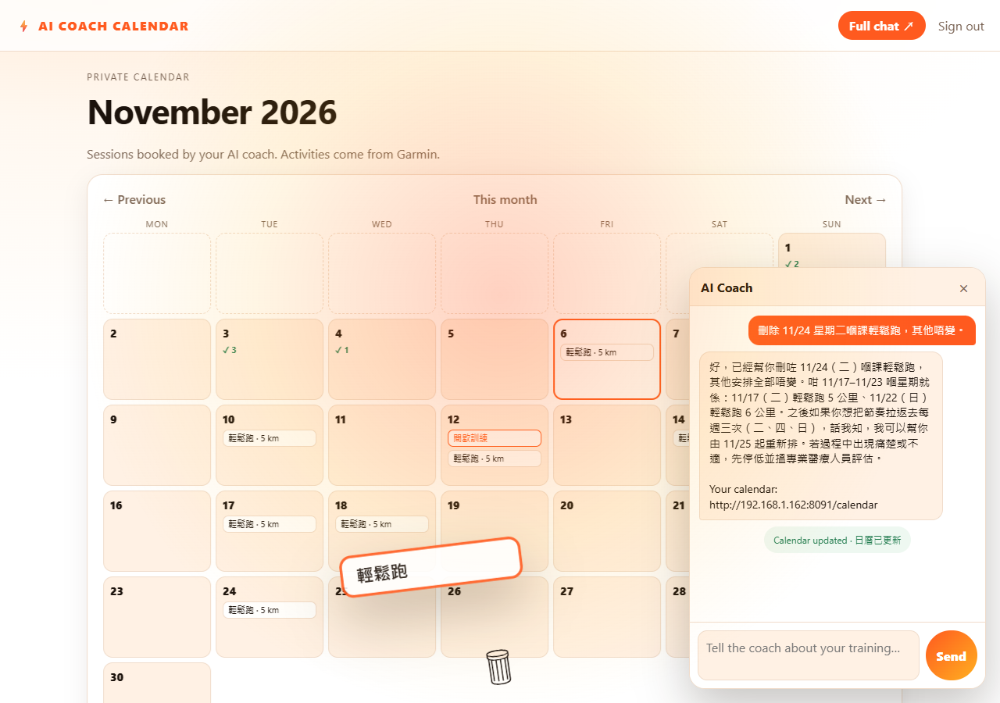

# POC3 — Calendar-first AI coach

**Status:** standalone proof of concept · **Surface:** private calendar + in-calendar coach bubble · **Repo:** training-planner-3

---

## 1. What POC3 is

POC3 keeps the conversation, memory and planning, but moves the **calendar to the centre of the product**. After signup and
login the runner lands on a private month calendar. The coach lives in a bubble on that page: the runner talks to it, and the calendar
is the coach's working surface — it books, moves and deletes sessions in front of the runner, with a page-wide animation.

The coach is not a human. It is an LLM behind a small server that validates every proposal before writing anything. The
calendar is **system-owned**: it is not the runner's Google/Outlook calendar, and the runner never has to curate it by hand.

POC3 is deliberately narrower than the earlier proofs:

- **Standalone product.** The calendar and the bubble are the product.
- **Standalone accounts.** Multiple runners can sign up; every account has its own profile, calendar, conversations and
  change history. Admin tooling is out of scope.
- **The coach is the only writer.** There is no manual edit form; the bubble is the edit path.
- **Every edit is auditable.** Each batch is stored with before/after snapshots and can be undone by another coach turn.

---

## 2. Why calendar-first

| Problem with chat-first | POC3 answer |
|---|---|
| A chat thread hides the plan; the runner has to remember what was booked | The plan is visible immediately: month grid, today ring, Garmin completions |
| "Coach said it changed something" is hard to verify | Every change is a visible cell edit + animation + `poc3.changes` metadata |
| Chat UIs are generic; a training plan has days, weeks and load | Calendar-native CRUD, batch edits, day detail |
| Embedding a separate chat application is heavy (iframe, cookies, double login) | A same-origin bubble: no iframe, no second login, direct DOM access for animation |

The design decision is recorded in [`adr/0002-calendar-first-bubble.md`](adr/0002-calendar-first-bubble.md).

---

## 3. The user journey

1. Open `http://<host>:8091/signup`, create an account (username, display name, password, timezone, optional goal), then
   sign in.
2. Land on **November 2026** (or the current month). Empty days are dashed; booked days carry session chips; Garmin days
   carry a `✓ n` badge. The nav shows your display name and links to **/profile**.
   The coach header shows the booking limit: **Bookings up to 180 days ahead · 可預約未來 180 日**.
3. Click **💬 Coach** (bottom-right). Tell it a goal or a constraint:
   - "I want to run a 10k in 8 weeks."
   - "Move Tuesday's run to Wednesday and delete Sunday's."
   - "I only have 30 minutes on weekdays."
4. The coach replies in the bubble and books the plan. The month grid updates **in place**; changed days animate.
5. The coach returns 1–3 tappable suggestions after every turn. To undo, the runner simply asks the coach in conversation
   (for example "undo the last change"); there is no history panel or Undo button.
6. Later, Garmin activities appear on the same calendar after a sync. The coach can refer to them on the next turn.

---

## 4. Architecture

```
┌─────────────────────────────────────────────────────────────────────┐
│ Browser                                                             │
│  :8091/calendar   month grid + day cells + Garmin badges            │
│  💬 Coach bubble  self-implemented HTML/CSS/JS, same-origin          │
│        │ POST /chat                                                  │
└────────┼────────────────────────────────────────────────────────────┘
         ▼
┌──────────────────────┐        ┌─────────────────────────────────────┐
│ POC3 web (:8091)     │        │ POC3 gateway (:8090)                │
│ src/web.ts           │───────▶│ src/gateway.ts                      │
│ - signup/login/      │  HTTP  │ - OpenAI-compatible /v1/chat/...    │
│   profile/cookie     │        │ - prompt + validate + apply CRUD    │
│ - month/day render   │        │ - change sets + revert + suggestions│
│ - /calendar/data     │        └───────────────┬─────────────────────┘
│ - /sync (Garmin)     │                        │
└──────────┬───────────┘                        ▼
           │                          ┌──────────────────────────────┐
           │                          │ SQLite (node:sqlite)         │
           │                          │ messages, memories,          │
           │                          │ sessions, activities         │
           │                          └──────────────────────────────┘
           ▼
   Garmin Personal API
   activities
```

Key properties:

- **One store.** The calendar page and the gateway share the same SQLite file. The bubble never talks to the LLM directly;
  it always goes through `/chat` → gateway.
- **No iframe.** The bubble is part of the calendar document (ADR-0002). It can read the month cells and animate them.
- **Server-side validation.** The model proposes; `parseCoachTurn` validates day, horizon, kinds, counts and CRUD ids before
  any write (ADR-0001).
- **Accounts are server-side.** `src/auth.ts` hashes passwords with scrypt and issues a signed `poc3_session` cookie; every
  route resolves the current user and scopes all reads/writes to that `userId`.
- **The calendar is a projection.** The booking is stored in SQLite; the calendar page reads SQLite.
- **Changes are auditable.** The gateway writes one `ChangeSet` per batch with before/after snapshots; a later coach turn can
  revert it.

---

## 5. Surfaces

| Surface | URL | Implementation | Purpose |
|---|---|---|---|
| Private calendar | `/calendar` (`:8091`) | `src/web.ts` + `src/styles.ts` | month grid, day detail, Garmin badges |
| Coach bubble | bottom-right of the calendar | self-implemented in `renderChatBubble()` | short turns, bookings, CRUD, revert, suggestions, animation; reloads the recent conversation on open |
| Coach gateway | `:8090/v1` | `src/gateway.ts` | OpenAI-compatible model `poc3-coach`; the only writer |
| Accounts | `/signup`, `/login`, `/logout` | `src/auth.ts` + `src/web.ts` | standalone multi-user accounts |
| Profile | `/profile` | `src/web.ts` | display name, timezone, goal, optional password change |
| Day detail | `/day/YYYY-MM-DD` | `src/web.ts` | one day's sessions and activities |
| Garmin sync | `POST /sync` | `src/garmin.ts` | pull recent activities into the calendar |

The bubble is a same-origin client of `/chat`; it is not an iframe, widget or API-key embed.

---

## 6. Data model

SQLite tables (created by `src/store.ts`):

| Table | Key fields | Notes |
|---|---|---|
| `messages` | `message_id`, `user_id`, `role`, `text`, `created_at` | conversation history for prompt context |
| `memories` | `memory_id`, `user_id`, `text`, `created_at` | durable facts the coach chose to remember |
| `sessions` | `session_id`, `user_id`, `day`, `payload`, `created_at` | the training plan; `payload` is the full session JSON |
| `activities` | `activity_id`, `user_id`, `day`, `payload`, `created_at` | Garmin activities mapped to calendar days |
| `users` | `user_id`, `username` (unique, case-insensitive), `payload`, `created_at` | standalone account + profile + password hash |
| `change_sets` | `change_set_id`, `user_id`, `created_at`, `payload`, `reverted_at` | audit log; payload has before/after entries |

Session payload:

```json
{
  "sessionId": "session:<sha256(userId:day:kind:title)[0..32]>",
  "userId": "u_<uuid>",
  "day": "2026-11-10",
  "title": "輕鬆跑",
  "kind": "easy",
  "distanceKm": 5,
  "durationMin": 35,
  "note": "可以邊跑邊講嘢嘅速度",
  "createdAt": "2026-11-06T01:00:00.000Z"
}
```

The session id is deterministic for an add (`day + kind + title`), so re-planning the same booking replaces it instead of
duplicating. `update` and `remove` target the existing id supplied by the prompt facts.

`change_sets` is the audit trail. Each entry stores the full `before` and `after` session snapshots, so the inverse is
unambiguous: an add is undone by a delete, a remove by restoring the snapshot, an update by restoring the previous snapshot.
A revert is itself recorded as a new change set, so the history remains append-only.

---

## 7. The coach contract

The model is asked for exactly one JSON object:

```json
{
  "reply": "string",
  "memories": ["string"],
  "sessions": [
    {
      "action": "add" | "update" | "remove",
      "sessionId": "session:… | null",
      "day": "YYYY-MM-DD",
      "title": "string",
      "kind": "easy" | "long" | "interval" | "tempo" | "rest" | "cross" | "race" | "racewalk",
      "distanceKm": 0,
      "durationMin": 0,
      "note": "string | null"
    }
  ],
  "suggestions": ["1–3 short follow-ups"],
  "revertChangeSetId": "change:… | last | null"
}
```

Rules enforced by `src/coach.ts`:

- `add` and `update` need a day in `[today, today + 180]`; a past day is rejected. A month/day without a year resolves to the next occurrence on or after today.
- `update` and `remove` need an existing `sessionId` from the facts.
- At most **14 actions** per turn; titles ≤ 80 chars; notes ≤ 280; distance 0–60 km; duration 0–300 min.
- `suggestions` is required: 1–3 items, each 1–120 chars. They become tappable chips in the bubble.
- `revertChangeSetId` is optional: an existing change-set id, or `"last"` for the newest non-reverted batch. A turn cannot
  combine a revert with `sessions`; that is rejected with zero writes.
- Unknown keys, wrong types, invalid kinds and malformed days reject the whole turn.
- A rejected turn writes **nothing**; the reply is a deterministic fallback. If the model echoes the JSON schema itself, the gateway asks once more with an explicit repair instruction before falling back.
- The prompt includes the last 10 turns as "Conversation so far", the upcoming schedule with session ids, and the recent
  change sets (id, summary, createdAt, revertedAt), and asks the coach to review the existing plan before editing.

### CRUD, in one turn or many

A single reply may contain a batch of actions across days:

```json
"sessions": [
  { "action": "update", "sessionId": "session:a", "day": "2026-11-11", … },
  { "action": "update", "sessionId": "session:b", "day": "2026-11-13", … },
  { "action": "remove", "sessionId": "session:c" },
  { "action": "add",    "day": "2026-11-20", … }
]
```

The gateway applies the batch in order, records one change set with before/after snapshots, and returns the changes for
the UI:

```json
{
  "poc3": {
    "sessions": 4,
    "memories": 1,
    "changes": [
      { "action": "update", "fromDay": "2026-11-10", "toDay": "2026-11-11", "title": "輕鬆跑", "kind": "easy" },
      { "action": "remove", "fromDay": "2026-11-17", "toDay": null, "title": "輕鬆跑", "kind": "easy" }
    ],
    "changeSetId": "change:…",
    "reverted": false,
    "suggestions": ["加一次週末長跑", "將星期五改去星期六"]
  }
}
```

### Change history and undo

Every batch is stored as a `ChangeSet` with `entries: ChangeEntry[]`. Each entry carries the full `before` and `after`
session snapshots, the action and the old/new day:

```ts
interface ChangeEntry {
  action: "add" | "update" | "remove" | "revert";
  sessionId: string;
  before: TrainingSession | null;
  after: TrainingSession | null;
  fromDay: string | null;
  toDay: string | null;
  title: string;
  kind: SessionKind;
}
```

A later coach turn can undo it by returning `revertChangeSetId` (or `"last"`). The gateway applies the inverse in reverse
order:

- `add` → delete the added session
- `remove` → restore the `before` snapshot
- `update` → restore the `before` snapshot (including a move back to `fromDay`)

The revert is itself appended as a new change set (`summary: "Undo: …"`), and the original set is marked `revertedAt`. This
keeps the log append-only and auditable. The log is internal: there is no history panel and no `/calendar/history` route.
Undo is intentionally **not a button**: the runner orders it inside the conversation, and the coach uses the same validated
revert path. There is no direct revert API shortcut.

---

## 8. Calendar UX and animation

- **Month grid** with Monday-first weeks, today ring, out-of-month dimming, previous/next month. The nav marks the current
  month as **This month** and changes that label to **Back to <current month>** when viewing another month.
  Clicking the month heading or the **This month / Back to <current month>** nav item opens the same **year/month
  picker**: pick any year (2000–2100) and any month, or jump back with **This month**.
- **Session chips** carry title + distance; colours by kind (`easy`, `long`, `interval`, `tempo`, `rest`, `cross`, `race`, `racewalk`).
- **Garmin badge** `✓ n` on days with activities.
- **Bubble** is a full-height floating panel: the log fills the available height and scrolls, with suggestions and the input
  pinned below; desktop and mobile both use the viewport height.
- **CRUD animation** (verified in headless Chrome):
  - `update`: the chip leaves the old cell, flies in an arc to the new day, scales up and rotates; the target cell pulses green.
  - `remove`: the chip flies into a bin at the bottom centre, shrinks and fades; the old cell pulses red and the bin pops.
  - `add`: the new chip pops into the target day.
  - Multiple changes leave in a **140 ms stagger**, so a multi-day edit reads as one coordinated action.
  - A full-page warm flash + short shake runs behind the animation. The grid is refreshed **before** the animation, so the
    end state is correct even if the animation is interrupted.



### Day actions

Clicking a day cell opens a small menu anchored to that day:

| Choice | What it does |
|---|---|
| Add a session here | Opens the coach bubble with `Add a session on YYYY-MM-DD: ` prefilled; the runner completes the request |
| Move a session here | Prefills `Move a session to YYYY-MM-DD: ` so the runner names the source |
| Delete a session here | Sends `Delete the session on YYYY-MM-DD.`; disabled when the day has no session |
| Ask coach about this day | Sends `What is planned on YYYY-MM-DD? Review it and suggest changes.` |
| View day details | Navigates to `/day/YYYY-MM-DD` |

All write choices go through the coach; there is no direct edit API. The menu closes on Escape, outside click, or after a
choice, and is keyboard reachable (Enter/Space on a focused day).

---

## 9. Garmin

`src/garmin.ts` calls the Garmin Personal API:

- Token endpoint returns a **bare JWT as `text/plain`**, not JSON; the client handles both.
- Activities: `activitylist-service/activities/search/activities?start=0&limit=N` with `Authorization: Bearer <jwt>`.
- `mapGarminActivity` maps an activity to `{ activityId, day, title, kind, distanceKm, durationMin, source: "garmin" }`.
- `POST /sync` pulls recent activities into SQLite and redirects back to the calendar. Garmin is the completion source; the
  coach is the booking source.

Environment: `GARMIN_PERSONAL_API_KEY`.

---

## 10. HTTP API

### Gateway (`:8090`)

| Method | Path | Purpose |
|---|---|---|
| `GET` | `/health` | liveness + model name |
| `GET` | `/v1/models` | OpenAI-compatible model list (`poc3-coach`) |
| `POST` | `/v1/chat/completions` | one coach turn; `stream` supported (single-chunk SSE) |

The gateway binds `127.0.0.1` and trusts the internal `x-poc3-user` header set by the web server; the browser never talks to
it directly. The web surface is the authenticated entry point.

### Calendar web (`:8091`)

| Method | Path | Purpose |
|---|---|---|
| `GET`/`POST` | `/signup` | create a standalone account (username, display name, password, timezone, goal) |
| `GET`/`POST` | `/login` | password login; sets the signed `poc3_session` cookie |
| `GET` | `/logout` | clears the cookie |
| `GET`/`POST` | `/profile` | display name, timezone, goal, optional password change |
| `GET` | `/calendar?month=YYYY-MM` | month grid (authenticated, user-scoped) |
| `GET` | `/day/YYYY-MM-DD` | day detail |
| `GET` | `/calendar/data?month=YYYY-MM` | JSON used by the in-place refresh |
| `POST` | `/chat` | bubble proxy → gateway; returns `{reply, sessions, changes, suggestions, changeSetId, reverted}` |
| `GET` | `/chat/history` | the signed-in runner's recent messages, oldest first (used to restore the bubble after refresh) |
| `POST` | `/sync` | Garmin pull |
| `GET` | `/static/app.css` | styles |

All page routes except `/login`, `/signup`, `/health` and `/static/app.css` redirect unauthenticated requests to `/login`.

---

## 11. Run it

Requirements: Node.js 24+, pnpm 12+ (or npm), a model endpoint that speaks OpenAI chat completions.

```bash
pnpm install
```

Set the minimum environment (PowerShell shown):

```powershell
$env:POC3_AUTH_SECRET='<long random secret>'
$env:POC3_DB='sqlite:data/poc3.sqlite'
$env:POC3_MODEL_BASE_URL='http://192.168.1.202:8102/v1'
$env:POC3_MODEL_API_KEY='<model key>'
$env:POC3_MODEL_NAME='dgx/general'
$env:POC3_CALENDAR_URL='http://127.0.0.1:8091/calendar'
$env:GARMIN_PERSONAL_API_KEY='<Garmin personal API key>'
pnpm dev
```

Then:

- Sign up: `http://127.0.0.1:8091/signup`
- Calendar: `http://127.0.0.1:8091/calendar`
- Gateway: `http://127.0.0.1:8090/health`

Ports: `POC3_GATEWAY_PORT` (default `8090`), `POC3_WEB_PORT` (default `8091`).

### Environment reference

| Variable | Default | Meaning |
|---|---|---|
| `POC3_GATEWAY_PORT` | `8090` | gateway port |
| `POC3_WEB_PORT` | `8091` | calendar port |
| `POC3_DB` | `sqlite:data/poc3.sqlite` | SQLite spec; directory is created |
| `POC3_AUTH_SECRET` | `poc3-dev-secret-change-me` | HMAC secret for the signed session cookie; set a strong value |
| `POC3_USER_ID` | `demo-runner` | gateway fallback when no `x-poc3-user` header |
| `POC3_MODEL_BASE_URL` | `http://192.168.1.202:8102/v1` | OpenAI-compatible endpoint |
| `POC3_MODEL_API_KEY` | empty | model bearer |
| `POC3_MODEL_NAME` | `dgx/general` | model name |
| `POC3_MODEL_ID` | `poc3-coach` | id exposed by the gateway |
| `POC3_CALENDAR_URL` | `http://127.0.0.1:8091/calendar` | link appended to replies |
| `POC3_GATEWAY_URL` | `http://127.0.0.1:8090` | web → gateway |
| `GARMIN_PERSONAL_API_KEY` | empty | Garmin Personal API key |

Never commit real keys or `.env` files.

---

## 12. Testing and gates

```bash
pnpm lint
pnpm typecheck
pnpm test
```

Current state: **87 tests in 6 files** — auth (signup/login/cookie/profile), coach contract/actions/suggestions/revert, gateway
streaming + CRUD + batch + change sets + revert, store users/change sets, Garmin mapping/token quirks, calendar web + conversation reload.

The lint gate is `tools/lint.mjs`: no `console` in `src` except `index.ts`, no `TODO`, no `any`, no obvious secrets.

---

## 13. Honest limits

1. **No streaming in the bubble.** `/chat` waits for the whole reply; the gateway supports streaming.
2. **Auth is PoC-grade.** The default `POC3_AUTH_SECRET` must be replaced; there is no email verification, password reset,
   rate limit or session revocation list.
3. **The gateway trusts `x-poc3-user`.** It binds localhost and is meant to sit behind the web server; do not expose it.
4. **No manual edit form.** The coach is the only writer by design; the runner can only ask it.
5. **No external calendar sync.** Google/Outlook/CalDAV are out of scope.
6. **Single-process SQLite.** Fine for a PoC; not a multi-instance production store.
7. **Animation is best-effort.** It is DOM/CSS/Web Animations; reduced-motion users get the grid update without the flourish.

---

## 14. Documents

- [`FEATURES-FOR-REVIEW.md`](FEATURES-FOR-REVIEW.md) — candidate features from PoC1/PoC2, prioritised for review.
- [`adr/0001-server-validated-coach.md`](adr/0001-server-validated-coach.md)
- [`adr/0002-calendar-first-bubble.md`](adr/0002-calendar-first-bubble.md)
- [`design/calendar-crud-animation.png`](design/calendar-crud-animation.png)

POC3 is a proof of concept, not a production plan. The next step is the owner's review of the feature backlog.
