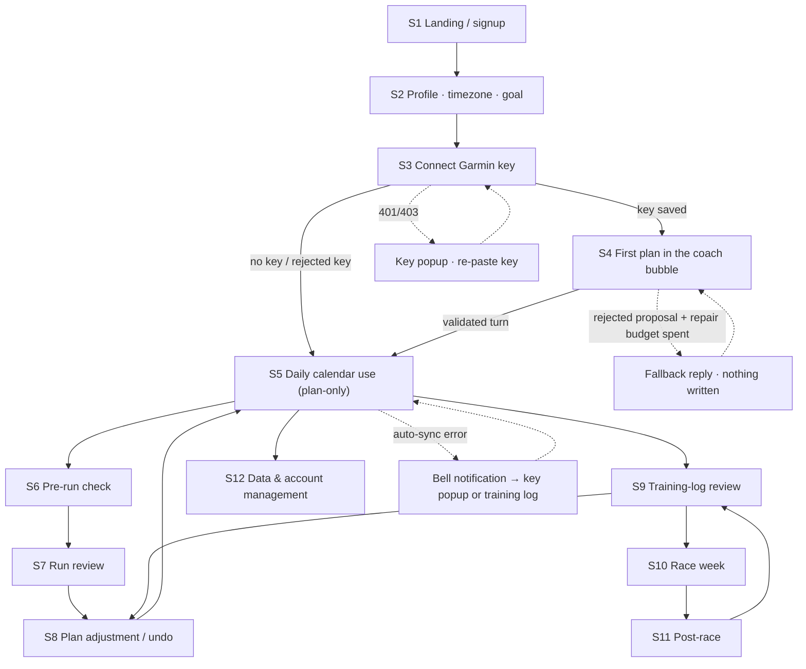
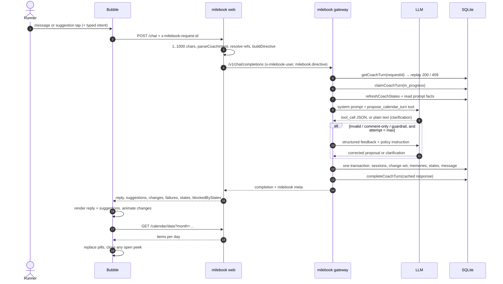
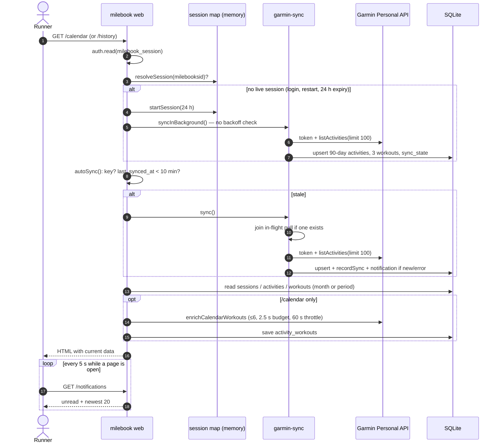

# Milebook — end-to-end user workflow map

**Status:** complete (read-only analysis) · **Date:** 2026-11-18 · **Shared task:** `task-1` · **Owner:** product analysis
**Product:** Milebook, a calendar-first AI coach for runners (`milebook web` :8093 live / :8091 default, `milebook gateway` :8092 live / :8090 default).
**Scope:** every runner-facing workflow and surface, from first landing to data/account management, plus the cross-cutting
flows (auto-sync, coach turn, validation/repair, idempotency, undo, coaching states, notifications, timezone, auth, isolation).
**Out of scope:** solutioning. This document is the factual map; the gap analysis is the next document.
**Deliverable:** this file is the only artefact written. No source, test, data or doc file was modified; no server was started
or stopped; no SQLite file was touched.

---

## 1. How to read this document

### 1.1 Evidence legend

| Marker | Meaning | How it was produced |
|---|---|---|
| **Code anchor** `src/file.ts:NN` | A claim verified by reading that line in the working tree during this session. | `read`/`grep` against the checkout at `C:\Users\MY\Desktop\Development\training-planner-poc3`. |
| **Doc anchor** `docs/FILE.md:NN` | A claim whose source of truth is a document (contract, ADR, research), not code. | Line numbers are the current file's lines. |
| **`[inference]`** | Behaviour derived by reasoning from code that was read, but not observed at runtime (no server was started). | The reasoning step is stated in the sentence. |
| **`[drift]`** | Documentation and code disagree; both anchors are given and the code is treated as the observed behaviour. | Cross-check during writing. |

### 1.2 Confidence scale

| Level | Test |
|---|---|
| **High** | Directly readable in the cited lines; no runtime assumption needed. |
| **Medium** | Requires an inference step (browser behaviour, timing, Garmin payload variance, or two conditions coinciding). The inference is written out. |
| **Low** | Plausible but depends on unverified environment details (device, network, Garmin schema, browser feature support). |

### 1.3 Corpus note (anchor drift)

The analysis brief quoted approximate file sizes; the working tree is larger, and every anchor here uses the real numbers:
`web.ts` 3,903 (brief 3,716) · `gateway.ts` 1,160 (1,102) · `coach.ts` 610 (580) · `directives.ts` 423 (403) ·
`coach-states.ts` 694 (655) · `coach-state-catalog.ts` 656 (646) · `training.ts` 307 (279) · `garmin-sync.ts` 250 (225) ·
`garmin-workout.ts` 435 (399) · `garmin.ts` 456 (417) · `store.ts` 866 (790) · `auth.ts` 343 (299) · `history.ts` 93 (87) ·
`web-coach-states.ts` 247 (239) · `time.ts` 63 (56) · `styles.ts` 551 (540) · `types.ts` 483 (446).
`src/web.ts` still holds the route table **and** the inline client scripts (bubble `src/web.ts:1615`, account menu
`src/web.ts:1324`, bell `src/web.ts:1368`, Garmin modal `src/web.ts:1507`), which is why so many client anchors sit in one
file.

### 1.4 What was *not* verified

- No server was started, so no live route, animation, Garmin pull or model turn was observed. Anything depending on
  wall-clock timing, Garmin payload shape or browser rendering is marked `[inference]` even when the code is unambiguous.
- The Garmin `activity/workouts` DTO is not fully published (`docs/GARMIN-TRAINING-PROGRAMS.md:61-64`); workout content is
  only verifiable as "the mapper's contract", never as "what Garmin returns".
- `test/` was not read line-by-line; the suite is treated as a claim (`README.md:253`, `docs/MILEBOOK-CALENDAR.md:939`).

---

## 2. Personas and segments

Eight segments. Each is a runner the workflow must serve; "fit" states what Milebook actually does, not what it aspires to.
Segment selection is an inference from the feature set (calendar-first planning + Garmin completion + race/load states);
the JTBD statements are analyst-authored.

| ID | Segment | Primary job-to-be-done | Milebook fit today | Blocking gap |
|---|---|---|---|---|
| **P1** | First-5K beginner | "Tell me what to run this week and don't make me learn a training system." | Good: three starter prompts, eight session kinds, beginner coaching state | Goal typed at signup never reaches the coach (WF-01); no guided first plan |
| **P2** | Half/marathon race-focused | "Build and protect a race block, then tell me how it went." | Strong: race kind, race day/week/taper/post-race states, hard guardrails | No goal race date, no countdown, no race-day briefing (WF-27) |
| **P3** | Garmin power user | "Use everything my watch knows: load, laps, zones, the workout I followed." | Strongest segment: paired pill, workout brief, splits/laps/zones/PRs, load card | PR/best-effort scope silently capped (WF-17); no zone boundaries, no gear |
| **P4** | Non-Garmin / manual runner | "Log the run I actually did, from any watch or none." | **Blocked**: the only writer of activities is Garmin sync | No manual/reported activity entry (WF-02); "Reported" source is unreachable |
| **P5** | Returning from injury | "Let me come back slowly and stop me when I overreach." | Good guardrails: pain/illness/return states with confirmation and hard blocks | Confirmation card is lost on refresh (WF-13); run/walk sessions can't be logged without Garmin (WF-02) |
| **P6** | Time-crunched parent | "Fit 3 short sessions into a real week, and remind me." | Good: time-crunch state, day-menu prefills, short sessions | No reminders at all (CN-05); mobile is a fixed 7-column grid (WF-22) |
| **P7** | Masters / older runner | "Progress conservatively and show me whether the ramp is safe." | Good: masters state, ACWR/load card, hard/easy split | No wellness inputs (sleep/HRV), no RPE/feel; ACWR is Garmin-load-only (`docs/COACH-STATES.md:318`) |
| **P8** | Bilingual (zh-Hant/en) runner | "Speak to me in my language and keep the plan readable." | Partial: coach replies in Traditional Chinese when the message contains Chinese (`src/coach.ts:232`); key strings are bilingual | Static UI copy is mostly English; dates are en-GB only (`src/web.ts:404-407`) |

### P1 — First-5K beginner

- **JTBD / needs:** "Tell me what to run this week"; a first plan without training vocabulary, walk breaks allowed, no punishment for a missed day.
- **Milebook fit:** three starter prompts on first open (`src/web.ts:95`, `src/web.ts:1874-1877`); eight kinds with friendly labels (`src/web.ts:915-928`); a `beginner` state with walk-break guidance (`src/coach-state-catalog.ts:509-517`); the coach is told to build a periodic system from a training-related message (`src/coach.ts:238`).
- **Break / confidence:** the signup "Training goal" (`src/web.ts:2740`, stored `src/web.ts:2984`) is absent from the prompt facts (`src/coach.ts:265-302`, `CoachPromptInput` `src/coach.ts:106-129`); its only consumer is `plan_stale` (`src/coach-states.ts:280`). High.

### P2 — Half/marathon race-focused runner

- **JTBD / needs:** a race date on the calendar, taper logic, hard-session protection in race week, a post-race rebuild, and a review of the race itself.
- **Milebook fit:** `race`/`racewalk` kinds (`src/coach.ts:26`); race day/week/taper detection with TTLs (`src/coach-states.ts:182-207`); post-race detection (`src/coach-states.ts:148-175`, `:209-219`); guardrails over the effective post-turn calendar (`src/coach-states.ts:631-685`).
- **Break / confidence:** no goal-race object, no goal time, no countdown, no race briefing; a race beyond 180 days is refused by the validator (`src/coach.ts:465-467`). High.

### P3 — Garmin power user

- **JTBD / needs:** automatic completion plus deep metrics: laps, zones, PRs, load, and the executed workout.
- **Milebook fit:** paired pill (`src/web.ts:327-344`), workout brief (`src/web.ts:894-912`), detail step card (`src/web.ts:629-641`), splits (`src/web.ts:605-614`), laps (`src/web.ts:616-623`), zones (`src/web.ts:677-689`), PR badges (`src/web.ts:597-602`), load card (`src/training.ts:222-307`).
- **Break / confidence:** PRs and best efforts are stored-history only — 100 activities / 90 days (`src/garmin-sync.ts:41-44`) — and the pages do not say so (`src/web.ts:691-696`); the trend keeps 12 runs (`src/web.ts:1184-1189`). High.

### P4 — Non-Garmin / manual runner

- **JTBD / needs:** "I ran; put it on the calendar even though my watch isn't a Garmin."
- **Milebook fit:** only the vocabulary: `Activity.source` allows `"chat"` (`src/types.ts:67`), the UI renders a "Reported" chip (`src/web.ts:393-395`), and the log header says "from Garmin and reported runs" (`src/web.ts:3581`).
- **Break / confidence:** the only `store.appendActivity` caller in the tree is the Garmin sync (`src/garmin-sync.ts:165`), so the "Reported" branch is dead code and this segment cannot use the completion half at all. High (grep-verified single call site).

### P5 — Returning-from-injury runner

- **JTBD / needs:** pain/return context, run/walk sessions, hard-session blocks, and a way to record a cautious 12-minute jog.
- **Milebook fit:** `pain_injury` and `return_to_run` require confirmation and block intensity/racing (`src/coach-state-catalog.ts:283-366`); illness blocks everything but rest (`:304-320`); the gateway enforces with one repair (`src/gateway.ts:1011-1047`).
- **Break / confidence:** the confirmation card is DOM-only and lost on refresh (`src/web.ts:1878-1959` vs `src/web.ts:1652-1668`); completed return-to-run sessions cannot be recorded without Garmin (WF-02). High.

### P6 — Time-crunched parent

- **JTBD / needs:** three 30-minute sessions, a view of what is coming, reminders, phone-first use.
- **Milebook fit:** `time_crunch` state (`src/coach-state-catalog.ts:397-405`); day-menu prefills "Add a session on …" / "Move a session to …" (`src/web.ts:2152-2153`).
- **Break / confidence:** no reminders (the bell is a Garmin feed, `src/types.ts:142`), the Plan surface is month-only (`src/web.ts:3601-3648`), and the grid stays seven columns with 104 px cells on a phone (`src/styles.ts:38`, `:70`). High.

### P7 — Masters / older runner

- **JTBD / needs:** conservative progression, visible ramp warnings, more recovery, an explanation for fatigue.
- **Milebook fit:** `masters` state (`src/coach-state-catalog.ts:537-545`); load card with ACWR, week change, hard/easy and signal chip (`src/web.ts:3546-3562`, `src/training.ts:268-307`); `sleep_debt`/`high_stress` states (`src/coach-state-catalog.ts:411-433`).
- **Break / confidence:** those states are chat/user-only — no wellness ingestion (`docs/COACH-STATES.md:318`); ACWR returns `insufficient` without a baseline (`src/training.ts:239-240`). High.

### P8 — Bilingual (zh-Hant/en) runner

- **JTBD / needs:** Traditional Chinese coach replies and readable dates; bilingual key actions.
- **Milebook fit:** the coach language rule (`src/coach.ts:232`); bilingual system lines (`src/web.ts:2005`, `:2013`, `:2044`); bilingual state headings (`src/web-coach-states.ts:229`).
- **Break / confidence:** nav, forms, empty/error copy and the whole log are English-only; the stored failure note picks Chinese vs English from the *reply* text (`src/gateway.ts:385-390`); dates are `en-GB` with a UTC day (`src/web.ts:404-407`). High for copy, Medium for the blocking claim (inference).

### 2.1 Segment coverage

`yes` = reachable in code today; `—` = not segment-critical; **no** = verified gap (see §6, §7).

| Capability | P1 | P2 | P3 | P4 | P5 | P6 | P7 | P8 |
|---|---|---|---|---|---|---|---|---|
| Coach-written plan | yes | yes | yes | yes | yes | yes | yes | yes |
| Garmin completion | optional | yes | yes | **no** | yes | optional | yes | optional |
| Manual completion | **no** | **no** | **no** | **no** | **no** | **no** | **no** | **no** |
| Race phase + guardrails | — | yes | yes | — | partial | — | — | — |
| Load/ramp analysis | — | yes | yes | — | partial | — | yes | — |
| Reminders | — | — | — | — | — | **no** | — | — |
| Phone-first layout | — | — | — | — | — | **no** | — | — |
| Goal visible to coach | **no** | **no** | **no** | **no** | **no** | **no** | **no** | **no** |

---

## 3. End-to-end journey

Twelve stages. The flowchart is the happy path plus the two loops that actually exist in code: plan→calendar→plan (coach
edits) and calendar→log→plan (review-driven edits). Dashed edges are failure/recovery paths.

### S1 — Landing / signup

| Field | Detail |
|---|---|
| **Trigger** | Runner opens the root URL with no valid `milebook_session` cookie; every page route redirects to `/login` (`src/web.ts:3010-3013`). |
| **Surfaces / routes** | `GET /login` (`src/web.ts:2938-2945`), `GET /signup` (`src/web.ts:2967-2975`), `POST /signup`, `POST /login`, `GET /logout` (`src/web.ts:2999-3008`). Signed-out layout shows only Sign in / Sign up (`src/web.ts:1598-1601`). |
| **User actions** | Username (`[a-z0-9_]{3,24}`), display name (1-60), password (≥8), timezone (form default `Asia/Hong_Kong`), optional goal (≤120). |
| **System behavior** | `auth.signup` normalises/validates, hashes with scrypt, stores the profile and returns a signed cookie (`src/auth.ts:258-279`). Signup immediately starts a browser session and redirects to `/calendar` (`src/web.ts:2986-2988`), so no separate login is needed. `milebooksid` is in-memory, HttpOnly, 24 h (`src/web.ts:87-88`, `:159-160`); `milebook_session` is stateless HMAC, 30 days (`src/auth.ts:13-14`, `:240-246`). |
| **Success feedback** | Landing on the calendar with the runner's display name in the welcome line (`src/web.ts:3639-3640`). |
| **Failure / empty paths** | Validation errors redirect back with `?error=` and an escaped banner (`src/web.ts:2989-2992`, `:2712-2727`); duplicate username is `username-taken` (`src/auth.ts:265-267`). No "forgot password", no email verification, no rate limit (WF-21). |
| **Friction** | The docs' journey says "create an account, then sign in" (`docs/MILEBOOK-CALENDAR.md:53-54`) but code signs the runner in during signup `[drift]`; the timezone default differs between form (`src/web.ts:2739`), route fallback (`:2983`) and auth layer (`UTC`, `src/auth.ts:262`). |
| **Evidence** | `src/web.ts:2938-3008`, `src/auth.ts:13-14`, `:258-279`, `src/web.ts:1598-1610`. |

### S2 — Profile, timezone, goal

| Field | Detail |
|---|---|
| **Trigger** | First visit after signup, or account menu → **Profile** (`src/web.ts:1313`). |
| **Surfaces / routes** | `GET/POST /profile` (`src/web.ts:3030-3058`); account menu (`src/web.ts:1308-1321`). |
| **User actions** | Change display name, IANA timezone, free-text goal, and optionally the password (blank keeps it). |
| **System behavior** | `updateProfile` validates and persists; the route redirects to `/profile?saved=1` (`src/web.ts:3047-3049`). `today` is recomputed per request in the profile timezone (`src/web.ts:3015`, `src/time.ts:42-45`), so a timezone change moves the today ring, the default month and the coach horizon immediately. |
| **Success feedback** | "Profile saved." status line (`src/web.ts:2754`). |
| **Failure / empty paths** | Invalid timezone/name/password redirect with `?error=` (`src/web.ts:3050-3052`). The username field is read-only (`src/web.ts:2757`). The profile page has **no Garmin key control** (`src/web.ts:2749-2771`) even though `/coach-states` tells the runner to add it there (WF-03). |
| **Friction** | The goal field is a dead end for coaching: stored, displayed, used only by `plan_stale` detection, never in the prompt (WF-01). A timezone change moves "today" but not already-booked sessions (date-only, `src/types.ts:47-48`) — correct, but undocumented for the runner. |
| **Evidence** | `src/web.ts:2749-2771`, `:3015`, `src/coach.ts:265-302`, `src/coach-states.ts:280`. |

### S3 — Connect Garmin

| Field | Detail |
|---|---|
| **Trigger** | Account menu → **Sync Garmin now** (`src/web.ts:1300-1305`) or **Garmin key** (`:1316`); the bell footer link (`:1363`); a 401/403 error notification (`src/garmin-sync.ts:80-84`). |
| **Surfaces / routes** | `POST /garmin/key` (`src/web.ts:3839-3871`); the modal is rendered on `/calendar` and `/history` only (`:3638`, `:3444`) and auto-opens when the URL carries `garmin=setup` or `keyError` (`:1553`). |
| **User actions** | Follow four in-modal steps to Garmin Connect, create a Personal API key, paste it, press **Show** to verify, **Save & sync**. |
| **System behavior** | Plausibility check (`src/web.ts:171-174`), token exchange (`:3854-3861`), per-runner plaintext save (`:3862`, `src/store.ts:583-585`), client cached in memory (`:2778-2786`), then an immediate sync with `notifyWhenUnchanged: true` (`:3865`). |
| **Success feedback** | Redirect to `next` with `?synced=N` and optionally `?newest=<id>` (`src/web.ts:205-209`, `:3866`); the bell records the result (`src/garmin-sync.ts:187-197`). |
| **Failure / empty paths** | Empty key, implausible key and a rejected token all return to the modal with `keyError` (`src/web.ts:3843-3861`); Garmin 401/403/429/400 become actionable copy (`src/garmin-errors.ts:54+`). `/sync` with no saved key redirects to `garmin=setup` (`:3876-3879`). |
| **Friction** | `synced`/`syncError` are never rendered (WF-04); the `/coach-states` setup card links to a page with no key field (WF-03); `data-open-garmin` has no emitters (WF-03); no route deletes a saved key (CN-26). |
| **Evidence** | `src/web.ts:1479-1556`, `:3839-3887`, `src/garmin-sync.ts:59-92`, `src/store.ts:575-585`. |

### S4 — First plan creation (coach bubble)

| Field | Detail |
|---|---|
| **Trigger** | The runner clicks the 💬 Coach bubble (`src/web.ts:1616`) or a day-menu "Add a session here" (`:2152`). |
| **Surfaces / routes** | Bubble on every signed-in page (`src/web.ts:1605`); `POST /chat` (`:3151-3315`) → gateway `POST /v1/chat/completions` (`src/gateway.ts:793-1155`). |
| **User actions** | Type a goal or constraint, or tap a starter/coach suggestion. Day-menu prefills "Add a session on …" / "Move a session to …" without sending. |
| **System behavior** | Web validates message length 1-1000 (`src/web.ts:3162`), parses the typed intent (`:3167`), resolves referenced rows and builds the hidden directive (`:3174-3188`), then proxies. The gateway refreshes states (`src/gateway.ts:881-883`), builds the prompt (`src/coach.ts:262-342`), calls the model with one tool (`src/gateway.ts:210-240`), parses/validates (`src/coach.ts:392-609`), applies guardrails (`src/gateway.ts:1011-1047`) and writes one transaction (`:596-763`). |
| **Success feedback** | Reply bubble + up to 3 tappable suggestions (`src/web.ts:2000-2002`), "Calendar updated · 日曆已更新" (`:2003-2006`), grid refreshed in place and changed pills animated (`:1790-1846`). |
| **Failure / empty paths** | A validation failure returns structured feedback for **one** repair (`src/gateway.ts:926-1073`, `src/coach.ts:352-389`); after the budget the deterministic fallback is used (`src/gateway.ts:114-115`, `:314-328`). Partial batches return `failures` rendered as a "Could not apply · 未套用" card with **Show {day}** and **Try again** (`src/web.ts:2038-2081`). Transport failure → 502 "The coach is unavailable right now." with a Try-again chip (`:1990-1998`). |
| **Friction** | No streaming and no cancel (WF-25); comment-only turns and guardrail vetoes are explained only after the fact (WF-15); the 180-day horizon is invisible until a request exceeds it (WF-09). |
| **Evidence** | `src/web.ts:1960-2021`, `src/gateway.ts:876-1137`, `src/coach.ts:231-342`. |

### S5 — Daily calendar use

| Field | Detail |
|---|---|
| **Trigger** | Login, the Plan tab (`src/web.ts:1604`), or a bookmark to `/calendar?month=YYYY-MM`. |
| **Surfaces / routes** | `GET /calendar` (`src/web.ts:3601-3649`); `GET /calendar/data?month=` for the in-place refresh (`:3328-3356`); day menu (`:2022-2157`); month picker (`:2212-2296`). |
| **User actions** | Read the grid, hover a pill for the tooltip, click a day for actions, click a pill for its peek, click the month label for the picker, use ← Previous / Next →. |
| **System behavior** | `autoSync` runs before render (`src/web.ts:3605`), active state chips are computed (`:3606-3613`), sessions/activities/workouts are read scoped to the month (`:3614-3618`), missing workouts are filled up to 6 / 2.5 s / 60 s throttle (`:2802-2839`), and each cell renders up to four pills plus `+n more` (`:263-264`, `:383-390`). |
| **Success feedback** | Colored plan pills, green ✓ run pills, green/purple ◈ paired pills, today ring (`src/web.ts:3628`), tooltips with kind/distance/duration/pace/HR/note (`:276-292`, `:306-316`). |
| **Failure / empty paths** | Empty days are empty cells with no "book something" CTA. A malformed `?month=` throws inside `addDays` and lands on the 500 page (WF-26). Auto-sync errors appear only in the bell (`src/garmin-sync.ts:199-207`). |
| **Friction** | Month-only planning (CN-08); no today/week shortcut on the Plan surface; a refresh closes an open peek (`src/web.ts:1674`); a deleted session's pill disappears correctly because the server omits empty days and the client clears first (`:1679-1683`). |
| **Evidence** | `src/web.ts:3601-3649`, `:2022-2296`, `:1670-1785`, `:2802-2839`. |

### S6 — Pre-run check

| Field | Detail |
|---|---|
| **Trigger** | The runner opens the calendar on the session day and taps the plan pill. |
| **Surfaces / routes** | Session peek `GET /session/<sessionId>/peek` (`src/web.ts:3679-3703`), rendered by `renderSessionPeek` (`:2503-2552`). |
| **User actions** | Read kind, planned distance/duration, note and outcome; choose **View day**, **Ask coach**, **Open run** (when linked) or **Training log week**. |
| **System behavior** | `buildSessionPeek` computes the day outcome server-side (`src/web.ts:952-1003`): completed with match status, not matched, no run recorded, today/upcoming, planned rest, or "recorded anyway" on a rest day. Matching is day-scoped and greedy (`src/training.ts:57-101`). |
| **Success feedback** | Outcome chip + matched run metrics in one dialog (`src/web.ts:2522-2534`); "Ask coach" opens the bubble with a natural question plus a comment-only directive (`:1051-1052`). |
| **Failure / empty paths** | A failed peek shows "Could not load this session just now…" with **View day →** only (`src/web.ts:2387-2392`); a foreign/missing session is 404 (`:3692-3696`). |
| **Friction** | The peek exists **only** from the calendar grid; in the training log and `/day/<date>` planned sessions are inert text (WF-08). The outcome cannot be acted on directly (no "mark as done", no reschedule) — every action routes back to the coach. |
| **Evidence** | `src/web.ts:2503-2552`, `:952-1059`, `src/training.ts:57-125`. |

### S7 — Run review

| Field | Detail |
|---|---|
| **Trigger** | A new activity arrives from sync (bell + review card), or the runner taps a green pill / activity row / detail page. |
| **Surfaces / routes** | Run peek `GET /activity/<id>/peek` (`src/web.ts:3651-3677`); `/activity/<id>` (`:3733-3814`); training-log week rows (`:3460-3469`); auto-sync review card (`:3569-3573`). |
| **User actions** | Inspect metrics, plan match, program, load/effect, fastest efforts; open full detail; ask the coach; jump to the day or the week. |
| **System behavior** | Peek is built from stored fields only (`src/web.ts:844-876`) — no Garmin call. The detail page fetches Garmin samples, summary and workout on demand (`:3759-3780`) and stores the workout (`:648-675`). PR flags come from stored-history bests (`:809-815`, `src/training.ts:147-167`). |
| **Success feedback** | Popup with metrics/plan/program/efforts and four actions (`src/web.ts:2496-2501`); detail page with plan-vs-actual bars (`:748-761`), splits, laps, zones and PR badges. |
| **Failure / empty paths** | Failed peek → "Could not load this run just now…" with **Open full detail** and **View day** (`src/web.ts:2401-2405`). Failed splits/summary/workout degrade only their own card (`:605-641`). A run with no session is labelled Unplanned (`:786-789`). |
| **Friction** | The review prompt is ephemeral (WF-06); PR scope is unstated (WF-17); the detail page blocks on up to three Garmin calls (WF-05). |
| **Evidence** | `src/web.ts:844-912`, `:3733-3814`, `:648-675`. |

### S8 — Plan adjustment / undo

| Field | Detail |
|---|---|
| **Trigger** | The runner says "move Tuesday", "delete Sunday", "I only have 30 minutes", or "undo that". |
| **Surfaces / routes** | Bubble composer; day-menu "Delete a session here" (send-now) and prefilled add/move (`src/web.ts:2147-2157`). |
| **User actions** | Type the change, use the day menu, or tap a suggestion chip. Undo is requested in conversation — there is no button (`docs/MILEBOOK-CALENDAR.md:426-428`). |
| **System behavior** | The gateway applies a batch in order, records one change set with before/after snapshots (`src/gateway.ts:744-757`), and returns `changes` for the animation. A revert resolves `"last"` to the newest non-reverted set (`:393-398`), applies the inverse in reverse order (`src/history.ts:37-93`) and appends a new change set summarised "Undo: …". A revert cannot share a turn with edits (`:623-630`). |
| **Success feedback** | Pills fly/land/bin animation with 140 ms stagger (`src/web.ts:1803-1846`), "Calendar updated · 日曆已更新". |
| **Failure / empty paths** | Unknown/already-reverted change set → fallback reply explaining it (`src/gateway.ts:632-649`). A guardrail blocks the edit and the runner sees "Calendar unchanged — <state> · 日曆未有更改" (`src/web.ts:2011-2014`). |
| **Friction** | No history panel and no diff preview, so the runner cannot see what will be undone (WF-07); the animation has no remove branch for `revert` entries, so undoing an add shows a ghost animating in place with no cell pulse (WF-07); a state guardrail can veto a booking with no pre-warning (WF-15). |
| **Evidence** | `src/gateway.ts:596-763`, `src/history.ts:37-93`, `src/web.ts:1790-1846`, `:2152-2156`. |

### S9 — Training-log review

| Field | Detail |
|---|---|
| **Trigger** | View switcher → **Training log** (`src/web.ts:1604`) or "Training log week" from a peek (`:2500`). |
| **Surfaces / routes** | `GET /history?view=week\|month\|year&period=…` (`src/web.ts:3358-3599`); period bar (`:3424-3440`); detail page (`:3733`). |
| **User actions** | Switch view, page with ← / →, use **This week/month/year**, pick a date/month/year, drill year→month→week→day, open a run's detail, ask the coach about a run or the week. |
| **System behavior** | Page load calls `autoSync` (`src/web.ts:3415`); the view is chosen from `view`/`period` with a fallback to current (`:3359-3413`); week = seven day cards (`:3492-3505`), month = week rows (`:3506-3526`), year = month rows (`:3527-3544`); the load card is week-only (`:3546-3562`); best efforts appear on month/year (`:3564-3567`). |
| **Success feedback** | Summary stats, review card, load card with signal chip, volume chart, one metric-trend card with seven chips (`src/web.ts:1112-1176`, `:1251-1260`), period rows with drill links. |
| **Failure / empty paths** | "No recorded activities in this week yet." (`src/web.ts:3574-3576`); "No session or activity." per day (`:3474`); "No best-effort data in this period." (`:691-696`); a metric with fewer than two runs keeps an honest note (`:1199-1201`). A malformed `period` falls back for month/year but can throw for a bad week date (WF-26). |
| **Friction** | Planned sessions are inert (WF-08); the trend truncates at 12 runs (WF-18); the selected metric resets on navigation (documented as deliberate, `docs/TRAINING-LOG-PLAN.md:208-209`). |
| **Evidence** | `src/web.ts:3358-3599`, `:1112-1284`, `src/training.ts:222-307`. |

### S10 — Race week

| Field | Detail |
|---|---|
| **Trigger** | A `race` session is 0-7 days away; the gateway refreshes states on every turn (`src/gateway.ts:881-883`) and the calendar chips render them (`src/web.ts:3606-3613`). |
| **Surfaces / routes** | Calendar state chips → `/coach-states` (`src/web.ts:3610-3613`); bubble state cards (`:1878-1959`); manager page (`:3088-3123`). |
| **User actions** | See "Race week", read the guardrail copy, ask the coach for the week, resolve the state if it is wrong. |
| **System behavior** | Detection at 1-7 days → `race_week` confidence 0.90, TTL days+1 (`src/coach-states.ts:192-198`); 8-21 days → `taper` 0.80 (`:199-206`); the gateway blocks interval/tempo on race day-3..race day (`src/coach-state-catalog.ts:103-113`, `src/coach-states.ts:653-666`) and long runs inside the taper window (`src/coach-state-catalog.ts:115-155`). |
| **Success feedback** | Chip on the calendar, state card in the bubble, "Calendar unchanged — Race week · 日曆未有更改" when a write was refused (`src/web.ts:2011-2014`). |
| **Failure / empty paths** | If no race session is booked (usual when the race lives in Garmin), no state exists — there is no goal-race field and no future-plan import (CN-06). The state page shows stored states only; auto detection is persisted only by a turn or **Refresh** (`src/web.ts:3076-3086`, `docs/COACH-STATES.md:90-94`). |
| **Friction** | No race-day briefing, no goal time, no countdown (WF-27); the runner must know `/coach-states` exists (account menu `src/web.ts:1314`, chips). |
| **Evidence** | `src/coach-states.ts:180-314`, `src/coach-state-catalog.ts:78-155`, `src/gateway.ts:1011-1047`. |

### S11 — Post-race

| Field | Detail |
|---|---|
| **Trigger** | A race-like activity within 14 days (`src/coach-states.ts:148-175`, `:209-219`). |
| **Surfaces / routes** | Same state surfaces; the run detail/peek for the race itself. |
| **User actions** | Read the post-race state, ask what to do next, let the coach rebuild the week. |
| **System behavior** | `post_race` at 0.90 (planned race) or 0.70 (title heuristic), TTL `max(1, 14 - daysSince)` (`src/coach-states.ts:211-218`); guardrail blocks interval/tempo/race/racewalk from race day through +7 (`src/coach-state-catalog.ts:138-155`). Titles containing "race pace", "tempo", "interval" or "training" are excluded to avoid false positives (`docs/COACH-STATES.md:102-104`). |
| **Success feedback** | Chip + bubble card; the coach is told to protect recovery. |
| **Failure / empty paths** | A race recorded under an unusual title produces no `post_race` (`docs/COACH-STATES.md:377-378`); a race the runner did not book produces nothing. |
| **Friction** | Same confirmation-visibility issue as S10 (WF-13); no "race report" surface that ties the race activity to the plan in one place. |
| **Evidence** | `src/coach-states.ts:142-175`, `:209-219`, `src/coach-state-catalog.ts:138-155`. |

### S12 — Data and account management

| Field | Detail |
|---|---|
| **Trigger** | The runner wants to change something durable: profile, Garmin key, coaching states, sign out — or (not possible) delete data. |
| **Surfaces / routes** | Account menu (`src/web.ts:1308-1321`): Profile, Coaching states, Sync Garmin now, Garmin key, Sign out. `/coach-audit` by URL only (`:3060-3074`). |
| **User actions** | Edit profile, replace key, set/confirm/resolve a state, refresh states, sign out, inspect hidden directives (if they know the URL). |
| **System behavior** | Profile persists (`src/web.ts:3039-3055`); key upserts (`src/store.ts:583-585`); states are scoped to the signed-in runner and same-origin checked (`src/web.ts:2909-2912`, `:3100-3123`); sign-out clears `milebooksid` and the auth cookie (`:2999-3004`). |
| **Success feedback** | "Profile saved.", redirect to `/coach-states`, bell entries. |
| **Failure / empty paths** | State-form errors map fixed codes to copy (`src/web-coach-states.ts:123-138`); an expired state cannot be confirmed (`src/coach-states.ts:473-482`). No account deletion, password reset, export or key deletion (CN-12, CN-13, CN-15, CN-26). |
| **Friction** | `/coach-audit` is unlinked and not role-gated (WF-20); the signed auth cookie cannot be revoked (WF-21); memories are invisible (CN-25). |
| **Evidence** | `src/web.ts:1308-1321`, `:2999-3008`, `:3060-3123`, `src/auth.ts:240-256`. |

---

## 4. Feature inventory by surface

### 4.0 Surface index

| ID | Surface | Route / entry | Primary persona | State |
|---|---|---|---|---|
| SF-01 | Accounts, auth, session | `/signup`, `/login`, `/logout`, cookies | all | implemented |
| SF-02 | Profile | `/profile`, account menu | all | implemented |
| SF-03 | Calendar grid, day actions, month picker | `/calendar`, `/calendar/data`, `#day-menu`, `#month-picker` | P1-P7 | implemented |
| SF-04 | Run peek | green pill half → `/activity/<id>/peek` | P3 | implemented |
| SF-05 | Session peek | plan pill → `/session/<id>/peek` | P1-P6 | implemented |
| SF-06 | Workout brief | purple pill half → `/workout/<id>/peek` | P3 | implemented |
| SF-07 | Day page | `/day/YYYY-MM-DD` | all | implemented, thin |
| SF-08 | Training log — week | `/history?view=week` | P2, P3, P7 | implemented |
| SF-09 | Training log — month | `/history?view=month` | P2, P3 | implemented |
| SF-10 | Training log — year | `/history?view=year` | P2, P7 | implemented |
| SF-11 | Metric trend + volume + summary | inside `/history` | P3, P7 | implemented |
| SF-12 | Load card, ACWR, hard/easy, weekly review | week view | P2, P7 | implemented |
| SF-13 | Activity detail | `/activity/<id>` | P3 | implemented |
| SF-14 | Coach bubble | every signed-in page, `POST /chat` | all | implemented, no streaming |
| SF-15 | Coaching states manager | `/coach-states` | P2, P5, P6 | implemented |
| SF-16 | Coach audit | `/coach-audit` (unlinked) | owner/operator | implemented |
| SF-17 | Notification bell + sync feed | `#notif-btn`, `/notifications` | all | implemented |
| SF-18 | Garmin key + sync | modal, `POST /garmin/key`, `POST /sync` | P3 | implemented |

### SF-01 — Accounts, auth, session

| Aspect | Detail |
|---|---|
| **Purpose** | Give each runner an independent, private calendar. |
| **Entry points** | `/signup`, `/login`, `/logout`; the signed-out layout offers only Sign in / Sign up (`src/web.ts:1598-1601`). |
| **Data dependencies** | `users` table (`src/store.ts:51-57`), scrypt hashes (`src/auth.ts:142-163`), HMAC-signed `milebook_session` (`src/auth.ts:240-246`), in-memory `milebooksid` map (`src/web.ts:2855-2901`). |
| **Visible states** | Login/signup forms with escaped error banners (`src/web.ts:2712-2747`); "Profile saved." (`:2754`). |
| **Missing / awkward** | No password reset, email verification, rate limit or revocation list (`docs/MILEBOOK-CALENDAR.md:961-962`); the auth cookie has no `Secure` flag (PoC over HTTP, `src/auth.ts:245`); signup already signs in, so the documented "then sign in" step does not exist `[drift]` (`docs/MILEBOOK-CALENDAR.md:53-54` vs `src/web.ts:2986-2988`). |
| **Anchors** | `src/web.ts:2938-3008`, `src/auth.ts:13-14`, `:240-256`, `src/web.ts:2855-2901`. |

### SF-02 — Profile

| Aspect | Detail |
|---|---|
| **Purpose** | Own the identity the rest of the app reads: display name, timezone, goal, password. |
| **Entry points** | `/profile` (`src/web.ts:3030-3058`); account menu → Profile (`:1313`); the page links to `/coach-states` (`:2765`). |
| **Data dependencies** | `UserProfile` (`src/types.ts:9-24`), `auth.updateProfile` (`src/auth.ts:81-88`), `safeTimeZone` (`src/time.ts:12-20`). |
| **Visible states** | Saved banner, error banner, "Member since" date, read-only username (`src/web.ts:2752-2764`). |
| **Missing / awkward** | No Garmin key field (WF-03). The goal is stored but never shown on the calendar or sent to the coach (WF-01). No avatar/locale/units preference. |
| **Anchors** | `src/web.ts:2749-2771`, `src/coach.ts:265-302`, `src/coach-states.ts:280`. |

### SF-03 — Calendar grid, day actions, month picker

| Aspect | Detail |
|---|---|
| **Purpose** | The product's home: a private month where plan pills and recorded runs sit on the same day. |
| **Entry points** | `/calendar` (`src/web.ts:3601-3649`); Plan tab (`:1604`); any `/calendar?month=` link; day cells are anchors to `/day/<date>` (`:3628`). |
| **Data dependencies** | `sessions`, `activities`, `activity_workouts` scoped to the month (`src/web.ts:3614-3618`); `calendarDayItems` shared by first render and refresh (`:346-361`). |
| **Visible states** | Up to 4 pills + `+n more` (`src/web.ts:263-264`, `:383-390`); today ring (`:3628`); paired pill with two buttons (`:369-377`); tooltips with kind/distance/duration/note (`:276-292`); state chips (max 3, `no_key` hidden, `:3606-3613`). |
| **Missing / awkward** | Month-only; no week/agenda/day-column view (CN-08). No drag-and-drop. No "today" button on the Plan surface. The day menu is the only direct manipulation, and every write option still goes through the coach (`docs/MILEBOOK-CALENDAR.md:544-557`). |
| **Anchors** | `src/web.ts:3601-3649`, `:2022-2296`, `:3328-3356`, `:1670-1785`. |

### SF-04 — Run peek

| Aspect | Detail |
|---|---|
| **Purpose** | Answer "what was this run?" without leaving the month. |
| **Entry points** | Click/Enter on the green half of a paired pill or a plain green pill (`src/web.ts:2166-2210`); `GET /activity/<id>/peek` (`:3651-3677`). |
| **Data dependencies** | Stored activity fields only; plan match (`src/training.ts:114-125`); PR set from stored history (`src/web.ts:809-815`); stored workout (`:3674`). |
| **Visible states** | Header (title + full day), source chip Garmin/Reported, metrics line, plan chip, optional Garmin workout row, up to six training-first metrics, fastest efforts with PR badge, four actions (`src/web.ts:2407-2502`); loading and error states (`:2380-2406`). |
| **Missing / awkward** | Stored fields only — no splits/laps/zones (documented, `docs/MILEBOOK-CALENDAR.md:1002-1004`). No "ask about a different run" affordance. The peek closes on page scroll (`src/web.ts:2681`). |
| **Anchors** | `src/web.ts:844-876`, `:2407-2502`, `:2619-2666`. |

### SF-05 — Session peek

| Aspect | Detail |
|---|---|
| **Purpose** | Answer "what is this session, and did it happen?" from the grid. |
| **Entry points** | Click/Enter on a colored plan pill (`src/web.ts:2182-2209`); `GET /session/<id>/peek` (`:3679-3703`). |
| **Data dependencies** | Stored session + same-day activities (`src/web.ts:3697-3701`); day-scoped matcher (`src/training.ts:57-101`). |
| **Visible states** | Kind chip with friendly label (`src/web.ts:915-928`), planned distance/duration, note, outcome chip (`completed` / `unmatched` / `missed` / `upcoming` / `rest`), actions View day / Ask coach / Open run / Training log week (`:2503-2552`). |
| **Missing / awkward** | No session detail page and no edit path; Ask coach is comment-only, so the peek can never change the plan (`docs/MILEBOOK-CALENDAR.md:1005-1006`). Only reachable from the calendar (WF-08). |
| **Anchors** | `src/web.ts:952-1059`, `:2503-2552`. |

### SF-06 — Workout brief

| Aspect | Detail |
|---|---|
| **Purpose** | Show the Garmin workout a recorded run followed, from the calendar. |
| **Entry points** | Click/Enter on the purple half of a paired pill (`src/web.ts:2174-2177`); `GET /workout/<activityId>/peek` (`:3705-3731`). |
| **Data dependencies** | `activity_workouts` row; on-demand fetch when missing/failed (`src/web.ts:3724`, `:648-675`); mapper output (`src/garmin-workout.ts:392-433`). |
| **Visible states** | Name or label, "Followed by: <run>", grouped summary, up to 8 steps with index/intensity/duration/target, "+n more steps", coach notes, actions Open activity / View day / Training log week (`src/web.ts:2553-2618`). |
| **Missing / awkward** | Read-only and not a plan (`docs/MILEBOOK-CALENDAR.md:1007-1012`); 404 when the workout is `none`/`unavailable` (`src/web.ts:3725-3728`); the brief can block on a live Garmin call (WF-05). |
| **Anchors** | `src/web.ts:894-912`, `:2553-2618`, `:3705-3731`. |

### SF-07 — Day page

| Aspect | Detail |
|---|---|
| **Purpose** | One day's plan and records, with detail links. |
| **Entry points** | Any day cell (`src/web.ts:3628`), "View day" in all three peeks (`:2499`, `:2546`, `:2615`), training-log day headers (`:3476`). |
| **Data dependencies** | Sessions + activities + `ok` workouts for that day (`src/web.ts:3822-3826`). |
| **Visible states** | "Booked by the coach" list, "Recorded activities" list with Detail chips (`src/web.ts:3830-3834`), optional "Garmin workouts" card (`:3827-3829`). Empty copy: "No session booked." / "Nothing recorded yet." |
| **Missing / awkward** | No coach entry point, no session peek, no link to the training-log week, no edit/delete. A read-only dead end except for activity links (WF-08). |
| **Anchors** | `src/web.ts:3816-3837`, `:397-402`. |

### SF-08 — Training log, week view

| Aspect | Detail |
|---|---|
| **Purpose** | Day-level drill-down: what was planned vs what happened. |
| **Entry points** | `/history` (default), `view=week&period=<Monday>` (`src/web.ts:3402-3413`); "Training log week" links from every peek. |
| **Data dependencies** | Activities/sessions/workouts in the week (`src/web.ts:3417-3419`); plan matcher; load summary over all activities (`:3497`). |
| **Visible states** | Seven day cards with planned chips, match badges On plan/Short/Long/Unplanned (`src/web.ts:726-733`), Garmin workout line (`:3456-3459`), activity rows with Ask coach / Detail / View plan (`:3460-3469`), "No activity recorded" + Ask coach for a missed day (`:3470-3474`). |
| **Missing / awkward** | Planned chips are inert ``s (`src/web.ts:231-234`) — no session peek, no day link from a missed session (WF-08). The week summary's "planned N km" is a sum with no per-kind breakdown (`:3494-3496`). |
| **Anchors** | `src/web.ts:3446-3505`, `:231-234`. |

### SF-09 — Training log, month view

| Aspect | Detail |
|---|---|
| **Purpose** | Week-by-week volume for a month, with period best efforts. |
| **Entry points** | `view=month&period=YYYY-MM` (`src/web.ts:3376-3388`); Week→Month tab (`:3438-3440`); year row "View month" (`:3533`). |
| **Data dependencies** | Week buckets computed from the month's edges, including partial weeks (`src/web.ts:3507-3510`); best efforts for the period (`:3564-3567`). |
| **Visible states** | Week rows: runs, km, time, planned km, "View week" (`src/web.ts:3516`); weekly volume chart; Best efforts card; month picker (`<input type="month">`). |
| **Missing / awkward** | No load card (week-only by design, `docs/TRAINING-LOG-PLAN.md:126`); no per-day detail without drilling into a week. |
| **Anchors** | `src/web.ts:3506-3526`, `:3564-3567`, `:691-696`. |

### SF-10 — Training log, year view

| Aspect | Detail |
|---|---|
| **Purpose** | Month-by-month consistency and period bests. |
| **Entry points** | `view=year&period=YYYY` (`src/web.ts:3389-3401`); year select limited to 2000-2100 (`:3401`). |
| **Data dependencies** | Month buckets from the year's activities/sessions (`src/web.ts:3528-3543`); best efforts over the year. |
| **Visible states** | Twelve month rows with runs/km/time/planned km and "View month" (`src/web.ts:3533`); monthly volume chart; Best efforts card. |
| **Missing / awkward** | A year with no data still renders twelve zero rows (no empty-state substitution); consistency is active months / 12 (`src/web.ts:3541`), which reads as "low" for a runner who started in November. |
| **Anchors** | `src/web.ts:3527-3544`, `:3540-3543`. |

### SF-11 — Metric trend, volume and summary

| Aspect | Detail |
|---|---|
| **Purpose** | One card that plots any of seven metrics over the selected period, plus volume and averages. |
| **Entry points** | Always rendered on `/history` (`src/web.ts:3593`). |
| **Data dependencies** | Period activities; per-metric value extractors (`src/web.ts:1112-1176`); `minSpread` for a stable axis. |
| **Visible states** | Volume bar chart (`src/web.ts:1066-1102`); summary dl with average pace/HR/cadence/consistency (`:1282-1283`); seven radio chips in a `role="radiogroup"` (`:1251-1260`); one pre-rendered SVG panel per metric; honest "Need at least two runs…" note (`:1199-1201`); CSS `:has()` shows exactly the checked panel (`src/styles.ts:189-196`). |
| **Missing / awkward** | The line keeps only the last 12 runs with the metric (`src/web.ts:1184-1189`) while the volume chart covers the whole period (WF-18). The selection resets on navigation (`docs/TRAINING-LOG-PLAN.md:208-209`). Dots are not interactive. |
| **Anchors** | `src/web.ts:1112-1284`, `src/styles.ts:174-196`. |

### SF-12 — Load card, ACWR, hard/easy, weekly review

| Aspect | Detail |
|---|---|
| **Purpose** | A weekly decision surface: how much load, is the ramp safe, is the mix balanced. |
| **Entry points** | Week view only (`src/web.ts:3546-3562`). |
| **Data dependencies** | Garmin `trainingLoad`, `trainingEffectLabel`, `anaerobicTrainingEffect` (`src/training.ts:207-216`); 7/28-day coupled ACWR (`:222-243`). |
| **Visible states** | Load, ACWR, vs last week, hard/easy km (`src/web.ts:3549-3554`); signal chip Steady / Watch the ramp / High ramp / Not enough history / No load data (`src/training.ts:274-307`); "soft signal, not medical advice" note (`src/web.ts:3558-3560`); "Review my week with the coach" (`:3561`). |
| **Missing / awkward** | Requires Garmin load; a manual runner sees "No load data". The button only opens the bubble — it never calls the model by itself (`docs/MILEBOOK-CALENDAR.md:994-995`). Hard/easy depends on Garmin labels; unlabelled activities drop out (`docs/MILEBOOK-CALENDAR.md:992-993`). |
| **Anchors** | `src/web.ts:3546-3562`, `src/training.ts:222-307`, `src/web.ts:698-718`. |

### SF-13 — Activity detail

| Aspect | Detail |
|---|---|
| **Purpose** | The full record of one run: plan comparison, rich metrics, execution depth, workout, coach review. |
| **Entry points** | `/activity/<id>` from every peek and log row (`src/web.ts:3733-3814`); "Detail" chips. |
| **Data dependencies** | Stored activity; same-day sessions; on-demand Garmin details (splits), summary (laps), workouts (`src/web.ts:3759-3780`); PR set over stored history (`:3781`). |
| **Visible states** | Summary stats, Plan vs actual card with bars (`src/web.ts:748-761`), workout card, Run metrics card, per-km splits, Garmin laps, HR zones, Ask coach card, "Other planned sessions that day" (`:3794-3811`). Each section degrades independently (`:605-641`). |
| **Missing / awkward** | Up to three serial Garmin calls before HTML is sent (WF-05); splits/laps are re-fetched on every visit (not stored, `docs/MILEBOOK-CALENDAR.md:244-246`); no RPE/feel/notes, no gear, no route. |
| **Anchors** | `src/web.ts:3733-3814`, `:605-689`, `src/garmin.ts:156-220`. |

### SF-14 — Coach bubble

| Aspect | Detail |
|---|---|
| **Purpose** | The only writer: conversation + validated calendar edits + durable state, in a same-origin panel. |
| **Entry points** | Fixed 💬 Coach button on every signed-in page (`src/web.ts:1616`); opened by `show()` (`:1636`); also opened programmatically by every `[data-coach-message]` trigger (`:2685-2694`) and by day-menu choices (`:2152-2156`). |
| **Composer** | `<textarea maxlength="1000">` + Send; Enter submits, Shift+Enter newline (`src/web.ts:1621`, `:2705-2707`). Server re-validates 1-1000 (`:3162`). |
| **Starters / follow-ups** | Three starters (`src/web.ts:95`) on first open or when a turn has no suggestions (`:1874-1877`, `:2001`); otherwise 1-3 model suggestions as chips that send immediately (`:1847-1861`). A failed turn replaces the rail with a single "Try again" chip (`:1862-1873`). |
| **Streaming absence** | No SSE consumption; the panel shows a "…" typing bubble until the full JSON returns (`src/web.ts:1965`, `:1989`). The gateway *can* stream but emits one chunk and skips idempotency (`src/gateway.ts:1114-1126`, `:821`); documented limit `docs/MILEBOOK-CALENDAR.md:959-960`. |
| **History restore** | On open, `GET /chat/history` returns the last 40 messages and the bubble appends them once (`src/web.ts:1652-1668`, `:3317-3326`). Only role+text are restored: no suggestions, no state cards, no failure cards. |
| **Typed intents** | The browser sends `{kind, activityId\|day\|weekStart, source?, focus?, style?}`; the web validates it against allowlists (`src/directives.ts:19-45`, `:169-207`) and builds the directive server-side (`:210-278`). The browser can never send hidden prose. |
| **Hidden directives** | Six intents (`chat`, `review-activity`, `review-day`, `review-week`, `plan`, `undo`); review intents set `allowCalendarWrites: false` (`src/directives.ts:219-256`). The gateway re-validates, resolves references from the store (404 before the model, `src/gateway.ts:846-854`), renders a Turn directive block (`src/directives.ts:383-420`) and audits it (`src/gateway.ts:562-585`). |
| **Comment-only enforcement** | Server-side, not prompt-level: a proposed write on a comment-only turn is rejected `comment-only-write`, repaired once, then replaced by the comment-only fallback (`src/gateway.ts:963-995`, `:314-317`); a second defence exists inside the transaction (`:615-621`). The UI adds "Calendar unchanged · 日曆未有更改" (`src/web.ts:2007-2009`). |
| **Could not apply card** | Built from `milebook.failures`; lists action, title, day, reason, plus **Show {day}** (sends a review-day intent) and **Try again** (resends the same message+intent) (`src/web.ts:2038-2081`). A localized note is stored with the message so it survives a reload (`src/gateway.ts:384-390`, `:759`). |
| **Undo** | Requested in chat only; no button, no history panel (`docs/MILEBOOK-CALENDAR.md:426-428`). `revertChangeSetId` accepts an id or `"last"` (`src/gateway.ts:393-398`), cannot mix with edits (`:623-630`), and the revert is a new audited change set (`src/history.ts:83-92`). |
| **Missing / awkward** | No cancel, no retry budget visible, no message editing, no latency feedback; the panel covers the bottom-right of the grid on desktop (`src/styles.ts:326`). |
| **Anchors** | `src/web.ts:1615-2709`, `src/directives.ts:19-278`, `src/gateway.ts:876-1137`. |

### SF-15 — Coaching states manager

| Aspect | Detail |
|---|---|
| **Purpose** | Show and edit durable context: race phase, load, safety, life, environment, runner states. |
| **Entry points** | Account menu → Coaching states (`src/web.ts:1314`); profile link (`:2765`); calendar chips "All states" (`:3613`). |
| **Data dependencies** | `coach_states` + `coach_state_events` (`src/store.ts:157-185`); catalog of 34 keys (`src/coach-state-catalog.ts:76-627`). |
| **Visible states** | Active cards (label, status, source, expiry, evidence, note, Resolve), proposed cards with Confirm/Dismiss (`src/web-coach-states.ts:150-179`, `:199-202`), Refresh button (`:231`), set-state form grouped by family (`:203-239`), resolved history (last 100), setup card when no key, clinician disclaimer (`:240`). |
| **Missing / awkward** | GET never refreshes detection (`src/web.ts:3088-3098`, `docs/COACH-STATES.md:90-94`); the setup card's "Add it on Profile" link is a dead end (WF-03); the note limit is 200 here but 280 in chat proposals (`src/web.ts:3113` vs `src/coach.ts:589-591`); no filter/sort beyond priority ordering. |
| **Anchors** | `src/web.ts:3088-3149`, `src/web-coach-states.ts:181-246`. |

### SF-16 — Coach audit

| Aspect | Detail |
|---|---|
| **Purpose** | Operator/owner transparency: hidden directives, blocked writes, active states, immutable state log, legacy `mode:` memories. |
| **Entry points** | URL only — no inbound link exists anywhere in `src` (grep). Documented as "owner-only internal page, not linked in the end-user UI" (`README.md:133`). |
| **Data dependencies** | `coach_directives` (last 50), active states, `coach_state_events` (last 20), memories filtered to `mode:` (`src/web.ts:3062-3069`). |
| **Visible states** | Four audit metrics, active state cards with raw keys/confidence/guardrails, State activity list, legacy modes, recent directives with mode/source/write permission/blocked count/visible message/focus/references/background (`src/web-coach-states.ts:17-94`). |
| **Missing / awkward** | Not role-gated — any signed-in runner can open their own audit page (WF-20); it shows directives but **not** change sets, so "what changed in the calendar" is not auditable here; legacy `mode:` memories only, no general memory list (CN-25). |
| **Anchors** | `src/web.ts:3060-3074`, `src/web-coach-states.ts:17-94`. |

### SF-17 — Notification bell and sync feed

| Aspect | Detail |
|---|---|
| **Purpose** | The single feed for sync outcomes; the only place a background sync failure surfaces. |
| **Entry points** | Bell button in the top bar (`src/web.ts:1357-1366`); badge with unread count; tab title carries the count (`:1585-1588`). |
| **Data dependencies** | `notifications` table (`src/store.ts:116-124`); `GET /notifications` returns unread + newest 20 (`src/web.ts:3017-3022`); `POST /notifications/read` marks all read (`:3024-3028`). |
| **Visible states** | Empty "No notifications yet."; items with title/body/time linking to `/calendar?month=…`, `/history`, or `/calendar?garmin=setup` (`src/garmin-sync.ts:80-84`, `:195`); footer "Garmin key" link (`src/web.ts:1363`). |
| **Missing / awkward** | Poll every 5 s with no backoff (`src/web.ts:1474`); mark-all-read only; no pruning (only coach states are pruned, `src/store.ts:839-842`); timestamps render in the *browser* timezone (`src/web.ts:1411`) while the rest uses the profile timezone (WF-19); opening the panel immediately marks everything read (`:1430-1441`). |
| **Anchors** | `src/web.ts:1357-1477`, `:3017-3028`, `src/garmin-sync.ts:59-92`. |

### SF-18 — Garmin key and sync

| Aspect | Detail |
|---|---|
| **Purpose** | Connect one Garmin account per runner and pull completed activities into the calendar. |
| **Entry points** | Account menu **Sync Garmin now** (`src/web.ts:1300-1305`) / **Garmin key** (`:1316`); bell footer; `garmin=setup` query; 401/403 notification. |
| **Data dependencies** | `garmin_keys` (plaintext, `src/store.ts:110-115`), token cache 20 min (`src/garmin.ts:65`, `:82-119`), activity list capped at 100 (`src/garmin-sync.ts:41`, `:155`), 90-day window (`:44`, `:156`), upsert by `(user_id, activity_id)` (`:164-166`). |
| **Visible states** | Modal with four setup steps, masked current key, Show/Hide toggle, inline key error (`src/web.ts:1479-1505`); notification on success/no-change/error. |
| **Missing / awkward** | No delete/disconnect (CN-26); no OAuth; the key is plaintext; the modal only exists on `/calendar` and `/history` (WF-03); manual sync results are not rendered on the page (WF-04); no timeout on Garmin calls (WF-05). |
| **Anchors** | `src/web.ts:1479-1556`, `:3839-3887`, `src/garmin-sync.ts:94-250`, `src/garmin.ts:60-258`. |

### 4.1 Cross-surface behaviours

| ID | Behaviour | Evidence | Notes |
|---|---|---|---|
| SF-19 | **Error pages** | 403 cross-origin POST (`src/web.ts:2909-2912`), 404 unknown route (`:3889`), 404 bad day/activity (`:3738-3744`, `:3818-3820`), 405 method (`:2963`), 500 catch-all (`:3890-3893`) | All use `pageLayout`, so nav/bubble still render; the 500 page prints the raw exception message. A malformed `?month=` reaches the 500 path (WF-26). |
| SF-20 | **Empty states** | "No recorded activities in this {view} yet." (`src/web.ts:3574-3576`), "No session or activity." (`:3474`), "No best-effort data in this period." (`:691-696`), "No notifications yet." (`:1391-1396`), "No session booked." / "Nothing recorded yet." (`:3832-3833`), empty cell with no CTA (`:3622-3631`) | Honest, never fake data, but none offers a next action (WF-23). |
| SF-21 | **Keyboard / aria / focus** | Pills are `role="button" tabindex="0" aria-haspopup="dialog"` with an `sr-only` prefix (`src/web.ts:367`, `:376`, `:380`); Enter/Space on the cell (`:2189-2210`); Escape closes peek/menu/picker/modal; focus returns to the pill (`:2331-2339`); `aria-live` on chat log and notification list (`:1619`, `:1362`); focus-visible outlines (`src/styles.ts:60`, `:69`, `:76`, `:178`, `:404`) | Gaps: pill buttons are nested inside an `<a class="cell">` (WF-11); the peek is a dialog without `aria-modal` or a focus trap (`src/web.ts:2299-2304`); the day menu and month picker move focus to one control but implement no roving focus (`:2145`, `:2280`). |
| SF-22 | **Responsive / mobile** | Media queries at 640 px (`src/styles.ts:70`, `:94`, `:140`, `:214`, `:240`, `:281`, `:321`, `:412-414`, `:530`); peek becomes a bottom sheet ≤640 px (`src/web.ts:2345-2349`); coach panel uses `100dvh` (`src/styles.ts:326`) and near-full-screen on mobile (`:413`); print stylesheet hides chrome (`:550`) | The month grid stays 7 columns with 104 px min-height cells (`src/styles.ts:38`), so a phone shows very narrow pills; no manifest, theme-color or service worker (layout head `src/web.ts:1609-1610`), so no install/offline (WF-22). |
| SF-23 | **Performance-relevant behaviour** | In-place refresh fetches `/calendar/data` and replaces pills (`src/web.ts:1670-1785`); animation refreshes the grid *before* animating (`:1793`), 950 ms WAAPI ghosts with 140 ms stagger (`:1803-1846`); auto-sync backoff 10 min (`:2788-2796`); workout fill 6 / 2.5 s / 60 s (`:2802-2839`); sync enrichment 3 lookups × 2 attempts (`src/garmin-sync.ts:100-148`); bell poll 5 s (`src/web.ts:1474`); model timeout 120 s (`src/gateway.ts:213`) | No timeout on Garmin HTTP (WF-05); page HTML waits on sync/workouts/detail; no streaming; unbounded `messages`/`notifications`/`coach_turns` tables (only coach states are pruned). |

---

## 5. Cross-cutting workflows

Ten flows that cross screens, plus the coach-turn sequence they all meet in. Each states the trigger, the sequence, the
failure boundary and the observable surface.

### X1 — Auto-sync on session start and page-load backoff

- **Two independent triggers.** (a) A *new browser session* — login/signup, or an auth cookie with no live `milebooksid` —
  calls `startSession(..., syncOnStart)`, which fires `syncService.syncInBackground` when a key exists
  (`src/web.ts:2878-2885`). (b) A *page load* of `/calendar` or `/history` calls `autoSync`, which returns immediately
  when there is no key or when `sync_state.last_synced_at` is younger than 10 minutes (`src/web.ts:2788-2796`, default at
  `:68-69`).
- **Skip rule.** `/sync` and `/garmin/key` POSTs pass `ownsSync` and skip `resolveSession` (`src/web.ts:2932-2936`), so the
  manual request cannot create a session and trigger the session-start pull *on that request*.
- **Dedupe.** `createGarminSync` keeps one in-flight promise per user; a second `sync()` joins it
  (`src/garmin-sync.ts:216-223`). `syncInBackground` ignores the 10-minute backoff (`:241-243`).
- **What a pull does.** Up to 100 activities, keep the last 90 days, upsert each, count new ones, enrich up to 3 workouts,
  then `recordSync` and append at most one notification (`src/garmin-sync.ts:150-208`).
- **Failure boundary.** A pull error is caught inside `run`, recorded in `sync_state` and turned into an error notification
  (`src/garmin-sync.ts:199-207`); it never throws to the page. A workout error is swallowed separately (`:179-183`).
- **Observable surface.** The bell only: automatic no-change checks are silent because `notifyWhenUnchanged` is false
  (`src/garmin-sync.ts:210-239` vs `src/web.ts:2795`).
- **Known edge.** After a manual `/sync` that had no live `milebooksid` (server restart or >24 h), the redirect GET creates a
  session and starts a *second* full pull; the in-flight dedupe cannot help because the first pull already finished
  (WF-12) `[inference]`.
- **Anchors:** `src/web.ts:2788-2801`, `:2878-2901`, `:2930-2936`, `src/garmin-sync.ts:210-250`.

### X2 — Garmin workout enrichment (caps and throttle)

- **Three separate budgets**, all best-effort: sync enrichment (3 lookups, 2 attempts, `src/garmin-sync.ts:100-148`),
  calendar fill (6 lookups, 2.5 s wall budget, 60 s per-runner throttle, `src/web.ts:2802-2839`), and on-demand from the
  detail page or the workout brief (`src/web.ts:648-675`, `:3724`).
- **Status model.** `ok` / `none` / `unavailable` plus `attempts` and `fetched_at` (`src/types.ts:106-135`). A 404 is stored
  as `none` and ends retries; any other failure stores `unavailable` with the attempt raised (`src/garmin-sync.ts:137-146`,
  `src/web.ts:665-674`).
- **Pairing rule.** Only `ok` workouts pair; everything else stays a plain green pill (`src/web.ts:346-361`).
- **Failure boundary.** Enrichment can never fail an activity sync (`src/garmin-sync.ts:179-183`); a failed brief shows the
  honest error (`src/web.ts:2393-2399`).
- **Observable surface.** Paired pill, workout brief, detail step card, week-card line, day-page card, run-peek row
  (`docs/MILEBOOK-CALENDAR.md:763-768`).
- **Anchors:** `src/web.ts:2802-2839`, `src/garmin-sync.ts:111-148`, `src/web.ts:648-675`.

### X3 — Gateway validation and one bounded repair

- **Contract.** One tool call `propose_calendar_turn`; a plain assistant message is a valid clarification
  (`src/gateway.ts:242-280`, `src/coach.ts:160-228`).
- **Validation order.** Object shape and unknown keys → reply length → memories → sessions (action, sessionId, ISO day,
  `today ≤ day ≤ today+180`, title ≤80, kind in the eight, distance 0-60, duration 0-300, note ≤280) → suggestions (1-3,
  ≤120) → revert id → state proposals (`src/coach.ts:392-609`).
- **Repair.** On failure the model gets structured `{code, issues, context, attempt, maxAttempts, policy}` plus a
  policy-specific instruction (`src/coach.ts:352-389`, `src/gateway.ts:282-312`). Budget is `MILEBOOK_MAX_ATTEMPTS`
  (default 2 total, `src/index.ts:17-18`, `src/gateway.ts:768`).
- **Fallback.** Only after the budget: a deterministic reply with special text for `comment-only-write`, `mode-guardrail`,
  `past-session` and `session-too-far` (`src/gateway.ts:314-328`).
- **Atomic write.** Every mutation, the assistant message, memories and state proposals commit in one transaction
  (`src/gateway.ts:605-762`).
- **Anchors:** `src/coach.ts:392-609`, `src/gateway.ts:926-1073`, `docs/adr/0003-validation-feedback-loop.md:1-26`.

### X4 — Idempotent request replay

- **Key.** The bubble generates 16 random bytes per turn and sends `x-milebook-request-id` (`src/web.ts:1967-1978`); the web
  forwards it (`:3190-3198`); the gateway accepts a header or `request_id` (`src/gateway.ts:157-165`).
- **Claim/replay.** A completed id replays the cached response with `x-milebook-idempotent-replay: true`; an in-flight id gets
  409 `turn-in-progress`; a replay with a different directive hash gets 409 `directive-mismatch`
  (`src/gateway.ts:821-845`). The claim is taken before the model call (`:855-874`); a failed turn releases it
  (`:1074-1081`, `:1138-1147`).
- **Client retry.** The bubble retries the *same* request id once on a network error, so a committed-but-lost response
  replays instead of double-booking (`src/web.ts:1979-1988`).
- **Limit.** Streaming turns opt out of idempotency (`src/gateway.ts:821`), and `coach_turns` has no lease timeout, so a
  crashed in-flight row needs manual cleanup (`docs/MILEBOOK-CALENDAR.md:966-967`).
- **Anchors:** `src/gateway.ts:821-874`, `src/web.ts:1967-1988`, `docs/adr/0003-validation-feedback-loop.md:6`.

### X5 — Undo and change-set lifecycle

1. Every applied batch becomes one `ChangeSet` with `entries[]` carrying `before`/`after` snapshots and `fromDay`/`toDay`
   (`src/gateway.ts:744-757`, `src/types.ts:172-196`).
2. A revert resolves the target (`"last"` = newest non-reverted, `src/gateway.ts:393-398`), refuses to mix with edits
   (`:623-630`), refuses unknown/already-reverted sets (`:632-649`), then applies the inverse in reverse order
   (`src/history.ts:37-93`).
3. The revert is itself a change set summarised "Undo: …" and the original is marked `revertedAt` (`src/history.ts:83-92`),
   so a revert can be reverted.
4. Guardrails evaluate the **effective post-turn calendar**, including restored sessions (`src/gateway.ts:407-496`,
   `:1011-1019`).
5. The UI animates the returned `changes`; `revert` entries are not `remove`, so an undone *add* has no bin target and no
   delete pulse (WF-07).
- **Anchors:** `src/gateway.ts:596-763`, `src/history.ts:37-93`, `src/web.ts:1790-1846`.

### X6 — Coaching-state detection, precedence, refresh and TTL

- **Detection.** Ten signals only from stored data: race day/week/taper, post-race, load high/watch, under-load,
  hard/easy imbalance, day-aware consistency, plan stale, no key, data stale (`src/coach-states.ts:180-314`). Detection is
  pure and capped at 8 states (`:50`).
- **Persistence.** `syncCoachStates` runs in one transaction: expire TTLs, auto-resolve vanished auto keys, update or create
  detected keys, honour the 7-day dismissal cooldown, prune >180 days, then return active rows (`src/coach-states.ts:317-399`).
- **Lifecycle.** auto → active when the detector fires and resolved when it stops; user/chat → active until TTL expiry or an
  explicit resolve; sensitive proposals → `observing` until confirmed (`src/coach-states.ts:500-570`, `:473-497`).
- **Precedence.** Sorted by catalog priority then confidence (`src/coach-states.ts:572-577`); one primary per exclusive
  family, the rest secondary (`:580-590`); safety wins on conflict (`:609-613`).
- **Prompt vs page.** The gateway refreshes before the prompt (`src/gateway.ts:881-883`); GET pages never write
  (`src/web.ts:3088-3098`); only **Refresh** or a turn persists detection (`:3076-3086`).
- **Kill switch.** `MILEBOOK_AUTO_STATES=false` disables detection while manual/chat states still work (`src/index.ts:36`,
  `src/coach-states.ts:409`).
- **Anchors:** `src/coach-states.ts:180-425`, `src/gateway.ts:881-883`, `docs/COACH-STATES.md:87-131`.

### X7 — Sensitive-state confirmation

- Four keys are marked `sensitive` (`medical_red_flag`, `pregnancy_postpartum`, `menstrual_cycle_support`,
  `low_energy_availability`, `src/coach-state-catalog.ts:357`, `:590`, `:606`, `:622`); seven keys require confirmation
  (`requiresConfirmation: true` at `:293`, `:314`, `:335`, `:356`, `:589`, `:605`, `:621` — the three safety keys plus the
  four sensitive ones).
- A proposal for one of them is stored as `observing`, not `active` (`src/coach-states.ts:527`), so it does not apply
  guardrails yet (`:639`).
- Confirmation is `POST /coach-states/<id>/confirm` (observing → active, expired rejected, `src/coach-states.ts:473-482`);
  dismissal is `/resolve` (`:484-497`).
- The bubble renders a card with Confirm/Dismiss/Resolve and the non-diagnosis note (`src/web.ts:1878-1959`); the manager
  renders the same (`src/web-coach-states.ts:150-179`).
- **Failure boundary:** the card is DOM-only; after a refresh the runner must find `/coach-states` (WF-13). If a guardrail
  forces a fallback, proposals are still stored so the card is not lost (`src/gateway.ts:1100-1110`).
- **Anchors:** `src/coach-state-catalog.ts:283-366`, `src/coach-states.ts:500-570`, `src/gateway.ts:1100-1110`.

### X8 — Notification lifecycle

| Step | Behaviour | Anchor |
|---|---|---|
| Create | Only from Garmin sync: new activities (success), manual/key no-change confirmation, or an error. | `src/garmin-sync.ts:86-92`, `:187-206` |
| Suppress | Automatic page-load checks pass no `notifyWhenUnchanged`, so a no-change pull writes nothing. | `src/garmin-sync.ts:210-239`, `src/web.ts:2795` |
| Read | Opening the bell marks **all** unread read, then clears the badge and the title count. | `src/web.ts:1430-1441`, `:3024-3028` |
| Poll | Every 5 s, silently ignoring failures; the list is replaced wholesale. | `src/web.ts:1418-1428`, `:1474` |
| Target | New activity → `/calendar?month=…`; 401/403 → key popup; other errors → `/history`. | `src/garmin-sync.ts:80-84`, `:195` |
| Count | Server-rendered in `<title>`, capped `99+`, absent at zero and on signed-out pages; the poll keeps it current. | `src/web.ts:1563-1588`, `:1380-1387` |
| Retain | Never pruned; only coach states/events are pruned. | `src/store.ts:839-842` |

### X9 — Timezone and "today"

- `today` is computed per request from the profile's IANA zone via `Intl` (`src/web.ts:3015`, `src/time.ts:22-45`), not from
  server UTC; an unusable zone falls back to UTC (`src/time.ts:12-20`).
- The gateway recomputes `today` from the stored profile for every turn (`src/gateway.ts:877-880`) and puts
  `today/timezone/weekday/tomorrow/horizonEnd` in the facts (`src/coach.ts:265-271`); history lines are date-stamped in the
  same zone (`:303-309`), and the rules forbid reusing an old date (`:242`).
- Validation compares the proposed day against that same local `today` (`src/coach.ts:459-468`), so a 00:30 Hong Kong
  booking is "today", not yesterday.
- Display helpers format date-only values with `timeZone: "UTC"` (`src/web.ts:404-414`) because days are stored as
  `YYYY-MM-DD`; state expiry and history timestamps use the profile zone (`src/web-coach-states.ts:166`, `:222`);
  notification timestamps use the **browser** zone (`src/web.ts:1411`) — the one inconsistent clock (WF-19).
- Month math uses UTC day arithmetic (`src/time.ts:54-58`), so DST never shifts a booking; there is no per-session time of
  day, so a session is "all day" by construction (`src/types.ts:47-48`).
- **Anchors:** `src/time.ts:1-63`, `src/coach.ts:262-342`, `src/gateway.ts:876-883`.

### X10 — Auth cookie, session and multi-user isolation

- **Two cookies.** `milebook_session` = base64url `{userId, exp}` + HMAC-SHA256, HttpOnly, SameSite=Lax, 30 days
  (`src/auth.ts:13-14`, `:240-246`); `milebooksid` = random UUID in an in-process map, HttpOnly, 24 h (`src/web.ts:159-160`,
  `:87-89`).
- **Read path.** `auth.read` verifies signature and expiry, then loads the profile from the store, so a forged or stale
  cookie cannot invent a user (`src/auth.ts:1-8`, `src/web.ts:2930`); every store call is scoped by `userId`
  (`src/store.ts:429-500`, `:787-841`).
- **CSRF.** SameSite=Lax plus an Origin-vs-Host check on every POST (`src/web.ts:2909-2912`, `:1287-1297`); the check
  passes when `Origin` is absent, so it stops browsers, not scripts.
- **Gateway trust.** The web forwards `x-milebook-user`; the gateway believes it and binds `127.0.0.1` (`src/web.ts:3196`,
  `src/gateway.ts:814`, `src/index.ts:47`, `docs/MILEBOOK-CALENDAR.md:963`). The gateway's CORS headers allow any origin
  (`src/gateway.ts:118-127`), acceptable only because of the loopback bind.
- **Cross-user boundaries observed in code.** Peek endpoints 404 a foreign id (`src/web.ts:3664-3667`, `:3692-3696`); the
  workout brief 404s a foreign activity (`:3718-3721`); directive references 404 before the model (`src/gateway.ts:846-854`);
  a change set from another user is rejected (`src/history.ts:43-45`); the same Garmin activity can be stored by two
  accounts because the key is composite (`docs/MILEBOOK-CALENDAR.md:774-781`).
- **Revocation.** Logout deletes the in-memory session and clears both cookies (`src/web.ts:2999-3004`), but the signed
  cookie is stateless: a copied cookie stays valid for 30 days (WF-21).
- **Anchors:** `src/auth.ts:1-14`, `:240-256`, `src/web.ts:2855-2936`, `:2999-3008`.

---

## 6. Workflow friction and risk register

27 items. Severity: **blocker** = a named segment cannot complete the core loop, or the only write path fails;
**high** = a main-path action is misleading, lost or unrecoverable; **medium** = friction that costs a step or trust;
**low** = polish/robustness. Confidence follows §1.2; `[drift]` items also carry both anchors.

| ID | Title | Stage | Severity | Confidence |
|---|---|---|---|---|
| WF-01 | Profile goal never reaches the coach | S2, S4 | high | high |
| WF-02 | No manual/reported activity entry; "Reported" is unreachable | S7, S9 | **blocker** | high |
| WF-03 | Garmin connect dead ends (setup card, dead trigger, modal on 2 pages) | S3 | high | high |
| WF-04 | Manual sync result is discarded from the page | S3 | medium | high |
| WF-05 | Page render blocks on Garmin I/O with no timeout | S5, S7, S9 | high | high |
| WF-06 | New-run review card is ephemeral and unreachable from the bell | S7 | medium | high |
| WF-07 | Undo has no affordance, no history view, no revert animation | S8 | medium | high |
| WF-08 | Planned sessions are inert outside the calendar grid | S5, S6, S9 | medium | high |
| WF-09 | Booking horizon is invisible in the UI `[drift]` | S4 | medium | high |
| WF-10 | No reduced-motion support `[drift]` | S5, S8 | medium | high |
| WF-11 | Nested interactive elements, no dialog focus trap, no roving focus | S5 | medium | medium |
| WF-12 | Manual sync can trigger a second full pull | S3 | low | medium |
| WF-13 | Observing (proposed) state cards vanish on refresh | S10, S11 | high | high |
| WF-14 | Non-sensitive chat states activate silently and change guardrails | S10 | medium | high |
| WF-15 | Read-only and guardrail enforcement are explained only afterwards | S4, S8 | medium | high |
| WF-16 | Coach-only writes: a model outage freezes the calendar | S4, S8 | **blocker** | high |
| WF-17 | PR / best-effort scope is unstated | S9 | medium | high |
| WF-18 | Trend graph silently truncates to 12 runs | S9 | low | high |
| WF-19 | Notification timestamps use the device timezone | S5 | low | high |
| WF-20 | `/coach-audit` is unlinked and not role-gated | S12 | low | high |
| WF-21 | Account lifecycle gaps: no reset, deletion or revocation | S1, S12 | medium | high |
| WF-22 | No installable/offline app; seven-column grid on phones | S5 | medium | high |
| WF-23 | Empty states are honest but dead ends | S3, S5 | low | high |
| WF-24 | `?newest=` labels an old run "New run synced" | S7 | low | high |
| WF-25 | No streaming, no cancel, no client fetch timeout | S4 | medium | high |
| WF-26 | Malformed `month`/`period` returns the 500 error page | S5, S9 | low | high |
| WF-27 | Plan model cannot express strength work or race-day support | S4, S10 | medium | high |

### 6.1 Detailed register

#### WF-01 — Profile goal never reaches the coach
**S2, S4 · high · high** — **Observed** the signup/profile "Training goal" is stored and displayed, but `buildCoachPrompt`'s facts object contains no goal field and `CoachPromptInput` has no such input; the only consumer is `plan_stale` detection, so a runner who typed "half marathon in March" has effectively told the coach nothing. **Evidence** `src/web.ts:2740`, `:2984`, `src/auth.ts:134-140`, `src/coach.ts:265-302`, `:106-129`, `src/coach-states.ts:280`. **Why it matters** onboarding promises personalisation and silently drops the only goal the runner was asked for; P2's race block starts from a conversation the runner must repeat.

#### WF-02 — No manual/reported activity entry
**S7, S9 · blocker · high** — **Observed** `Activity.source` allows `"chat"`, the UI has a "Reported" chip and the log copy says "from Garmin and reported runs", but `store.appendActivity` has exactly one caller (the Garmin sync); no route, coach action or form creates an activity, so the completion half of the product is Garmin-only. **Evidence** `src/types.ts:67`, `src/web.ts:393-395`, `:2414-2415`, `:3581`, `src/garmin-sync.ts:165` (only call site, grep-verified). **Why it matters** P4 cannot use the product; P1/P5/P6 cannot record treadmill, commute or cautious return-to-run sessions, so plan-match badges and the log stay empty for them.

#### WF-03 — Garmin connect dead ends
**S3 · high · high** — **Observed** three separate dead ends around the only data connection: the `/coach-states` setup card says "Add it on Profile" but `/profile` has no key control; the Garmin script binds `[data-open-garmin]` yet no element in the codebase emits that attribute, so the binding is dead and the modal only opens via `?garmin=setup`/`?keyError`; the modal markup+script exist only on `/calendar` and `/history`. **Evidence** `src/web-coach-states.ts:194`, `src/web.ts:2749-2771`, `:1540`, `:1553`, `:3444`, `:3638`. **Why it matters** the first-run task of a data-driven product is one wrong link away from a dead end; the runner must find the account menu or the bell footer to continue.

#### WF-04 — Manual sync result is discarded from the page
**S3 · medium · high** — **Observed** `/sync` and `/garmin/key` redirect with `synced=N` or `syncError=…`, but no route renders either param and `cleanNext` deliberately strips them; the only visible outcome is a bell notification (and its badge), which the runner must open to read. **Evidence** `src/web.ts:196-210`, `:3866`, `:3882`, `:3415-3421`, `:3569-3573`, `src/garmin-sync.ts:86-92`. **Why it matters** "I pressed Sync Garmin now and nothing happened" is the expected reading; the confirmation exists but is one click away and visually disconnected from the button.

#### WF-05 — Page render blocks on Garmin I/O
**S5, S7, S9 · high · high** — **Observed** `/calendar` awaits `autoSync` and `enrichCalendarWorkouts` before sending HTML, `/history` awaits `autoSync`, and `/activity/<id>` awaits up to three serial Garmin calls (detail samples, summary, workout); Garmin requests carry no `AbortSignal` or timeout, so a slow or hung Garmin delays or stalls the whole page. **Evidence** `src/web.ts:3605-3618`, `:3415`, `:3759-3780`, `src/garmin.ts:75-180` (no signal), `src/gateway.ts:213` (the only timeout in the system is the model call). **Why it matters** the calendar is the product's front door and it waits on a third party; `[inference]` on a slow link this reads as "the app is broken", with no skeleton, spinner or stale-cache fallback.

#### WF-06 — New-run review card is ephemeral
**S7 · medium · high** — **Observed** the "Review this run with the coach" card renders only when this page load's sync returned a genuinely new activity (`auto.newest`) or when the URL carries `?newest=`; within the 10-minute backoff `autoSync` returns an empty outcome, so the card disappears on refresh, and the notification for that activity links to `/calendar?month=…`, not to the review card. **Evidence** `src/web.ts:3569-3573`, `:2788-2796`, `src/garmin-sync.ts:195`. **Why it matters** the one proactive coaching moment in the product is the easiest thing to lose; a runner who refreshes or navigates away must remember to ask.

#### WF-07 — Undo has no affordance, no history view, no revert animation
**S8 · medium · high** — **Observed** undo is chat-only (no button, no `/calendar/history`) and the change log is invisible to the runner: `/coach-audit` shows directives and state events, not change sets; the animation checks `action === "remove"` to pick the bin and the red pulse, while revert entries carry `action: "revert"`, so undoing an *add* produces a ghost animating to its own start position with no cell pulse. **Evidence** `docs/MILEBOOK-CALENDAR.md:400-428`, `src/web.ts:3060-3074`, `:1816`, `:1833`, `src/history.ts:53-81`. **Why it matters** recovery is the trust mechanism for an LLM writer; the runner cannot inspect what a batch did, and undoing an add looks like nothing happened.

#### WF-08 — Planned sessions are inert outside the calendar
**S5, S6, S9 · medium · high** — **Observed** `sessionChip` renders a `` with a tooltip — no link, no peek, no action — and it is used for the training log's planned line, the unmatched line and the detail page's "Other planned sessions"; `/day/<date>` lists sessions as plain `<li>` items; the session peek is reachable only by clicking a plan pill in the month grid. **Evidence** `src/web.ts:231-234`, `:3452-3455`, `:3796`, `:3832`, `:2182-2185`. **Why it matters** a runner reviewing the week ("did I do Tuesday?") cannot open the session they are looking at; they must go back to the month and find the day.

#### WF-09 — Booking horizon is invisible in the UI
**S4 · medium · high · `[drift]`** — **Observed** the README says the 180-day horizon is "shown in the bubble header", but the bubble header contains only the title and the minimize button and the string "180"/"horizon" does not occur anywhere in `src/web.ts`; the limit lives in the validator and the model's rules, and the runner learns it only when a request exceeds it. **Evidence** `README.md:313` vs `src/web.ts:1617-1618` (grep: no matches), `src/coach.ts:40`, `:465-467`, `src/gateway.ts:324-326`. **Why it matters** a runner planning a spring marathon cannot tell whether the coach can book it; the refusal arrives as a surprise after the fact.

#### WF-10 — No reduced-motion support
**S5, S8 · medium · high · `[drift]`** — **Observed** the docs say reduced-motion users "get the grid update without the flourish", but there is no `prefers-reduced-motion` query and no `matchMedia` call anywhere in `src`; the grid does refresh before the animation, so the end state is correct, but the full-page flash, the flying ghost and the trash pop still run. **Evidence** `docs/MILEBOOK-CALENDAR.md:968` vs grep (no matches in `src`), `src/web.ts:1790-1846`, `src/styles.ts:417-421`. **Why it matters** the loudest visual feature is exactly the one motion-sensitive users cannot turn off; accessibility is also a stated open backlog item (`docs/FEATURES-FOR-REVIEW.md:52`).

#### WF-11 — Nested interactive elements and missing dialog semantics
**S5 · medium · medium** — **Observed** each day cell is an `<a href="/day/…">` that contains `role="button"` pill spans, and the click handler `preventDefault`s and routes by the closest data attribute; the peek is `role="dialog"` with `tabIndex=-1`, no `aria-modal`, no focus trap and no labelled title until it is set; the day menu is `role="menu"` but its items are plain buttons with no roving focus. **Evidence** `src/web.ts:3628`, `:367-380`, `:2299-2304`, `:2022-2146`. **Why it matters** screen-reader users meet buttons inside a link and keyboard users can Tab out of an open dialog into the page behind it; `[inference]` on the exact AT behaviour, but the markup facts are certain.

#### WF-12 — Manual sync can trigger a second full pull
**S3 · low · medium** — **Observed** `/sync` and `/garmin/key` skip `resolveSession` (`ownsSync`), so they never create a browser session; the redirect GET then creates one if `milebooksid` is missing (server restart, >24 h) and `startSession` fires `syncInBackground`, which ignores the 10-minute backoff — the in-flight dedupe cannot help because the manual pull already finished, although the docs claim manual requests "cannot double-pull". **Evidence** `src/web.ts:2932-2936`, `:2878-2885`, `src/garmin-sync.ts:216-223`, `docs/MILEBOOK-CALENDAR.md:787-789`. **Why it matters** two 100-activity pulls for one click; harmless for data, wasteful against an unpublished Garmin quota.

#### WF-13 — Observing state cards vanish on refresh
**S10, S11 · high · high** — **Observed** a sensitive/safety proposal is stored as `observing` and shown as a bubble card with Confirm/Dismiss, but the card is DOM-only: history restore replays messages and nothing else, so after any refresh the confirmation control is gone and the runner must know to open `/coach-states`; the reply text may mention it, but the buttons are unreachable from the chat. **Evidence** `src/web.ts:1878-1959`, `:1652-1668`, `src/coach-states.ts:527`, `src/web-coach-states.ts:199-202`. **Why it matters** this is the safety-critical confirmation path for pain, illness, pregnancy and low energy availability; losing the confirm button invites the runner to ignore a state that was meant to protect them.

#### WF-14 — Non-sensitive chat states activate silently
**S10 · medium · high** — **Observed** a chat proposal for an ordinary state (travel, heat, time crunch, load states) is written as `active` with `source: chat` and takes effect on the same turn's guardrails and every later turn; there is no confirm step and no notification, and the only trace is the bubble card (lost on refresh, WF-13) and `/coach-states`. **Evidence** `src/coach-states.ts:527`, `:535-549`, `src/gateway.ts:996-1019`, `docs/COACH-STATES.md:167`. **Why it matters** a misread message ("I'm travelling next month") can silently change what the coach will book for weeks; the runner never consented to a durable context change.

#### WF-15 — Enforcement is explained only after the turn
**S4, S8 · medium · high** — **Observed** review actions ("Ask coach" in every peek, "Review my week") are comment-only and state guardrails can veto a booking; both are enforced server-side and surfaced only in the reply, the fallback text or a system line ("Calendar unchanged …"), while nothing on the button or in the composer says the turn is read-only or that a state may block it. **Evidence** `src/directives.ts:219-256`, `src/gateway.ts:963-995`, `:314-320`, `src/web.ts:2007-2014`. **Why it matters** a runner who taps "Ask coach" expecting a reschedule gets a comment; a runner who asks for intervals in race week gets a refusal — both correct behaviour with a confusing affordance.

#### WF-16 — Coach-only writes freeze the calendar during a model outage
**S4, S8 · blocker · high** — **Observed** there is no edit form and no direct session API; the only writer is the gateway's validated turn, so a model transport failure returns 502, the bubble shows "The coach is unavailable right now." with a Try-again chip, and nothing can be booked, moved or deleted until the model recovers. **Evidence** `docs/MILEBOOK-CALENDAR.md:32`, `src/web.ts:3310-3313`, `:1990-1998`, `src/gateway.ts:1074-1081`, `docs/FEATURES-FOR-REVIEW.md:66`. **Why it matters** availability of the whole planning surface equals availability of one external model, and there is no deterministic fallback planner (`docs/FEATURES-FOR-REVIEW.md:66`).

#### WF-17 — PR / best-effort scope is unstated
**S9 · medium · high** — **Observed** best efforts and PR badges are computed over stored activities only (max 100 per pull, last 90 days), but the detail page, run peek and period best-efforts card present them as plain "Fastest 1 km" with a PR chip and no scope note; the caveat exists only in the docs. **Evidence** `src/garmin-sync.ts:41-44`, `:155-163`, `src/training.ts:147-176`, `src/web.ts:597-602`, `:691-696`, `README.md:344-345`. **Why it matters** a runner can be shown a "PR" that is slower than their real lifetime best, which erodes trust in every other number on the page.

#### WF-18 — Trend graph silently truncates to 12 runs
**S9 · low · high** — **Observed** `trendPoints` filters activities with the metric, takes the first 12 (activities are day-descending), reverses them and plots those; the caption reports only the plotted count while the volume chart covers the whole period, so a month with 20 runs plots 12 with no "showing the last 12" note. **Evidence** `src/web.ts:1184-1189`, `src/store.ts:489-500` (day DESC), `src/web.ts:1196-1201`. **Why it matters** silent truncation changes the visual story of a block and contradicts the "period" framing of the card.

#### WF-19 — Notification timestamps use the device timezone
**S5 · low · high** — **Observed** the bell renders `new Date(item.createdAt).toLocaleString()` (browser locale/zone), while the rest of the app formats in the profile timezone; a runner travelling, or using a device set to another zone, sees two clocks. **Evidence** `src/web.ts:1408-1412` vs `:3579`, `src/web-coach-states.ts:166`. **Why it matters** small, but it is the one place where "when did this happen" disagrees with the calendar's own day model.

#### WF-20 — `/coach-audit` is unlinked and not role-gated
**S12 · low · high** — **Observed** no element in `src` links to `/coach-audit` (grep); the page is scoped to the signed-in user and has no role check, so "owner-only" means "any account, its own rows"; it also cannot show change sets, so the calendar audit story stops at directives. **Evidence** `src/web.ts:3060-3074`, `src/web-coach-states.ts:17-94`, `README.md:133`, `docs/MILEBOOK-CALENDAR.md:691-693`. **Why it matters** transparency features that nobody can find do not build trust, and "owner-only" in the docs overstates the access control that exists.

#### WF-21 — Account lifecycle gaps
**S1, S12 · medium · high** — **Observed** no password reset, email verification, rate limit, account deletion or session revocation list; logout deletes the in-memory `milebooksid` and clears both cookies, but the signed `milebook_session` is stateless and stays valid for 30 days if copied. **Evidence** `src/auth.ts:13-14`, `:240-256`, `src/web.ts:2999-3004`, `docs/MILEBOOK-CALENDAR.md:961-962`. **Why it matters** a runner who shares a laptop or loses a cookie cannot invalidate access, and a runner who wants their data gone has no path.

#### WF-22 — No installable/offline app; seven-column grid on phones
**S5 · medium · high** — **Observed** the layout head has no manifest, theme-color or service worker, and the month grid stays seven columns with 104 px minimum cell height at every width; only the coach panel and the peek adapt (bottom sheet ≤640 px). **Evidence** `src/web.ts:1609-1610`, `src/styles.ts:38`, `:70`, `:412-414`, `src/web.ts:2345-2349`. **Why it matters** the product is described as a phone-first calendar (`docs/FEATURES-FOR-REVIEW.md:51`); at 360 px a cell is ~45 px wide, so pills truncate to a few characters and the tooltip is the only full text.

#### WF-23 — Empty states are dead ends
**S3, S5 · low · high** — **Observed** the empty calendar shows no CTA, "No recorded activities in this week yet." offers no "connect Garmin" or "log a run" action, and the one setup CTA that exists is broken (WF-03). **Evidence** `src/web.ts:3622-3631`, `:3574-3576`, `:3546-3562`, `src/web-coach-states.ts:194`. **Why it matters** a brand-new account has no plan and no data; the first screen explains the pill colour legend but not what to do next.

#### WF-24 — `?newest=` labels an old run "New run synced"
**S7 · low · high** — **Observed** the review card is driven by `?newest=<activityId>` without checking that the activity is actually new, so a bookmarked or crafted URL shows "New run synced" for an old run. **Evidence** `src/web.ts:3421-3422`, `:3569-3573`. **Why it matters** low, but it is the same card that carries the product's only proactive prompt, and a false "new" weakens it.

#### WF-25 — No streaming, no cancel, no client fetch timeout
**S4 · medium · high** — **Observed** the bubble shows a "…" typing bubble until the full JSON returns; there is no abort button and the client fetch has no timeout, so the perceived wait equals the gateway's 120 s model timeout plus any repair call (up to two model calls per turn). **Evidence** `src/web.ts:1965-1989`, `:1974-1978`, `src/gateway.ts:213`, `:927`, `docs/MILEBOOK-CALENDAR.md:959-960`. **Why it matters** a two-attempt turn can take a long time with no progress signal; the runner's only options are wait or reload, which loses the in-flight turn's UI (though not its idempotent result).

#### WF-26 — Malformed `month`/`period` returns the 500 error page
**S5, S9 · low · high** — **Observed** `/calendar` does not validate `?month=` (unlike `/calendar/data`), so `?month=abc` or `2026-13` reaches `addDays` with an invalid date and throws; the catch-all renders the 500 page with the raw exception message, and week periods have the same exposure via an invalid date string. **Evidence** `src/web.ts:3602-3604`, `:222-225`, `:212-216`, `:3330-3334` (the validated sibling), `:3890-3893`. **Why it matters** robustness/URL hygiene rather than a main path, but the error page is the only page that leaks an exception string.

#### WF-27 — Plan model cannot express strength work or race-day support
**S4, S10 · medium · high** — **Observed** the eight kinds are all running/rest/cross with no strength, mobility or cycling kind, yet the `strength_focus` state tells the coach to prescribe "one or two strength sessions"; race day exists only as a session with `kind: "race"` — no goal time, no countdown, no briefing surface. **Evidence** `src/coach.ts:26`, `src/types.ts:42`, `src/coach-state-catalog.ts:551-559`, `src/coach-states.ts:182-207`. **Why it matters** P2 and P7 get coaching advice the calendar cannot represent; a strength session becomes a `cross` or a title-only note, and the race has no artefact beyond a pill.

---

## 7. What a runner cannot do today

Verified against code. **absent** = no implementation found; **partial** = a related capability exists but the end-to-end
task is not possible. "Closest evidence" is the nearest code, not a suggestion.

| ID | Task | Status | Closest evidence |
|---|---|---|---|
| CN-01 | Record a run without Garmin (form or "log my run") | **absent** | `src/garmin-sync.ts:165` is the only `appendActivity` caller; `src/types.ts:67` types the unused `"chat"` source |
| CN-02 | Mark a planned session complete / skipped / partial by hand | **absent** | Outcomes are derived from Garmin activities only (`src/web.ts:952-1003`) |
| CN-03 | Edit or delete a session without the coach | **absent (by design)** | No edit route in `src/web.ts:2903-3893`; `docs/MILEBOOK-CALENDAR.md:32` |
| CN-04 | Undo via a button or a change-history panel | **absent** | Chat-only revert (`src/gateway.ts:632-665`); no `/calendar/history` (`docs/MILEBOOK-CALENDAR.md:426`) |
| CN-05 | Get a reminder or notification for an upcoming session | **absent** | `NotificationSource = "garmin"` only (`src/types.ts:142`); no scheduler outside page loads |
| CN-06 | Import the future Garmin plan / Garmin Coach plan | **absent** | `docs/GARMIN-TRAINING-PROGRAMS.md:11-14`; no plan endpoint in `src/garmin.ts` |
| CN-07 | Start from a plan template ("10k in 8 weeks") | **absent** | Backlog `docs/FEATURES-FOR-REVIEW.md:71`; no template code |
| CN-08 | Use a week or agenda view for the **plan** | **absent** | `/calendar` is month-only (`src/web.ts:3601-3648`); week exists only for the past (`/history`) |
| CN-09 | Book strength / mobility / cycling sessions as their own kind | **absent** | Eight kinds, none strength (`src/coach.ts:26`) |
| CN-10 | Read a race-day briefing, goal time or countdown | **absent** | No goal-race object; profile goal unused by the prompt (`src/coach.ts:265-302`) |
| CN-11 | See a before/after diff before a batch is applied | **absent** | Single-phase turns (`src/gateway.ts:596-763`); backlog `docs/FEATURES-FOR-REVIEW.md:44` |
| CN-12 | Delete the account and its data | **absent** | `Store` has no user delete (`src/types.ts:390-482`) |
| CN-13 | Reset a forgotten password or verify an email | **absent** | `Auth` surface has no reset/verify (`src/auth.ts:81-88`) |
| CN-14 | Sign out every device / revoke a stolen cookie | **absent** | Stateless 30-day cookie (`src/auth.ts:240-246`); logout clears only the browser (`src/web.ts:2999-3004`) |
| CN-15 | Export data (JSON/CSV/ICS) or back up | **absent** | No export route; backlog `docs/FEATURES-FOR-REVIEW.md:86` |
| CN-16 | Install the app / use it offline | **absent** | No manifest or service worker (`src/web.ts:1609-1610`) |
| CN-17 | Add RPE, feel or notes to a run | **absent** | Later slice `docs/TRAINING-LOG-PLAN.md:84` |
| CN-18 | Track shoe/gear mileage | **absent** | Later slice `docs/TRAINING-LOG-PLAN.md:86` |
| CN-19 | Filter or search the training log | **absent** | Later slice `docs/TRAINING-LOG-PLAN.md:87` |
| CN-20 | See a route map or heatmap | **absent** | Later slice `docs/TRAINING-LOG-PLAN.md:88` |
| CN-21 | Set HR zone boundaries or see zone charts | **absent** | Only Garmin seconds are stored/rendered (`src/web.ts:677-689`) |
| CN-22 | Open a records page / see all-time PRs | **absent** | Period bests only (`src/training.ts:170-176`); PRs scoped to stored history |
| CN-23 | Use a second activity source (Strava/Apple) | **absent** | Garmin-only sync (`src/garmin-sync.ts:150-208`) |
| CN-24 | Use wellness data (sleep, HRV, readiness) | **absent** | `docs/COACH-STATES.md:318`; no ingestion path |
| CN-25 | See or delete what the coach remembers | **absent** | No `/memories` route; audit shows only legacy `mode:` rows (`src/web.ts:3065-3067`) |
| CN-26 | Disconnect or delete the stored Garmin key | **absent** | Only `saveGarminKey` exists (`src/store.ts:583-585`); no delete statement for `garmin_keys` |
| CN-27 | Treat the plan as an object (phases, end date, archive) | **absent** | Sessions only (`src/types.ts:44-55`); no plan table (`src/store.ts:51-185`) |
| CN-28 | Mute or configure notifications | **absent** | Bell has no preferences; mark-all-read only (`src/web.ts:3024-3028`) |
| CN-29 | Cancel an in-flight coach turn or stream the reply | **absent** | No abort in the bubble (`src/web.ts:1974-1988`); gateway streams one chunk (`src/gateway.ts:1114-1126`) |
| CN-30 | Copy last week / duplicate a block | **absent** | No duplicate action; the coach must re-book (`src/coach.ts:248`) |

Two cases are **partial** rather than absent and deserve their own note: **goal handling** (stored, used by `plan_stale`,
never by the prompt) and **undo** (works through chat, but the runner cannot inspect or selectively revert a batch).

---

## 8. Milebook strengths to protect

These are workflow properties, not feature-list items; each is unusually good and easy to lose in a redesign.

| ID | Strength | Why it matters | Evidence |
|---|---|---|---|
| ST-01 | **The calendar is the product; the bubble edits it in place** | Every change is visible where the plan lives; no separate chat thread to reconcile. | `docs/adr/0002-calendar-first-bubble.md:1-14`, `src/web.ts:1670-1785` |
| ST-02 | **Server validates before writing, atomically** | A hallucinated day, id or kind cannot corrupt the plan; a batch commits with its audit row or not at all. | `src/coach.ts:392-609`, `src/gateway.ts:596-763` |
| ST-03 | **One bounded repair with structured feedback** | The model learns *why* it failed and can ask instead of producing a dead-end fallback. | `src/gateway.ts:926-1073`, `docs/adr/0003-validation-feedback-loop.md:1-26` |
| ST-04 | **Typed intents, server-authored directives, enforced write permission** | The browser cannot smuggle hidden prose; a "review" turn cannot write even if the model tries. | `src/directives.ts:169-278`, `src/gateway.ts:963-995` |
| ST-05 | **Idempotent turns with directive-hash binding** | A retried request replays instead of double-booking, and a reused id with a different directive is rejected. | `src/gateway.ts:821-874`, `src/web.ts:1967-1988` |
| ST-06 | **Every batch is reversible and append-only** | Undo is itself audited, so trust can be rebuilt after a bad edit. | `src/history.ts:37-93`, `src/gateway.ts:744-757` |
| ST-07 | **Day-scoped plan matching, never cross-day** | "Did I do the plan?" is answered honestly, including "unplanned" and "not matched". | `src/training.ts:57-125`, `src/web.ts:952-1003` |
| ST-08 | **The executed Garmin workout is overlaid, best-effort** | Richer context without letting a flaky Garmin endpoint break the log. | `src/garmin-sync.ts:111-148`, `src/web.ts:648-675` |
| ST-09 | **Coaching states are durable, typed, auditable and hard-enforced** | The only mechanism that can say "no" to the model, with an immutable transition log. | `src/coach-states.ts:180-425`, `:631-685` |
| ST-10 | **Sensitive states are never inferred** | Pain, illness, pregnancy, cycle and low-energy topics require the runner. | `src/coach-state-catalog.ts:283-366`, `docs/COACH-STATES.md:83-85` |
| ST-11 | **The log is honest about missing data** | "No load data", "Not enough history", "Need at least two runs", "No best-effort data" instead of invented values. | `src/training.ts:268-307`, `src/web.ts:1199-1201`, `:691-696` |
| ST-12 | **Timezone-correct "today" end to end** | One day definition for the grid, the prompt, the validator and state expiry. | `src/time.ts:1-63`, `src/gateway.ts:877-883`, `src/coach.ts:265-271` |

Two smaller properties belong in the same brief: the **read-only projections** (the past is never rewritten by the coach,
`docs/MILEBOOK-CALENDAR.md:22`) and the **in-place refresh that cannot drift from the HTML** because both use the same server
helpers (`src/web.ts:346-361`).

---

## 9. Handoff

### 9.1 Open questions for the gap analysis

| ID | Question | Why it is open |
|---|---|---|
| Q-01 | Is manual activity entry a product decision or an oversight? The `"chat"` source and "Reported" chip suggest it was planned. | Code has the vocabulary but no writer (WF-02); backlog lists it as P2 (`docs/FEATURES-FOR-REVIEW.md:85`). |
| Q-02 | Should the profile goal become prompt facts, a goal-race object, or both? | It is stored but invisible to the coach (WF-01); a race countdown needs a date, not text. |
| Q-03 | Is the coach-only write path acceptable during model downtime, or is a deterministic planner in scope? | Backlog P0 (`docs/FEATURES-FOR-REVIEW.md:66`); currently a blocker for every persona (WF-16). |
| Q-04 | Should sensitive-state confirmation survive a refresh (persisted card / bell item)? | The safety path currently depends on not refreshing (WF-13). |
| Q-05 | Is the 180-day horizon a product constraint to surface, or an implementation detail? | README claims it is shown; nothing renders it (WF-09). |
| Q-06 | What is the intended mobile story: responsive month grid, week/agenda view, or PWA? | Three different answers imply different work (WF-22, CN-08, CN-16). |
| Q-07 | Should PR/best-effort scope be labelled, or should history be extended? | The 100/90-day cap is a sync limit, not a product limit (WF-17). |
| Q-08 | Is `/coach-audit` an operator tool or a runner-facing transparency page? | It is unlinked and not role-gated (WF-20). |
| Q-09 | What is the account-lifecycle bar for this PoC: reset/verification/deletion now, or later? | Documented as PoC-grade (`docs/MILEBOOK-CALENDAR.md:961`), but it blocks real use (WF-21). |
| Q-10 | Should Garmin be disconnectable (key deletion) even without OAuth? | No delete path exists (CN-26); the key is plaintext. |
| Q-11 | Which missing surfaces are deliberately out of scope (reminders, export, records page) versus deferred? | Backlog mixes "later slice" and "not in scope" (`docs/FEATURES-FOR-REVIEW.md`, `README.md:308-309`). |
| Q-12 | Does the plan need non-running kinds (strength, mobility) for `strength_focus` to be coherent? | The state promises sessions the calendar cannot express (WF-27). |

### 9.2 ID index (every ID created in this document)

- **Personas:** P1 first-5K beginner · P2 half/marathon race-focused · P3 Garmin power user · P4 non-Garmin/manual runner · P5 returning-from-injury · P6 time-crunched parent · P7 masters/older runner · P8 bilingual zh-Hant/en runner.
- **Journey stages:** S1 landing/signup · S2 profile/timezone/goal · S3 connect Garmin · S4 first plan · S5 daily calendar · S6 pre-run check · S7 run review · S8 plan adjustment/undo · S9 training-log review · S10 race week · S11 post-race · S12 data/account management.
- **Surfaces:** SF-01 accounts/auth/session · SF-02 profile · SF-03 calendar grid/day actions/month picker · SF-04 run peek · SF-05 session peek · SF-06 workout brief · SF-07 day page · SF-08 log week · SF-09 log month · SF-10 log year · SF-11 metric trend/volume/summary · SF-12 load card/weekly review · SF-13 activity detail · SF-14 coach bubble · SF-15 coaching states manager · SF-16 coach audit · SF-17 notification bell/sync feed · SF-18 Garmin key/sync · SF-19 error pages · SF-20 empty states · SF-21 keyboard/aria/focus · SF-22 responsive/mobile · SF-23 performance behaviour.
- **Cross-cutting workflows:** X1 auto-sync (session start + page-load backoff) · X2 workout enrichment caps/throttle · X3 gateway validation + one repair · X4 idempotent replay · X5 undo/change-set lifecycle · X6 coaching-state detection/precedence/refresh/TTL · X7 sensitive-state confirmation · X8 notification lifecycle · X9 timezone/today · X10 auth cookie/session/isolation.
- **Friction register:** WF-01 … WF-27, titled in §6.0 and detailed in §6.1.
- **Cannot-do checklist:** CN-01 … CN-30, enumerated in §7.
- **Strengths:** ST-01 … ST-12, enumerated in §8.
- **Open questions:** Q-01 … Q-12, enumerated in §9.1.

### 9.3 Method trace (for review)

1. Read `README.md`, `docs/README.md`, `docs/MILEBOOK-CALENDAR.md` (all 1,049 lines), `docs/COACH-STATES.md`,
   `docs/TRAINING-LOG-PLAN.md`, `docs/GARMIN-TRAINING-PROGRAMS.md`, `docs/FEATURES-FOR-REVIEW.md`, and the three ADRs.
2. Read the route table (`src/web.ts:2903-3903`), the inline client scripts (bubble, calendar, bell, account menu, Garmin
   modal), the peek builders, the training-log renderers and the trend/load cards.
3. Read `src/coach.ts`, `src/gateway.ts`, `src/directives.ts`, `src/coach-states.ts`, `src/coach-state-catalog.ts`,
   `src/training.ts`, `src/garmin-sync.ts`, `src/garmin.ts`, `src/store.ts`, `src/auth.ts`, `src/history.ts`,
   `src/web-coach-states.ts`, `src/time.ts`, `src/types.ts`, and the relevant `src/styles.ts` rules.
4. Cross-checked every documented claim the workflow depends on; disagreements are marked `[drift]` with both anchors
   (WF-09, WF-10, plus the smaller drifts in S1, S3, S5, SF-15, SF-16, X10).
5. Ran no server, test or deploy; wrote only this file. File sizes were verified with a per-file line count (§1.3).
