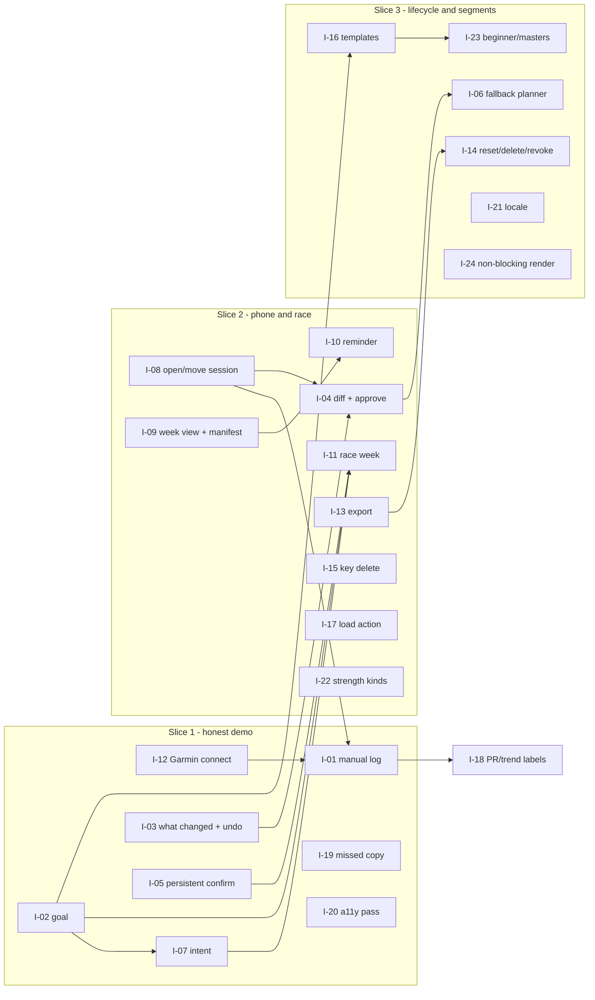

# POC3 - improvement backlog: ranked, sliced and testable

**Status:** complete analysis; first slice implemented. **Date:** 2026-11-18. **Companion:** `04-gap-analysis.md` (gap ids G-01..G-28, need ids N1-N43).
**Scope:** improvements that fit a private single-runner PoC. No new infrastructure is required by slice 1.

**Implementation status (2026-11-18).** Implemented after this backlog: I-01, I-02 (facts half), I-03, I-05, I-07, I-08
(Move action only), I-12, I-13, I-15, I-18, I-19, I-20 and QW-1..QW-8. Still proposals: I-04, I-06, I-09, I-10, I-11,
I-14, I-16, I-17, I-21..I-24. The change log, files and verification are in `07-implementation-plan.md`; the analysis and
acceptance criteria below are unchanged.

## 1. Method

**Scoring.** `value = runner impact (1-5) x evidence strength (1-5) x strategic fit (1-5)`, max 125. Impact comes from
02 section 5 severity and section 10 rank; evidence strength from 02's own confidence column (high 5, medium 4, low 3) and
the number of independent sources; strategic fit from 03 O1-O6 and the protect list in 04 section 8. Effort:
`S` <= 1 day, `M` = 2-4 days, `L` = 1-2 weeks. Confidence is about the estimate, not the need. Ties break on severity,
then on whether the item is a defect (fix first). Scores are a decision aid, not a measurement; a second rater would move
items by 5-10 points.

**How to read the table.** `Type` is fix / workflow / feature / trust / platform / safety. `Evidence` lists the N, G and
WF/CN/O ids that justify the item, not every related id (see 04 section 11 for the full mapping). `Slice` is 1, 2, 3 or
`QW` (quick win). Every item names a proposed slice - a shippable behaviour, not a work breakdown.

**Excluded from this backlog.** Strava or any second source, social features, payments, wellness/HRV ingestion, clinical
advice, external two-way calendar sync, native apps, AI route generation, an open-ended agent loop (04 section 9,
NB-1..NB-10). Also excluded: anything requiring multi-tenant or production hardening; this is a private PoC and the
backlog is sized for one runner and one process (`README.md:326-328`).

---

## 2. Backlog table I-01..I-24

| Rank | ID | Title | Type | User story | Evidence | Effort | Risk | Depends on | Score | Slice |
|---|---|---|---|---|---|---|---|---|---|---|
| 1 | I-01 | Log a run without a watch | feature | As a runner whose treadmill or commute run is not on Garmin, I want to put it on the calendar so my log is honest | N25, N8, G-02, WF-02, CN-01 | M | medium: match rules must not loosen | I-08 | 125 | 1 |
| 2 | I-03 | "What changed" card plus a real undo button | trust | As the owner of my plan, I want to see what a coach batch did and reverse it in one click | N35, G-05, G-24, WF-07, CN-04, O4 | M | low: journal already exists (ST-06) | none | 125 | 1 |
| 3 | I-05 | Sensitive confirmation that survives refresh | safety | As a runner who reported pain, I want the confirm control still there after I reload | N16, G-07, WF-13, Q-04 | S | low | none | 120 | 1 |
| 4 | I-02 | Goal reaches the coach and becomes a goal object | feature | As a runner who typed "half marathon in March", I want the coach to already know it | N1, N3, G-01, WF-01, CN-10, Q-02 | S | low | none | 108 | 1 |
| 5 | I-09 | Week/agenda view under 640 px plus a manifest | platform | As a runner at the track, I want today's and this week's sessions readable on my phone | N5, N12, G-11, WF-22, CN-16, O1 risk | M | medium: two layouts to keep in sync | I-08 | 108 | 2 |
| 6 | I-06 | Deterministic fallback planner | platform | As a runner, I want to still add or move a session when the model is down | N1, N4, N29, G-09, WF-16, Q-03 | L | high: must reuse the validator, not bypass it | I-04 | 100 | 3 |
| 7 | I-04 | Diff preview and approve before a multi-session write | trust | As a runner, I want to approve a rewrite of my week before it lands | N36, N4, G-06, CN-11, O1/O4 | L | high: two-phase turn touches idempotency | I-03 | 100 | 2 |
| 8 | I-08 | Open, move and edit a session from every surface | workflow | As a runner reviewing the week, I want to open or move the session I am looking at | N29, N4, N18, G-10, WF-08, CN-03 | M | medium: write path must stay validated | none | 100 | 2 |
| 9 | I-07 | Session intent and effort target in the peek | feature | As a runner about to start, I want to know what this session is for and how hard it should feel | N5, N6, N31, G-17, N7 | S | low: copy plus one field | I-02 | 96 | 1 |
| 10 | I-12 | Garmin connect: one working path and a visible result | fix | As a new runner, I want one obvious way to connect Garmin and to see that it worked | N24, G-03, WF-03, WF-04, WF-12, WF-23 | S | low | none | 90 | 1 |
| 11 | I-10 | Reminder for today's session | feature | As a time-poor runner, I want one nudge before today's session, and I want to turn it off | N12, N14, G-12, CN-05 | M | medium: needs a scheduler or a page-load trigger | I-09 | 90 | 2 |
| 12 | I-11 | Race-week brief and countdown | feature | As a runner in race week, I want the final seven days on the calendar with a goal pace range | N20, N21, N22, N23, G-13, WF-27, CN-10, O5 | M | medium: no prediction overreach | I-02 | 90 | 2 |
| 13 | I-13 | Export and backup | platform | As a runner, I want my plan and log out of the app, so "it is yours" is true | N34, N37, G-21, CN-15, C7 | S | low | none | 90 | 2 |
| 14 | I-17 | Load sentence and a per-run exclusion | trust | As a runner whose ACWR is high, I want one concrete action, and I want to exclude a hot or trail run | N11, N17, N26, G-28, WF-17 | S | low: copy plus a flag | none | 80 | 2 |
| 15 | I-19 | Missed-run copy that lets it go | trust | As a runner who missed Tuesday, I want to be told the block does not change | N13, N33, N43, G-19, WF-08 | S | low | none | 80 | 1 |
| 16 | I-14 | Reset, delete and revoke | platform | As a runner on a shared laptop, I want to reset my password, sign out every device and delete my account | N34, N37, G-22, WF-21, CN-12/13/14, Q-09 | M | medium: delete must be a real cascade | I-13 | 75 | 3 |
| 17 | I-15 | Delete and protect the Garmin key | safety | As a runner, I want to remove the key from the server and not have it stored in the clear | N34, N41, G-23, CN-26, Q-10 | S | low: encryption key handling | none | 75 | 2 |
| 18 | I-18 | Label PR scope and trend window | fix | As a runner, I want to know a PR is "within stored history" and that a chart shows 12 runs | N10, N15, G-20, WF-17, WF-18 | S | low | none | 75 | QW |
| 19 | I-20 | Accessibility pass | platform | As a keyboard or motion-sensitive runner, I want to use the calendar without the flourish and without losing focus | N5, N12, G-27, WF-10, WF-11 | S | low | none | 72 | 1 |
| 20 | I-16 | Plan templates with provenance | feature | As a beginner, I want a named 8-week 10k block to start from, not a blank chat | N1, N3, G-04, CN-07, O2 | M | medium: licensing of named plans | I-02 | 72 | 3 |
| 21 | I-22 | Strength and mobility session kinds | feature | As a runner told to do strength, I want it on the calendar as its own kind | N19, G-14, WF-27, CN-09, Q-12 | M | medium: schema plus validation enum | I-08 | 60 | 2 |
| 22 | I-21 | Locale and copy pass | platform | As a zh-Hant runner, I want one language at a time, including dates and coach replies | N30, N37, G-26, P8 | M | low | none | 60 | 3 |
| 23 | I-24 | Render no longer blocks on Garmin | platform | As a runner on a slow link, I want the calendar to render now and fill in later | N12, N24, G-25, WF-05, WF-25, CN-29 | M | medium: stale-cache rules | I-13 | 60 | 3 |
| 24 | I-23 | Beginner and masters mode | feature | As a beginner or masters runner, I want to repeat a week and have fewer hard days by default | N38, N39, G-15, C1 | L | high: segment bet, needs validation | I-16, I-21 | 54 | 3 |

**Reading the ranking.** The top four are all slice 1 and all defect-or-trust work: they are cheap because the hard part
already ships (ST-02/ST-06/ST-09). The bottom five are segment bets and platform work that only pay off after the trust
and mobile gaps close. Most items above rank 15 need no new infrastructure; the exceptions are I-09 (manifest and service
worker) and I-10 (a reminder delivery channel), both scheduled for slice 2 with that cost called out.

**Ordering note (review 06 F-14).** 04 orders gaps by runner impact x strategic cost; this table orders improvements by
score. The orders differ legitimately: a cheap fix can outrank a more severe gap (G-09 is 04's #2, but its item I-06 is
#6 because it is L and high-risk), and a trust fix can outrank a feature with the same impact because its evidence is
stronger.

---

## 3. Detailed cards (top 12)

### I-01 Log a run without a watch

- **Problem.** `appendActivity` has one caller, the Garmin sync (`src/garmin-sync.ts:165`); the UI has a "Reported" chip
  and the log copy says "from Garmin and reported runs" (`src/web.ts:393-395`, `:2414-2415`), but nothing can create an
  activity. P4 cannot use the product; P1/P5/P6 cannot record treadmill, commute or cautious return runs.
- **Proposed behaviour.** A "Log a run" action on the empty calendar state, the training-log empty state, the day page and
  the coach ("log my run: 5 km easy, 32 min"). One form, four fields (day, distance, duration, optional note), same-day
  plan match runs unchanged.
- **UX sketch.**
  - Empty week: "No recorded activities. [Log a run] [Connect Garmin]".
  - Form is a small dialog reusing the peek shell; day defaults to today in profile timezone.
  - Saved run appears as a green pill with a "reported" marker; the run peek shows "Reported by you".
  - Coach reply: "Logged 5 km easy on Tuesday; it matches your 5 km easy session."
- **Acceptance criteria.**
  1. A signed-in user can create an activity with source `"chat"` and it renders on `/calendar` and `/history`.
  2. `matchActivitiesToPlan` returns `on-plan`/`short`/`long`/`unplanned` for a reported run exactly as for a Garmin run.
  3. A second submission with the same client key does not duplicate the row (idempotent).
  4. A reported run never enters the Garmin sync path and is never overwritten by a later sync.
  5. Deleting a reported run restores the previous plan-match badge.
- **Code touchpoints.** `src/types.ts:67` (source), `src/types.ts:414` (`appendActivity`), `src/store.ts:503`,
  `src/web.ts:2414-2415` (empty copy), `src/web.ts:3452-3455` (planned line), `src/training.ts:57-125` (matching).
- **Data/API/schema.** New `POST /activities` with the same session and CSRF/same-origin check as state writes; no schema
  change (the table already stores `source`).
- **Edge cases.** Future-dated run; zero distance; two runs one day; a reported run on a rest day; a reported run that
  duplicates a Garmin activity; timezone boundary at 23:59.
- **Success metric.** Share of accounts with at least one reported run in week one; log completeness (days with a planned
  session and a recorded outcome) up from the current Garmin-only baseline.
- **Risks.** Loosening same-day matching would break ST-07; the form could become a second logging app. Keep it four
  fields and no editing of Garmin rows.
- **Open questions.** Does a reported run count for load/ACWR? Recommendation: yes, but with a `reported` flag shown in the
  load card footnote.

### I-03 "What changed" card plus a real undo button

- **Problem.** Revert exists and is audited (`src/history.ts:37-93`, ST-06) but is reachable only by asking the coach;
  `/coach-audit` shows directives and state events, not change sets, and is unlinked (`src/web.ts:3060-3074`, WF-20).
  Undoing an add animates a ghost to its own start position because the animation checks `action === "remove"`
  (`src/web.ts:1816`, `:1833`).
- **Proposed behaviour.** After any committed batch, a dismissible card appears above the grid: "Moved Thu tempo ->
  Fri; added Sat easy. [Undo] [Why?]". The card persists for the session, is reachable from the bell, and links to a
  runner-facing change list.
- **UX sketch.**
  - Card lists each change as one line with day and title; max five lines plus "+n more".
  - Undo is one button, confirms inline ("Undone. Thursday's tempo is back.").
  - "Why?" expands the stored summary/reason, not raw JSON.
  - A `/calendar/changes` list (last 20) reuses the same rows; `/coach-audit` stays as the operator view.
- **Acceptance criteria.**
  1. Every committed change set produces exactly one card, keyed by `changeSetId`.
  2. Undo from the card produces a `revert` change set and the grid returns to the pre-batch state (snapshot equality).
  3. Reverting an add animates the removal (cell pulse plus bin), not a ghost to origin.
  4. The card survives a refresh until dismissed or reverted.
  5. `/coach-audit` gains a link from the account menu and an explicit operator flag in config.
- **Code touchpoints.** `src/history.ts:53-81`, `src/gateway.ts:744-757`, `src/web.ts:1670-1785` (grid refresh),
  `src/web.ts:1816`, `:1833` (animation branch), `src/web.ts:3060-3074` (audit route).
- **Data/API/schema.** Read endpoint `GET /calendar/changes` over the existing change-set store; no schema change.
- **Edge cases.** Two batches in a row; a batch already reverted; a batch containing a moved race; undo after the session
  timezone rolls over; undo of a batch that touched a past day (must be refused with a reason).
- **Success metric.** Undo rate per 100 coach turns; share of batches where the runner opens "Why?"; support-style
  questions "what did it change" down to zero in the 5-runner test.
- **Risks.** A card on every turn becomes noise; cap it to batches that changed more than one session or any move/delete.
- **Open questions.** Should single-session adds get a card? Recommendation: inline chat confirmation only.

### I-05 Sensitive confirmation that survives refresh

- **Problem.** A sensitive proposal is stored as `observing` and rendered as a DOM-only bubble card; history restore
  replays messages and nothing else, so a refresh removes the Confirm/Dismiss control and the runner must know to open
  `/coach-states` (`src/web.ts:1878-1959`, `src/web.ts:1652-1668`, `src/coach-states.ts:527`). This is the safety path for
  pain, illness, pregnancy and low energy availability (ST-10, WF-13).
- **Proposed behaviour.** An `observing` proposal always has a durable surface: a bell item plus a card that re-renders
  from stored state on every page load, with Confirm and Dismiss.
- **UX sketch.**
  - Bell badge appears when a proposal is `observing`; item text states the evidence ("you mentioned knee pain").
  - Card renders from `getActiveCoachStates`, not from the message log.
  - Confirm and Dismiss are POSTs with the same origin check as `/coach-states`.
  - Dismissed proposals show in `/coach-states` with the seven-day cooldown unchanged.
- **Acceptance criteria.**
  1. Reload, second tab and a new session all show the pending proposal with both actions.
  2. Confirming changes the state to `active` and the guardrail takes effect on the next turn.
  3. Dismissing leaves the state resolved and does not re-propose inside the cooldown.
  4. No sensitive state can become `active` without an explicit confirm (no inference, no auto-confirm).
  5. A proposal older than the retention window is not shown.
- **Code touchpoints.** `src/coach-states.ts:473-499` (confirm/resolve), `src/coach-states.ts:527`,
  `src/web.ts:1878-1959` (card), `src/web.ts:1408-1412` (bell render), `src/web-coach-states.ts:199-202`.
- **Data/API/schema.** No schema change; render from stored rows. Optionally a `notification` row with source `state`
  (extends `NotificationSource`, `src/types.ts:142`).
- **Edge cases.** Two pending proposals; proposal for a state already active; confirm after expiry; dismiss then re-propose
  by the runner in chat.
- **Success metric.** Zero pending proposals without a visible control on reload (automated check across pages); time from
  proposal to confirm in the 5-runner test.
- **Risks.** A persistent safety card could feel like nagging; use one bell item and one card, not both plus a modal.

### I-02 Goal reaches the coach and becomes a goal object

- **Problem.** The profile goal is stored (`src/types.ts:24`) and displayed, but `facts` has no goal field
  (`src/coach.ts:265-302`) and `CoachPromptInput` has no such input, so the only consumer is `plan_stale` detection.
  Onboarding promises personalisation and drops the only thing it asked (WF-01, CN-10).
- **Proposed behaviour.** Two steps: goal text into prompt facts (one day), then a goal-race object (date, distance,
  target time) that drives a countdown and a plan end date.
- **UX sketch.**
  - Profile: goal text plus optional race date, distance and target time.
  - Calendar header: "Half marathon - 18 Mar - 12 weeks, 4 days".
  - Session peek in race week shows the goal pace range once I-11 ships.
- **Acceptance criteria.**
  1. The built prompt contains the goal string when set and omits the field when unset.
  2. A goal with a date produces a countdown and a plan end date that the validator accepts as inside the 180-day horizon.
  3. Changing the goal does not rewrite existing sessions; it marks `plan_stale` as today.
  4. A goal without a date still reaches the prompt.
- **Code touchpoints.** `src/coach.ts:106-129` (`CoachPromptInput`), `src/coach.ts:265-302` (facts), prompt caller in
  `src/web.ts` (turn construction), `src/types.ts:9-24` (profile fields), `src/coach.ts:40` (horizon).
- **Data/API/schema.** Add `goalDate`, `goalDistanceKm`, `goalTimeSec` to the profile payload; migration via
  `PRAGMA user_version` (C8).
- **Edge cases.** Goal date in the past; goal date beyond the horizon; goal changed mid-block; timezone on race day.
- **Success metric.** Share of new accounts with a goal that appears in the prompt; first-plan time down.
- **Risks.** A race object invites race-day logistics scope creep; keep it to date, distance, target time and countdown.

### I-09 Week/agenda view under 640 px plus a manifest

- **Problem.** The head has no manifest, theme-color or service worker (`src/web.ts:1609-1610`) and the grid is seven
  columns with 104 px minimum cell height at every width (`src/styles.ts:38`, `:70`); at 360 px a cell is about 45 px
  (WF-22). The product is described as phone-first (`docs/FEATURES-FOR-REVIEW.md:51`).
- **Proposed behaviour.** Under 640 px the plan defaults to a week/agenda list (day header plus session rows with full
  titles), the month grid stays available as a toggle, and the head gains a manifest and theme-color. The offline shell is
  a later slice and is not required for this item.
- **UX sketch.**
  - Sticky "This week" header with prev/next and a Today button.
  - One row per day: date, kind chip, full title, matched/missed state.
  - Toggle "Month" keeps the existing grid for planning.
  - Add to home screen works; the icon and theme colour match the app.
- **Acceptance criteria.**
  1. At 360x640 the week view shows full session titles with no truncation and one tap opens the session peek.
  2. The month grid is reachable in one tap and does not horizontally scroll.
  3. Lighthouse installability passes (manifest, theme-color, icons, start URL).
  4. No layout regression at 768 px and 1280 px.
  5. Keyboard order in the week view follows the visual order.
- **Code touchpoints.** `src/web.ts:1609-1610` (head), `src/web.ts:3601-3648` (calendar route), `src/styles.ts:38`,
  `:70`, `:412-414` (grid and media queries), `src/web.ts:231-234` (`sessionChip`).
- **Data/API/schema.** No API change; a `view=week` query or a CSS-only default with a toggle.
- **Edge cases.** Empty week; more than four items a day; a paired run+program row; landscape phone.
- **Success metric.** Mobile sessions per week; share of mobile sessions that open a session peek; bounce on mobile.
- **Risks.** Two renderers drift. Generate both from the same server helpers, which is what the in-place refresh already
  does (`src/web.ts:346-361`).

### I-06 Deterministic fallback planner

- **Problem.** The only writer is the gateway's validated turn; a model failure returns 502 and nothing can be booked,
  moved or deleted (`src/gateway.ts:1074-1081`, WF-16). Planner availability equals model availability, which is a blocker
  for every persona (Q-03).
- **Proposed behaviour.** When the model is unavailable or returns unparseable output twice, a deterministic planner
  produces a conservative default week from the goal and the last four weeks, and the UI says plainly which planner ran.
- **UX sketch.**
  - Banner: "The coach is unavailable. Here is a basic week you can edit." [Use it] [Dismiss].
  - The plan is a plain progressive week: one long run, one quality session, easy days, one rest day.
  - Every generated session carries `source: fallback` in the change set summary.
- **Acceptance criteria.**
  1. With the model endpoint forced to fail, "plan my next week" still produces dated sessions inside the horizon.
  2. Fallback output passes the same validator (`src/coach.ts:392-609`); no bypass.
  3. The change set is auditable and revertible like any other batch.
  4. The runner can tell which planner produced the week.
  5. No fallback output is produced for a guardrail-blocked request (pain state still wins).
- **Code touchpoints.** `src/gateway.ts:1074-1081` (failure branch), `src/coach.ts:392-609` (validator),
  `src/gateway.ts:596-763` (commit path), `src/directives.ts:210-278` (intent).
- **Data/API/schema.** None; reuse the session write path.
- **Edge cases.** No history; goal in the past; race week; injury state active; two fallbacks in a row.
- **Success metric.** Coach-turn success rate during simulated model downtime; no dead-end "Try again" states.
- **Risks.** A mediocre fallback week could be worse than no plan. Cap it to one week, label it, and never generate it in
  race week or with an active sensitive state.

### I-04 Diff preview and approve before a multi-session write

- **Problem.** A turn proposes and commits in one phase (`src/gateway.ts:596-763`), so a plausible but wrong rewrite of a
  week lands silently (CN-11, N36, O1/O4). This is the one trust feature competitors cannot copy quickly, and POC3 does not
  ship it.
- **Proposed behaviour.** For any turn that would touch more than one session, or any move/delete, the gateway returns a
  proposal with a diff and no write; the runner approves or edits. Single-session adds stay one-phase.
- **UX sketch.**
  - Card: "This will move Thu tempo to Fri and delete Sat easy." with a two-column before/after per day.
  - [Apply] [Cancel] [Ask for something else].
  - Applying reuses the same idempotency key so a double click cannot double-apply.
- **Acceptance criteria.**
  1. A multi-session turn writes nothing before approval (assert the sessions table is unchanged).
  2. The diff lists every add, move and delete with before and after day and title.
  3. Approve commits exactly the previewed diff (deep equality on the change set).
  4. Cancel leaves no change set and no audit row claiming a write.
  5. A stale proposal (plan changed since preview) is rejected with a reason, not applied.
- **Code touchpoints.** `src/gateway.ts:596-763`, `src/gateway.ts:821-874` (idempotency), `src/coach.ts:58-104`
  (`CoachTurn`), `src/web.ts:1965-1989` (bubble client), `src/history.ts:37-93`.
- **Data/API/schema.** A `proposed` turn status (the enum already has `in_progress`/`completed`/`failed`,
  `src/types.ts:197`) plus a preview payload; one migration.
- **Edge cases.** Proposal expires; two proposals open; the runner edits the plan in between; approve after a model retry.
- **Success metric.** Share of multi-session turns approved without a follow-up correction; reverts of multi-session
  batches down.
- **Risks.** Adds a click to the main path. Restrict to destructive or multi-day turns, which is what the evidence supports.

### I-08 Open, move and edit a session from every surface

- **Problem.** `sessionChip` is a span with a tooltip, `/day` lists sessions as plain items, and the session peek is
  reachable only from a plan pill in the month grid (`src/web.ts:231-234`, `:2182-2185`, WF-08). Moving a session requires
  a sentence to the coach (CN-03, N29 rank 2).
- **Proposed behaviour.** Every session chip links to the session peek; the peek gains "Move" and "Ask coach"; Move opens
  a date picker and writes through the validated path (or the diff/approve flow once I-04 ships).
- **UX sketch.**
  - Chip is a button with the same look; opens the shared dialog.
  - Peek footer: [Move] [Delete] [Ask coach] [View day].
  - Move shows "Thu -> Fri" and the week re-flows only if the coach is asked to.
- **Acceptance criteria.**
  1. A session is openable from the calendar grid, the training-log week/month views, the day page and the activity detail.
  2. Move writes a change set with before/after day and is revertible.
  3. Delete requires one confirmation and is revertible.
  4. Keyboard: Enter opens, Escape closes, focus returns to the chip.
  5. No new write path bypasses the validator.
- **Code touchpoints.** `src/web.ts:231-234`, `src/web.ts:1020-1060` (peek), `src/web.ts:2182-2185` (day page),
  `src/web.ts:3452-3455` (log planned line), `src/gateway.ts:596-763`.
- **Data/API/schema.** A `POST /sessions/move` that builds a one-session turn and runs the same validation; no schema
  change.
- **Edge cases.** Move onto a day with a session; move outside the horizon; move a race; move a past session (refuse).
- **Success metric.** Moves per active week; share of moves done outside chat; time from log view to session open.
- **Risks.** Direct manipulation plus chat can conflict; route both through one validator and show the same diff.

### I-12 Garmin connect: one working path and a visible result

- **Problem.** Three dead ends: the setup card points at a profile control that does not exist, the `[data-open-garmin]`
  binding has no emitter, and the modal markup exists only on `/calendar` and `/history` (`src/web-coach-states.ts:194`,
  `src/web.ts:2749-2771`, `:3444`, `:3638`). `/sync` results are stripped by `cleanNext` and never rendered (WF-04).
- **Proposed behaviour.** One connect entry point in the account menu and one in the empty state, one modal partial
  mounted in the shared layout, and an inline result banner after save/sync.
- **UX sketch.**
  - Empty calendar: [Connect Garmin] -> modal with the key field and a link to the Garmin key page.
  - After save: inline banner "Connected. Synced 12 activities, 2 new." with a bell item as backup.
  - Failure: inline banner with the mapped error text, not a redirect param.
- **Acceptance criteria.**
  1. Exactly one element emits `[data-open-garmin]` and the binding is live on every page that shows the account menu.
  2. The setup card's link resolves to a control that exists.
  3. `synced=N` and `syncError` render as a banner on the redirect target, then clear on reload.
  4. A manual sync never triggers a second background pull (`resolveSession` called in both routes).
  5. The modal is keyboard-trapped and Escape closes it.
- **Code touchpoints.** `src/web-coach-states.ts:194`, `src/web.ts:2749-2771`, `:3444`, `:3638`, `:3866`, `:3882`,
  `:3415-3421`, `:2932-2936`, `src/garmin-sync.ts:216-223`.
- **Data/API/schema.** None.
- **Edge cases.** Invalid key; expired key; sync while offline; second connect attempt; key saved on another device.
- **Success metric.** First-run completion rate (account -> connected -> first activity visible); sync support questions.
- **Risks.** Low. This is a defect cluster and the cheapest trust win in the backlog.

### I-10 Reminder for today's session

- **Problem.** `NotificationSource = "garmin"` only (`src/types.ts:142`); there is no scheduler outside page loads, so a
  plan never nudges (CN-05, WF-17 in 03's table stakes). P6 has no reminder path at all (01 section 2.1).
- **Proposed behaviour.** One opt-in browser notification per training day at a runner-set time, plus a weekly review
  nudge. No email infrastructure in slice 2.
- **UX sketch.**
  - Profile or bell settings: "Remind me at 07:00 on training days" with an off switch.
  - Notification text: "Today: 5 km easy. Why: aerobic base, week 6 of 16."
  - A missed reminder never produces a second notification.
- **Acceptance criteria.**
  1. With permission granted and a time set, a notification fires once on a training day and not on a rest day.
  2. Opt-out stops all reminders immediately and is stored per user.
  3. No duplicate notification for the same session and day.
  4. The reminder body matches the session peek's intent line once I-07 ships.
  5. Reminders use the profile timezone, not the device (`src/time.ts`).
- **Code touchpoints.** `src/types.ts:142-160`, `src/web.ts` notification render, `src/store.ts` notification table,
  `src/time.ts:42-63`.
- **Data/API/schema.** `notification_prefs` (user, time, enabled) plus a `source` value for session reminders.
- **Edge cases.** Browser closed; permission denied; daylight-saving change; two sessions in a day; timezone change.
- **Success metric.** Opt-in rate; session completion on reminder days versus non-reminder days in the 5-runner test.
- **Risks.** Browser notifications are unreliable when the tab is closed. Say so in the UI; do not promise a push service.

### I-11 Race-week brief and countdown

- **Problem.** Race day, race week, taper and post-race are detected states, and intervals are blocked, but there is no
  countdown, goal time, briefing, pacing note or return block (`src/coach.ts:26`, CN-10, WF-27, O5). P2's whole season
  ends in a week the product cannot show.
- **Proposed behaviour.** A race-week card and seven dated entries (shakeout, carb days, rest, race), a goal pace range
  from the goal object, and a post-race return block scheduled on race day plus one.
- **UX sketch.**
  - Header countdown: "Race in 6 days - half marathon, target 1:45".
  - Race week list: Mon easy 6 km, Wed shakeout 4 km with strides, Thu rest, Fri carbs note, Sun race.
  - Race pill opens a brief: goal pace range, even-effort note, "nothing new on race day".
  - Day after: "Reverse taper: 20-30 min very easy, no pace target" for week one.
- **Acceptance criteria.**
  1. With a goal race date set, the calendar shows a countdown and a plan end date.
  2. The seven race-week days contain the expected session kinds and no long run or intervals (guardrail test).
  3. The race brief shows a pace range derived from the goal time and distance, labelled as a range, with no prediction.
  4. A post-race block appears within one day of the race and is revertible.
  5. No race-week artefact is produced without a goal date; the state-only behaviour is unchanged.
- **Code touchpoints.** `src/coach-state-catalog.ts` (race week/taper/post-race), `src/coach-states.ts:631-685`,
  `src/coach.ts:26` (kinds), `src/web.ts:3601-3648` (calendar), `src/web.ts:1020-1060` (peek).
- **Data/API/schema.** Goal object from I-02; no other schema change. Race result capture is a later slice.
- **Edge cases.** Goal time missing; race cancelled; two races in a block; race on a rest day; taper already active.
- **Success metric.** Race-week sessions viewed; share of race-week plans with no guardrail violation; post-race return
  block used.
- **Risks.** Prediction overreach (03 O5 warns about Athletica). Show a range and an effort instruction, never a predicted
  finish time.

### I-13 Export and backup

- **Problem.** No export route, no backup, no ICS (`CN-15`, `docs/FEATURES-FOR-REVIEW.md:86`), while ownership is the
  stated advantage over TrainingPeaks and Runna (C7, 03 section 7.2). A lost volume loses the plan.
- **Proposed behaviour.** `GET /export.json` (profile, sessions, activities, states, change sets), `GET /export.csv`
  (activities), `GET /calendar.ics` (planned sessions, read-only), plus a documented SQLite backup command.
- **UX sketch.**
  - Account menu: "Download my data" with three format buttons.
  - ICS opens in Google/Apple Calendar as a read-only copy.
  - Docs page: one command to back up the SQLite file.
- **Acceptance criteria.**
  1. JSON export contains every session, activity, state and change set for the signed-in user and nothing for anyone else.
  2. CSV opens in a spreadsheet with one row per activity and stable columns.
  3. ICS validates (RFC 5545) and shows planned sessions with the profile timezone.
  4. Export is rate-limited and never includes the Garmin key or password hash.
  5. A restore from the documented backup reproduces the same row counts.
- **Code touchpoints.** `src/web.ts:2903-3893` (route table), `src/store.ts:51-185` (schema), `src/types.ts:390-482`.
- **Data/API/schema.** Read-only endpoints; no schema change.
- **Edge cases.** Empty account; 100-activity cap (label it in the export); large JSON; timezone on ICS dates.
- **Success metric.** Export used at least once by every validation runner; trust rating on "I can leave with my data".
- **Risks.** ICS is one-way by design; say so, and do not let it become external sync (NB-6).

---

## 4. Three delivery slices

### Slice 1 - "Make the demo honest" (target 1.5 weeks, no new infrastructure)

- **Goal.** A new runner can state a goal, connect Garmin or log a run by hand, see what the coach changed, undo it, and
  trust that a pain confirmation survives a reload.
- **Contents.** I-01, I-02 (facts half), I-03, I-05, I-07, I-12, I-18, I-19, I-20 plus the quick wins in section 5.
- **Exit criteria.** 1) A reported run appears on the calendar and matches the plan. 2) The goal string is in the built
  prompt. 3) Undo is reachable without chat and the card survives refresh. 4) A pending sensitive proposal is visible
  after reload and cannot auto-confirm. 5) The session peek states intent and effort. 6) Garmin connect has one live path
  and an inline result. 7) PR scope and the trend window are labelled. 8) No page renders a dead CTA.
- **Effort.** 6-8 focused days. **Unlocks.** A demo that survives a suspicious runner; it makes O1/O3/O4 legible without
  new architecture.

### Slice 2 - "Phone and race week" (target 2 weeks)

- **Goal.** The product is usable on a phone and the race season has a visible artefact; destructive coach writes are
  reviewable and the data can leave.
- **Contents.** I-09, I-08, I-10, I-11, I-04, I-13, I-15, I-17, I-22.
- **Exit criteria.** 1) Week view is complete at 360 px and installable. 2) Sessions open and move from every surface.
  3) One reminder fires once and can be turned off. 4) Race week is readable as seven dated entries with a pace range.
  5) A multi-session turn writes nothing before approval. 6) JSON/CSV/ICS export works. 7) The Garmin key can be deleted.
- **Effort.** 9-11 days. **Unlocks.** Table-stakes parity on mobile and export (03 section 7.1), and O5 becomes claimable.

### Slice 3 - "Lifecycle and segments" (target 3 weeks)

- **Goal.** The account can be closed and secured, the coach still plans when the model is down, a beginner or zh-Hant
  runner has a starting point, and the calendar never blocks on Garmin.
- **Contents.** I-06, I-14, I-16, I-21, I-23, I-24.
- **Exit criteria.** 1) Fallback planner produces a validated week with the model down. 2) Reset, revoke and delete work
  and delete cascades. 3) One named template produces a dated block with provenance. 4) UI language is consistent and the
  coach replies in the selected language. 5) Beginner mode can repeat a week and has no pace targets. 6) Calendar HTML is
  sent before Garmin enrichment completes and a hung Garmin cannot stall the page.
- **Effort.** 12-15 days. **Unlocks.** Real-runner safety (Q-09), availability (Q-03), the beginner segment (C1) and the
  P8 segment, plus the remaining 03 90-day items except reminders-at-scale and wearable breadth.

---

## 5. Quick wins (under one day each, 8 items)

| # | Win | Files | Why it is cheap |
|---|---|---|---|
| QW-1 | Put the goal into prompt facts | `src/coach.ts:106-129`, `:265-302`; prompt caller in `src/web.ts` | the profile field already exists (`src/types.ts:24`) |
| QW-2 | Render the 180-day horizon in the bubble header | `src/web.ts:1617-1618`; `HORIZON_DAYS` `src/coach.ts:40` | README already claims it ships (M1) |
| QW-3 | Fix the Garmin setup card link and delete the dead `[data-open-garmin]` binding or emit it | `src/web-coach-states.ts:194`; `src/web.ts:2749-2771` | one link, one binding |
| QW-4 | Render `synced`/`syncError` as an inline banner | `src/web.ts:3866`, `:3882`, `:3415-3421` | the params are already produced |
| QW-5 | Add `prefers-reduced-motion` and a no-animation class | `src/styles.ts:417-421`; `src/web.ts:1790-1846` | CSS-only plus one class toggle |
| QW-6 | Caption the trend graph ("last 12 runs") or plot the period | `src/web.ts:1184-1201` | one string or one filter |
| QW-7 | Format bell timestamps in the profile timezone | `src/web.ts:1408-1412` | `src/time.ts:48` already exists |
| QW-8 | Add a PR scope note and validate `?month=` | `src/web.ts:691-696`, `:597-602`, `:3602-3604` | reuse the validated sibling at `:3330-3334` |

Together these are one focused day and they remove most of the "demo smell" identified in 04 section 6(a).

---

## 6. Not now / rejected

| Item | Why not now |
|---|---|
| Time budget and short-session variant (G-16, N27) | Highest-value gap for P6 but needs a session schema change plus an availability model; defer until P6 is one of the five validation runners and the slice 1-2 trust work is done |
| Drag-and-drop reschedule (A6) | The move button plus diff/approve (I-08, I-04) captures the need at a fraction of the risk; drag targets and conflict rules are a large surface |
| Plan import from PDF/Sheets (O2) | High value, but parse errors place wrong dates silently; needs the diff/approve flow first (I-04) and a provenance schema (I-16). Revisit after slice 3 |
| Streaming coach replies | Real but expensive (SSE plus partial JSON); the client abort in I-24 covers the "dead bubble" perception first |
| Conversation summarisation (B8) | A prompt-limit problem, not a runner problem; solve when a real history hits the limit |
| Native mobile app | PWA closes the table-stakes gap; native is a distribution bet (NB-7) |
| Strava, social, payments, wellness, clinical advice, route maps | Explicit non-goals and safety liabilities (04 section 9, NB-1..NB-10) |
| Coach view / multi-tenant | Non-goal; export is the cheap hedge (03 section 7.2) |
| Full accessibility audit and screen-reader certification | Do the cheap pass (I-20) now; commission an audit only when a real AT user is in the validation set |
| Race result capture and analytics | Needs I-11 first; the evidence supports a return block, not post-race analytics (02 N23) |

---

## 7. Dependency graph and sequencing

**Sequencing rationale.** Trust before surface: I-03 must land before I-04, because a diff is only meaningful if the
runner already sees what a committed batch did. Input before output: I-01 and I-02 must land before I-11, because a race
brief with no goal object has nothing to say, and plan match with no manual entry cannot be honest. Mobile before
reminders: I-09 before I-10, because a reminder that opens a truncated grid wastes the nudge. Lifecycle last, because
deleting an account before export exists destroys data with no exit. The fallback planner is deliberately late: it is the
most expensive platform item and its value is availability, not capability, so it should not delay the trust work that
makes the product defensible.

---

## 8. Success metrics and the 5-runner validation plan

**Product metrics (instrumented in the PoC, per runner).**
- First-plan time: account creation to a dated block (target under 3 minutes).
- Plan-match honesty: share of days where the badge is correct or explicitly "not matched"; zero silently wrong matches.
- Undo and change visibility: share of multi-session batches where the runner opens the card; undo rate per 100 turns.
- Consent integrity: zero pending sensitive proposals without a visible control after reload (automated).
- Mobile use: share of sessions on a phone viewport; session peek opens per mobile session.
- Log completeness: days with a planned session and a recorded outcome, split Garmin versus reported.
- Reminder effect: completion on reminder days versus non-reminder days.
- Export: at least one export per runner during validation.

**The 5 runners.** Recruit one per segment so that a single failure is diagnostic, not averaged away: P1 first-5K
beginner, P2 half-marathon race-focused, P4 non-Garmin/manual, P5 returning-from-injury, P6 time-crunched parent. P3/P7/P8
are covered by proxy checks in the same sessions (Garmin power user walks the connect path; a zh-Hant speaker reviews the
copy; a masters runner reviews defaults).

**Protocol (two weeks, diary-aided).** Day 0: 30-minute setup, think-aloud, no coaching from the facilitator. Days 1-3:
first plan from a stated goal, then daily use on the phone. Day 4: log a run without a watch and correct a wrong match.
Day 5: ask for a multi-session change and review the diff. Day 7: miss a session on purpose and report how the product
made them feel. Day 10: report pain in chat and reload the page. Day 12: move a session from the log view. Day 14: export
data and try to delete the account. Each session is recorded; every observed dead end is logged with the screen and the
step.

**What would falsify the bet.**
- If runners do not open the "what changed" card at all, O4's value is lower than 03 claims and I-04 should be descoped to
  the single-session confirmation.
- If manual entry is used by fewer than two of five runners, the N25 severity is segment-specific and I-01 can stay minimal.
- If the diff card is read but ignored (approved without reading), the problem is trust in the model, not visibility, and
  the next investment is I-06, not more UI.
- If mobile sessions stay under 20 percent, the phone-first premise is wrong for this sample and I-09/I-10 should be
  re-scoped before slice 3.
- If the missed-run copy produces guilt in more than one runner, stop and rewrite with a clinician-informed reviewer
  before shipping N43-adjacent copy.
- If the fallback planner's weeks are edited away by every runner, availability is not the binding constraint and I-06
  moves behind I-16.

---

## 9. Mapping to owner questions and to 03 opportunities

| Improvement | Answers Q | Protects / captures O |
|---|---|---|
| I-01 manual log | Q-01 | O6 privacy niche (no second source needed) and O1 (the calendar matches reality) |
| I-02 goal object | Q-02, Q-05 | O1 and O5 (a race artefact needs a goal) |
| I-03 what changed + undo | Q-08 | **O4** directly; protects ST-06 |
| I-04 diff + approve | Q-08 | **O4** and O1's "with proof"; protects ST-02/ST-05 |
| I-05 persistent confirm | Q-04 | **O3** directly; protects ST-09/ST-10 |
| I-06 fallback planner | Q-03 | O1 (the write path must not depend on one model) |
| I-07 session intent | Q-02 | O1 (the calendar answers "what is this for") |
| I-08 open/move session | Q-06 | O1 (direct manipulation is the differentiator's other half) |
| I-09 week view + manifest | Q-06 | O1 risk mitigation; closes a 03 table stake |
| I-10 reminder | Q-06 | 03 90-day item 6; supports N14 |
| I-11 race week | Q-02, Q-05 | **O5** directly |
| I-12 Garmin connect repair | Q-10 | Protects N24; removes the first-run dead end |
| I-13 export + backup | Q-11 | O6 and C7 (ownership must be literal) |
| I-14 reset/delete/revoke | Q-09 | O6 privacy promise; 03 table stake |
| I-15 key delete | Q-10 | O6 and N41 |
| I-16 templates | Q-11 | **O2** (provenance first, import later) |
| I-17 load action | Q-07 | O3 (guardrails with an explanation) |
| I-18 PR/trend labels | Q-07 | Protects ST-11 honesty |
| I-19 missed-run copy | Q-01 | O3's consent tone; supports N13/N43 |
| I-20 a11y pass | Q-06 | 03 table stake; protects the loud-animation identity |
| I-21 locale | Q-11 | P8 segment; no O maps cleanly |
| I-22 strength kinds | Q-12 | O3 coherence (`strength_focus` must be representable) |
| I-23 beginner/masters | Q-06 | C1 segment; O2's template path is the prerequisite |
| I-24 non-blocking render | Q-03 | Protects O1's perceived reliability |

**Two gaps without a dedicated item (review 06 F-12).** G-08 (guardrails and read-only turns explained only after the
fact) is carried by I-03 (visible change and refusal card) plus the composer-side labelling described in 04 section 6;
G-18 (no judgement sentence at review time) is carried by I-07 (intent at the point of running) and I-01 (a reported run
can be matched and corrected). They are not separate backlog items because both are copy and wiring on surfaces those
items already touch; splitting them would create duplicate acceptance tests.

**One-line summary for the owner.** Slice 1 is not new product; it is the product POC3 already claims to be, made visible
and honest. Slice 2 buys table stakes and the race story. Slice 3 buys safety, availability and segments. The
differentiators in 03 (O1, O3, O4, O5) are all protected by slice 1-2 work that is cheap precisely because the underlying
machinery already ships.
